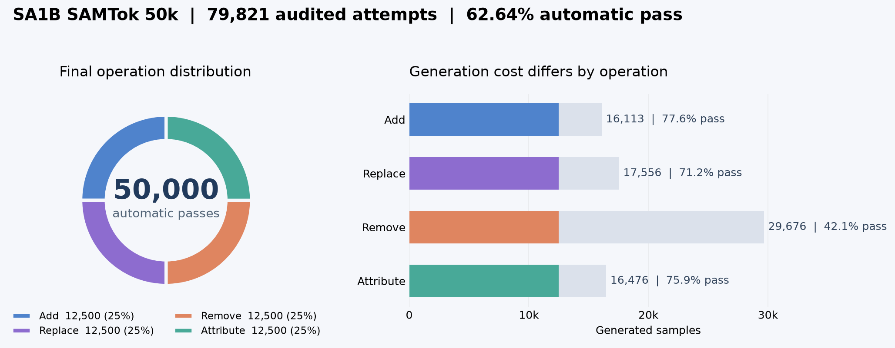

# SA-1B SAMTok 编辑数据构造

最新进展（2026-10-26，单目标 10 万四机生产）：把孪生/多目标的证据管线用到单目标（v2.1：每个目标从原图单独生成、单独审核、逐像素证明后导出），并实现了 10 万个、四种操作各 2.5 万的四机生产。
- 实验目录：`02_production_runs/sa1b_samtok_single100k_20261026`，已准备，提交 Arnold 前执行 bundle。
- 入口指令见[单目标文档](docs/SINGLE_TARGET_V2_ZH.md#入口指令)。
- 均衡做法：按剩余缺口选样，规划前删掉已满操作的目标；规划允许单目标组，只在单目标进程内替换规则，孪生/多目标代码不动。
- 验证：助手盲评两轮各 60:60，合格 75% vs 50k 旧版 66%，不合格 2 vs 7。本机 54.3 GPU·秒/样本，独占节点折算约 45–47（旧版 46.3）。见[中文报告](/opt/tiger/tanyue/visualization_tmp/single_target_v2_20261026/单目标v2_验证报告.md)。

最新进展（2026-10-25，第八轮，四机生产实现）：四机证据管线生产已实现并冻结，当前计划为孪生约 2.5 万个样本（1.25 万组）、多目标约 10 万个样本（目标），实验目录 `02_production_runs/sa1b_samtok_group_twins50k_multi100k_20261025`。四台执行同一个 `deployment/arnold_entry.sh`（`scripts/run_evidence_production_4node.py`），入口指令见[运行指南](docs/FOURNODE_RUN_GUIDE.md#入口指令)。按需整片读入 SA-1B，每图菜单并行选样，每波约 3 万 GPU·秒，最后一波只差 1–2 个单位时不再跑。单机生产规模冒烟：227 个孪生组加 149 个多目标组一波 58 分钟，GPU 平均忙 90%。预计四台独占节点约 2 天（本机 GPU 与他人进程共享，直接换算 3.3 天）。见[中文报告](/opt/tiger/tanyue/visualization_tmp/production_4node_20261025/四机生产实现与时间估计.md)。

最新进展（2026-10-25，第七轮，管线层面收尾）：逐项实现并对照验证管线层面能解决的问题，只保留有明确收益的：请求优先级调度（`--priority-scheduling`，同批规划对照中生成阶段 427→370 秒，交付结果相同）、航拍视角不做新增（`--evidence-gate-viewpoint`）、跳过黑白照片（`--skip-grayscale`）。保护邻近内容（盲评 10:9）、生成失败换种子重试（5 组救回 1 组）、读者反馈重新规划（5 个救回 2 个）均无明确收益，未采用。新图完整出图 5：交付 77 个，助手盲评合格 65%，含小瑕疵 96%，不合格 3；另保留单目标 21 个，无不合格（不同图，不能与前几次直接比较）。剩下的瑕疵主要在生成器（贴片感的牌子与旗帜、删除残留）。见[中文报告](/opt/tiger/tanyue/visualization_tmp/audit_verifier_pasted_20261024/验证报告_第七轮.md)。

最新进展（2026-10-24，第六轮，效率）：同等质量要求下提速。两类同时规划和生成（`--concurrent-kinds`）、规划 8 卡、审核 3 卡（`--audit-devices 5,6,7`）、首波和后续波次选样余量（`--selection-margin 1.25 --fill-margin 2.0`）、规划服务提前加载、核验器分操作（`--audit-verifier split`）、均衡导出改为精确搜索。新图完整出图 4：2 波、完整会话 1241 秒（完整出图 2 为 2178 秒），每个合格交付目标 17.5 秒（原 54.5 秒）；组内交付 88 个，助手盲评合格 81%，含小瑕疵 100%，不合格 0（不同图，质量差异不能归因于改动）。另有可选的“画里”新增核验（`--evidence-gate-medium`）和衣物长度规则（`--garment-extent-check`），并修复了 Ref 核对漏洞（第 3 版）。仍未解决：新增物在阴影或虚化处过亮过锐、可写区域重画导致邻近内容变糊、删除残留。见[中文报告](/opt/tiger/tanyue/visualization_tmp/audit_verifier_pasted_20261024/验证报告_第六轮.md)。

最新进展（2026-10-24，第五轮）：新增可选的单目标保留（`--keep-singles`：孪生一个成员被拒时保留另一个，多目标只剩一个目标时保留它）和审核疑虑核对（`--audit-ref-reconcile`：审核质疑 Ref 唯一性或判“选错对象”时，用规划阶段的读者证据裁决）。对照出图中合格被误拒 13/226→3/226，没有不合格被放行；新图完整出图 2 组内交付 67 个（合格 60%，含小瑕疵 93%，不合格 5），另保留单目标 7 个，回放核对第 2 版后可多交付 5 个合格目标。光照提示传给生成器、核验器加针对性问题、同一样本审两次都没有带来提升，未采用。新问题：在邮票、DVD 封面、浮雕等画面里新增，生成器画成写实物体。见[中文报告](/opt/tiger/tanyue/visualization_tmp/audit_verifier_pasted_20261024/验证报告_续.md)。

最新进展（2026-10-24，第四轮）：新增可选的审核核验器（`--audit-verifier think512|nothink`，`sa1b_pipeline/edit_verifier.py`）：主审核放行后，按操作类型问 5–7 个是/否缺陷问题，只拒绝不放行。新图完整出图中，它在主审核放行的目标里拦下不合格 4/8，误拒合格 0/50；同一批出图交付不合格率 9.3%→5.5%（73 个交付，合格 59%，含小瑕疵 95%）。代价是孪生同组合格成员一起丢掉（本次 6 个）、审核耗时增加；完整出图后已改为与主审核同批提交。贴图感：景深匹配改为 `focus_match`（离线盲评可见差异 14:3 偏好），但完整出图只触发 2/46；剩下的贴图感主要是阴影或逆光处新增物的光照与饱和度，尚未解决。见[中文报告](/opt/tiger/tanyue/visualization_tmp/audit_verifier_pasted_20261024/验证报告.md)。

最新进展（2026-10-23，第三轮）：新增可选的编辑器收尾处理（`--edit-finish`）。删除时用 SAM3 找出目标自己的投影和倒影一并删除，另有补颗粒、杂散清理和景深匹配。选目标与规划新增：改色光照判断（`--evidence-gate-lighting`）、替换重试（`--replace-retry`），以及穿戴物、覆盖层、地表改色三条规则；表盘类新增物允许数字。新图完整出图 74 个交付目标，助手盲评：合格 74%（含小瑕疵 95%），不合格 4。删除残留投影或倒影、新物体平涂、阴影部件改色被提亮都是 0；孪生 add 接受率 0.22→0.57，但大部分属于样本差异。每个合格目标约 34 秒。见[中文报告](/opt/tiger/tanyue/visualization_tmp/clean_edit_quality_20261023/验证报告.md)。

最新进展（2026-10-22，第二轮）：新增可选的显式文字 + OCR 核验（`--text-verify`）、删除承托检查（选目标阶段自动启用）和按实际接受量分波均衡（`scripts/run_evidence_waves.py`）。新图完整出图、助手盲评：合格 74%（含小瑕疵 98%），0 不合格；文字编辑全部写对，删除/替换 0 悬空；交付类型 15/15/13/15。见[中文报告](/opt/tiger/tanyue/visualization_tmp/text_support_balance_20261022/验证报告.md)。

最新进展（2026-10-22）：新增可选的**元数据选目标**（`scripts/select_evidence_groups.py`）和**规划后证据核验**（`--evidence-gates`），默认管线不变。新图两臂完整出图对照、助手盲评：交付目标合格率 79%（含小瑕疵 94%）vs 当前方案 59%（72%），交付量持平，完整会话耗时 +6.5%，每个合格目标耗时约降 22%。样本仍小，暂不切换默认、不宜无人复核放量。见[当前方法](docs/PIPELINE.md#元数据选目标--证据核验完整出图对照2026-10-22)、[中文报告](/opt/tiger/tanyue/visualization_tmp/evidence_gate_20261022/验证报告.md)、[对照PDF](/opt/tiger/tanyue/visualization_tmp/evidence_gate_20261022/完整出图对照_两方案65目标+被丢弃16计划.pdf)。

最新工作版保持27B `v13.8`，每mask原两图一次规划。最新三阶段试验确认：人工准确身份可将诊断合格20/48提高到29/48，但DAM辅助与65例LoRA未达到采用标准。独立新48目标：原27B20、关闭思考20、LoRA17、DAM22项直接合格；关闭思考规划热态316→56秒，但组级质量与定位存在退化，暂不默认启用。核心残留是mask实例绑定、操作自然性及精确指代，仍不建议无人复核放量。本轮没有新生图或正式数据改动。见[当前方法](docs/PIPELINE.md)、[中文报告](/opt/tiger/tanyue/visualization_tmp/oracle_region_sft_20261021/验证报告.md)、[新图孪生PDF](/opt/tiger/tanyue/visualization_tmp/oracle_region_sft_20261021/独立新图_孪生8组.pdf)、[新图多目标PDF](/opt/tiger/tanyue/visualization_tmp/oracle_region_sft_20261021/独立新图_多目标8组.pdf)。

已完成 [FLUX 3 / 专用工具的固定目标对照](docs/PIPELINE.md#flux-3-与专用编辑工具对照2026-10-20)：原生vLLM-Omni接入可运行，FLUX出图更快，但本轮局部编辑质量较差，保留Qwen为默认；LaMa在部分删除任务有收益。该实验为16个目标级对照，不替代完整管线验收。

当前开发版统一27B规划/审核、逐mask规划和40步编辑，**尚不建议无人复核放量**。近期模型比较各120目标：27B直接基本合格66项，Flash-Next FP8为56项；含仅文字待修则分别69/70项，未证明换模型能改善整体质量。当前部署热态耗时9.80/25.57分钟，继续保留27B。源图mask一致性修补仅改善部分边缘，关键残留未解决，未接入生产默认。方法、完整PDF和计时边界见[模型与mask对照](docs/PIPELINE.md#mask修补与27bflash-next规划对照2026-10-20)；规划结果不等于完整生图通过率。

本仓库实现基于 SA-1B 图像与 dense mask 的局部编辑数据构造，覆盖 `add`、`replace`、`remove`、`attribute`。当前孪生与多目标开发版本统一使用 **Qwen3.8-27B 规划和审核**（旧共享文本孪生另有独立盲测），Qwen-Image-2.1 以 40 步生成目标图，保留 instruction/mask 2.0。已完成的单目标 50k 和旧四机冻结任务使用各自原配置，不能将其与当前开发版本混为一谈。

早期指令专项验证见 [PIPELINE 第 10 节](docs/PIPELINE.md#10-指令自然性丰富度与格式专项2026-10-17)：两类各做三轮单次调用规划实验。源 ID 确定性绑定修复保留；自然性与内容偏好仅局部改善，未达到采用标准，保留为显式实验选项。该阶段没有据此启动新生图或全量任务；后续结果以上方最新验证为准。

单目标 50k 的正式入口是 `scripts/run_production_4node.py`，四机启动包装在 `scripts/production/bootstrap_arnold_4node.sh`。运行指南和冻结配置见 [docs/FOURNODE_RUN_GUIDE.md](docs/FOURNODE_RUN_GUIDE.md)。详细设计、代码路径、质量和实时进度见 [docs/PIPELINE.md](docs/PIPELINE.md)。历史方案已经压缩到 [docs/DEVELOPMENT_HISTORY.md](docs/DEVELOPMENT_HISTORY.md)。

## 工作目录与入口

工作区统一归档到 `/mnt/bn/strategy-mllm-train/user/tanyue/experiments2/SAMTokEdit/data_pipeline`，按共享输入、生产过程、部署、当前验证、历史实验组织，见[归档索引](/mnt/bn/strategy-mllm-train/user/tanyue/experiments2/SAMTokEdit/data_pipeline/README.md)。本项目datasets目录只保留正式50k release，原始清单及媒体未变。

当前新任务入口为 `scripts/groups_single_node_entry.sh`，以 `GROUP_KIND=twins|multi` 选择类型，独立输出到归档下的新运行目录。源输入通过显式路径映射读取，映射哈希锁定在新任务合同中。完整用法见[运行指南](docs/FOURNODE_RUN_GUIDE.md#迁移后的新任务入口与旧任务边界2026-10-20)。

旧20k四机工作区和15k单机部署已归档；前者保存的进度为孪生自动通过547组，后者是部署准备，均不是正式完成数据。冻结记录保留原文，不能仅修改外层目录直接恢复旧任务。数据与文档迁移已完成；最新小批实验位于当前验证归档，未启动正式批量生成。

## 多目标逐步保留入口

新建多目标任务使用 `parallel-components-v1`：独立区域从原图并行编辑，冲突区域串行；逐项审核后只融合合格区域。失败回退，至少保留两个目标，并重新检查类型组合与最终整图；不要求目标相邻。入口为 `scripts/run_multi_transactional.py`，复用 `run_group_pipeline.py --plan-only` 的计划，不重复规划。新准备的四机配置自动接入：每节点 6 个编辑器＋2 个审核器分卡常驻，逐步审核合批；旧冻结部署包及旧 `keep-passed-v1` 配置保持原流程。调用和恢复见 [四机指南](docs/FOURNODE_RUN_GUIDE.md#多目标并行融合与逐步保留)。

默认 `--generation-mode parallel-components`；新实验加 `--local-generation-reference` 将编辑器的原图方位指代转换为局部实体定位，训练指令保持不变。`--save-crop-evidence` 保存合成前后的局部证据。最新 27B 测试 10 候选生成 9 组 / 32 项，单项保留 26，整组自动通过 3；其中仅 1 组基本可用（有轻微叶片数量偏差）。该轮主要问题是指代、操作自然性及当时的邻接合同（邻接要求已于 2026-10-18 取消），见 [PIPELINE 第 9 节](docs/PIPELINE.md#9-统一-27b-与质量修复验证2026-10-17)。并行融合设计见第 7.20 节；历史结果不代表最新版本的验收。

## 已完成的 50k 数据

本批共生成并审核 79,821 条，自动通过 **50,000 条**，add/replace/remove/attribute 各 12,500 条，覆盖 1,132 张源图。推荐训练入口：

```text
/mnt/bn/strategy-mllm-train/user/tanyue/datasets/sa1b_samtok_edit_50k_20261014/release/annotations/train.jsonl
```

图片、源区域 mask 和执行 support mask 都在同一 `release/` 内，所有媒体相对路径以 `release/` 为根。统计、字段协议、读取代码及每类三例的可视化见 [50k 数据说明](docs/DATASET_50K_ZH.md)；源记录缓存 A 已按确认删除，其他候选保留，见 [清理记录](docs/CLEANUP_CANDIDATES_50K_ZH.md)。数据为自动审核通过版本，尚未完成独立人工验收，文档保留了抽查发现的问题。



## 目录

```text
sa1b_pipeline/                 核心数据、规划、生成、审核、队列和发布实现
scripts/run_production_4node.py  四机调度、配额、恢复和最终合并
scripts/production/            缓存源记录、启动、运行时检查和打包
scripts/run_balanced_planning.py  规划模型批处理入口
scripts/run_generation_queue.py   常驻编辑器 worker
scripts/run_audit_queue.py        批量审核 worker
scripts/shard_group_selection.py  分组数据四 rank 确定性分片
scripts/merge_group_shards.py     分片结果合并与硬校验
scripts/group_4node_entry.sh      分组数据 Arnold 四机 rank 入口
requirements/production/       CUDA 12.9 的三套锁定运行时
tests/                         协议、配额、恢复、缓存和生产回归测试
docs/PIPELINE.md               当前版本说明
docs/FOURNODE_RUN_GUIDE.md     四机运行指南
docs/DEVELOPMENT_HISTORY.md    迭代留痕
```

## 快速检查

```bash
python -m pytest -q tests/test_production_4node.py tests/test_production_source_cache.py tests/test_production_cuda_runtime.py
python -m scripts.run_production_4node --root /path/to/run status
```

正式四机入口需要 Arnold 注入 `ARNOLD_WORKER_NUM=4`、`ARNOLD_WORKER_GPU=8`、`ARNOLD_ID=0..3`，并挂载 `/mnt/bn/strategy-mllm-train`。入口会校验冻结代码包、共享源记录缓存和 CUDA 12.9 环境；不需要额外挂载原始 SG2 HDFS。完整命令、恢复和日志位置见四机指南。

## 分组数据（新增）

反事实孪生和多目标数据使用独立运行根目录，入口为
`scripts/prepare_group_inputs.py` 和 `scripts/run_group_pipeline.py`。准备阶段先写入
`eval_reservation.json`，再物化训练/评测候选；训练脚本会拒绝评测源图的 source ID
或原图字节哈希。`sa1b_pipeline/group_selection.py` 只做几何和配额预选，
`group_planning.py` 对每组只调用一次规划模型并校验实体/范围字段，`group_generation.py` 负责同 seed
孪生生成或 source→step 链式生成，`group_audit.py` 接入 27B 语义审核。

组级结果必须通过确定性检查、27B 审核和人工复核后才能发布；`--plan-only` 只产出
规划检查点，不会伪造目标图或人工结论。完整协议、字段和交付批次见
`docs/PIPELINE.md` 的“分组数据扩展”章节。新孪生允许跨类别：同类约 30%、跨类约 70%，保留同粒度、面积比 ≤3 和共享编辑自然性，生图前新增仅看干净原图＋no-ref 的独立盲测；见第 7.10 节。动态补样设计见第 7.11 节：动态补样按最终通过类别 × 同类/跨类缺额推进；候选规划增加共享编辑适配依据，盲测改为语义适用范围，审核区分严重缺陷与轻微差异，并用确定性检查拦截 add 空编辑。协议仍为 instruction/mask 2.0、`benchmark-concise-3-blind-1`。

多目标完整流程验证见 [PIPELINE 7.14](docs/PIPELINE.md#714-多目标小批验证与-remove-修复2026-10-16)：固定 10 组生成 6 组 / 21 步，完整自动及视觉合格为 0，主要仍是 mask 范围错配和操作分类。修复“删除手套时恢复裸手”后，同一份 3 目标计划复测同时通过自动和视觉检查。单步约 19.6 秒；已有完整好坏案例 PDF 和一组可移植合格预览，尚不建议全量放大。

最新规划范围修复对照见 [PIPELINE 7.15](docs/PIPELINE.md#715-规划范围修复对照2026-10-16)：先识别区域再设计编辑的纯抠图版本减少部分误放行，但完整可用计划仍为 1/7；逐 mask 独立调用也未带来质量收益。保留可复现实验和中文逐例 PDF，暂不替换生产默认。

前一轮两波尝试 24 组，生成 12 组／24 张目标图，完整 pipeline 自动通过 7 组（add 0、remove 3、replace 1、attribute 3）；逐图明确合格 6 组、边界 1 组、失败 5 组。成功阶段合计 19.2 分钟，含共享盘加载中断与缓存校验约 26.1 分钟。动态补齐有效，但 add/replace 缺额与语义审核漏判尚未解决，不建议无人复核放量。完整 PDF、合格记录和详细统计路径见 [PIPELINE 7.11](docs/PIPELINE.md#711-合理性规划严重错误审核与动态补样2026-10-15)。

最新 add 专项已修复附着区域误拦截、非穷尽盲测举例造成的误拒，并跳过空批次的模型加载；完整 Ref 生图与 40 步保持不变。6 个候选生成 5 组／10 张图，自动通过 3 组；逐图完整合格 1 组、待核实 3 组、失败 1 组。画面与附着基本自然的有 4/5，但指代和最终源区域仍限制数据质量。双卡生图阶段 155.8 秒；同图解析的 SAM3 调用由 7 次降为 1 次。尚不建议无人复核放量，完整好坏案例 PDF、路径及口径见 [PIPELINE 7.12](docs/PIPELINE.md#712-add-成功率诊断与修复2026-10-15)。

小批动态入口为 `scripts/run_dynamic_twins.py`，支持阶段恢复、最终配额、尝试预算和进度日志；它是单协调器，不可直接在四 rank 共享一个输出根目录。生成仍用双卡常驻编辑器，联合审核每组一次，明确合格记录与自动通过记录分开保存。

当前独立输入根目录为
`/mnt/bn/strategy-mllm-train/user/tanyue/experiments2/SAMTokEdit/data_pipeline/01_shared_inputs/sa1b_samtok_group_inputs_20261014`：
训练候选 15,994、评测候选 1,199、评测 reservation 1,200；孪生第一批已固定为
`inputs/train_twin_selected.jsonl`（5,000 组）和
`inputs/eval_twin_selected.jsonl`（200 组）。四机运行先用
`shard_group_selection.py` 生成每个 rank 的 `selected_rank*.jsonl`，各 rank 使用独立
输出目录，完成后用 `merge_group_shards.py` 合并；快速 bbox 容量模式只用于估算，最终
数据必须经过严格 mask 几何、27B 审核和人工复核。
