# 50k 正式单目标编辑数据：结果与使用说明

本批数据已完成四机生成、自动审核、配额补齐、本地汇总及规范目录整理。**最终 50,000 条独立 mask 编辑样本，四类各 12,500 条，覆盖 1,132 张源图。** 本文描述 2026-10-14 启动、2026-10-15 收尾的这一批数据；不混入后续孪生/多目标实验。状态是 pipeline 自动审核通过，尚未完成独立人工质量验收。

## 1. 唯一训练入口与目录约定

正式数据根目录（下文 `DATA_ROOT`）：

```text
/mnt/bn/strategy-mllm-train/user/tanyue/datasets/sa1b_samtok_edit_50k_20261014/release
```

只需携带整个 `release/` 即可读取训练数据和查看可视化。图片不依赖旧实验目录或模型目录；标注中的媒体相对路径一律相对于 `DATA_ROOT`，不是 `annotations/`。父目录保留运行和审核追溯材料，不能将其中所有 JSONL 一起读入训练，否则会重复计数并混入失败样本。

```text
release/
├── README.md                       本说明的离线副本
├── release.json                    版本、数量、原始导出/正式标注 SHA-256
├── statistics.json                 全量统计与每类/每节点通过率
├── provenance/                     本批配置、原始汇总、代码校验和及整理脚本
├── validation.json                 整理后的引用、协议及 benchmark 隔离检查
├── annotations/
│   ├── train.jsonl                 50,000 条训练主标注，推荐入口
│   ├── audit.jsonl                 同 50,000 条完整生成/审核记录
│   ├── media_manifest.jsonl        151,132 个媒体路径、原路径、大小
│   └── visual_review.jsonl         本次 12 例 assistant 目视记录
├── images/source/sa/sa_*.jpg        1,132 张源图，每张只存一个正式入口
├── images/target/<前两位>/<id>.png  50,000 张目标图
├── masks/region/<前两位>/<id>.png   50,000 个源区域 mask
├── masks/support/<前两位>/<id>.png  50,000 个执行支持区域
└── visualizations/
    ├── examples_12.pdf             内嵌图片的 12 页可视化
    ├── 01_*.jpg … 12_*.jpg         单页图（全景＋对齐局部）
    ├── cases.json                  展示抽样规则、样本 ID、目视结论
    ├── review_summary.json         抽查范围及限制
    └── statistics.png              英文统计图
```

`sample_id` 是 `SHA256(job_id)` 的前 24 个十六进制字符，已检查 50k 内唯一；文件名不依赖 rank 或 wave。原始 `job_id`、`case_id`、`source_id`、`object_id` 保留，支持溯源。规范媒体通过同文件系统硬链接建立，逐文件验证与旧路径 inode 相同，未改动像素，也未重复复制约 214.60 GiB 的媒体内容。请将正式媒体视为只读；对硬链接任一入口原地写入会影响同一文件。删除旧路径不会删除仍有正式硬链接的文件。

| 媒体目录 | 文件数 | 逻辑大小 |
| --- | ---: | ---: |
| `images/source/` | 1,132 | 1.049 GiB |
| `images/target/` | 50,000 | 212.595 GiB |
| `masks/region/` | 50,000 | 0.761 GiB |
| `masks/support/` | 50,000 | 0.199 GiB |

上述是正式媒体的逻辑大小；硬链接与运行目录共享数据块，不能把两个目录的 `du` 数值相加当作额外占用。原始导出仍在父目录 `final/auto_pass.jsonl`，其 SHA-256 为 `aee1bf1ded92268ede367aff61f22dd1186e9c99713cd50ec94a6b5f29cda3c0`；正式 `train.jsonl` 和 `audit.jsonl` 的 SHA-256 见 `release.json`。

## 2. 本批统计

| 编辑类型 | 生成并审核 | 自动通过 | 自动通过率 | 最终占比 |
| --- | ---: | ---: | ---: | ---: |
| add | 16,113 | 12,500 | 77.58% | 25% |
| replace | 17,556 | 12,500 | 71.20% | 25% |
| remove | 29,676 | 12,500 | 42.12% | 25% |
| attribute | 16,476 | 12,500 | 75.87% | 25% |
| 合计 | 79,821 | 50,000 | 62.64% | 100% |


统计图中灰条为生成总数，彩条为通过数。分母来自四个节点 `validation.jsonl` 的全部 79,821 条终态结果；分子使用原 pipeline 的 `automatic_pass(require_operation=True)`，不使用本次目视意见改写。失败共 29,821 条。配额调度通过补充缺额类别保证最终均衡；remove 的通过率最低、生成成本最高。每个节点最终均为 12,500 条，node0/1/2/3 分别生成 19,973 / 19,752 / 20,333 / 19,763 条。

每张源图平均贡献 44.17 个编辑样本，中位数 37，范围 1–210。**50k 不是 50k 张不同源图，也不是一张目标图联合编辑多个对象。** 每条样本独立从原图生成；不同 mask 可以来自同一源图。划分训练/验证集应按 `source_id` 分组，不能直接随机拆行，以免同图泄漏。

生成时使用冻结的 benchmark 排除清单；整理后另核对最新 1,084-case benchmark 的 source ID 和源文件 SHA-256 回执，结果写入 `validation.json`。该检查不等同于近重复图像检索。

## 3. 标注字段及 mask 含义

| 字段 | 类型／含义 |
| --- | --- |
| `sample_id`, `job_id` | 唯一样本 ID、原始任务 ID；可用于关联 `audit.jsonl` 和目视记录。 |
| `source_id`, `object_id` | SA-1B 源图及原始 mask ID；`object_id` 按字符串使用。 |
| `source_image`, `edited_image` | 原图和最终目标图，相对于 `DATA_ROOT`；原分辨率保留。 |
| `instruction` | 含明确对象指代的简洁英文指令；训练的主文本。 |
| `instruction_noref` | 使用 selected object 的短指令；必须配合区域输入使用，不能当作无定位文本。 |
| `operation` | `add`、`replace`、`remove`、`attribute`。 |
| `instruction_spec` | 结构化意图：`ref/scope/attributes/payload/placement` 等；协议版本 1.0。 |
| `mask` | 源图坐标系的 PNG 区域 mask，非零为前景；与原图等宽高。 |
| `mask_role` | add 为 `anchor`；其余三类为 `target`。 |
| `support_mask` | 生成/合成时允许改动的支持区域；不是用户输入 selector 的替代。 |
| `support_policy` | 支持区域的生成策略；用于诊断合成范围。 |
| `bbox` | 原图像素坐标 `[x0,y0,x1,y1]`，右、下端点不包含，可用 `image.crop(bbox)`。 |
| `point` | 原图像素坐标 `[x,y]`，位于源 mask 内；可转换为点式交互输入。 |
| `image_size` | `[width,height]`；图片缩放时必须同步缩放 bbox/point/mask。 |
| `audit` | 自动审核摘要：decision 及 operation_correct/target_done/non_target_preserved/natural。 |
| `manual_review` | 当前均为 `not_performed`，表示没有独立人工验收；12 例 assistant 目视记录单独保存。 |

- **add：** `mask` 表示新增物体直接所在、直接附着的宿主/区域；仅在直接添加不自然时允许很近的邻接锚点。它不是新增物体的输出分割，也不要求新增物体的所有像素严格处于源 mask 内。执行范围由 support mask 约束。
- **replace/remove/attribute：** `mask` 指向待替换、删除或改属性的源对象/部件。source selector 的意义不因输入形式是 box、point 或 mask 而变化。
- 本批 `change_mask/new_object_mask/execution_mask_path` 没有提供有效输出分割，完整记录中的空值不能当作全零真值；不要由 add 的锚点 mask 推断新增物体分割。
- `audit.jsonl` 保留 `prompt/generation_context/editor_config/seed/generation_seconds/deterministic/semantic_audit/audit_runtime/source_provenance` 等完整字段。长 `prompt` 用于生成追溯，不应替代简洁的训练 `instruction`。`source_provenance` 中的原 TFRecord、dense JSON 和模型绝对路径是历史来源描述，读取训练图片不依赖这些路径。

## 4. 最小读取示例

```python
import json
from pathlib import Path
import numpy as np
from PIL import Image

DATA_ROOT = Path("/mnt/bn/strategy-mllm-train/user/tanyue/datasets/sa1b_samtok_edit_50k_20261014/release")
with (DATA_ROOT / "annotations/train.jsonl").open() as f:
    sample = json.loads(next(f))

source = Image.open(DATA_ROOT / sample["source_image"]).convert("RGB")
target = Image.open(DATA_ROOT / sample["edited_image"]).convert("RGB")
region = np.asarray(Image.open(DATA_ROOT / sample["mask"]).convert("L")) > 0
support = np.asarray(Image.open(DATA_ROOT / sample["support_mask"]).convert("L")) > 0
assert source.size == target.size == tuple(sample["image_size"])
assert region.shape == support.shape == (source.height, source.width)
text = sample["instruction"]
# 区域交互模型也可以用 instruction_noref，并提供 region / bbox / point 之一。
```

典型训练输入为 `(source, instruction, selector)`，监督为 `target`；selector 可按模型要求选择 mask、box 或 point。本批没有预定义训练/验证划分，也没有人工质检后的独立子集。目视标记为 `issue` 的样本可按 `sample_id` 在训练读取时排除，但这只是已知问题过滤，不能宣称其余样本全部人工合格。

## 5. 速度与完成记录

配置：4 台机器 × 8 GPU；每台在生成阶段使用 6 个单卡 Qwen-Image-2.1 编辑器和 2 个 Qwen3.8-27B 审核 worker；40 steps，seed 0，vLLM-Omni。规划使用 Qwen3.8-Flash-Next，按缺额补类型。

- 全部 79,821 条的 `generation_seconds` 平均 10.20 秒，中位数 9.77 秒，P90 11.69 秒。这是单条生成阶段记录，不包含规划、冷启动、补额和总导出。
- `audit_seconds` 平均 3.46 秒，中位数 3.26 秒，P90 4.38 秒，口径为 batch wall time 按条摊销，不能与总工期简单相加。
- 最近一次四机恢复启动记录最早为 10 月 14 日 11:12:01 UTC；最后一个节点在 10 月 15 日 07:17:35 UTC 达到生成/审核配额，约 20.09 小时（约 2,489 条通过样本/小时）。这段墙钟包含规划、加载、排队、补额和期间导出，不包含更早的启动故障。
- node2 在 08:11:49 UTC 完成节点导出，随后共享盘 `flock` 不支持导致汇总失败。无需重生；CPU 独立收尾于 08:27:06 UTC 完成，耗时 265 秒。按上述恢复启动到最终汇总计约 21.25 小时；这是本批实测，非未来固定工期承诺。

## 6. 质量检查与可视化抽查

发布整理检查覆盖：50k 数量、四类配额、job/source-mask 唯一性、自动审核判定、全部媒体文件存在/非空/位于根目录、规范副本与原文件同 inode、指令和坐标原样保留。没有做全量图片解码，也没有完成独立人工验收。

下列 12 例按固定规则选择：每类从 mask 面积占原图至少 1% 的样本中，按 `SHA256("release-examples-20261015:" + job_id)` 排序取前 3。该规则偏向便于观看的区域，**不是全量随机质量评测**；不据此外推合格率。assistant 已逐张查看：9 例基本可用、2 例待复核、1 例有明确问题。自动通过标记未因此修改。

| PDF 页 | 类型 | source/mask | 目视判断 | 具体观察 |
| --- | --- | --- | --- | --- |
| 1 | add | `sa_2890554/6` | 基本可用 | 粉笔星星出现在黑板左下空白处，直接宿主明确，原文字和周围人物保持；指令仍可压缩。 |
| 2 | add | `sa_846304/46` | 基本可用 | 新花篮位于左侧木立面的上部并直接附着，场景和尺度合理；细小挂接结构建议原分辨率复核。 |
| 3 | add | `sa_4844850/28` | 基本可用 | 金属招牌直接挂在指定立柱上，锚点准确，邻近行人和原招牌保持。 |
| 4 | replace | `sa_6521474/46` | 待复核 | 目标树变为覆霜裸枝树，区域基本准确；但同一树的季节/外观变化接近 attribute，replace 类型边界存在歧义，指令偏长。 |
| 5 | replace | `sa_8297834/41` | 基本可用 | 尖顶钟楼替换为铜色圆顶亭，屋顶透视、位置和主体建筑保持，替换关系清楚。 |
| 6 | replace | `sa_1040883/4` | 待复核 | 墙面成功替换为红砖，但源图焊接蓝光在新墙上明显减弱，新墙偏亮偏平，光照融合需复核。 |
| 7 | remove | `sa_3730537/21` | 基本可用 | 左下雕花托座被移除，檐口及邻近雕像保持，背景补全整体连贯。 |
| 8 | remove | `sa_1563482/10` | 基本可用 | 前景石栏板被移除，地砖透视衔接基本合理，柱体和细金属栏杆保持。 |
| 9 | remove | `sa_1110373/9` | 发现问题 | 帆船主体被删除，但原船上方仍有悬空细绳/索具残留；自动 target_done/natural 均通过，存在删除完整性漏检。 |
| 10 | attribute | `sa_248484/15` | 基本可用 | 背景塑料袋变为深蓝，主要褶皱与前景锅具、手部保持；局部纹理略有重绘。 |
| 11 | attribute | `sa_3962368/18` | 基本可用 | 左上云朵局部变为金粉色，其他天空和建筑保持，指代清楚。 |
| 12 | attribute | `sa_9435005/5` | 基本可用 | 目标锈钢筋变为深灰，邻近钢筋与横向绑扎关系保持；底部附着物仍存在，未被当作整根几何替换。 |

主要问题：remove 的细绳、阴影或附属结构可能漏删；replace 与 attribute 的语义边界仍可能混淆；目标纹理替换有时不保留原光照；少数 instruction 的对象限定和结果描述仍偏长。针对这些问题，应增加附属物完整性、光照一致性及类型边界的专项复核，不能仅靠精确类型配额宣称数据质量均衡。

离线 PDF：`DATA_ROOT/visualizations/examples_12.pdf`，12 页内嵌图片。以下页面与 PDF 一致：左为源图、中为洋红色源 mask、右为目标图，下排为相同坐标的局部裁剪。图片没有通过重新生图或局部修补美化。

**01. add — `sa_2890554/mask 6`**

`Add a small white chalk star doodle on the empty lower-left area of the board of the small chalkboard menu on the easel.`

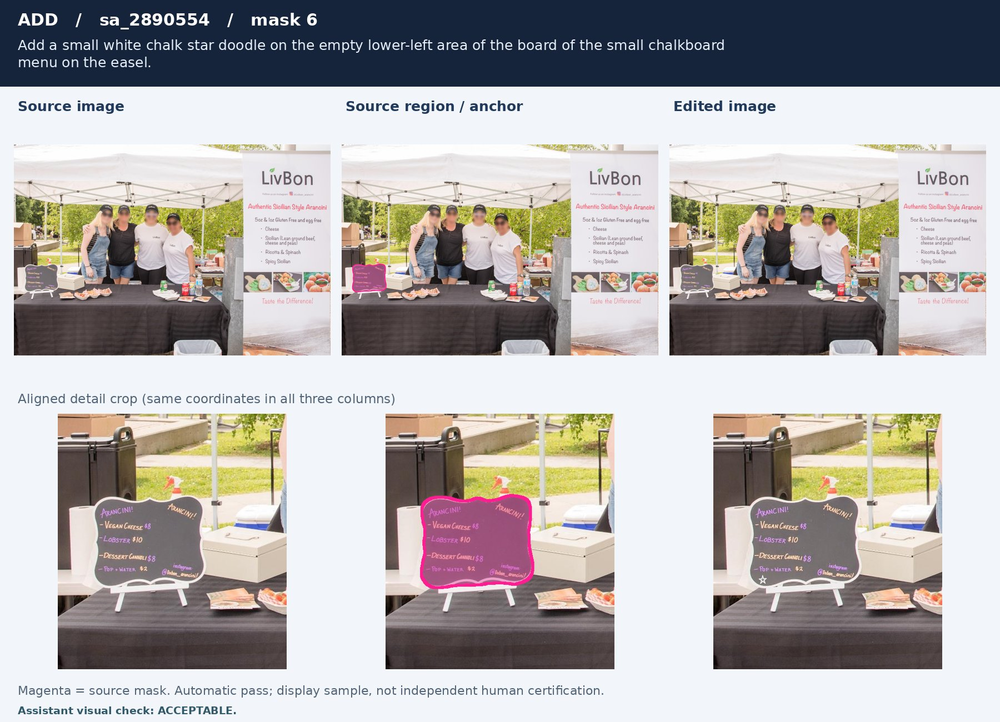

**02. add — `sa_846304/mask 46`**

`Add a small hanging flower basket attached to the upper cornice of the dark wooden facade on the left.`

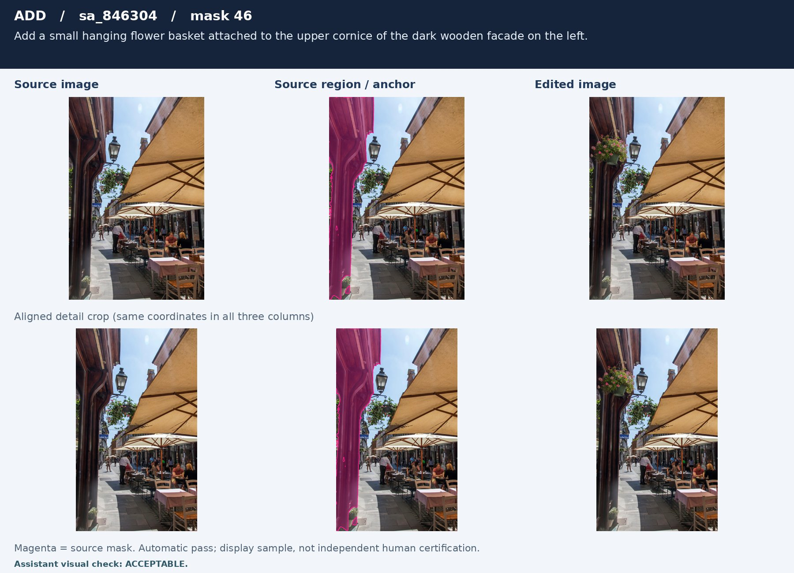

**03. add — `sa_4844850/mask 28`**

`Add a small hanging metal sign attached to the rust-colored support pole beside the bamboo display.`

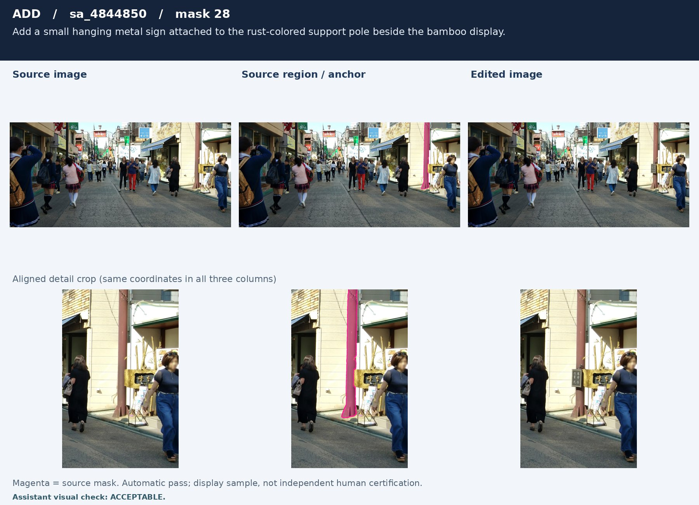

**04. replace — `sa_6521474/mask 46`**

`Replace the golden-leafed tree standing just right of the parked black car with a snow-laden bare-branched tree with white frost coating its limbs.`

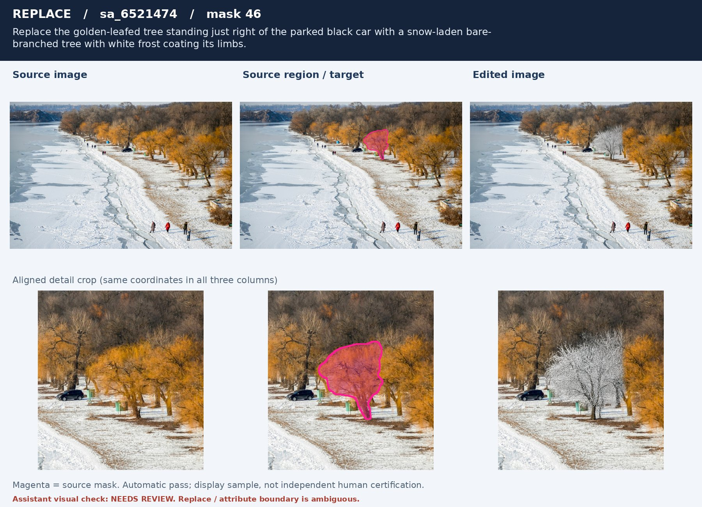

**05. replace — `sa_8297834/mask 41`**

`Replace the bell tower rising above the red-tiled roof with a domed cupola with a rounded copper dome and a short finial instead of the pointed spire.`

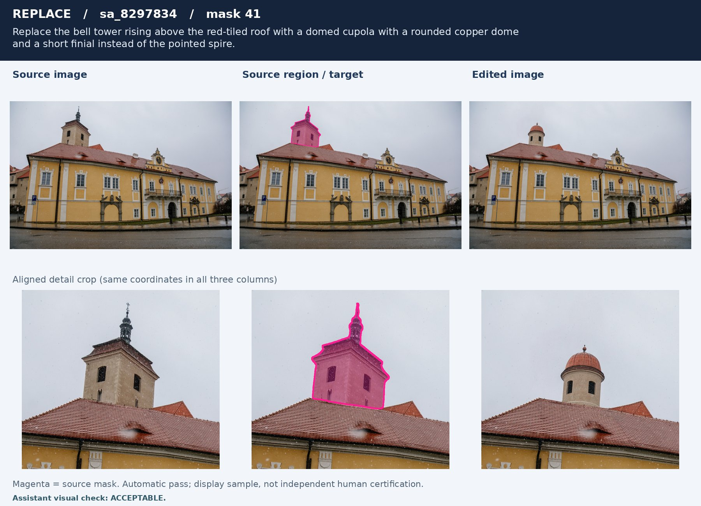

**06. replace — `sa_1040883/mask 4`**

`Replace the rough concrete wall behind the vertical metal rods with a red brick wall with visible mortar joints.`

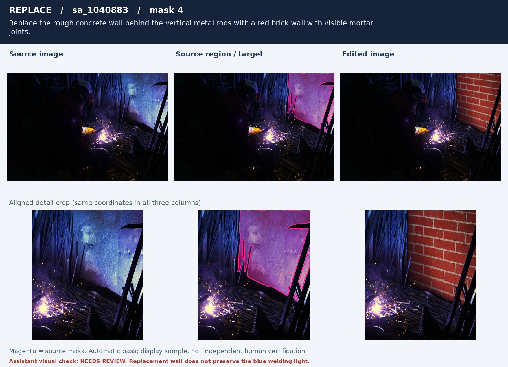

**07. remove — `sa_3730537/mask 21`**

`Remove the carved scroll bracket at the lower-left end of the niche cornice.`

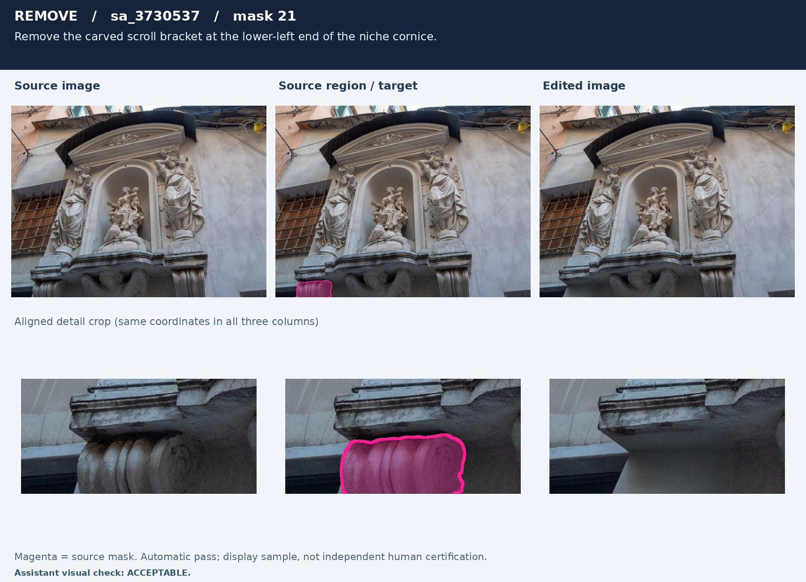

**08. remove — `sa_1563482/mask 10`**

`Remove the low stone parapet panel in the foreground.`

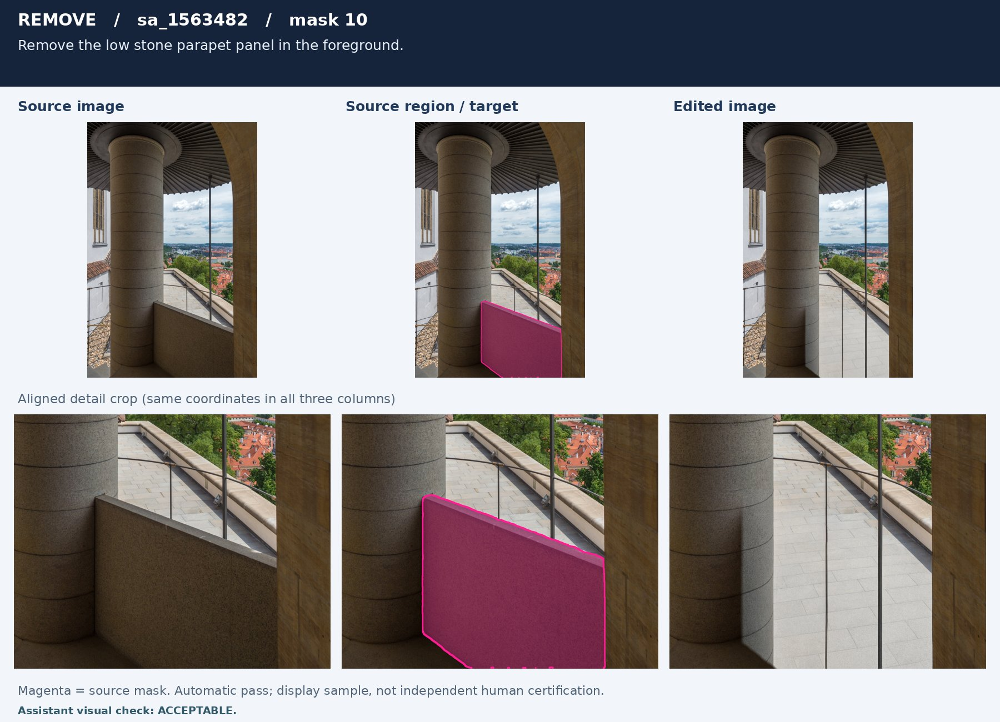

**09. remove — `sa_1110373/mask 9`**

`Remove the central white sailboat with the tall mast and angled boom.`

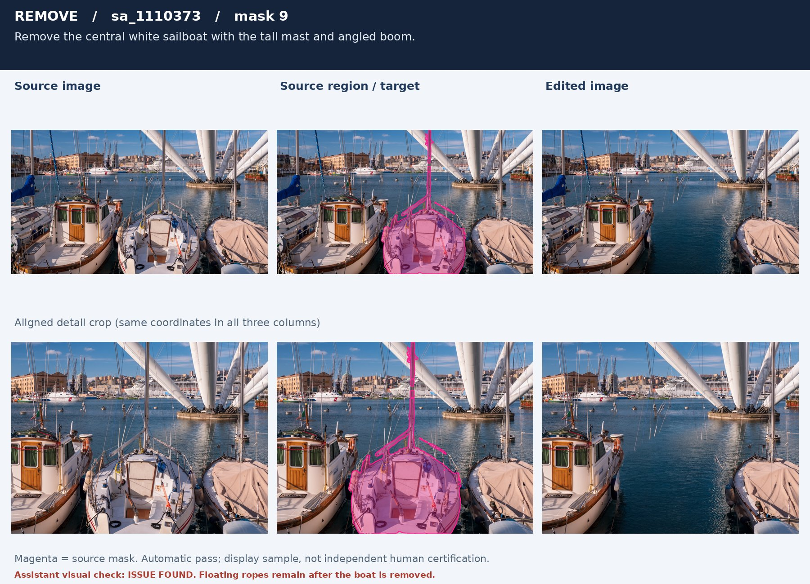

**10. attribute — `sa_248484/mask 15`**

`Change the color of the crumpled black plastic bag in the background to deep navy blue.`

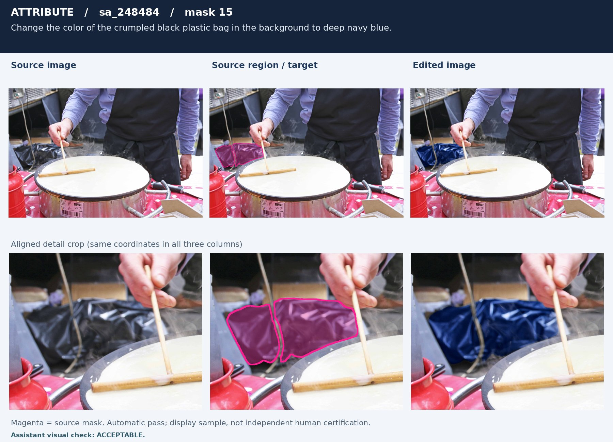

**11. attribute — `sa_3962368/mask 18`**

`Tint the small cloud in the top-left corner a soft golden-pink.`

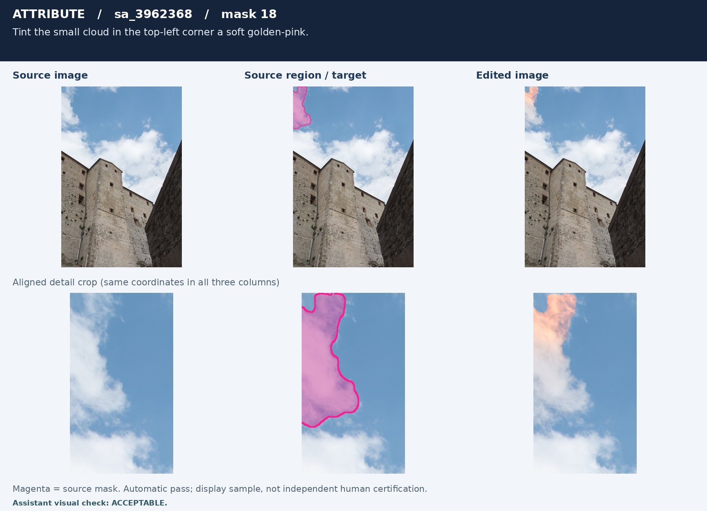

**12. attribute — `sa_9435005/mask 5`**

`Change the color of the rusted vertical rebar just right of the horizontal tie-bar knot to a uniform dark gunmetal gray.`

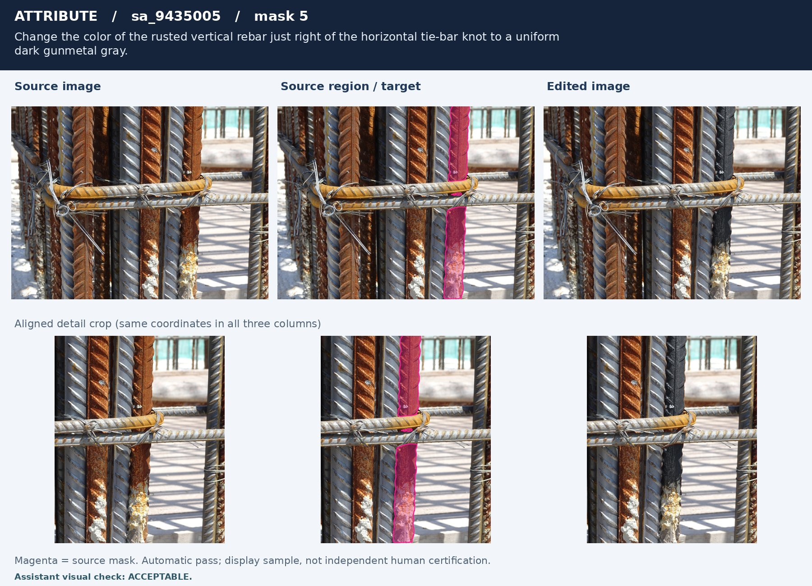

## 7. 追溯与清理

父目录 `config.json`、`deployment/`、`inputs/` 冻结本批生成协议和来源；`nodes/node*/validation.jsonl` 保留全部 79,821 条审核结果；`final/` 保留合并原始导出。历史 `failure.json` 反映曾经发生的错误，当前完成状态看 `final/summary.json` 和规范目录 `release.json`。

清理建议、测量大小及删除条件见 [清理候选清单](CLEANUP_CANDIDATES_50K_ZH.md)。规范整理后，已按用户确认仅删除父目录 `source_cache/`（4,004 个文件，17.439 GiB 逻辑大小），正式数据及其他候选保留。旧四机运行若需恢复或扩量，须先重建缓存；训练读取 `release/` 不受影响。其余候选仍需另行确认；不要直接递归删除 `nodes/`，否则会丢失失败样本和原始审核追溯。
