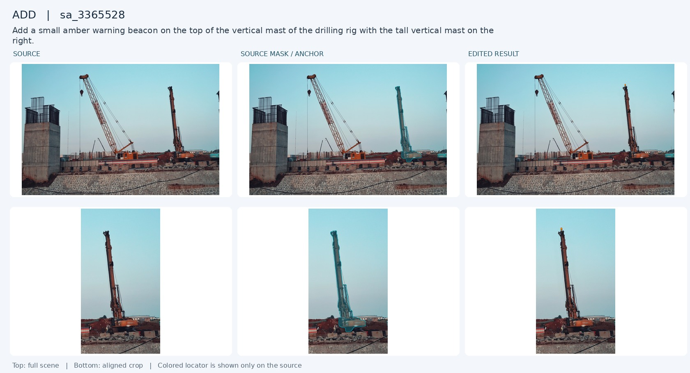
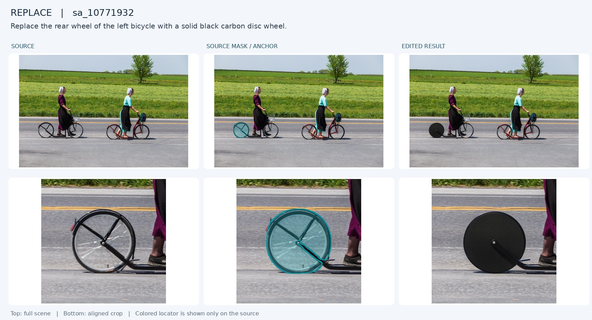
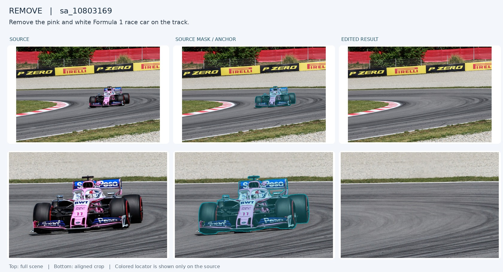
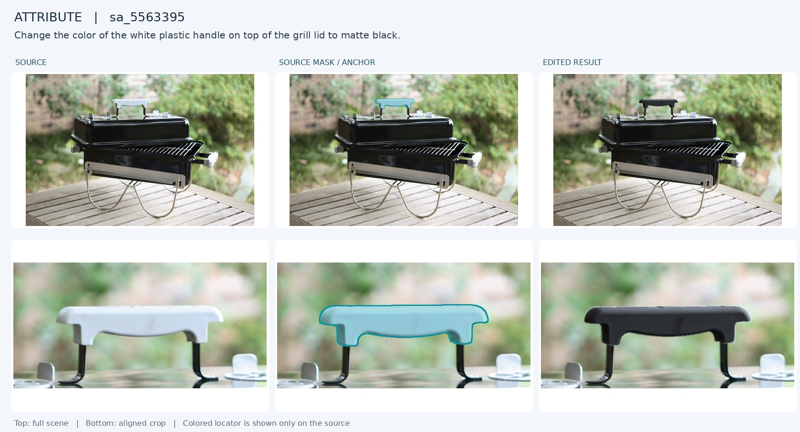
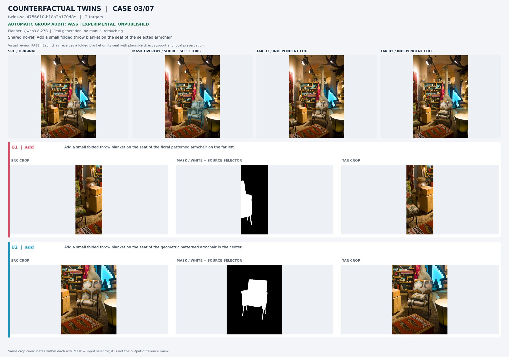
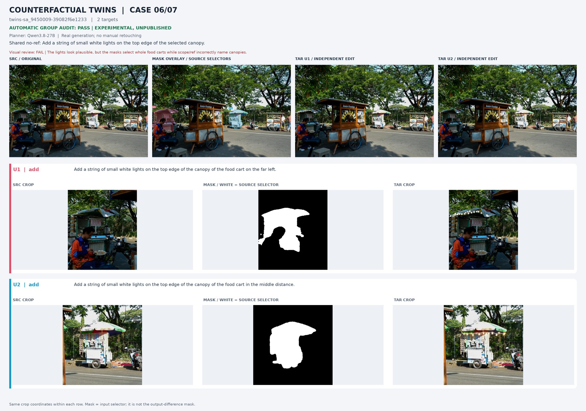
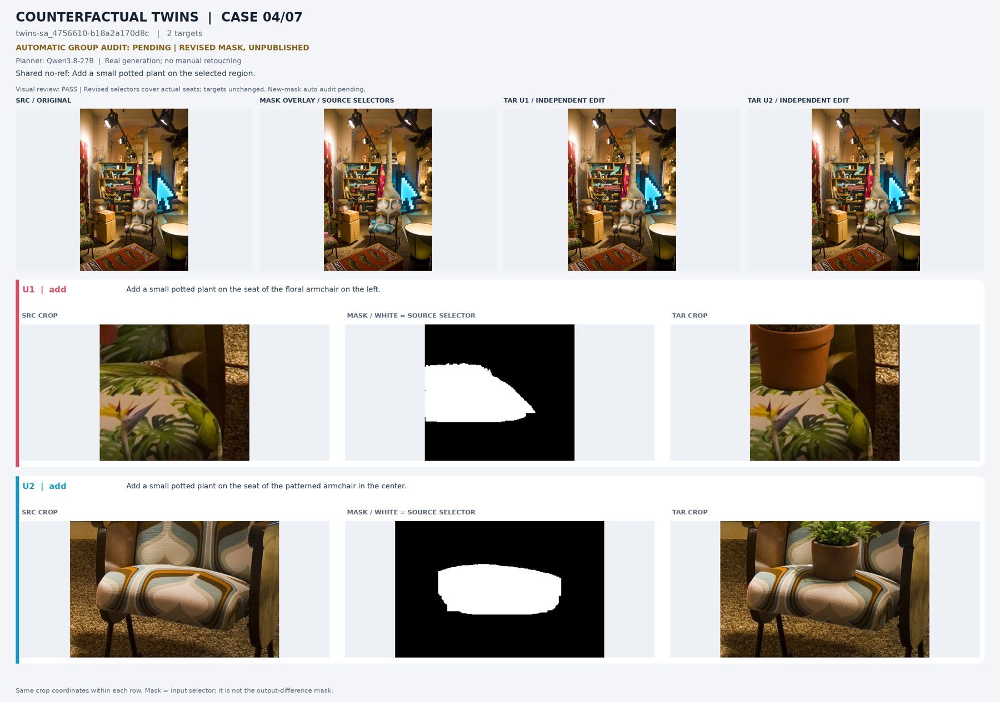
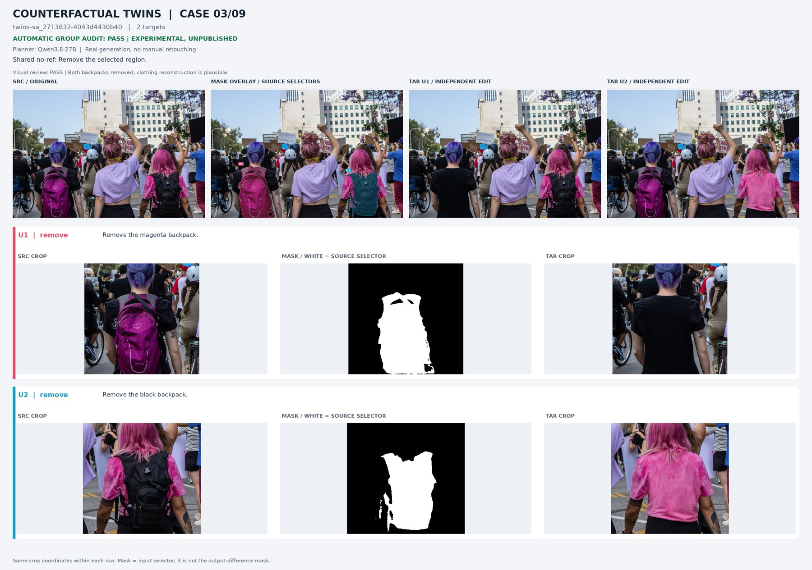

# 当前 SA-1B 标注管线

## 1. 目标和当前状态

管线的输出是一条 mask 对应一条独立的局部编辑样本：原图、精简指令、源区域信息、目标图、执行区域和审核记录。当前协议支持四类操作：`add`、`replace`、`remove`、`attribute`。正式目标是 50,000 条自动审核通过样本，四类各 12,500 条；每个四机 rank 的目标是每类 3,125 条。

当前正式运行根目录为：

```text
/mnt/bn/strategy-mllm-train/user/tanyue/datasets/sa1b_samtok_edit_50k_20261014
```

2026-10-15 已完成：累计生成并审核 79,821 条，自动通过 50,000 条（62.64%），四类各 12,500 条，覆盖 1,132 张不同源图。规范训练入口为上述根目录下 `release/annotations/train.jsonl`，所有媒体路径相对于 `release/`。原始四机合并记录保留在 `final/auto_pass.jsonl`。本批完整统计、目录、字段、读取示例、12 例目视记录和图片见 [50k 数据说明](DATASET_50K_ZH.md)。自动审核完成不等于独立人工验收完成。

## 2. 源数据

源数据是 SA-1B 图像及其 dense label 记录。准备阶段从 SG2 的随机访问索引冻结 16,000 个 source ID，并提取 32,000 条原始 TFRecord 记录（每张图的 image 和 annotation），缓存约 17.42 GiB。运行期间缓存保留原始 TFRecord 字节、记录长度、CRC32C、SHA-256 和 source ID，四机通过 `shared_record_cache_v1` 读取，不依赖任务内的 SG2 HDFS 挂载。50k 完成并整理后，已按用户确认删除该批 `source_cache/`（17.439 GiB 逻辑大小）；正式 `release/` 不依赖它，旧任务恢复/扩量需先重建缓存。

源选择固定随机种子，排除 benchmark source ID 和原图字节哈希；每个 rank 负责不重叠的 4,000 张源图。源图中的所有可解码、非空 mask 都进入供给池；尺寸不一致、空 mask 或无法解码的记录只记录为异常，不按面积、遮挡或主体美观进行隐式筛选。一个源图可以贡献多个独立 case，多个 case 不代表同一目标图联合执行多个编辑。

## 3. 数据要求和指令协议

每个 mask 必须绑定一个明确的源对象或部件。`ref` 是对该 mask 的唯一、无歧义指代；同类多个实例使用颜色、相对位置、宿主和部件层级区分。`box`、`point` 和 `mask` 是同一 source selector 的不同输入形式，不能改变目标含义。

- `remove`：删除 mask 所指的完整对象或明确部件；不适合删除手臂、人体关键部位或会破坏场景语义的区域时拒绝。
- `replace`：把 mask 所指对象替换为同一功能层级的新对象，指令只写对象和必要的属性/形态。
- `attribute`：只改变 mask 所指对象的指定可见属性，例如颜色、材质、纹理或图案；保持身份、轮廓和未请求属性。
- `add`：mask 是新增物体的直接宿主或直接附着区域，优先写“附着于/放置在”该宿主的自然表面；只有直接覆盖 mask 会突兀时，才退到相邻且距离很近的锚点。新增物体本身不作为已存在物体去描述。

指令采用单句、动词开头、只包含操作、目标和必要限定的形式。例如：`Change the color of the left wooden shutter of the middle window to deep forest green.`；`Add a small lantern attached to the selected region.`（mask 选中下横杆）。不在 instruction 中堆叠审核规则、模型提示或多余位置解释；详细保护约束写入结构化字段和生成 prompt。

## 4. 代码实现

| 阶段 | 代码 | 作用 |
| --- | --- | --- |
| 源记录缓存 | `scripts/production/stage_source_cache.py`、`sa1b_pipeline/production_source_cache.py` | 按冻结 reservoir 提取原始 TFRecord；校验 CRC、长度、SHA 和 source ID；支持断点恢复。 |
| 源 materialize | `sa1b_pipeline/production_sources.py` | 从共享缓存还原原图和 dense mask，保持原始像素和所有有效 mask；写入 provenance。 |
| 规划 | `scripts/run_production_4node.py`、`scripts/run_balanced_planning.py`、`scripts/experiment_batched_planning.py`、`sa1b_pipeline/per_mask.py` | 每个 mask 一次 MLLM 请求；每个 wave 启动两个 TP=4 规划副本；输入为全景图、单 mask crop 和结构化 mask 信息；根据剩余类别缺额给定类型优先级，禁止把不合适的操作静默改成其他类型。 |
| 指令协议 | `sa1b_pipeline/instruction_protocol.py`、`instruction_style.py`、`instructions.py`、`planning_schema.py` | 解析 `ref`、`operation`、`scope`、`payload`、`attributes`、`placement`；检查精简句式、类型字段和 add 直接支撑原则。 |
| 生成 | `sa1b_pipeline/production_generation.py`、`scripts/run_generation_queue.py`、`sa1b_pipeline/editor.py`、`utils/qwen21_omni.py` | 每 rank 启动 6 个单卡编辑器；Qwen-Image-2.1/vLLM-Omni，40 steps、seed 0；区域保护和 compositor 记录 generation fingerprint。 |
| 审核 | `scripts/run_audit_queue.py`、`sa1b_pipeline/audit_backend.py`、`sa1b_pipeline/validate.py` | 每 rank 启动 2 个审核 worker；批量检查 target_done、non_target_preserved、natural、operation_correct、结构完整性和 mask/尺寸一致性。任一关键字段失败则拒绝。 |
| 配额与恢复 | `sa1b_pipeline/operation_balance.py`、`shared_operation_quota.py`、`production_state.py`、`work_queue.py` | 以自动审核通过数填充四类缺额；本地 SQLite 队列保存租约和提交；共享 JSON/JSONL checkpoint 支持中断恢复和重复提交隔离。 |
| 四机编排 | `scripts/run_production_4node.py`、`scripts/production/bootstrap_arnold_4node.sh` | 校验 rank、共享缓存、模型配置和代码 hash；按 source wave 规划、生成、审核、合并；最终验证数量、四类均衡、ID/mask 唯一性及媒体存在性/非空/路径范围；没有全量解码图片。 |
| 运行时 | `scripts/production/setup_runtime.sh`、`scripts/production/check_runtime.py`、`requirements/production/*.lock.txt` | 三套独立 CUDA 12.9 环境；规划、编辑、审核均固定 PyTorch `2.13.0+cu129` 和明确的 cu129 vLLM wheel，ready 前执行真实 GPU matmul/RMSNorm 检查。 |

## 5. 小批量质量和速度

**总体评价：小批量验证中，经指令、成图目视复核和自动审核共同筛选的保留样本质量基本过关，四类都能得到自然、局部且符合请求的编辑结果，可作为后续人工打标和扩量验证的基础。** 这里评价的是保留样本，完整候选批次的质量统计如下；当前仍需过滤失败结果，并在训练发布前进行人工验收。

2026-10-13 的完整质量验证使用 30 张源图、60 条独立编辑，四类各 15 条：规划目视通过 52/60，目标图目视通过 46/60，自动审核通过 52/60，三者交集保留 **40/60（66.7%），四类各 10 条**。目视结论来自 assistant 逐图复核，未经过独立人工标注员验收。该批用于质量验证；后续加速和正式部署验证另计，不能合并成更多独立样本。

当前生产配置的补充冒烟验证使用 2 张新源图、182 个有效 mask，完成 182 次规划调用，接受 174 条计划；实际生成并审核 5 条，最终自动通过 4 条，四类各 1 条。首次 remove 失败后仅补充 remove，验证了失败过滤和类别补额。该小样本用于执行链路验证，不作为稳定质量率估计，不计入正式 50k 配额。

### 通过案例可视化

以下四例均来自上述 40 条保留清单，原指令和目标图没有为了展示而改写或重新生成。每张图上排展示全景、下排展示对齐局部；列顺序为源图、源 mask 定位、目标图。彩色标注只绘制在源图上，目标图保持原始生成结果。展示例为挑选的正例，不代替全批质量统计。

**Add — 钻机顶部添加警示灯（`sa_3365528 / mask 0`）。** 灯具直接附着在 mask 对应钻机的桅杆顶部，位置、尺度和场景用途合理，周边机械结构保持。



**Replace — 自行车后轮替换为碳纤维碟轮（`sa_10771932 / mask 1`）。** 新轮保持原轮的位置和透视，轮轴与车架连接自然，人物和另一辆自行车保持。



**Remove — 移除赛道上的赛车（`sa_10803169 / mask 0`）。** 赛车完整消失，路面和轮胎痕迹衔接自然，赛道边缘和广告牌保持。



**Attribute — 烤炉上方把手改为哑黑色（`sa_5563395 / mask 0`）。** 颜色修改集中在所指把手，形状、支架和邻近白色部件保持，明暗与原光照匹配。



### 本地验证结果路径

| 内容 | 本地路径 |
| --- | --- |
| 40 条过关结果及源图、目标图、mask 路径 | `/mnt/bn/strategy-mllm-train/user/tanyue/datasets/sa1b_edit_work/full30_concise2_20261013/generation/retained.jsonl` |
| 完整 60 条生成结果 | 同目录 `generated.jsonl` |
| 逐例目视结论、自动审核、完整性检查 | 同目录 `visual_review.jsonl`、`audit_0.jsonl`、`integrity_checks.jsonl` |
| 保留 40 例可视化 PDF（图片内嵌，可离线查看） | `/opt/tiger/tanyue/sa1b-samtok-edit-data/artifacts/full30_concise2_20261013/保留40例_可视化.pdf` |
| 全部 60 例逐例复核 PDF | 同目录 `全部60例_逐例质量复核.pdf` |
| 当前生产配置四类自动通过的冒烟结果 | `/mnt/bn/strategy-mllm-train/user/tanyue/datasets/sa1b_samtok_edit_50k_20261014/verification/real_gpu_smoke/auto_pass_preview.jsonl` |

`retained.jsonl` 的图片字段是绝对路径；`auto_pass_preview.jsonl` 的图片字段相对于正式运行根目录解析。本地完整结果和 PDF 不随仓库上传；上面的四张精简案例图及其来源清单 `docs/assets/validation/cases.json` 随仓库提交，可直接在 GitHub 查看。

候选中仍有 Ref 与 mask 错配、add 附着不完整、attribute 边缘混色、replace 层级不准确和自动审核误判。保留通过结果的同时，原始失败记录也保留用于复核。

速度证据分开记录：

- CUDA 12.9 新编辑环境的一条 40-step smoke：模型加载 28.3 秒，生成与保存 18.1 秒，输出尺寸 1500×2265。
- 已完成的 6 editor + 2 audit 小批量重放为 60 条原始结果约 293 秒，约 737 原始例/小时；这不含规划、冷启动和人工验收，也不是 50k 交付承诺。
- 当前四机首 wave 冷启动包含约 23–25 分钟规划模型加载/JIT；热态规划每约 54 个 mask 需要 67–75 秒。实际全量工期要以四机持续日志为准，不能用单条生成延迟线性替代规划、审核和类别补额成本。

CUDA 12.9 冒烟测试的原始 source、mask、target 和完整元数据位于正式运行根目录 `verification/cuda129_fix/`。该单例只验证运行兼容性，不并入上面的 60 条质量统计。

## 6. 运行结果和查看方式

本批已完成生成、审核与收尾。共享盘不支持 `flock` 导致 node2 最后的汇总报错；独立 CPU 收尾入口 `scripts/finalize_production_exports.py` 使用目录锁，复核后完成汇总，未重新生图。旧错误记录仍保留，不代表当前未完成。

正式使用目录：

```text
release/annotations/train.jsonl      50,000 条训练主标注
release/annotations/audit.jsonl      对应完整生成与审核记录
release/images/source/              原图
release/images/target/              目标图
release/masks/region/               源区域（add 为锚点）
release/masks/support/              生成执行范围
release/statistics.json             全量统计
release/validation.json             整理和隔离检查
release/visualizations/examples_12.pdf  每类三例，含问题案例
```

父目录 `nodes/`、`final/`、`inputs/`、`deployment/` 保留运行溯源，不作为训练入口一起加载。整理脚本 `scripts/organize_production_release.py` 建立规范硬链接和相对路径标注，保留原始文件；正式媒体不可原地修改。归档详情和字段协议见 [50k 数据说明](DATASET_50K_ZH.md)，待确认的删除项见 [清理候选清单](CLEANUP_CANDIDATES_50K_ZH.md)。

```bash
ROOT=/mnt/bn/strategy-mllm-train/user/tanyue/datasets/sa1b_samtok_edit_50k_20261014
cat "$ROOT/release/release.json"
cat "$ROOT/release/statistics.json"
```

本次 12 例固定规则目视抽查发现：9 例基本可用，2 例待复核，1 例帆船删除后有悬空索具残留。它们均为 pipeline 自动通过样本；抽查偏向可见区域，不能外推全量质量率，也未据此改写原始自动通过标记。人工验收仍需检查指代、目标完整性、非目标保持、自然性和 add 直接锚点。

## 7. 分组数据扩展

分组数据是 50k 单目标管线的独立补充，不修改或复用 50k 的运行检查点。需求分为两类：

| 数据 | 训练规模 | 第一批 | 评测 | 组内约束 |
| --- | ---: | ---: | ---: | --- |
| 反事实孪生 | 15,000 组 | 5,000 组 | 200 组 | 同源图 2–3 个粒度相近实例，允许不同类别；共用 no-ref/payload，只替换 ref/mask |
| 紧邻多目标 | 5,000 组 | 1,500 组 | 100 组 | 每组 2–5 个原图目标，至少一对相邻，按 source→step 链式生成 |

评测源图必须先于训练源图预留，并同时排除 benchmark 的 200 张图、50k 冻结 reservoir 和已有训练清单中的 source ID 与原图字节哈希。准备脚本将证据写入独立根目录的 `inputs/eval_reservation.json` 和 `inputs/manifest.json`；训练导出前再次执行 `assert_no_eval_leakage`。50k 根目录
`/mnt/bn/strategy-mllm-train/user/tanyue/datasets/sa1b_samtok_edit_50k_20261014` 只读，不能作为新任务的输出目录。

### 7.1 组级协议

新运行使用 instruction protocol **2.0**、mask semantics **2.0** 和写作风格 `benchmark-concise-3-blind-1`。历史 50k 和旧小批量记录不在本次原地迁移范围内。

统一规则：把“对哪里做”整体换成 `the selected region`，源 mask 就选中这个“哪里”；“做什么”原样保留。no-ref 不出现目标类别、部件、site、方位或序数；payload、属性值、附着关系和结果说明保留。Ref 渲染规则不变。`instruction_spec` 仍保留 scope、target_part 和 placement.site，供 Ref 和构造使用。

| 操作 | 盲指代 no-ref |
| --- | --- |
| attribute | `Change the color of the selected region to navy blue.`；其他属性按同一模板，text/tint/opacity 保留专用句式 |
| replace | `Replace the selected region with a flared bell sleeve.` |
| remove | `Remove the selected region.`；contents 保留 `including its contents`，剪短保留结果说明 |
| add | `Add a folded throw blanket on the selected region.` |

确定性检查由 `instruction_protocol.validate_noref` 校验完整的语义槽位渲染，不把 payload 或文字属性中的同名词误判为指代泄露。提及其他场景物体的保护 qualifier 在 no-ref 去除、记录 `qualifier_dropped`；通用编辑保护保留，未分类 qualifier 拒绝而不猜测。Ref 原句不变。token 插在完整定位槽之后，不插入 payload 的同名文字中。两个仓库的 `instruction_protocol.py` 必须逐字节一致。

源 mask 选中实际被编辑部分；add 为源图中的直接附着部位，不是新物体轮廓。带 site 的 add 先沿用原宿主生成，再由 `source_regions.py` 取差异区域扩张并与宿主相交。扩张半径为差异框短边的约 30%，至少 16 像素。记录阈值、相交面积和面积比例，保存 `mask_v1/bbox_v1/point_v1`，另存新 mask，重算紧致 bbox 和离边界最远的 point。像素差异先降噪并去除小连通域，避免重建噪声选回整个宿主。可选 `--site-model` 接入常驻 SAM3：按 scope + site 分割源图部位，与宿主和差异接触区相交；差异无法定位时使用 SAM3 部位结果。SAM3 也约束已有差分结果，避免花盆投影到椅背时把椅背误当座面。整宿主候选被排除，也可接入预先验证的 site mask；失败标记 `blind_ineligible_reason=part_mask_missing`，只能作为 ref 无 token 诊断样本，不进入孪生/多目标最终池。target_part/remove 部件使用已解析部件区域，contents 使用容器与内容物的并集。

孪生组共用 operation、payload、attributes、placement.relation 和 no-ref 文本；每个成员保留自己的真实 scope 和 placement.site，不再要求同类或同 scope。每个成员仅有自己的 ref、源 mask、support mask、目标图和审核结果。ref 必须在原图中唯一地区分组内实例，不能写 mask、颜色标注或 crop。add 的 source mask 是直接承载物/附着区域；孪生组必须对全部成员使用直接支撑锚点，不允许参照式 add。多目标仍按统一协议判断直接支撑关系。anchor 不是新增物体的输出 mask。孪生组要求同操作、同 payload、no-ref 逐字相同，以及最终源 mask 粒度相近、面积比 ≤3；独立无定位盲测替代原来的同类硬限制。多目标每个 mask 对应一句 no-ref，允许不同目标句子完全相同。

多目标组的每个 instruction 都基于原图书写；不引用前一步新生成的物体。2–4 个目标的 operation 不重复，5 个目标必须包含四类并只重复一类。默认顺序为 `remove → replace → attribute → add`，但实际使用规划模型返回的合法顺序。每个步骤使用同一个 seed，在上一步输出图上调用 Qwen-Image-2.1，再使用原图 mask 几何和 bounded support 贴回。

### 7.2 代码路径和数据流

1. `scripts/prepare_group_inputs.py` 加载 benchmark exclusion、50k reservoir 和源注册表，调用 `sa1b_pipeline.source_isolation` 先预留 eval，再调用 `production_sources.materialize` 将 image/dense record 物化到新根目录。正式运行应对每个已有训练清单重复传入 `--existing-manifest PATH`；`--skip-discovery` 只适合已显式列全清单的运行，不能据此宣称与所有历史训练集隔离。
2. `sa1b_pipeline.group_selection` 对孪生候选执行粒度、面积比、mask 间隔、宿主关系和每源最多两组约束；候选同类约 30%、跨类约 70%，按成员独立识别结果复核类别关系，训练按 `--twin-three-member-fraction` 预留约 15% 的三实例组；评测严格只选双实例组；对 replace/remove 会提前过滤别名列表和文字/阴影等需要额外执行区域的候选。多目标默认使用 `strict_geometry=True`，先用 bbox 下界缩小候选，再在局部联合 bbox 上计算精确 mask gap 和冲突；按 2/3/4/5 目标配额补充不冲突目标。每个多目标组先在 `sa1b_pipeline.multi_operation_balance.operation_schedules` 中枚举可行的操作序列，再用 `balance_multi_operations` 做全局四类配额优化，避免固定序列造成 add/attribute 偏置；`scripts/rebalance_multi_operations.py` 可对已选 shard 只重排合法 `operations` 字段并保留其他选择证据。`--fast-selection` 只用于容量估计，使用 bbox 近邻并明确标记 `geometry_exact=false`，不能进入最终数据。这里不做语义 fallback。
3. `sa1b_pipeline.group_planning` 为每组提供干净全图和成员 crop contact sheet；后者逐行并列干净裁图与同尺度黑白 mask，避免标注染色干扰外观判断；规划模型每组一次请求返回共享编辑槽位与各成员真实 scope/site（孪生）或每目标 spec（多目标）和 refs。孪生规划后再独立调用一次无定位盲测，仅输入干净原图和共享 no-ref；不提供 mask、crop、ref、成员列表或目标图，不通过则在生图前停止。`scripts/run_group_pipeline.py` 会把未完成组按 `--planner-batch-size` 批量提交 vLLM，同时逐组落盘 checkpoint，避免批处理牺牲恢复能力。`build_twin_group`/`build_multi_group` 通过既有 `instructions.build_unit` 渲染 protocol 2.0 文本，拒绝 operation、ref、payload 或 no-ref 不一致；还会拒绝组内重复 ref、unit/object 错配、属性 no-op 和与 dense 描述主颜色冲突的 ref。
4. `sa1b_pipeline.group_generation` 复用既有 Qwen-Image-2.1 regional crop、区域权重和 paste-back。孪生成员各自在同一 source/seed 上独立生成；多目标按 `generation_order` 链式生成。每一步写出 input/output、support mask、generation context 和确定性检查。新组运行用 `render.json` 校验源图/链式前一步、mask 内容、指令、seed 和编辑器配置，并验证已有目标图哈希；匹配时复用且保留原生成 context。已变更输入或缺乏可验证 checkpoint 的历史图片会明确拒绝复用，不会静默重标注旧图。`--generate-only` 将通过确定性检查的组持久化到 `generated.jsonl`；`--audit-only --audit-model ...` 在独立审核环境读取该清单，不加载编辑器。所有语义审核结果写入 `audited.jsonl`，包括失败组。
5. `sa1b_pipeline.group_audit` 接入 27B，先对每个孪生成员/多目标链式步骤调用带 `operation_correct` 的 50k 单条审核协议，再对整组审核成员完成度、非目标保持、唯一指代、可比性、相邻串扰和整图自然性；任一成员或组级字段失败都会 all-or-nothing 丢弃。审核请求按 auditor batch size 分批。孪生组使用干净全图及逐成员 SOURCE / RESULT / MASK ONLY 黑白定位拼图，并附每个目标 contract；不能把标注图当作编辑结果。`scripts/review_group_data.py` 生成图片内嵌 PDF 和人工 ledger；人工复核未完成时 `release.json.published` 必须为 false。

### 7.3 交付字段和状态

孪生最终文件为 `final/twins_train.jsonl`、`final/twins_eval.jsonl`；多目标最终文件为 `final/multi_train.jsonl`、`final/multi_eval.jsonl`。每条记录都包含 `source_provenance`、原图路径、结构化 spec、当前源区域 mask/bbox/真实 interior point（更换时保留 v1 历史字段）、support mask、目标图、seed、generation context、deterministic/semantic audit 和组级 checks。多目标额外包含每一步的 `step_input_image`、`step_output_image`、`generation_order`、`adjacent_pairs` 与最终 `joint_target`。

当前独立输入根目录已经完成源隔离和物化：训练候选 15,994 张、评测候选 1,199 张，评测 reservation 1,200 条（含 benchmark、50k 冻结目录和两个历史训练清单的 ID/哈希排除）。孪生初始候选选择文件曾按四类各 1,250 组落盘（尚非合格数据；下述精确面积复核发现缺额）：`inputs/train_twin_selected.jsonl` 5,000 行、`inputs/eval_twin_pairs_selected.jsonl` 200 行；训练侧的成员数为 4,248 个双成员组和 752 个三成员组，scope 为 object 3,000、不同宿主部件 1,500、同宿主部件 500，最小成员面积分布为 30% / 40% / 30%，并通过每源最多两组及 train/eval 不重叠复核。评测候选已修正为 200 个双成员组，四类各 50，scope 为 120/60/20；32 个原三成员候选经过 pair 几何检查后选定两成员。新分片为 `shards/twins_eval_pairs_v2/`；旧 `twins_eval` 分片不可用于新运行。规划、生图、27B 审核和逐图视觉复核完成后才能发布。规划拒绝、生成失败、组级审核失败都保留在 checkpoint 中，不能把单个成员降级为普通单目标样本，也不能用自动审核结果代替逐图复核。用户已指定由 assistant 承担视觉复核，ledger 如实记录 reviewer=assistant 和逐项结论。

2026-10-15 精确 RLE 面积复核发现：初始训练 5,000 组中 1,086 组、评测 200 组中 34 组不满足成员面积比 ≤3。原因是快速候选选择缺少真实 mask 面积比检查，而非生成失败；已在候选选择、规划和导出三处检查，使用压缩 RLE 直接计算面积。旧选择文件保留用于追溯，必须补齐合格候选后才能用作正式批次。审计见 `verification/twin_exact_area_inventory.json`。point 统一采用带外部零边界的 SciPy 距离变换，禁止用距图像边缘的距离替代 mask 内距。

最新完整孪生诊断批次 `sa1b_samtok_twins_contract27b_20261015T030501Z` 使用 27B 规划和审核、Qwen-Image-2.1 40 步生成：16 组 / 34 张目标图，生成墙钟 795.4 秒（含加载、IO、检查，约 23.4 秒/张），规划 198.3 秒，黑白定位复审 250.3 秒。12 组通过确定性检查，复审后 5 组通过成员及组级语义检查，导出 schema 再过滤 1 组面积比不合格，暂存 4 组（add 3、replace 1），`published=false`。assistant 已实际查看全部 34 张目标图和源 mask；严格按完整协议只有赛车金色轮圈 1 组通过，与自动暂存交集 1 组。其余问题包括 ref 不准确、操作类型错配、添加落在邻近物体或 mask 孔洞、删除残留、成员面积差过大；不能以局部编辑美观代替整组协议通过。原彩色定位审核会误读标注色，结果已归档，不能作为可靠通过率。

完整图片内嵌 PDF：`/mnt/bn/strategy-mllm-train/user/tanyue/datasets/sa1b_samtok_twins_contract27b_20261015T030501Z/visual_review/human_review.pdf`（34 页）；逐图复核记录位于同目录 `human_review.jsonl`。诊断报告位于运行根目录 `quality_analysis_zh.md`，统计依据为 `verification/review_summary.json`。这批是孪生任务诊断，不代表原 50k 单目标生产的质量或速度。原 50k 运行根目录、配置和代码包未被修改。

轮廓辅助规划回归 `sa1b_samtok_twins_outline27b_20261015T031801Z` 在相同 16 组上先过滤 6 组面积不合格，再规划 10 组，耗时 180.4 秒；assistant 查看全图与 mask 后判 3/10 组规划基本可用。石拱/蓝灯混淆及重复 shutter 表述有改善，但复杂定位、整物/子部件 scope 和类型语义仍不稳定。已增加颜色替换和 add 位置占位词检查；独立的 32 组新源图（四类各 8）随后完成规划，326.3 秒内 29 组通过结构检查（add 6、replace 7、remove 8、attribute 8），对应 61 张待生成目标图。assistant 已实际检查全部 29 组源图和 mask，8 组规划基本可用；其余主要是全图左右错配、重复目标中的模糊指代、整体/部件 scope 错配或不自然的操作设计。生图正在独立目录 `sa1b_samtok_twins_unseen32_20261015` 进行，尚无该批次目标图审核结果；不能将结构通过率 29/32 当作语义正确率。针对全图与 crop 位置关联，新增实验开关 `--locate-planning-scene`，只在目标外侧画轮廓及 U 标签并提供归一化 bbox，目标内部像素保持不变；默认关闭，待回归实测。

多目标容量审计的 bbox 快速模式在 1,199 个评测候选上可以构造 100 组，并得到 2/3/4/5 目标配额 20/30/25/25；随后精确 mask 复核只有 53/100 通过，因此快速模式只用于估算候选供给，最终选择必须使用严格几何模式。审计记录位于：
`/mnt/bn/strategy-mllm-train/user/tanyue/datasets/sa1b_samtok_group_inputs_20261014/verification/multi_selection_capacity_fast.json`。

当前已完成的最终选择使用“快速容量池 + RLE 相邻复核”两阶段流程：快速阶段只扩大候选池，不进入数据发布；`scripts/recheck_multi_selection.py` 对预选 pair 的 RLE mask 在局部联合 crop 上复核相邻性，并按目标数配额重新抽取。结果为：训练 1,500 组（2/3/4/5 目标分别 300/450/375/375），评测 100 组（20/30/25/25）；训练复核 3,668 组、通过 1,500 组（40.9%），训练源图 1,314 张、评测源图 85 张，双方源 ID 不重叠，每张源图最多 2 组。所有保留选择均有 `geometry_exact=true` 的相邻证据；生成阶段仍需重新计算 support mask 并由组级审核决定发布。

多目标操作分配随后已按可行序列重新平衡。训练 5,325 个目标的计数为 add 1,394、replace 1,269、remove 1,269、attribute 1,393；评测 355 个目标的计数为 add 92、replace 87、remove 86、attribute 90。训练最大偏差为 62 个目标（23.83%–26.18%），评测最大偏差为 3 个目标（24.23%–25.92%）；每个序列仍满足 2–4 目标不重复、5 目标四类齐全且只重复一类。证据写入 `verification/multi_operation_balance.json`，实现位于 `sa1b_pipeline/multi_operation_balance.py`，重排脚本为 `scripts/rebalance_multi_operations.py`。

选择文件和四机分片位于：

```text
/mnt/bn/strategy-mllm-train/user/tanyue/datasets/sa1b_samtok_group_inputs_20261014/inputs/train_multi_selected.jsonl
/mnt/bn/strategy-mllm-train/user/tanyue/datasets/sa1b_samtok_group_inputs_20261014/inputs/eval_multi_selected.jsonl
/mnt/bn/strategy-mllm-train/user/tanyue/datasets/sa1b_samtok_group_inputs_20261014/shards/multi_train_wave1/
/mnt/bn/strategy-mllm-train/user/tanyue/datasets/sa1b_samtok_group_inputs_20261014/shards/multi_eval/
```

### 7.4 规划/生图小批量验证（2026-10-14）

在独立目录 `sa1b_samtok_group_twins_pilot_20261014` 对 8 个孪生候选做了完整的选择与规划验证。规划模型使用 4 卡 TP，批量提交 7 个未完成组；冷启动模型权重加载约 205 秒、引擎初始化约 30 秒，热态 7 组请求约 102 秒（约 4.1 组/分钟，约 247 规划请求/小时）。8 组中 3 组通过结构化计划，5 组拒绝：2 组缺少可执行的子区域、1 组候选是视觉文字/局部、1 组模型返回不可行、1 组把阴影当作 add 锚点。后续已将阴影、反射、文字和小型穿戴部件加入 add 候选预过滤，并让批处理中单组失败只落盘 `rejected/*.json`，不丢弃同批有效结果。

3 组通过规划的 6 个成员均完成 Qwen-Image-2.1 40-step 生成。编辑器单卡冷启动约 53 秒，热态每张约 15.7 秒（约 3.8 张/分钟，约 229 张/小时）；该批实际生成 6 张目标图约 94 秒，不包含加载。人工逐图复核结论为：小目标街灯的删除变化过弱；拱门删除有残留和不自然色块；房屋编辑变化不明显。因此该 pilot 只用于暴露规划和生成风险，没有写入 `final/`，也没有把 8B 规划结果当作 27B 语义审核。

多目标随后在独立目录 `sa1b_samtok_group_multi_vllm8b_pilot_20261015_retry` 做了两组端到端冒烟。Qwen3-VL-8B 单卡规划 2 组：1 组通过结构校验，1 组返回不可行；规划层曾接受“把红色 SUV 改成红色”的 no-op，已在 `sa1b_pipeline.instructions.build_unit` 增加源 selector 属性重复硬门槛，并用回归测试拦截。保留组的四步链式编辑均完成，Qwen-Image-2.1 在 CUDA 12.9/SDPA 下每步约 16 秒，结构性检查通过；但人工查看发现 U1 的 mask 实际选中黑色 SUV，ref 却写成红色 SUV，且目标改黑属于 no-op，因此按整组 all-or-nothing 规则判失败。拼图为 `multi_montage.jpg`，人工记录为 `human_review_pilot/human_review.jsonl`。当前没有可发布的 27B 语义通过组，故该目录的 `final/multi_train.jsonl` 为 0 组，不能把它计入 1,500/100 的交付量。

Qwen3.8-27B 审核后端已在 `/tmp/sa1b-next-runtime` 的 vLLM 0.31.1 cu129 环境完成兼容性冒烟：正确解析 `Qwen3_5ForConditionalGeneration`，单卡冷启动加载约 14.3 分钟、占用约 51 GiB；模型可以返回结构化审核 JSON。首次冒烟还验证出旧审核输入缺少目标 contract，会出现证据与真实目标不符却返回 pass 的风险；现已改为同时传入带标签源图、结果拼图和每个目标的 ref/operation/instruction，并要求所有组级布尔字段为 true。首次返回的 pass 不计入语义质量统计，后续正式审核需使用修复后的 prompt。

可视化与人工记录：

- 规划/生成清单：`/mnt/bn/strategy-mllm-train/user/tanyue/datasets/sa1b_samtok_group_twins_pilot_20261014/review_manifest.jsonl`
- 图片内嵌人工复核 PDF：`/mnt/bn/strategy-mllm-train/user/tanyue/datasets/sa1b_samtok_group_twins_pilot_20261014/human_review/human_review.pdf`
- 已填写人工 ledger：`/mnt/bn/strategy-mllm-train/user/tanyue/datasets/sa1b_samtok_group_twins_pilot_20261014/human_review/human_review.jsonl`
- 机器可读汇总：`/mnt/bn/strategy-mllm-train/user/tanyue/datasets/sa1b_samtok_group_twins_pilot_20261014/pilot_summary.json`
- 生成图目录：`/mnt/bn/strategy-mllm-train/user/tanyue/datasets/sa1b_samtok_group_twins_pilot_20261014/generated/<twin_id>/member_U*/edited.png`

这些数字与单目标正式管线的吞吐需分阶段比较。此前四机正式管线热态自动通过约 4,400–4,800 个单目标样本/小时；旧单机小批量约 745 个原始样本/小时，四机约为 5.9–6.4 倍。孪生规划包含三张视觉输入的 MLLM 请求，单组还要生成两个成员，因此规划吞吐不能直接等同于单目标生图吞吐；批量请求和常驻模型进程是主要加速点。

当前新增分组验证位于 `/mnt/bn/strategy-mllm-train/user/tanyue/datasets/sa1b_samtok_twins_contract27b_20261015T030501Z`：16 组（四类各 4 组、34 个成员）的 27B 规划耗时 198.25 秒，结构通过 16 组；目视已发现指代/类型错误，6 组真实 mask 面积比不满足 ≤3，不计入交付。生成和审核结果以该目录中的阶段清单及复核记录为准。已增加真实面积比前置检查、评测仅双成员的导出校验，以及每成员一页的局部对照 PDF。

### 7.5 更强 MLLM 与审核提示对照（2026-10-15）

为验证 MLLM 是否是主要瓶颈，使用同一批 32 张源图、同一组 mask、相同的全图定位输入和相同的输出约束，对比 Qwen3.8-27B 与 Qwen3.8-Flash-Next-FP8。Flash-Next 使用 CUDA 12.9 的 vLLM 运行时、4 卡 TP4、Triton MoE 和 Engram CPU offload；代码在 `sa1b_pipeline/mllm_runtime.py` 自动按模型架构添加这些参数，27B 默认路径不变。

Flash-Next 规划完成 29/32 组，操作分布为 remove 8、attribute 7、add 7、replace 7；3 组因属性值已存在、不可执行或 add 缺直接支撑锚点而拒绝。相同定位输入的 27B 回归完成 28/32 组，分布为 attribute 8、remove 7、replace 7、add 6，4 组拒绝，其中 2 组是 add 缺直接支撑锚点。两者的结构通过率接近，因此不能仅凭通过数量宣称 Flash-Next 已显著优于 27B；Flash-Next 的指令更短、更常直接写出物体和位置，例如“Change the color of the right analog stick to red.”。

我逐项检查了 Flash-Next 的 29 个计划文本和代表性 mask crop。明显改善包括 protest sign 的人物关系、汽车挡泥板的左右关系、航站楼屏幕的 top-right site、游乐设施支撑杆的左右关系和 add 的直接附着表达。仍需人工/后续成图审核的风险包括水滴等过小目标、把柜台材料变化写成 replace、删除车轮或功能部件、同类电缆/门的部件层级，以及看似合理但直接支撑不自然的 add。Flash-Next 规划结果原始清单在 `sa1b_samtok_flashnext_validation_20261015/scene32/planned.jsonl`，输入和局部视图同目录保存。

对既有 12 组、24 张成员结果使用 Flash-Next 做审核对照。baseline 原提示的成员+组级语义通过为 6/12，grounded 提示（先核对白色 mask、排除黑色孔洞、全图核对 ref、检查 add 接触面和 remove/replace 语义）同样为 6/12；grounded 的语义字段通过为 8/12，baseline 为 7/12，说明提示顺序能减少部分漏检，但没有改变完整组级通过数。baseline 墙钟 415.25 秒、grounded 356.51 秒，均含同一模型已加载后的请求；模型加载 186.86 秒另计。结果、原始回答和请求日志在 `sa1b_samtok_flashnext_validation_20261015/audit12/`。

当前建议：规划侧优先使用已验证可加载的 Flash-Next FP8，并保留四类预分配和硬类型约束；审核侧可采用 grounded 提示，但不能把自动审核通过直接视为发布通过，仍需人工查看 mask、指代、目标完成度和自然性。Qwen-Image-2.1 成图质量仍是独立瓶颈，MLLM 更换不能替代成图抽查。生产入口的组级审核提示已同步加入上述核验顺序，remove 规划也明确拒绝删除车轮、车门、轮胎和功能支撑件等不自然目标。

### 7.6 孪生 wave1 正式选择（2026-10-15）

已在独立根目录 `/mnt/bn/strategy-mllm-train/user/tanyue/datasets/sa1b_samtok_twins_flashnext_wave1_20261015` 重建并硬校验第一批 5,000 组选择，尚未声明发布。选择清单为 `inputs/selected.jsonl`，四机分片为 `shards/twins_train_wave1/selected_rank{0,1,2,3}.jsonl`，每个 rank 1,250 组。

选择统计：四类各 1,250 组；双成员 4,248 组、三成员 752 组；scope 为 object 3,000、part_on_different_hosts 1,500、part_on_same_host 500；最小成员面积为 lt0.5% 1,501、0.5–2% 2,000、gt2% 1,499。共 3,313 个源图，每源最多两组；与评测 reservation 的 source ID 和 image SHA256 均为零交集；所有成员面积比最大 2.998，未发现超过 3 的组；remove 池没有 arm/hand/leg/foot/finger/head/face/person 类别。选择阶段约 18 分钟，主要成本是读取 1.6GB 候选并枚举四类同类实例，后续运行复用该清单，不再重复选择。

四机执行使用 `scripts/group_4node_entry.sh`：设置 `GROUP_ROOT` 为该目录，`GROUP_SELECTION` 指向 `inputs/selected.jsonl`，`GROUP_SHARD_ROOT` 指向 `shards/twins_train_wave1`，规划模型使用 `Qwen3.8-Flash-Next-FP8`，`GROUP_PLANNER_TP=4`，编辑模型使用 `Qwen-Image-2.1`，审核模型使用 `Qwen3.8-27B`。每个 rank 写入 `runs/twins_train/rank{0,1,2,3}`，不共享规划/编辑队列。完成后用 `scripts/merge_group_shards.py` 合并并执行发布前硬校验；规划、生图、语义审核和人工复核未完成前保持 `published=false`。 选择完整性记录已写入 `verification/selection_integrity.json`，包含清单哈希、四类计数、scope/面积桶、来源上限、eval 排除交集和四个分片哈希；四机尚未实际启动前，不应把该选择记录当作已生成数据。 训练/评测与 50k、benchmark exclusion 的全量 source ID/图像哈希交集记录见共享数据根目录 `sa1b_samtok_group_inputs_20261014/verification/source_isolation_full.json`，可由 `scripts/verify_group_inputs.py` 重建；其中两套评测之间有 13 个源图交集，当前需求允许，但若要做完全独立的联合评测需再排除。


### 7.7 现有产物质量复核与速度口径修正（2026-10-15）

用户要求先检验现有管线，不再新增生成。本次只读取既有目标图并制作可视化；补充多目标预览任务已在模型加载阶段停止，新增计划 0、新增目标图 0。停止记录在 `sa1b_samtok_group_preview20_20261015/stop_requested.json`；50k 运行目录、代码包和配置没有改动。

**当前结论：分组管线已经完成工程实现和若干完整实验，但尚不能认为质量已稳定过关。Flash-Next 的规划对照、旧 27B 的完整生成、多目标 8B 的工程冒烟，是不同实验，不能合并成“当前版本端到端通过率”。** 5,000/1,500 的正式选择清单也不能作为已生成或已通过的数据量。

#### 版本和实际证据

所有相对实验路径都位于 `/mnt/bn/strategy-mllm-train/user/tanyue/datasets/`。

| 实验 | 实际完成阶段 | 结果 | 适用结论 |
| --- | --- | --- | --- |
| `sa1b_samtok_twins_contract27b_20261015T030501Z` | 16 组、34 张目标图、27B 复审及完整目视记录 | 12/16 进入语义审核；5/12 自动组级通过；schema 后暂存 4 组；完整协议目视仅 1/16 组过关 | 旧版诊断；包含已修复的面积比、指代与类型问题，不能作为新版稳定产率 |
| `sa1b_samtok_twins_unseen32_20261015` | 27B 规划、61 张目标图、27B 成员及组级审核 | 规划 29/32；确定性通过 21/29；自动整组通过 7/21，即初始候选 7/32=21.9% | 目前有完整阶段分母的独立孪生验证；未发布 |
| `sa1b_samtok_twins_scene32_20261015` | 27B 加全图定位规划 | 28/32 组通过；351.1 秒阶段墙钟 | 仅规划；没有该版本对应的生图通过率 |
| `sa1b_samtok_flashnext_validation_20261015/scene32` | Flash-Next 加全图定位规划 | 29/32 组通过；866.4 秒阶段墙钟，含冷启动/JIT | 仅规划；尚无 Flash-Next 规划后完整生成与审核的同批结果 |
| `sa1b_samtok_flashnext_validation_20261015/audit12` | 同一批既有图的 Flash-Next 审核 prompt 对照 | baseline、grounded 完整成员+组级通过均 6/12；墙钟 415.2/356.5 秒，加载另计 186.9 秒 | 提示顺序有帮助，但不能据此声称审核准确率或新图质量显著提高 |
| `sa1b_samtok_group_multi_vllm8b_pilot_20261015_retry` | 2 组选样、1 组规划及 4 步链式生成 | 生成组目视失败，最终发布 0；未完成 27B 语义审核 | 链式生成工程可行；没有可靠的多目标最终通过率 |

32 组孪生的初始四类各 8 组，自动最终结果是 attribute 3、replace 3、add 1、remove 0。规划时的均衡不等于最终通过后的均衡。21 组语义审核的分母已经过滤了 8 个确定性失败组；29 个生图组中 6 个因确定性变化检查失败、2 个因执行区域间隔失败而没有进入语义审核。

#### 本轮具体看图结论

本轮逐图核对了 32 组实验中的全部 7 个自动通过组，并加入 3 个失败组，组成 10 组诊断 PDF。它是有目的选取的检查集合，不能把 2/10 直接外推为总体准确率。按指代、实例粒度、操作分类、编辑完成和自然性联合判断，其中 2 组基本合格；7 个自动通过组中的另外 5 组仍有协议或目标图问题。

| PDF case | source ID | 自动结果 | 本轮目视/协议判断 | 问题所在 |
| --- | --- | --- | --- | --- |
| 1 | `sa_6213528` | 通过 | 基本合格 | 两个摇杆帽分别改白，纹理和其他目标保持 |
| 2 | `sa_4587762` | 通过 | 基本合格 | 两处标志分别改蓝，图形保持；极细红边残留为轻微风险 |
| 3 | `sa_5006444` | 通过 | 失败 | 替换效果基本自然，但两个 selector 分别是多片叶串和一对叶片，不满足孪生单一同类实例的粒度约定；属于选样/规划问题 |
| 4 | `sa_296272` | 通过 | 失败 | 木柜台变大理石柜台主要是材质变化，未明确不同物理设计；replace/attribute 分类问题 |
| 5 | `sa_6352478` | 通过 | 失败 | 背景改蓝时也改动标志、文字颜色；生成保持不完整且审核漏检 |
| 6 | `sa_3106854` | 通过 | 失败 | U2 mask 只选一扇门叶，ref 却称整扇中门；规划范围扩大 |
| 7 | `sa_3115858` | 通过 | 失败 | U2 屏幕顶边已出画，摄像头实际加在侧边并遮挡信息；共享附着位置不可执行，审核漏检 |
| 8 | `sa_324598` | 失败 | 失败 | 删除挡泥板时改变非目标轮胎的位置/大小，结构不自然 |
| 9 | `sa_6288885` | 失败 | 失败 | 灯塔移除基本自然，但全图有多根灯塔，左右指代不唯一 |
| 10 | `sa_3927283` | 失败 | 失败 | U2 mask 是左缘另一个盒子的侧面，指令指向下方大盒，预期目标也未加丝带 |

多目标现有 1 个四目标组还发现：U1 黑 SUV 写成红 SUV，改黑属于 no-op；U3 的 mask 是白色道路标线，ref 却写整片道路，add 锚点从标线扩大成路面；U2 浅绿色窗帘也被描述成蓝色。窗户移除与轮毂替换局部基本合理，但无法挽救整组失败。这些问题要求规划验证白色 selector 的真实含义、范围和属性，不能只判断结果是否落在宽 support 区域内。

#### 速度：区分模型时间、阶段墙钟和交付产率

`unseen32` 的真实阶段墙钟：规划 326.3 秒，29 组/61 张目标图生成 1,387.7 秒，21 组审核 371.9 秒，合计约 34.8 分钟。生成模型单次约 16–17 秒，但加裁图、保存、区域检查等，阶段平均约 **22.7 秒/目标图**；61 个成员内部记录的平均耗时为 21.5 秒，两者分母与包含开销不同。不能把 16 秒模型延迟当作端到端每条交付时间。

本次复核时的 `scripts/group_4node_entry.sh` 在每个 rank 启动一个 `run_group_pipeline.py`，规划、生成、审核依次执行；`run_group_pipeline.py` 在一个编辑器中逐组、逐成员生成。它尚未复用 50k 的每机 6 editor + 2 audit 常驻队列。因此“四机有 32 卡”不等于“有 24 个并行编辑器”。先前据 50k 吞吐给出的首批 12–20 小时估计不适用于当前分组入口，应撤回。

按四个独立单编辑器、16–23 秒/步估算，在全部计划都可执行且无需补量的理想情况下，5,000 组孪生的 10,752 张图仅生图约 12–17 小时；1,500 组多目标的 5,325 步仅生图约 6–8.5 小时。两者都还没有包含规划、审核、IO、失败补量、冷启动和人工检查。多目标这个估计借用了孪生编辑器速度，尚未有大样本链式吞吐验证。

最终保留足额数据的工期目前无法可靠承诺：32 组孪生自动通过只有 7 组、remove 为 0，且还有审核漏检；固定的 5,000 组选样遇到规划或审核失败也不会自动变成 5,000 组最终结果。需先解决质量与按最终通过配额补量，再对真实分组并发实现测量吞吐。Flash-Next 的 866.4 秒与 27B 的 351.1 秒都包含冷启动，不能宣称它已经更快；当前批次也没有独立记录足以严格剥离全部 JIT 的热态阶段计时。

#### 可视化与复核记录

本轮可视化根目录：`sa1b_samtok_group_preview20_20261015/inspection/`。全部图片来自既有生成，不改写指令，也没有修图。每个孪生组一页，展示原图、全图 mask 定位、各成员目标图及对齐的 source/mask/target 局部。多目标一页展示原图、全部 mask、联合目标图，以及每一步输入、mask、输出局部。

- `twins/twins_10cases_src_mask_tar.pdf`：10 个完整孪生组；每页宽 3300 像素，包含通过与失败示例并分别标注自动与目视结果。
- `multi/multi_1cases_src_mask_tar.pdf`：现有唯一完整多目标组，包含全部 4 步。当前不新增生成，因此没有伪装成 10 个独立 case，也不把 4 步拆成 4 组。
- `visual_review.jsonl`：本轮孪生逐组中文复核记录。
- `metrics.json`：各批次阶段分母、耗时、自动结果和统计口径。
- `../twins_inspection10.jsonl`、`../multi_existing1.jsonl`：可视化对应完整原始字段。多目标旧清单首步引用的 `source.jpg` 已不存在，展示清单仅将该字段解析为组内真实 `source_image`；生成图和原实验文件均未修改。

可用 `scripts/preview_group_cases.py` 从指定完整分组清单重新绘制 PDF。它检查组 ID 唯一、完整目标图、非空 mask、source/mask/target 尺寸一致；所有局部使用相同裁图坐标。最终通过率与工期以当前核实的分阶段证据为准，不以测试数量或漂亮案例代替实测。


### 7.8 孪生质量与速度修复、小批量实测（2026-10-15）

**结论：已完成代码修复和两轮小批量验证，能得到人工确认可用的个别组，但自动准入仍未达到可放量标准。不能把自动通过率提升解释为真实质量已过关。** 本轮没有启动正式孪生 5k 或多目标生产，没有改写原 50k 生产目录。

#### 本轮实现

- `sa1b_pipeline/group_planning.py`：每组仍只规划一次。新增 grounding v2，显式输出各 mask 的实体、整体/部件/集合、宿主、原属性、全图区分依据和共同附着点可见性；这些内部字段不进入训练 instruction。`validate_twin_grounding` 拦截显式粒度矛盾、scope 不一致、不可执行 add、属性 no-op，以及同名物体仅换材质/颜色却标为 replace 的情形。字段是模型陈述，不是视觉正确性的证明。拒绝记录保留模型原始原因。
- `sa1b_pipeline/group_selection.py`：补充脸颊、耳鼻等人体部位删除预筛；在操作/范围/面积配额允许的候选内优先选择自然可编辑的对象。优先级只影响排序，不把材质标签当作实物身份的可靠证明，也不靠全面排除小目标来提高通过率。
- `sa1b_pipeline/group_generation.py`：`twin_support_preflight` 在生成前检查真实 writable mask 的间隔，复用检查结果；写区与编辑器的 `writable_mask` 一致。另新增显式 GPU 列表的常驻编辑器进程池，一组交给一个 worker，组内每个成员同源、同 seed、各生成一次；各组 checkpoint 独立，失败不会被拆成单成员发布。
- `scripts/run_group_pipeline.py`：`--editor-devices 2,3` 在 generation-only 阶段启用两卡动态分组调度；默认仍单编辑器。规划拒绝也被缓存，恢复不会重复请求同一已拒绝组；输出最终类别数和各类缺口。**缺口统计不等于已经实现自动补足合格配额。** grounding 的默认输出上限为 1600 token，实际输出不强制填满。
- `sa1b_pipeline/group_audit.py`：增加 `--twin-audit-mode joint` 实验选项，每组一次审核并返回逐成员结果；只有完整成员、全部必需字段和独立确定性检查通过，整组才通过。对照验证显示它仍严重漏检，故没有替换默认 legacy 审核，也没有增加默认复审/投票/重生图。
- `sa1b_pipeline/editor.py`：方形 mask 扩张改为两次一维最大值滤波，替代全图逐偏移扫描；方形核和边界条件完全相同。随机、边界、空/满 mask 及真实源 mask 均验证逐像素一致。该加速在下面两轮生图结束后加入，下面生图墙钟未计入其收益。

#### 两轮小批量结果

实验根目录均位于 `/mnt/bn/strategy-mllm-train/user/tanyue/datasets/`。第一轮用于暴露旧候选池问题，第二轮加入操作优先级；两轮源图不重叠，也排除了此前 unseen32 的源图。每轮预先固定四类各 3 组，不看目标图挑样；不为凑齐结果反复调用同一候选。第二轮范围配额为整体 6、不同宿主部件 4、同宿主部件 2，尺寸桶未强制匹配全量分布，因此不能作为全量无偏抽样。

| 指标 | `sa1b_samtok_twins_grounded12_20261015` | `sa1b_samtok_twins_priority12_20261015` |
| --- | ---: | ---: |
| 初始候选组 | 12 | 12 |
| 规划及生图前检查通过 | 6 | 7 |
| 实际生成目标图 | 12 | 14 |
| 确定性检查通过组 | 5 | 6 |
| 实验联合审核自动通过组 | 5 | 6 |
| 自动通过 / 初始候选 | 41.7% | 50.0% |
| 逐图复核完整协议合格组 | 2 | 3 |
| 自动通过组中的目视合格比例 | 2/5 | 3/6 |
| 规划阶段墙钟 | 249.9 秒 | 259.4 秒 |
| 生图阶段墙钟 | 288.2 秒（1 卡） | 212.7 秒（2 卡） |
| 审核阶段墙钟 | 161.2 秒 | 166.4 秒 |
| 三阶段合计 | 11.66 分钟 | 10.64 分钟 |

阶段墙钟包含各自模型启动、IO 和检查，不包括另外运行的旧图审核校准及人工复核。第二轮生成吞吐为 3.95 张/分钟，第一轮为 2.50 张/分钟，观察到约 1.58 倍；两轮图片不同且样本很小，这不是同输入严格性能基准。成员内部耗时均值分别为 19.43、19.56 秒，不能把双卡并行误写为每张图推理延迟减半。40 步和编辑模型均保持不变。

第二轮自动通过分布为 add 2、replace 1、remove 1、attribute 2；人工确认合格只有 add 1、attribute 2，说明自动分布看似均匀仍可能掩盖类别质量差异。三个人工通过组可用于小规模检查；不能直接将自动 final 清单当作已验收训练集。两个实验 `published=false`。

#### 第二轮逐组复核

| source ID | 结果 | 具体判断 |
| --- | --- | --- |
| `sa_4756610` | 基本合格 | 两把椅子座面分别加折叠毯，直接承载位置成立，其他实例保持 |
| `sa_4438201` | 基本合格 | 两件 T 恤分别改红，毛巾、人物和邻近衣服保持，图案大体保留 |
| `sa_9093640` | 基本合格 | 同一人物左右袖子分别改黑，指代精简明确，褶皱及另一袖子保持 |
| `sa_9450009` | 失败，自动漏检 | 加灯自然，但 mask 选整个餐车，scope/ref 却称遮棚；这是规划范围错配 |
| `sa_7139472` | 失败，自动漏检 | 上方是车门铰链/连接件，下方是把手；dense 标签与规划均误认为同类把手 |
| `sa_4098820` | 失败，自动漏检 | U2 只删掉袋子的白色部分，印刷部分仍保留；整袋指令与 mask 范围不一致 |
| `sa_9863688` | 失败，确定性正确拦截 | U1 未改红；两栋楼有多个窗口，ref 也缺少具体窗口位置 |

第二轮另外 5 组未生图：两组执行区域间隔不足、一组 add 无共同自然附着位置、一组袋子/带子粒度混合、一组同类标签实际分别是钟和灯。模型拒绝时旧日志可能显示 operation mismatch，原始 `raw.reason` 保存了真实原因；代码已改成优先输出 infeasible 的具体原因。

已逐图确认的 add 示例（两把椅子分别增加折叠毯）：



自动漏检示例（整辆餐车 mask 被规划成遮棚，图片看似自然仍不符合协议）：



#### 合并审核对照：未通过上线条件

对此前已逐图复核的固定 10 组（2 合格、8 不合格）只重做审核，不重新生成图片。此集合用于失败回归，不能外推总体精度。

| 单次联合审核 | 语义通过 | 拦截已知不合格组 | 加载 / 审核墙钟 |
| --- | ---: | ---: | --- |
| 27B，逐成员布尔字段 | 10/10 | 0/8 | 77.7 / 81.3 秒 |
| 27B，先观察实体/变化再判定 | 9/10 | 1/8 | 82.9 / 105.0 秒 |
| Flash-Next FP8 TP4，同观察式协议 | 9/10 | 1/8 | 188.0 / 430.8 秒 |

两个观察式版本仍放过多数已知错误，且拒绝的个别案例理由还需核实；Flash-Next 没有在这次对照中表现出值得支付额外延迟的收益。当前建议保留已经验证的确定性前置与并发加速，联合审核保持实验选项。下一步应解决实体/范围核验，而不是新增一轮同质复审或简单提高拒绝阈值。默认 legacy 也不代表已经可靠，仍需显式人工复核。

#### 不影响质量的 CPU 加速

真实源 mask 的方形扩张对照（两版逐像素一致）：add 半径 55，3.358 → 0.180 秒；remove 半径 21，0.483 → 0.024 秒；replace 半径 25，0.588 → 0.019 秒。仅此算子约 19–31 倍加速，不能把这个倍率当作端到端加速。记录在第二轮根目录 `dilation_benchmark.json`。

#### 可视化和记录

第二轮根目录下：

- `inspection/current_pdf/twins_7cases_src_mask_tar.pdf`：本轮全部 7 个实际生成组，清晰展示 source、mask、独立 target 和对齐局部；已标注自动判断及逐图复核结果。
- `inspection/all_iterations_pdf/twins_13cases_src_mask_tar.pdf`：两轮共 13 个生成组的完整诊断包，前 6 页是 grounded12，后 7 页是 priority12，不是 13 个通过组。
- `inspection/human_review.jsonl`：第二轮 7 组逐项中文复核记录；`inspection/manually_approved.jsonl` 仅包含 3 个人工通过组，保留原图和原始指令，没有事后修改失败标注来凑通过数。
- `inspection/experiment_summary.json`：分母、类型分布与阶段耗时；`commands.json`、`selection_protocol.json`、各阶段日志和逐成员 render checkpoint 可追溯。
- 第一轮根目录下 `calibration/`、`calibration_v2/`、`calibration_flash_v2/` 保存三种旧图审核对照和独立计时。

本轮新增测试覆盖 grounding 矛盾、材质伪 replace、执行区冲突不调用编辑器、合并审核缺成员/不确定/截断拒绝、GPU 所有权重复检查及扩张等价性；完整测试 275 项通过。双卡生成实际完成并正常退出，但尚未做四机规模的吞吐验证，不能据此承诺 5k 的最终交付时间。


### 7.9 盲指代 2.0 小批量验证（2026-10-15）

本轮在已有孪生与多目标实现上适配 07 定稿，不重写构造方法、不改 40 步编辑器、不动原 50k 数据。新代码为两种组接入协议渲染、token 绑定、源区域解析和发布门禁；实际新生图只验证孪生，多目标尚未重新做 2.0 端到端生图实验。

**结论：协议适配已验证，可以提供逐图确认合格的样本；自动准入尚未达到可直接放量的质量。** 自动审核通过不等于逐图复核通过。特别是“一个成员未改”“要求不符合场景”仍会被当前单次联合审核放过。

#### 已落实的改动

- `instruction_protocol.py` 统一盲指代，并与 benchmark 仓库的规范模块逐字节相同。对历史 26 个成员回放，Ref 不带 token 的渲染逐字不变；payload、属性值、附着关系和结果说明保留。这里只同步 benchmark 的模块与单测，不宣称 benchmark 存量标注已完成 2.0 发布。
- `group_planning.py` 使用精简的“先逐 mask 识别、再决定共享编辑”提示词。模型只看原图和放大的对齐 crop/mask 图，不再接收可能错误的 dense 类别提示；一次规划返回全部成员和共享编辑。`--structured-planning-json` 在同一次请求约束 JSON，不增加重试调用。
- `source_regions.py` 在目标图生成后、已有审核前解析真实源区域，保存旧 mask/bbox/point，另存新 mask 并重算几何；最终面积比仍需 ≤3。`site_segmentation.py` 提供可选 SAM3 部位约束，无新增 MLLM 请求。
- `refine_group_source_regions.py` 可对已有目标图在新目录修正 site，不重生成。变更 mask 后会撤销原语义通过状态，标为 pending；复核结论和旧自动结论分开保存。不能沿用旧 mask 的自动通过结果发布新版。

#### 三轮数据与实际通过率

每轮都固定 12 个规划候选，add/replace/remove/attribute 各 3 组。前两轮使用同一困难回归集合；第三轮从冻结池抽取未参与前两轮的 12 个源图，seed=151018，按既定几何/类型条件选择，不按生成结果挑图。各轮拒绝不补齐，不把成功成员拆成普通单目标计入。

| 阶段/指标 | 第一轮协议接入 | 第二轮精简规划 | 第三轮新源图验证 |
| --- | ---: | ---: | ---: |
| 规划通过 / 候选 | 7/12 | 7/12 | 9/12 |
| 生成目标图 | 15 | 14 | 19 |
| 确定性门禁通过 / 生成组 | 4/7 | 6/7 | 7/9 |
| pipeline 自动通过 / 候选 | 4/12（33.3%） | 6/12（50.0%） | 7/12（58.3%） |
| 自动通过 / 实际送联合审核 | 4/4 | 6/6 | 7/7 |
| 逐图复核合格 / 生成组 | 1/7 | 2/7 | 4/9（44.4%） |
| 逐图合格 / 自动通过组 | 1/4 | 2/6 | 4/7（57.1%） |
| 规划墙钟 | 238.13 s | 214.06 s | 230.32 s |
| 生成墙钟 | 187.19 s | 191.35 s | 227.54 s |
| 自动审核墙钟 | 128.81 s | 155.82 s | 163.52 s |
| 三阶段合计 | 9.24 min | 9.35 min | 10.36 min |

上表为 SAM3 修正前的原始、可复现运行。第二轮之后仅对 4 个 add/site 成员重算源区域：SAM3 成功 3、失败 1；椅子组经逐图确认由失败转为合格，第二轮修正版合格 **3/7**。餐车组仍失败，不能只因成功分割了一个成员就接收整组。两组修改过 mask 的自动语义审核均为 pending，未额外调用 MLLM，也未发布。

第三轮自动通过类型为 attribute 3、replace 2、remove 1、add 1；逐图确认合格为 attribute 2、replace 1、remove 1、add 0。可见按候选各 3 组约束仍不能保证最终质量合格集均衡。第二轮修正版与第三轮合并展示的 7 个合格组为 attribute 4、add 1、replace 1、remove 1，属于展示/复核子集，不是重新宣称均衡的数据发布。

这些计时包括各阶段加载和 IO；使用 Qwen3.8-27B 单卡规划、两张 GPU 上各一个常驻 Qwen-Image-2.1 编辑器、单卡 27B 联合审核。第三轮两卡生成吞吐约 5.0 张/min（227.54 s / 19 张），不能称作单张推理延迟或单卡速度。每候选规划一次，确定性通过组联合审核一次；该批为 12+7 次 MLLM 请求，无重复语义重试。联合审核仍是实验选项，未替换默认 legacy 审核。

SAM3 独立修正 4 个成员总计 16.25 s（含加载、读写和重新确定性检查），本次缓存权重、bf16 加载 4.11 s，首个分割 1.74 s，后续约 0.15–0.18 s/成员。此前冷读 float32 探针加载 85.81 s，不能把缓存加载当成所有机器的冷启动时间。已实际验证本地 Transformers 5.17 的 SAM3VideoModel.detector_model 路径；与编辑器同 GPU 常驻的完整吞吐/峰值显存尚未测量，因此 10.36 min 不包含这一可选修正阶段。当前不按小样本线性外推四机正式交付时间。

#### 逐图观察与问题归因

第三轮 9 组全部查看原图、源 mask、独立目标图和局部放大图：

| source ID | 复核 | 具体观察 |
| --- | --- | --- |
| sa_10305972 | 通过 | 两只衣袖分别变蓝，衣身、手和背景保留；Ref 与左右成员对应。 |
| sa_237975 | 通过 | 两个路灯灯头替换合理，安装/透视成立；payload 偏长、缺冠词仍是文风改进项。 |
| sa_2713832 | 通过 | 两个人的背包分别移除，衣服补全自然。 |
| sa_3493240 | 不通过 | 生鸡肉高饱和橙色改色不自然，包装/高光也染色；问题在编辑要求与自然性判断。 |
| sa_4484807 | 不通过 | 删除有人坐着的椅子使人物失去支撑；这是操作合理性问题，不能归咎于低光或遮挡。 |
| sa_690025 | 不通过 | “wide horizontal screen”在全图还有前景候选；小白块也难确认是物理贴纸，定位与实现均不够可靠。 |
| sa_7684549 | 通过 | 两只羽绒服衣袖独立改蓝，衣身和邻近物体保持。 |
| sa_8216588 | 不通过 | 右瓶未改、左瓶替换成功；整组必须失败，确定性门禁已拦截。 |
| sa_8566666 | 不通过 | 汽车门上装建筑门杠杆把手，出图清楚但不符合场景；规划与审核都未识别。 |

固定回归集中，精简规划已能拒绝“铰链当门把手”“背带/包/腰包混为同一范围”等旧错配。但门已有窗却再添加窗、袋子片段删不完整、百叶窗指代不清仍存在。椅子放花盆的成图本身可用，原差分选到椅背才是 2.0 锚点错误；SAM3 将其收窄到座面后通过。餐车一边放在倾斜顶棚、一边落在伞下柜边的案例，则不能仅靠改 mask 修复。

因此下一优先项仍是：在**同一次**规划里更可靠地判断成员原状态、承载功能和 payload 场景兼容性；审核在已有调用里比较每个成员的真实改动，不把文字自述当视觉证据。单纯扩大模型或多次审核在此前对照中未带来足够收益。本轮没有为追求通过率增加循环调用、降低标准或修改失败目标图。



上图两个输入 mask 都在源图座面；no-ref 同为 `Add a small potted plant on the selected region.`，不包含 chair、seat 或左右。目标图保持生成时原样。新 mask 的自动审核仍待重做，图中单独显示 assistant 复核通过。



#### 结果与证据路径

统一父目录：`/mnt/bn/strategy-mllm-train/user/tanyue/datasets/`。

| 子目录 | 内容 |
| --- | --- |
| `sa1b_samtok_twins_blind_v2_12_20261015` | 首轮原始输出、失败证据和逐图记录 |
| `sa1b_samtok_twins_blind_v2_compact12_20261015` | 同集合精简规划；`inspection/human_review.jsonl` 为原版复核 |
| 上述目录的 `site_refined/` | SAM3 修正的新版本，原图/目标图复用、旧 mask 保留；`inspection/manually_approved.jsonl` 为 3 组逐图合格记录 |
| `sa1b_samtok_twins_blind_v2_holdout12_20261015` | 新源图验证，`inspection/manually_approved.jsonl` 为 4 组逐图合格记录 |

新源图目录下 `inspection/reviewed_pdf/twins_9cases_src_mask_tar.pdf` 展示全部 9 组（含失败）；`inspection/verified_pdf/twins_7cases_src_mask_tar.pdf` 汇总两轮的 7 组合格展示，所有页面含 src、mask、tar、Ref、共享 no-ref 和复核结论。固定集修正版全部 7 组见其 `site_refined/inspection/reviewed_pdf/twins_7cases_src_mask_tar.pdf`。

`inspection/protocol_verification.json` 记录规范文件 SHA256、33 个最终版本成员的 no-ref/版本检查、3 个新 mask 的紧致框/最远内点检查，以及源图和目标图路径未变。另对最终两轮所有 36 对交叉成员用原宿主 mask 重算保护检查，均通过；收窄 site 不会放宽对其他宿主的保护。各轮 `commands.json`、`*_exit.json`、`code_snapshot/`、`human_review.jsonl` 保留命令、计时、代码和逐图证据。所有结果 `published=false`；展示合格样本不能冒充已完成正式发布审核。

验证：训练仓库全量测试为 288 passed；benchmark 全量测试为 99 passed（含历史 1.0 读取兼容与新 2.0 校验）；两份规范模块 cmp 一致，git diff --check 通过。benchmark 保留只读的 1.0 历史协议校验器，读取旧发布时按其版本校验，不静默改写标注。


### 7.10 跨类别孪生与独立盲测（2026-10-15）

根据最新要求，取消同类/同 scope 硬限制。版本仍为 instruction/mask 2.0，新增组级构造标识 `twin_contract_version=blind-cross-category-1`。第 7.9 节统计是此前“同类”版本，不能直接当作跨类版本的成图通过率。

当前约束：全部成员为整体物体，或全部为部件；源 mask 面积比不超过 3；同一编辑对所有成员都自然，no-ref 逐字相同。remove 允许不同种类的独立可删除物；attribute 要求新颜色与全部原色不同，材质等属性适用于全部成员；replace 需要适合所有位置的具体新对象，纯 `chrome finish` 不能当替换物；add 要求每个成员能直接承载相同新增物，自己的 site 可以不同，仍按 2.0 更新源 mask。

同类/跨类的 30%/70% 是组数配比，和编辑四类均衡同时约束。候选类别只是 coarse hint：先消除 alias 列表和装饰性形容词造成的假跨类，再由规划成员各自的真实 scope 复核；有至少两种类别的三成员组记为 cross。`group_selection.py` 为功能相近的 replace、承载条件相近的 add 提高候选优先级，但不把该启发式当视觉通过证明。缺额显式保留，不更换类别标签、不靠增加同类组填满跨类配额。

**独立盲测**实现于 `sa1b_pipeline/blind_identifiability.py`，在规划后、生图前执行：

1. 一个独立请求只输入干净原图和 no-ref。模型按“假设分别选择每个可见对象/部件”列出最多 12 个自然适用目标、框、自然性和相对倾向。它不接收被选成员数量/类别、Ref、mask、标注全图、crop 或目标图。
2. 请求结束后，代码才将模型框与成员框匹配。匹配 IoU ≥0.30、最佳与次佳差 ≥0.10、不得两个成员匹配到同一候选。缺候选、框不可靠、截断或格式错误是 uncertain，不能解释成“猜不出来所以通过”。
3. 各成员自然性分数须 ≥0.70；模型 preference_weight 在组内归一化后，最大份额不超过 `1/N+0.15`，最小不低于 `0.5/N`。两成员即最大不超过 0.65；超限则整组拒绝。这是可复现的初始工程阈值，并非校准过的真实概率，仍需用人工判断校准。
4. 每组最多一次新盲测请求，按批执行，响应及图像/句子/模型/匹配成员的指纹逐组保存到 `blind_probes/`。恢复复用相同请求；不循环调用至通过。规划 1 次＋独立盲测 1 次，再按既有配置做成图审核。多目标不增加这个孪生专属检查。

带定位的成图审核仍负责检查每个实际成员是否自然、完成编辑和保持邻近内容。联合审核的 same_scope 字段已换为 comparable_granularity；独立盲测通过是新的组级准入条件，不能让带 mask 的审核模型自称“看不到定位”。发布校验、分片合并同样检查该门禁。final 的类别份额按实际通过成员 scope 统计，与候选配比分开报告。

已知限制：全图盲测列举最多 12 个目标，可能漏掉小部件，框匹配也可能不准；这些情况保守标 uncertain，会降低召回。它不能替代对错误 Ref、整体/片段错配或不自然成图的检查。add 的初始盲测匹配规划宿主；后续真实 site 还必须通过源区域和成图审核。最终两个 site 的粒度/面积比另行检查。


本轮工程验证固定 10 个候选：同类 3、跨类 7；replace/attribute 各 3、add/remove 各 2。候选池由此前 24 张图与准备库前 100 张合并去重为 123 张，未按盲测输出筛选，不是独立泛化测试集。冻结清单最终只取 10 张不同源图。实际规划通过 7/10（同类 3、跨类 4）；另有 3 组因共享编辑不自然或粒度不一致拒绝。

| 检查 | 结果 | 正确解读 |
| --- | --- | --- |
| 首版独立盲测 | 0/7；主要返回“未提供选区”或漏列目标 | prompt 被误读成编辑执行任务，不能据此判定目标泄漏 |
| 明确反事实适用性后的复测 | 0/7 充分通过；当前解析下 7 组均 uncertain | 模型已经列举目标，但未覆盖/可靠匹配全部实际成员，不等价于 7 组全部有语义偏向 |
| 新增纯属性 replace 硬检查 | 回放额外拦截 1 组 `Replace ... with chrome finish.` | 该组原规划错把 finish 当替换物，修复不调用模型、不改历史原始结果 |
| 新目标图 | 0 张 | 全部停在生图前；没有新的成图通过率，也未启动四机任务 |

具体观察：窗玻璃与路面标线共用 `Replace the selected region with white dashed line.` 时，无定位模型只提路面标线，payload 明显更适合其中一类；这正是需要拦截的情况。但两个背包改红的案例被盲测遗漏，店门/百叶窗改蓝也只覆盖了右侧部分；这种漏检说明框枚举式盲测的召回不足，不能一概归因于源数据或指令错误。已看 mask/crop 还发现历史照片的 Ref 写成 leftmost 值得复核，独立盲测并不解决该问题。

首轮规划＋盲测共 265.55 s，其中 7 次盲测批处理 56.66 s。第二版只复用既有 7 条计划，盲测推理墙钟 117.48 s（约 16.8 s/组的批吞吐摊销，非单请求延迟），有效进程含模型加载共 188.75 s。另一次测试脚本缺少 spawn 的 main 保护导致启动失败，未发推理请求，已修正并保留日志。这些额外调用是两版 prompt 的对照实验，生产实现没有自动循环重试。

**当前建议：采用放宽同类的规则，但不要把本轮独立盲测实现当作已验证可用的生产审核器。** 需要进一步解决无定位目标列举/匹配的漏检，并用有明确“无偏向”和“有偏向”标签的对照集校准阈值；保持 fail 与 uncertain 分开记录。此轮停止新增调用与生图，避免为了凑通过样本反复审核。

证据根目录：`/mnt/bn/strategy-mllm-train/user/tanyue/datasets/sa1b_samtok_twins_cross_blind10_pool124_20261015/`。`inputs/selected.jsonl` 为冻结候选，`planned/` 保存计划和 Ref/no-ref，`blind_probes/` 为首版，`blind_probes_v2/` 为复测，`blind_probe_recheck.jsonl` 为兼容 bbox_2d 字段名后的确定性回放；`experiment_summary.json`、`deterministic_recheck.json` 与 `final_code_snapshot/` 保存统计、纯属性替换检查和最终代码。测试：299 passed；生成方法与两个仓库的 instruction_protocol.py 未改变。
