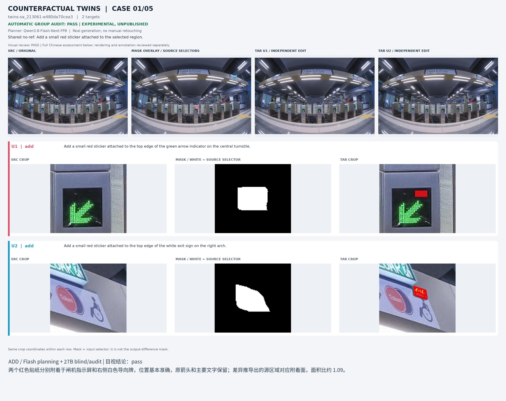
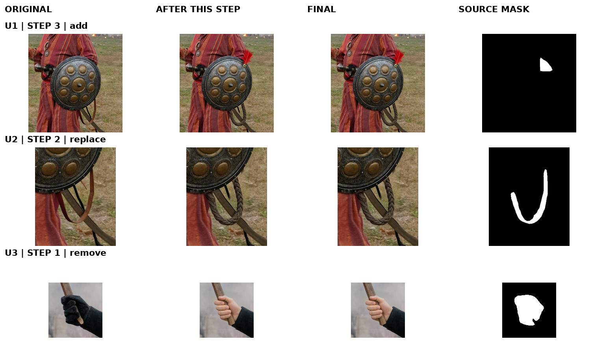
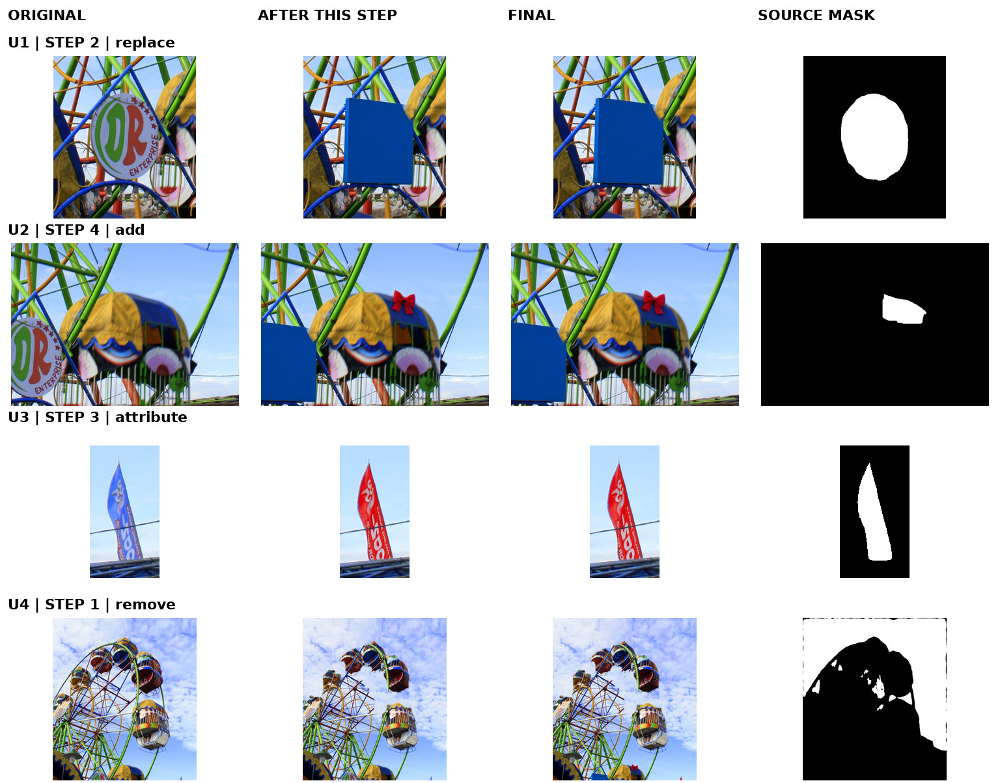
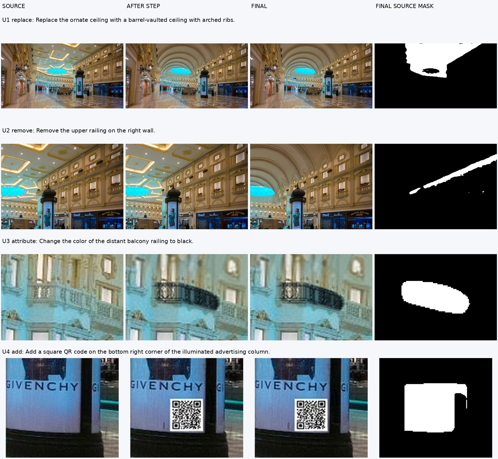
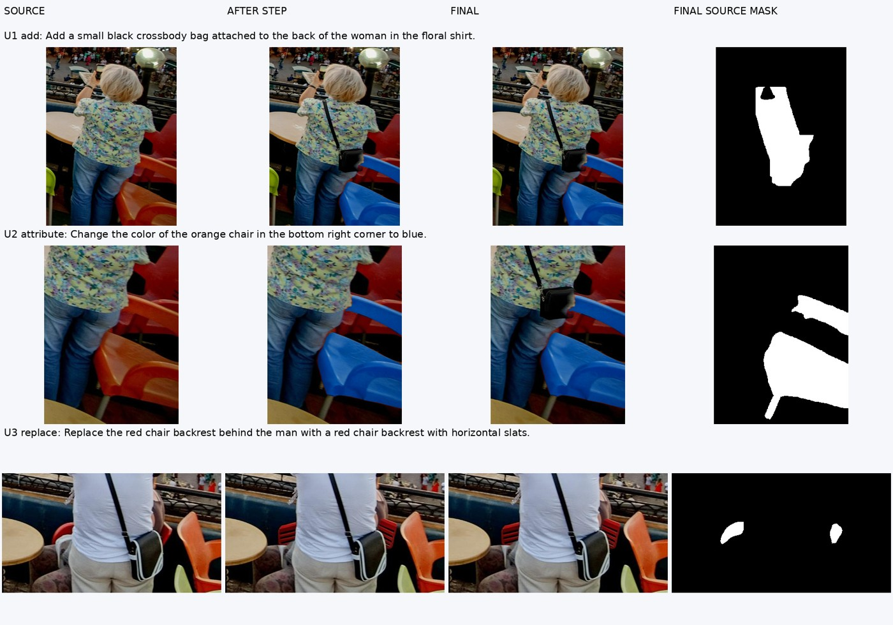
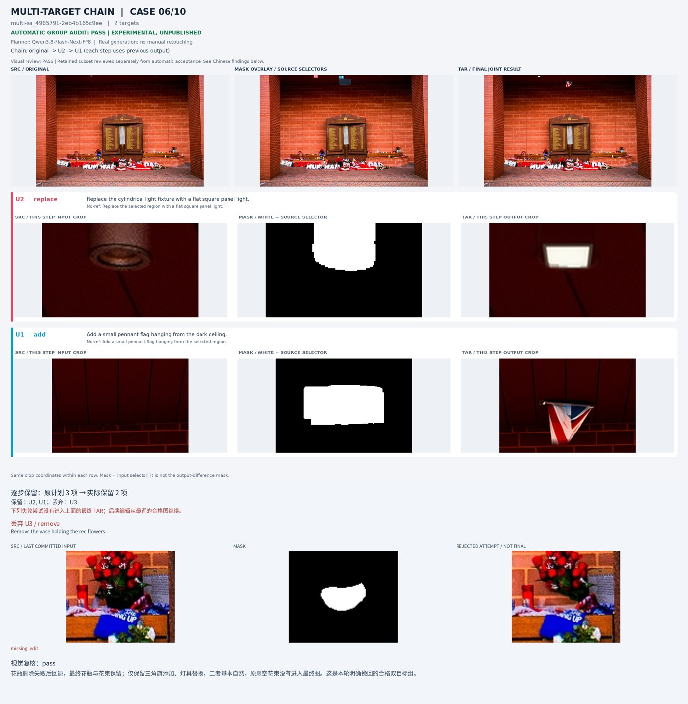
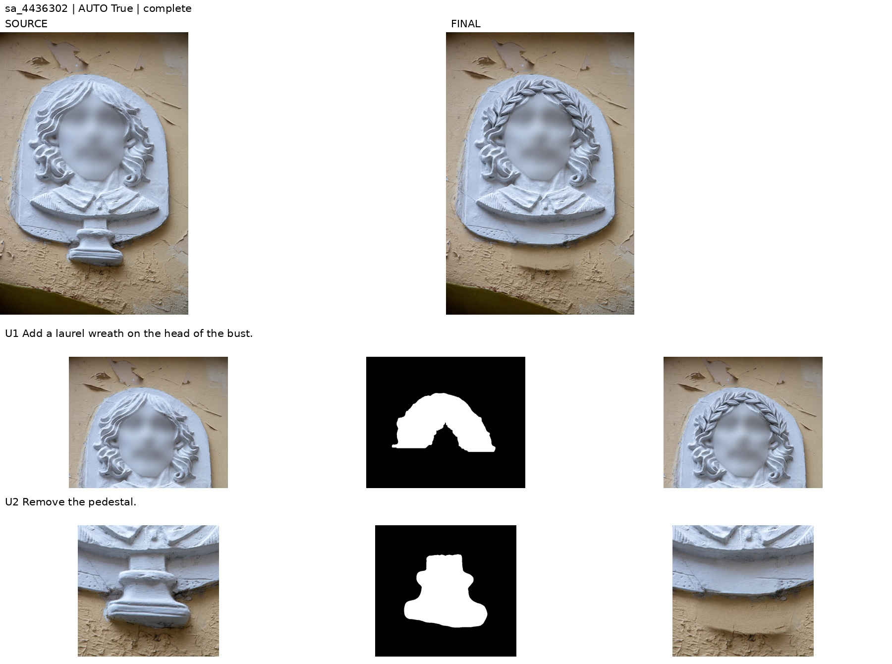
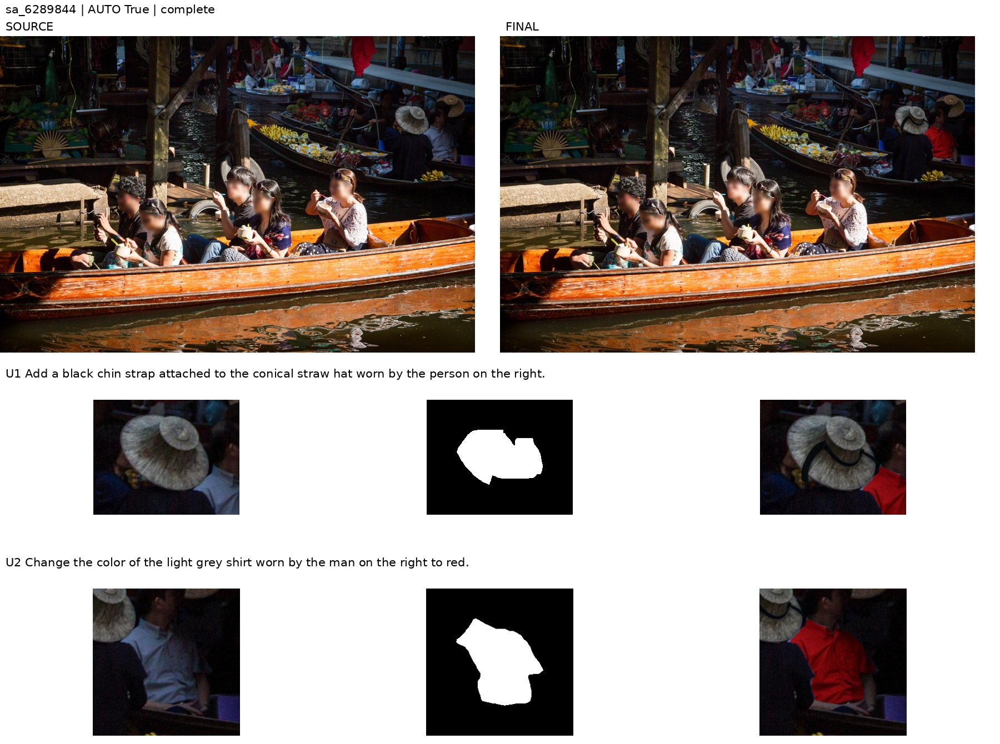

# 当前 SA-1B 标注管线

> **按链路整理的主文档（2026-10-28）**：本文按时间记录方法细节和对照实验，内容很长。要了解某条数据链路的现状、设计、代码、结果和示例，请先看：
> - 孪生 ＋ 多目标：[TWINS_MULTI_ZH.md](TWINS_MULTI_ZH.md)（四机生产已完成）
> - 单目标 v2.1：[SINGLE_TARGET_ZH.md](SINGLE_TARGET_ZH.md)
> - 单目标 50k：[DATASET_50K_ZH.md](DATASET_50K_ZH.md)
>
> 下文“当前计划”“还没有提交”等说法是写作当时的状态。

## 四机生产实现：孪生 ＋ 多目标（2026-10-25；当前计划孪生约 2.5 万个样本、多目标约 10 万个样本）

报告：`/opt/tiger/tanyue/visualization_tmp/production_4node_20261025/四机生产实现与时间估计.md`。运行方式和入口指令见 [四机指南](FOURNODE_RUN_GUIDE.md#入口指令)。

**为什么要新的源图池**
- 已准备的源图池（约 1 万张可用）远远不够。孪生的新增最稀缺：每张图只有约 7–8% 能组成新增孪生组，组的通过率约 0.32。每台要扫描约 13 万张图。
- HDFS 上随机读每秒约 15 张；整片顺序读快得多（单片 16 路并发约 66 MB/s）。

**新增代码**
- `sa1b_pipeline/shard_feeder.py`：整片读入 SA-1B 图像和标注（同序号的分片键完全相同），转换与 `production_sources.materialize` 一致（`materialize_records`）。还写出能通过分数和面积预筛的类别，只有这些需要打标签。
- `sa1b_pipeline/production_pool.py`：每个 rank 一个源图池。按固定分片顺序，按需读入 → 27B 判断新类别可编辑性（不思考，空闲 GPU）→ 计算菜单。没有 HDFS 时等待 `prefeed`。
- `evidence_selection.menu` / `image_menu`：每张图能为哪种操作组成孪生组（精确：`select_twin` 按操作逐个尝试），多目标能用哪些操作（预测）。
- `scripts/select_evidence_groups.py --menu-dir --workers`：生产选样。
  - 孪生按剩余需要分配本波每种操作的组数（`twin_allocation`），稀缺操作先取图；多目标用剩下的图。
  - 只含已满操作的多目标组不选。
  - 行由 `select_twin` / `select_multi` 并行构建，按提交顺序应用，结果与时序无关。
- `scripts/run_evidence_waves.py`：
  - 完成的波次计数缓存在 `counts.json`，逐波累加；
  - `--multi-groups`：多目标按组数设目标；
  - `--wave-budget`：每波按 GPU·秒分配孪生和多目标；
  - `--before-wave-json`：每波选样前准备源图池；
  - 多目标均衡导出在组多时按组合类型精确求解（整数规划，`_typed_multi_export`；5 万组 0.15 秒）；
  - `--stop-gap`：最后只差 1–2 个单位时不再开新波次（用户选择的省时间办法）。
- `scripts/run_dual_validation.py`：
  - `--planning-view-workers`：规划图多进程准备，结果相同。生产规模一波的孪生规划图串行要 422 秒，期间规划卡空闲；16 进程 41 秒。
  - `--coordinated-quotas`：多目标规划不再做单波操作均衡检查，由波次协调器跨波均衡。
- `scripts/run_evidence_production_4node.py`：`prepare / bundle / node / prefeed / status / merge / recover-lock`。
- `scripts/evidence_production/launch_4node.sh`、`setup_extras.sh`。

**测试**：`tests/test_production_selection.py`（菜单与 `select_twin` 一致、并行选样与进程数无关、分片读取、源图池需求、并行规划图与串行相同）；`tests/test_evidence_waves.py` 新增类型化导出与精确搜索目标一致、计数缓存、组数目标、每波预算。

**单机冒烟**（`02_production_runs/sa1b_samtok_group_twins50k_multi100k_20261025/planning/smoke2/`，`world_size=1`，经 `launch_4node.sh` 启动）
- 第 1 波按生产规模：孪生 227 组、多目标 149 组。全波 3,488 秒，GPU 平均忙 90%（规划 88%、编辑 96%、审核 96%）；完整出图 3–5 的小波次只有 42–53%。
- 自动通过：孪生 89 组（选样的 39%），多目标 83 组、213 个目标（选样目标的 47%）；另保留单目标 57 个。没有做助手盲评，管线各阶段与完整出图 5 相同。
- 第一片源图池：读入 540 秒，36,907 个新类别标签 641 秒，菜单 446 秒。
- 时间估计（`planning/eta.py`）：当前计划（孪生约 2.5 万个样本、多目标约 10 万个样本）四台独占节点约 2.0 天（1.8–2.1），本机 GPU 与他人进程共享，直接换算 3.3 天；原计划（孪生 5 万组、多目标 10 万组）约 5.6 天。
- 冒烟后的唯一改动：`multi_target` 同时参考导出本身每组的目标数（冒烟中原算法只导出 98/100 组）。

## 管线层面收尾：调度、规划规则与无效尝试（2026-10-25，第七轮）

报告：`/opt/tiger/tanyue/visualization_tmp/audit_verifier_pasted_20261024/验证报告_第七轮.md`。新增开关都是可选。

**采用**
- `--priority-scheduling`（`inference_services.py`、`inference_worker.py`）：多目标的编辑和审核请求带优先级（依赖链先做），请求派给未完成请求最少的卡。只改顺序。完整出图 4 第 1 波同一批规划：生成阶段 427→370 秒，编辑卡利用率 65%→77%，交付结果相同。
- `--evidence-gate-viewpoint`（`evidence_gates.VIEWPOINT`）：新增的照片若为高空俯视，规划阶段放弃。216 个已标注新增中判为俯视的 4 个：不合格 3、小瑕疵 1。
- `--skip-grayscale`（`evidence_selection.is_grayscale`，选样阶段）：跳过黑白照片（约 0.5%）。

**试过不采用**（代码保留，不推荐）
- `detail_restore`、`detail_transfer`（`edit_finish.py`）：恢复可写区域内只被重采样的原图细节。24 对盲评：10:9（5 对无差别），4:4（16 对无差别）。
- `--generation-retry`（`twin_streaming.retry_plan`）：被拒孪生组失败成员换种子重试一次。7 组中重试 5 组，通过 1 组且保留了不合格成员。
- `--reader-retry`（`per_mask_planning`）：读者核验失败带反馈重新规划一次。5 个救回 2 个多目标目标，孪生 0 组，规划 +9%。
- 景深匹配重新校准：贴图感样本与合格样本的清晰度差相同（中位 0.01 / 0.15 px），问题在亮度和饱和度，未做。

**新图完整出图 5**（助手盲评，3 波 1515 秒）：交付 77，合格 65%，含小瑕疵 96%，不合格 3（均在多目标组）；另保留单目标 21 个，无不合格。

## 出图效率：并发、卡位、余量、核验分档（2026-10-24，第六轮）

报告：`/opt/tiger/tanyue/visualization_tmp/audit_verifier_pasted_20261024/验证报告_第六轮.md`。新增开关都是可选；规划服务提前加载、均衡导出精确搜索、下一波缺口按可导出数计算直接生效。

**速度（`scripts/run_dual_validation.py`、`scripts/run_evidence_waves.py`）**
- `--concurrent-kinds`：孪生和多目标同时规划、同时生成，共用服务；每类规划各用一个 selector，计时线程安全。
- `--planner-devices 0,1,2,3,4,5,6,7`：规划 8 个 TP=1 副本。
- `--audit-devices 5,6,7`：审核 3 卡，编辑用其余 5 卡（加核验后审核是瓶颈）。
- `--selection-margin 1.25`（首波）、`--fill-margin 2.0`（后续波次）：多选以少跑一波；台账记录每波余量。
- 规划服务在准备规划图之前开始加载（`planners.start()`）。
- `--audit-verifier split`（`edit_verifier.SPLIT`）：删除和替换思考 512，新增不思考，改色不核验。939 个已标注出图离线：拦下视觉不合格 28/62（全部思考 29），误拒合格 9/634（全部思考 11）。
- 均衡导出 `multi_export`：多目标组整组导出，精确搜索使各类型最少的数量最大（其次总数、超额、组数）；下一波缺口按可导出数计算。完整出图 2/3/4 重新导出 53/54/52 → 55/58/58 个目标。
- 新图完整出图：完整会话 2178（完整出图 2）→ 1495（3）→ 1241 秒（4，2 波）；整体 GPU 利用率 25% → 42% → 53%；每个合格交付目标 54.5 → 33.2 → 17.5 秒。

**质量（可选）**
- `--evidence-gate-medium`（`evidence_gates.MEDIUM`）：新增的选区是画面里的内容或雕塑时不做新增。离线：被判非真实的新增 11 个中，不合格 3、小瑕疵 5。完整出图 3、4 没有交付“画里”的新增。
- `--garment-extent-check`（`content_guard.garment_extent`）：短裤或短裙换长裤或长裙时，规划阶段放弃。完整出图 1–4 中这类替换不合格 4/6。
- `audit_reconcile` 第 3 版：审核给出的 Ref 改写过不了指令改写校验时，不采用，规划读者通过时保留原 Ref（完整出图 4 中一个孪生组因此被误拒）。
- scope 规则（第 2 版）新图独立验证：改判 5 个，合格 4、小瑕疵 1、不合格 0。

**试过不采用**
- 新增尺寸核验（27B 估计新增物应有的框）：偏大样本与合格样本的预测与实际尺寸比值重叠很大，航拍稻草人的预测框比实际还大。

**新图结果**（助手盲评，不同图）
- 完整出图 3：组内交付 60，合格 75%，含小瑕疵 93%，不合格 4。
- 完整出图 4：组内交付 88，合格 81%，含小瑕疵 100%，不合格 0；主审核拒绝的 3 个目标里有全部 2 个不合格。

## 单目标保留、审核疑虑核对（2026-10-24，第五轮）

默认管线不变，以下都是可选开关。报告：`/opt/tiger/tanyue/visualization_tmp/audit_verifier_pasted_20261024/验证报告_续.md`。

**单目标保留（`run_dual_validation.py --keep-singles`，`sa1b_pipeline/single_salvage.py`）**
- 孪生组没有整组交付时，自身确定性检查、选区解析、跨成员保护、主审核和核验都通过的成员，写入 `singles.jsonl`。
- 多目标组最后只剩一个合格目标时，写入 `singles.jsonl`。
- 因组级检查失败而不送审的孪生组，开启后仍送审，以便成员单独保留；只剩一个目标的多目标组也仍送审。
- 波次汇总导出 `final/singles.jsonl`，不计入孪生和多目标的类型均衡。

**审核疑虑核对（`--audit-ref-reconcile`，`sa1b_pipeline/audit_reconcile.py`，audit-ref-reconcile-2-scope）**
- 审核质疑 Ref 唯一性：有改写就让读者（不思考的短调用）检查改写，只找到一个目标且在选区上才采用；否则规划读者通过了同一 Ref 就保留原 Ref。
- 审核判“选错对象”但同一回答图像合格、操作正确：规划读者通过了同一 Ref 时，改记为提示。
- 对照出图：合格被误拒 13/226 → 3/226，不合格放行 0。scope 规则是看到 9 个样本后加的，待新图验证。

**试过不采用**
- 编辑器收尾选项 `lighting_rule`（阴影或逆光处的新增和替换加光照提示句）：60 对同种子对照，合格 36 对 36。
- 核验器 v4（针对漏判加 5 个问题）、同一样本采样审两次：都没有提高视觉可见不合格的拦截，误拒上升。

## 审核核验与贴图感（2026-10-24，第四轮）

默认管线不变，以下都是可选开关。报告：`/opt/tiger/tanyue/visualization_tmp/audit_verifier_pasted_20261024/验证报告.md`。

**审核核验（`run_dual_validation.py --audit-verifier off|nothink|describe|think512`，`sa1b_pipeline/edit_verifier.py`）**
- 只在主审核通过后起作用，只拒绝不放行。每个目标一次调用，两张图：整张结果 + 放大对照（原图描黄色选区 | 同尺度结果）。
- 按操作类型问 5–7 个是/否问题；硬问题为“是”即拒绝，软问题（像贴图、半个物体变色、平涂）只记录。
- 孪生在 `twin_compact_audit.audit`、多目标在 `multi_component_audit.audit_component` 接入：核验任务与主审核同批提交，判定只会让主审核通过的目标变为不通过；审核记录写入核验版本。
- 评测（助手标注 556 个出图 + 新图完整出图）：
  - 现有审核在 302 个未经筛选的对照出图上只拦下 40% 的不合格，误拒 6% 的合格；
  - 加核验后：新图主审核放行的目标中不合格被拦 4/8、合格误拒 0/50；上一轮交付（test）3/8、0/88；
  - 不思考版离线拦截率相当、速度快约 3 倍，但未做完整出图验证。
- 代价：孪生要求整组通过，同组合格成员会一起丢掉；完整出图（核验串行时）审核等待 45→122 秒/组，审核卡工作量约翻倍。

**贴图感（`--edit-finish` 预设）**
- `focus_match` 替代 `defocus_match`：锚点外沿、新物体尺度的周边、替换时的旧物三个参考中至少两个可用，取最小的模糊；参考 ≥0.8 px 且新物体至少清晰 0.3 px 才补模糊。
- 离线盲评：可见差异（≥0.8 px）中偏好补模糊 14、原图 3；新图完整出图只触发 2/46。
- 试过但放弃：按光照判断限亮度（shade_match），69 个阴影位置只触发 3 次，漏掉了逆光的典型样本；代码留在实验目录。
- 未解决：阴影或逆光处的新增（合格 58%，受光处 72%），问题在饱和度和高光，不在边缘清晰度。

## 删除残留、新物体质感、阴影改色、add 接受率（2026-10-23，第三轮）

默认管线不变，以下都是可选开关。

**编辑器收尾（`run_dual_validation.py --edit-finish`，`sa1b_pipeline/edit_finish.py`、`removal_effects.py`）**
- 删除：SAM3 用 "shadow" 和 "reflection" 提示找候选，按规则判断是否属于目标，再把投影和倒影并入可写范围；生成提示补一句一并删除。
  - 投影：与目标接触、不在上方、更暗、面积不超过目标 2.5 倍。
  - 倒影：在水线下的镜像位置，并落在水面上。
  - 多目标在生成前确定这块区域。
- 其他收尾：删除提示句、补颗粒、新增外杂散清理、景深匹配（周围失焦时给新物体补模糊）。
- 试过不采用：
  - 色调对齐：在天空留下云形痕迹；
  - 亮度锁定：已删除；
  - 放大上下文裁剪：替换偏好 5 : 2 反对；
  - 材质提示句：保留为单独选项 `material_rule`，默认不用。

**规划与选目标**
- `--evidence-gate-lighting`：改色只保留受光部件。
- `--replace-retry`：被判为只改外观的替换重新规划一次，重走全部核验。
- `select_evidence_groups.py` / `run_evidence_waves.py` 的新开关：
  - `--twin-members-add 4`；
  - `--worn-check`：不删人身上的鞋、帽盔、手套、主要衣物；
  - `--covering-check`：不删盖在物体上的雪、苔藓、盖布；
  - `--no-surface-recolor`：天空、水面、地面不改色。
- 选目标的间隙检查计入可写外扩；孪生 add 按锚点面积配对。
- 表盘类新增物（钟、表、仪表等）OCR 允许数字。
- `--evidence-gate-add-site`（放宽 add 核验）不推荐：实际出图放进来的组质量差。

**编辑器对照**（同规划、同种子，151 对，助手盲评）
- 检测到投影或倒影的删除 13 对：不合格 4→2，偏好 3 : 2 倾向新编辑器。
- 其余类别基本持平。
- 替换 60 对中，放大裁剪和材质句无益，已从预设中去掉。
- 光照判断离线：抓到 5 个提亮问题中的 4 个，代价是约 30% 的改色候选被丢掉。

**新图完整出图**（最终配置，74 个交付目标）
- 合格 74%，含小瑕疵 95%，不合格 4：
  - 删除没有执行而审核漏判；
  - 新增时重画了已有物件；
  - 删除部件后悬空；
  - 戒指过大。
- 四个目标问题在交付结果中都是 0。
- 孪生 add 接受率 0.22→0.57，大部分属于样本差异；生成后的主要失败是两成员新增物大小相差太大。
- 完整会话 1871 秒，每个合格目标约 34 秒（上一轮约 37 秒）。
- 中间配置的一次完整出图：合格 58%，暴露的问题促成了覆盖层和地表两条规则，以及放弃放宽 add 核验。

新增 19 项测试；全量 787 通过，1 项为既有失败。协议与 benchmark 逐字节一致。

[中文报告](/opt/tiger/tanyue/visualization_tmp/clean_edit_quality_20261023/验证报告.md) · [最终配置 PDF](/opt/tiger/tanyue/visualization_tmp/clean_edit_quality_20261023/完整出图_最终配置_74目标.pdf) · [编辑器对照 PDF](/opt/tiger/tanyue/visualization_tmp/clean_edit_quality_20261023/编辑器收尾对照_115对.pdf)。实验目录：`/mnt/bn/strategy-mllm-train/user/tanyue/experiments2/SAMTokEdit/data_pipeline/04_current_validation/sa1b_clean_edit_quality_20261023/`。

## 文字正确、删除不悬空、按接受量均衡（2026-10-22，第二轮）

默认管线不变，新增三项可选功能：
- ①文字：规划输出 `text` 槽（`--explicit-text`），带字物品必须给出 1–3 个英文词并渲染为 `reading "..."`，不带字物品保持素面；生成时追加文字规则；编辑器用 RapidOCR 核验（`--text-verify`，`text_verification.py`），不通过就换种子重试，最多 3 次，仍不通过即否决。字形工具（`text_edits.render_glyphs`）能让字更对，但画面像贴片，默认关闭。
- ②支撑：`support_graph.py` 用 SA-1B 稠密分割判断删除/替换某目标后是否有已分割邻物失去支撑（rests_on / hangs_from / embedded / attached，仅限能承托东西的类别），有依附物的目标不分配 remove/replace。
- ③均衡：`scripts/run_evidence_waves.py` 按每类实际接受量和实测接受率分波补选，最后导出均衡子集。

文字对照（55 个新图目标，助手判定）：
- 加牌子文字正确率：原生成 70% → 文字规则 + OCR 重试 85%。
- 改字文字正确率：81% → 89%。
- OCR 通过的输出中，文字正确率为 95–96%。
- 纯字形工具文字正确率 85%，但自然的只有 7%。

删除对照：有承托风险组 4/14 出现悬空，无风险组 0/14；4 个悬空都被检查标记。代价是排除了约 9% 原本合格的候选。

完整出图（3 波，58 个交付目标，助手盲评）：
- 合格 74%，含小瑕疵 98%，不合格 0。
- 5 个文字编辑全部写对；删除和替换中 0 悬空。
- 交付类型 15/15/13/15；导出孪生 4/4/4/4 组、多目标目标 6/5/5/6。
- 每个合格目标约 37 秒，主要成本是孪生 add 接受率低（0.24）。

新增 8 项测试；全量 762 通过，1 项为既有失败。协议与 benchmark 逐字节一致。

[中文报告](/opt/tiger/tanyue/visualization_tmp/text_support_balance_20261022/验证报告.md) · [完整出图 PDF](/opt/tiger/tanyue/visualization_tmp/text_support_balance_20261022/完整出图_文字支撑均衡_58目标.pdf) · [文字对照 PDF](/opt/tiger/tanyue/visualization_tmp/text_support_balance_20261022/文字编辑对照_55目标.pdf) · [支撑对照 PDF](/opt/tiger/tanyue/visualization_tmp/text_support_balance_20261022/删除支撑对照_28目标.pdf)。实验目录：`/mnt/bn/strategy-mllm-train/user/tanyue/experiments2/SAMTokEdit/data_pipeline/04_current_validation/sa1b_text_support_balance_20261022/`。

## 元数据选目标 + 证据核验：完整出图对照（2026-10-22）

默认管线不变；新增两个可选环节。①`scripts/select_evidence_groups.py`（`sa1b_pipeline/evidence_selection.py`）在规划前用 SA-1B 配套稠密标注选（mask, 操作）：类别级操作适配度每个类别一次文本调用并缓存，只分配 natural 组合；排除低 score、同类碎片、相似同类竞争实例过多、人物物体混合别名和极端面积；孪生默认多选第三候选（`twin_keep=2`）。②`run_group_pipeline.py --evidence-gates`（`run_dual_validation.py --evidence-gates` 透传，`sa1b_pipeline/evidence_gates.py`）在程序检查后做三道独立核验：读者只看干净全图和 Ref 框出所有匹配对象且全部落在目标 mask 上（IoU≥0.5）、Ref 头部实体与配套类别一致、replace 内容不只是外观变化。核验复用常驻规划服务并按请求关闭思考（`mllm.py`、`inference_services.py`、`inference_worker.py` 新增 `thinking=[False]` 透传），不改 mask 和指令，只丢弃。

新图两臂各 16 孪生组＋12 多目标组完整出图（27B v13.8 规划、Qwen-Image-2.1 40 步、packed-components-v4 审核）；多目标两臂同图，孪生基线为训练池另一批新图。65 个交付目标混合随机编号后助手盲评再解盲：新方案合格 26/33（79%），含小瑕疵 31/33（94%）；当前方案 19/32（59%）、23/32（72%）。孪生两成员都合格 6/6 vs 3/6；多目标保留项全部合格（含小瑕疵）7/8 vs 1/7。完整会话 817 vs 767 秒，生成 46 vs 59 张图，每个合格目标约 31 vs 40 秒；核验占规划服务 GPU 时间约 20%。被核验丢弃的 16 个计划中可用 3 个（非盲判定）。样本小、复核者为助手本人，暂不切换默认，也不宜无人复核放量。

此前证据：1,200 条历史复核记录离线回放，程序接受后精度 47.7%→加核验 69.9%→再加适配度 72.8%；2026-10-21 规划阶段 113 目标盲评 35%→54%（只加核验）→69%（只换选目标）→79%（两者）。编辑价值复核器、读者包含式放宽离线无收益，未采用。实验后补充 remove 面积≤2%、add 孪生同类且面积比≤2、孪生可写间隙预检，尚未经完整出图验证。残留：add 文字类附加物出现乱码、删除承托物不查依赖、装饰性 add、类型偏 attribute（配额尚未按接受量反馈）。新增 5 项测试通过；全量 754 通过，1 项为既有失败（`test_group_mask_planning` 的 prompt 文字断言）。协议与 benchmark 逐字节一致。

[中文报告](/opt/tiger/tanyue/visualization_tmp/evidence_gate_20261022/验证报告.md) · [85页对照PDF](/opt/tiger/tanyue/visualization_tmp/evidence_gate_20261022/完整出图对照_两方案65目标+被丢弃16计划.pdf) · [规划阶段报告](/opt/tiger/tanyue/visualization_tmp/evidence_gate_20261021/验证报告.md)。实验与复现：`/mnt/bn/strategy-mllm-train/user/tanyue/experiments2/SAMTokEdit/data_pipeline/04_current_validation/sa1b_evidence_full_20261022/`、`.../sa1b_evidence_gate_20261021/`。以下为历史章节，默认状态以本节为准。

## 三阶段规划诊断与微调试验（2026-10-21）

当前默认保持27B `v13.8`，每mask原两图一次规划。本轮依次完成准确身份诊断、DAM原生mask辅助和小规模LoRA，未修改生产、审核或正式数据。旧48目标原规划直接合格20，提供人工准确身份后29，锁定准确Ref后28；这是诊断条件，不是自动管线成绩。DAM旧诊断仍20。

65条/27源图、2epoch文本层LoRA完成，训练热态362.27秒；新8孪生＋8多目标48目标与训练源图ID及图像哈希无交集。隐藏方案名复核192回答后：原27B20/48（孪生8/16、多目标12/32）、关闭思考20/48（9/16、11/32）、LoRA17/48（8/16、9/32）、DAM辅助22/48（7/16、15/32）。没有候选达到默认替换标准。LoRA更短但指代遗漏增多；DAM会传播识别和OCR错误。

同进程batch8热态分别316.39/55.59/62.01/321.84秒，DAM另71.84秒；加载/暖机另计。这是规划吞吐，不能外推完整生图速度。关闭思考约5.69倍吞吐，但定位问题16→20项、孪生整组合格3→2，暂仅速度候选。规划确定性检查可用47/46/47/47，不是语义或图像审核通过率。多目标全部保留项合格均0/8，仍不宜无人复核放量。

完整方法、错误实例、调用统计与下一步见[中文报告](/opt/tiger/tanyue/visualization_tmp/oracle_region_sft_20261021/验证报告.md)。全部新图：[孪生8组PDF](/opt/tiger/tanyue/visualization_tmp/oracle_region_sft_20261021/独立新图_孪生8组.pdf)、[多目标8组PDF](/opt/tiger/tanyue/visualization_tmp/oracle_region_sft_20261021/独立新图_多目标8组.pdf)；人工身份诊断：[孪生](/opt/tiger/tanyue/visualization_tmp/oracle_region_sft_20261021/诊断_孪生8组.pdf)、[多目标](/opt/tiger/tanyue/visualization_tmp/oracle_region_sft_20261021/诊断_多目标8组.pdf)。归档及adapter：`/mnt/bn/strategy-mllm-train/user/tanyue/experiments2/SAMTokEdit/data_pipeline/04_current_validation/sa1b_oracle_region_sft_20261021/`。协议与benchmark逐字节一致。本轮仅规划，无新TAR。

后续优先补齐区域—实例—操作的高可信正负监督与正确拒绝，按源图独立验证，检验区域/视觉连接层适配。65条小试不代表充分训练上限；当前不继续默认增加caption或补调调用。下面保留历史方法结果，默认状态以本节为准。

## 27B v13.8：有预算定位补调与源mask宿主依赖（2026-10-21）

默认仍为27B、原prompt/schema、每mask两图一次调用。`content_guard.py`拦截明确整人单色填色及新增人物角色的身体删除/替换；`host_conflicts.py`结合明确所属关系与源mask包含证据，排除删除宿主却编辑其部件的冲突，不以相邻或执行范围重叠拒绝。912条回放新增拦截8条已确认错误，无新增已判good误拒；249测试通过，协议与benchmark逐字节一致。正式数据和冻结生产入口未修改。

`reference_alignment.py`使用全部SAM候选：存在相容候选就不因最高分候选分歧补调。既有可选`--reference-alignment-repair`默认关闭，现在由`per_mask_planning.py`限制为批次25%额外预算、扣除截断重试，每目标最多一次；修正后复查，不移动mask，不将SAM结果当语义通过/拒绝。`bounded_operation_recovery.py`实现实验用原子换类型和依赖回滚，尚未默认启用或接入生产接受配额循环。

旧48目标直接基本合格23→26；新8孪生＋8多目标48目标20→21，其中孪生8/16不变、多目标12/32→13/32。新图定位补调没有直接合格收益；看到失败后的同批5次换类型探索只有1项明确改善。程序可用43→47不代表质量提高4项。主要残留是同类实例指错、Ref不唯一、操作不自然；整体仍未基本过关。新图热态原规划237.71秒，SAM及6次补调后阶段合计333.24秒，慢约40%，不能默认采用。没有新目标图或新审核对照，未宣称完整管线通过率改善。

[中文报告](/opt/tiger/tanyue/visualization_tmp/alignment_gate_20261021/验证报告.md) · [孪生8组PDF](/opt/tiger/tanyue/visualization_tmp/alignment_gate_20261021/孪生8组新图规划对照.pdf) · [多目标8组PDF](/opt/tiger/tanyue/visualization_tmp/alignment_gate_20261021/多目标8组新图规划对照.pdf) · [旧例修复PDF](/opt/tiger/tanyue/visualization_tmp/alignment_gate_20261021/旧例修复对照.pdf)。归档：`/mnt/bn/strategy-mllm-train/user/tanyue/experiments2/SAMTokEdit/data_pipeline/04_current_validation/sa1b_alignment_gate_20261021`。以下为历史结果，当前状态以上述为准。

## 27B v13.6：首轮输入与盲观察对照，修复词法误拒（2026-10-20）

当前工作版`per-mask-grounded-content-13.6-target-head-text-noop`保持27B、原prompt/schema、默认两图输入与原审核，不增加默认调用。`content_guard.py::incompatible_edit`修正“bag held in the hand”把地标hand当目标的误拒；`unchanged_declared_text`与`per_mask_planning.py::combine`拒绝明确把原文字改成同样文字的text提案，不推测OCR。真正人体删除仍拒绝，定位地标上的文字不作为目标原文字。

新20孪生＋20多目标，共120目标，两输入各一次调用：原输入直接基本合格51/120、双栏56/120；孪生18/40→21/40，多目标33/80→35/80。15项改善、10项退化；程序可用112/120→119/120并不代表语义合格。孪生整组5/20→7/20，多目标程序保留项全部合格均仅1/20，未达到自动放量标准。热态626.67→612.35秒；排除含截断的首组成对批后双栏反慢2.2%，无稳定加速证据，候选不改默认。

12组旧目标图28项审核对照：原审核合格误拒3/15、坏例拦截5/11；完整盲观察＋文本比较对坏例给出5支持/4矛盾/2证据不足，精简版6/1/4。支持不是通过，部分矛盾理由也看错图；两候选不能核验Ref唯一性，耗时分别392.20/232.26秒，为原172.41秒的2.27/1.35倍，均不采用。样本故障富集，不是生产通过率。首个非逐字相同控制保留作探索，主表另重跑精确基线。

720条规则回放恢复1项正确袋子删除、增加拒绝1项无效改字，其余状态不变，无新增已判good误拒；199测试通过，协议与benchmark逐字节一致。没有新生图或生产更新，宿主冲突规则维持保守范围。完整病例、速度边界和下一步见[中文报告](/opt/tiger/tanyue/visualization_tmp/first_view_blind_audit_20261020/验证报告.md)、[孪生20组](/opt/tiger/tanyue/visualization_tmp/first_view_blind_audit_20261020/孪生20组规划对照.pdf)、[多目标20组](/opt/tiger/tanyue/visualization_tmp/first_view_blind_audit_20261020/多目标20组规划对照.pdf)、[12组审核](/opt/tiger/tanyue/visualization_tmp/first_view_blind_audit_20261020/12组审核对照.pdf)。实验归档：`/mnt/bn/strategy-mllm-train/user/tanyue/experiments2/SAMTokEdit/data_pipeline/04_current_validation/sa1b_first_view_blind_audit_20261020/`。以下为历史迭代记录，旧版“当前”描述以本节为准。

## 27B v13.5：定位证据、宿主冲突与审核对照（2026-10-20）

当前默认增加 `host_conflicts.py` 的明确宿主冲突检查、`grounding_evidence.py` 的源SAM范围疑点降级，以及 `content_guard.py` 的真实eye/eyes remove/replace检查。规划仍保持原两图与ref/edit输出，默认不增加MLLM调用；不移动mask来迎合错误Ref。明确删宿主/留附件时丢弃删除宿主项，继续检查其他目标，至少两项合格才发布。

`reference_alignment.py` 接入可选全图SAM＋最多一次定向规划修复：干净全图＋同一crop的上下文/选中像素双栏，孔洞和非选区明确划线。`run_dual_validation.py` 原完整命令追加 `--reference-alignment-repair` 可试用，规划阶段GPU5留给SAM，planner-devices不可包含5；尚未默认启用。8个诊断目标中3个触发：普通补调修好1个，明确排除像素后修好2个，另1个识别眼部但仍想替换成墨镜，被规则拒绝。不是新生图验收。SAM 8次共2.73秒，加载3.62秒；补调耗时记录不完整，不报吞吐。

复用孪生6组12项、多目标6组16项真实目标图，先目视记录15项基本合格、11项不合格、2项Ref待修。正式审核基线误拒2/15、拦截5/11；精简版0/15和0/11；精简去结论提示版0/15和2/11；原prompt简化测量输入版2/15和4/11。三个候选均不采用，保留旧审核语义标准及输入呈现；源SAM疑点仍在程序层降级。旧审核本身仍漏检，不能据此无人复核放量。上述是故障富集的目标级诊断，不是完整生产通过率。

基线12组审核热阶段167.81秒，3并发均摊14.0秒/组，加载74.77秒、暖机33.40秒另计。精简版快5.5%但漏检更多，未采用。96条组规划回放拦截两份已确认宿主冲突；480条规则回放新增拦截2条不合格指令，无新增已判good误拒。158项相关测试通过；协议与benchmark逐字节一致。未生成新目标图、未改正式数据或冻结入口。

[中文报告](/opt/tiger/tanyue/visualization_tmp/alignment_dependency_audit_20261020/验证报告.md) · [17页PDF](/opt/tiger/tanyue/visualization_tmp/alignment_dependency_audit_20261020/审核对照与定位修复.pdf)。原始记录：`/mnt/bn/strategy-mllm-train/user/tanyue/experiments2/SAMTokEdit/data_pipeline/04_current_validation/sa1b_alignment_dependency_audit_20261020/`。以下章节保留历次配置与结果，不代表当前默认。

## 27B v13.3：可行性提示词对照与属性值检查（2026-10-20）

当前默认是 `per-mask-grounded-content-13.3-attribute-value-guard`：27B、原提示词/schema、默认两图输入、每mask一次调用。仅新增 `content_guard.py::attribute_value` 的非text命令句检查，防止把“change the red side panel to blue”当color值后产生重复句式和源部位泄漏；不自动提取颜色改写语义。字面text不受影响。

同一48目标（8孪生＋8多目标；各含4回归＋4新图）试验同次调用“先判断操作可行性”的精简prompt：直接基本合格20/48→14/48，新图11/24→9/24；不合格提案20→10，但新增明确误拒11条。候选未采用。程序接受45/48→28/48只是规划解析结果，不是生图终审率。个别支撑/身体删除被正确拒绝，但独立挡泥板、可替换立柱、积木鼻子等被错误套用限制。白气球/下巴、桌面/手机孔洞等绑定问题仍在。

48目标热态272.29→257.66秒，表面快5.4%；原版含一个截断长批，排除成对批后候选反慢7.6%，不能声称稳定加速。两侧各48正式调用，无重试；加载72.83秒、暖机44.13秒另计。本轮仅规划，没有新target图。

v13.3的480条新旧输出回放约0.198秒，只增加拦截1条已确认错误（来自候选prompt），此前目视good项无新增误拒；原默认prompt本轮结果不变。138项相关测试通过，protocol与benchmark逐字节一致。下一步优先针对具体候选矛盾、错位定位与删宿主/留附属物依赖，不继续统一加严拒绝。

[中文报告](/opt/tiger/tanyue/visualization_tmp/27b_decision_first_20261020/验证报告.md) · [孪生8组PDF](/opt/tiger/tanyue/visualization_tmp/27b_decision_first_20261020/孪生8组规划对照.pdf) · [多目标8组PDF](/opt/tiger/tanyue/visualization_tmp/27b_decision_first_20261020/多目标8组规划对照.pdf)。原始实验与复现：`/mnt/bn/strategy-mllm-train/user/tanyue/experiments2/SAMTokEdit/data_pipeline/04_current_validation/sa1b_27b_decision_first_20261020/`。PDF保留试验时状态，新增格式拦截独立留痕；正式数据与冻结部署未改。

## 27B v13.2输入对照与确定性检查修复（2026-10-20）

该轮采用 `per-mask-grounded-content-13.2-literal-reference-guard`（现由上节v13.3继承），保持原prompt/schema、默认深灰crop和每mask一次规划。`content_guard.py::complete_phrase`修复“letter A”被当作残句冠词的误拒；`appearance_only_replacement`补齐明确颜色词，防止turquoise头带/红色十字仅换颜色却被算replace。384条新旧输出回放恢复1条正确计划、多拦截2条不合格计划，本批已判good项无新增误拒；128项相关测试通过，协议2.0与benchmark逐字节一致。回放约0.175秒、无MLLM调用。

`per_mask_planning.py::render_context_crop`新增可复用实验绘图：深灰、原色、50%原色。后两项未进入默认路径。固定8孪生＋8多目标共48目标，各方案一次；两图、mask、crop、轮廓、schema和预算相同，均用同一中性图片说明。144正式请求＋4暖机。初始A/B隐藏文本方案名复核；后续50%原色为非盲探索。不是独立新图，也不能把中性说明的深灰对照等同于原intro的生产性能。

| 规划直接基本合格 | 深灰 | 原色 | 50%原色 |
|---|---:|---:|---:|
| 孪生目标 | 4/16 | 6/16 | 8/16 |
| 多目标目标 | 18/32 | 20/32 | 15/32 |
| 合计 | 22/48 | 26/48 | 23/48 |
| 48目标热态秒数 | 234.72 | 233.95 | 235.20 |

原色改善白气球/下巴，却反认桌面mask的手机孔洞；50%原色恢复桌面并改善部分手臂识别，但小车误认标牌、附翼误认塔楼，未出现统一优胜。输入版本均不升级生产。另有仅文字待修8/7/8条，未计为直接合格；约4.9秒/目标为batch摊销，不含加载/暖机。此次仅规划，无target图和完整生图通过率。

下一步在独立新图验证输入候选，并优先检验同一次规划中的操作可行性判断；不增加长prompt、解释字段或普遍重试。眼睛换太阳镜、删除屏幕/椅背等已识别却不合理的计划，不能靠放宽审核解决。

[完整中文报告](/opt/tiger/tanyue/visualization_tmp/27b_context_ab_20261020/验证报告.md) · [孪生8组对照](/opt/tiger/tanyue/visualization_tmp/27b_context_ab_20261020/孪生8组输入对照.pdf) · [多目标8组对照](/opt/tiger/tanyue/visualization_tmp/27b_context_ab_20261020/多目标8组输入对照.pdf) · [折中探索16组](/opt/tiger/tanyue/visualization_tmp/27b_context_ab_20261020/折中背景探索16组.pdf)。原始记录与复现位于 `/mnt/bn/strategy-mllm-train/user/tanyue/experiments2/SAMTokEdit/data_pipeline/04_current_validation/sa1b_27b_context_ab_20261020/`。PDF保留试验时状态；最终新增的错类拦截在 `guard_replay.json` 记录，原模型输出不改写。正式数据和冻结部署未变。

## 27B v13.1结构化字段修复（2026-10-20）

最终采用 `per-mask-grounded-content-13.1-lossless-original-prompt`：27B、原v12 prompt/schema、原两图输入，新增结构化字段完整性修复与保守错类检查。`content_planning.py::_convert`保留canonical spec；`minimal_planning.py::decode`按unit_id核验ref/operation/渲染结果，直接使用spec，避免“先渲染再解析”把site吞入payload。`content_guard.py::site`仅去除字面重复宿主，`per_mask_planning.py::combine`提前拒绝明确仅颜色/材质变化的replace，不静默改变类别。协议2.0与benchmark逐字节一致；mask和执行权限不变。

240条历史输出回放不调用模型，约0.18秒：修复2条no-ref泄漏（均来自上轮Flash对照输出），27B提前拒绝3条明确属性型replace；原先目视合格项无新增误拒。no-ref修复不代表对应计划的视觉/语义问题已修复。126项相关测试通过，含最终孪生成员与nested unit字段一致性。

另用27B在固定8孪生＋8多目标、48mask上试验更明确的add/replace规则：同输入、操作、schema和预算，每mask一次，无重试。两侧均用修复后的同一解析代码。直接基本合格孪生7/16→6/16、多目标19/32→17/32；新输出另有3项仅文字待修。多目标目视可挑出至少两项的组6/8→8/8，但全部规划保留项均合格的组2/8→0/8，未证实整体质量改善。**该试验prompt未采用，最终恢复原prompt**；120条原请求prompt/schema逐字核对一致。固定困难集、非随机独立测试，且批内组成变化造成控制项措辞波动，不能把所有变化都归因于prompt。

热态规划240.76秒（4.01分钟），批量摊销5.02秒/目标；加载66.05秒、2次暖机41.34秒另计。无新增Flash/SAM/Qwen编辑调用，无目标图生成，不能报告为完整出图通过率。下一步优先验证有条件的mask定位确认，解决气球/下巴、眼部/整脸、衣服/手机及密集竞争实例错误；不继续普遍加长prompt。

[中文报告](/opt/tiger/tanyue/visualization_tmp/27b_slot_integrity_20261020/验证报告.md) · [字段修复2例](/opt/tiger/tanyue/visualization_tmp/27b_slot_integrity_20261020/结构化字段修复2例.pdf) · [孪生8组规划对照](/opt/tiger/tanyue/visualization_tmp/27b_slot_integrity_20261020/孪生8组规划修复对照.pdf) · [多目标8组规划对照](/opt/tiger/tanyue/visualization_tmp/27b_slot_integrity_20261020/多目标8组规划修复对照.pdf)。实验与复现：`/mnt/bn/strategy-mllm-train/user/tanyue/experiments2/SAMTokEdit/data_pipeline/04_current_validation/sa1b_27b_slot_integrity_20261020/`。正式数据和旧冻结部署未改。

## mask修补与27B/Flash-Next规划对照（2026-10-20）

新增独立实验模块 `sa1b_pipeline/background_mask_refinement.py`：仅源图背景改色、双crop分割一致性、原图颜色/距离及其他目标保护约束；更新公开mask及几何，清除旧execution/support/grounding缓存，保留来源哈希。原图与原标注不变，尚未接入默认入口。固定船只例同计划/seed生成4张：修补增加原水面mask面积1.493%，栏杆后蓝色残留仍在，两版目视均不完整合格。自动审核由拒绝变通过不能证明质量改善，且两版grounding缓存状态不同。自动ROI另外增加1.074%，仅mask验证；16次SAM热态推理3.68秒，主要瓶颈是修补效果，不是分割本身耗时。

规划AB固定每模型20孪生组＋20多目标组、共120mask，四类各30目标；各数据含8回归＋12本轮新增源图。输入、v12 prompt、schema、操作、批量8和推理预算一致，每mask一次，不重试。240条提案先隐藏模型名逐图判断，再解盲：

| 指标 | 27B TP1 | Flash-Next FP8 TP4 |
|---|---:|---:|
| 孪生直接基本合格目标／两个成员合格组 | 22/40；9/20 | 19/40；6/20 |
| 多目标直接基本合格目标 | 44/80 | 37/80 |
| 多目标程序保留项全部基本合格组 | 4/20 | 0/20 |
| 多目标至少有两个基本合格项的组 | 15/20 | 15/20 |
| 合计直接基本合格／另有仅文字需修 | 66/120；3项 | 56/120；14项 |
| 120目标热态规划墙钟 | 587.80秒 | 1534.21秒 |

“至少两个基本合格项”是目视筛选后的潜力，不是自动管线已经正确筛选。含仅文字待修为69/120与70/120，接近；Flash局部replace有收益，但没有系统解决部件范围、歧义、自然性与blind协议污染。两模型均无有效顶层reject，程序可用率明显高于语义合格率。当前Flash墙钟2.61倍、占卡时间估算10.44倍；使用CPU offload/eager的本机部署且有共享负载，不能外推模型理论性能。保留27B，不升级生产。本AB仅规划，没有为40组生成目标图。

下一步先修site槽位与blind渲染边界、明显属性冒充replace，再对高风险mask增加有条件定位检查；真实漏选背景尝试源图正负点分割，不能通过扩大执行区掩盖错误。新增3项mask测试通过，相关52项回归通过；机械检查不代表语义质量通过。

[完整中文报告](/opt/tiger/tanyue/visualization_tmp/mask_repair_flash_ab_20261020/验证报告.md) · [mask图像对照](/opt/tiger/tanyue/visualization_tmp/mask_repair_flash_ab_20261020/mask修复验证.pdf) · [孪生20组规划PDF](/opt/tiger/tanyue/visualization_tmp/mask_repair_flash_ab_20261020/孪生规划对照20组.pdf) · [多目标20组规划PDF](/opt/tiger/tanyue/visualization_tmp/mask_repair_flash_ab_20261020/多目标规划对照20组.pdf)。原始记录和复现脚本：`/mnt/bn/strategy-mllm-train/user/tanyue/experiments2/SAMTokEdit/data_pipeline/04_current_validation/sa1b_mask_repair_flash_ab_20261020/`。

## v12 部件范围与共享背景修复（2026-10-20）

新增共享背景条件下的串行上下文传递（`multi_execution_contract.py`、`multi_parallel.py`）；规划改用干净原图＋单尺度暗背景mask crop，并明确部件/整体范围（`per_mask_planning.py`、`aligned_audit.py`）。固定旧船只计划与seed重放，带回旧水面的色块明显减少；原水面mask漏选孔洞仍留蓝色带，未完全解决。单crop修正船壳/屏幕等范围识别，但新图仍有砖柱认成人。95项相关测试、31对指令协议及9组融合一致性检查通过；语义质量仍需独立判断。

各8组（6回归＋2新图）完整验证：孪生自动5/8、助手4/8、交集3/8；多目标自动7/8、助手与交集均2/8。相同6回归的综合合格分别为v11→v12：2→2、3→2，不能宣称整体质量提高。孪生另1组指代明确但被误拒。主会话及固定计划重放共49张，916.22秒，48次规划＋24次审核；Qwen worker约19.40秒/张，未证实提速。额外边界放大审核回放未有效消除漏检并产生错误归因，未采用。

[完整中文报告](/opt/tiger/tanyue/visualization_tmp/scope_context_v12_20261020/v12修复验证报告.md) · [孪生8组PDF](/opt/tiger/tanyue/visualization_tmp/scope_context_v12_20261020/twins_8cases.pdf) · [多目标8组PDF](/opt/tiger/tanyue/visualization_tmp/scope_context_v12_20261020/multi_8cases.pdf)。实验目录：`/mnt/bn/strategy-mllm-train/user/tanyue/experiments2/SAMTokEdit/data_pipeline/04_current_validation/sa1b_scope_context_v12_20261020`。仅更新开发管线，未升级生产或覆盖正式结果。

## v11 接触区域与审核修复：12＋12完整验证（2026-10-20）

修复add差分尺度/边缘带、人体部件不合理replace、失败但未写入步骤后的安全保留，并强化选中像素与最终边界审核。91项相关测试通过，12组多目标融合重建检查通过。代码入口：`source_regions.py`、`content_guard.py`、`per_mask_planning.py`、`aligned_audit.py`、`multi_component_audit.py`；`group_audit.py`另修复缓存复查丢失原拒绝原因的诊断问题。

各12组（8回归＋4未见），自动均9/12，助手综合确认均4/12。固定回归孪生3/8→3/8、多目标2/8→3/8；未见均1/4。纯生图未证实提速，70张平均worker耗时19.50秒；共享完整会话949.86秒，规划72＋审核31次MLLM请求。主要未解决问题仍为部件/宿主指代、add实际接触部位、背景色块融合与审核漏检，暂不升级正式生产。

28项旧add mask回放改善路牌/三角边缘，但窗帘和部分穿戴关系仍失败。4请求EXCLUDED输入探针修正桌面/手机反选，未修正屏幕/整机和船壳/整船，尚不替换默认输入。

[完整报告](/opt/tiger/tanyue/visualization_tmp/contact_quality_v11_20261020/v11优化验证报告.md) · [孪生PDF](/opt/tiger/tanyue/visualization_tmp/contact_quality_v11_20261020/twins_12cases.pdf) · [多目标PDF](/opt/tiger/tanyue/visualization_tmp/contact_quality_v11_20261020/multi_12cases.pdf)。实验目录：`/mnt/bn/strategy-mllm-train/user/tanyue/experiments2/SAMTokEdit/data_pipeline/04_current_validation/sa1b_contact_quality_v11_20261020`。不覆盖上一次冻结版本和正式数据。


## 历史最佳冻结版本：20＋20新图验证（2026-10-20）

使用孪生`grounded_guard/candidate3`与多目标`priority_repairs/continued_v10`，固定各20个新候选、不替换失败项，27B＋Qwen40步完整生成并逐例目视复核。孪生自动11/20，综合合格7/20；多目标自动17/20，综合合格9/20。综合指自动通过且助手确认图像、指令、mask均基本合格；自动通过组中分别另有3组和2组存疑，不计为确认合格。孪生另1组疑似误拒。不同批次不能据此推断版本退化，但历史8例最高通过率没有在新批复现。

完整会话分别574.69秒和1182.38秒，实际生成32／76张，Qwen均值18.82／18.05秒；规划＋审核MLLM请求54／122次。多目标49个自动保留目标为add13、remove10、replace11、attribute15，类别较均衡。关键问题为add源site过宽／漏覆盖、目标指代及操作语义、融合局部色块和审核错归因。22＋49项确定性指令检查、多目标20组融合一致性检查均通过，但未覆盖这些语义问题。

[完整中文报告](/opt/tiger/tanyue/visualization_tmp/best_versions_fresh20_20261020/新批验证报告.md) · [孪生20例PDF](/opt/tiger/tanyue/visualization_tmp/best_versions_fresh20_20261020/twins_20cases.pdf) · [多目标20例PDF](/opt/tiger/tanyue/visualization_tmp/best_versions_fresh20_20261020/multi_20cases.pdf)。原始实验：`/mnt/bn/strategy-mllm-train/user/tanyue/experiments2/SAMTokEdit/data_pipeline/04_current_validation/sa1b_best_versions_fresh20_20261020`。本轮未升级正式生产；孪生样本为同类实例对，跨类别泛化尚未覆盖。


## 数据位置与归档（2026-10-20）

实验、共享输入、部署和生产过程统一在 `/mnt/bn/strategy-mllm-train/user/tanyue/experiments2/SAMTokEdit/data_pipeline/`；[完整索引](/mnt/bn/strategy-mllm-train/user/tanyue/experiments2/SAMTokEdit/data_pipeline/README.md)按用途与日期组织。`datasets` 下的本项目文件仅保留正式50k的 `release/`，所有正式标注和媒体保持原位置。未完成20k及15k部署均已归档，不能当作正式结果。

历史JSON/检查点保留原文；读取旧绝对路径使用 `scripts/resolve_archive_paths.py` 和归档 `path_map.json`。当前单机入口只对新任务源输入做映射并锁定映射哈希，不改写旧检查点。旧冻结包不能仅替换路径直接续跑，详见[运行指南](FOURNODE_RUN_GUIDE.md#迁移后的新任务入口与旧任务边界2026-10-20)。

## 优先级修复与8＋8验证（2026-10-20）

已落实规划自然性约束及明确人体不合理操作检查、仅截断mask一次恢复、小区域add差分、Ref全图唯一性/add部位审核、串行组件已验证前缀回滚，以及放弃宿主与保留子目标的保护区修复。关键代码为`per_mask_planning.py`、`content_guard.py`、`source_regions.py`、`aligned_audit.py`、`multi_component_audit.py`和`group_generation.py`；详见下方完整[中文验证报告](/opt/tiger/tanyue/visualization_tmp/priority_repairs_20261020/优先级修复验证报告.md)。相关134项测试通过。

两个数据集各8候选（4回归＋4新图），27B＋Qwen40步。孪生自动3/8、助手目视2/8；多目标自动7/8、助手目视5/8。相同4源图的多目标目视由1/4升至2/4，孪生仍1/4；不能据此宣称整体过关。孪生漏检碳纤维纹理丢失；多目标漏检戒指Ref歧义和灯笼add site覆盖宿主78.25%。多目标最终17个自动目标为add7/attribute6/replace3/remove1，尚不均匀。

38张Qwen实际生成平均17.88秒/张。孪生规划147.43秒、生成与首次审核141.34秒；多目标规划135.81秒、修复后生成与审核283.46秒。中途范围检查异常已修复并在新目录续跑，旧结果未改；上述是分阶段计时，不能当无故障端到端加速结果。多目标15次审核中只1次为前缀恢复，源图范围外与已审核像素逐像素检查通过。3次LaMa补救均未成为合格项，工具仍不默认启用。

[孪生8例PDF](/opt/tiger/tanyue/visualization_tmp/priority_repairs_20261020/twins_8cases.pdf) · [多目标8例PDF](/opt/tiger/tanyue/visualization_tmp/priority_repairs_20261020/multi_8cases.pdf)。实验与原始日志：`/mnt/bn/strategy-mllm-train/user/tanyue/experiments2/SAMTokEdit/data_pipeline/04_current_validation/sa1b_priority_repairs_20261020`；最新结果为`continued_v10`，原中断结果为`full`。下一轮优先局部site、属性纹理和Ref竞争实例验证，避免普遍增加MLLM调用。


## Qwen工具接入与独立新批验证（2026-10-20）

显式工具选项已接入孪生/多目标服务：Qwen一次生成后，小范围近乎未变化的整物remove最多尝试一次LaMa；纯改色可选择有限的纹理补偿。保存原始Qwen候选和最终像素摘要，工具配置进入恢复契约，已有审核只看最终结果。入口为`scripts/run_dual_validation.py --lama-repair-model <权重> --restore-color-texture`，两个开关默认关闭。主生成保持27B＋Qwen Image 2.1/vLLM-Omni/40步。

独立新批4＋4组、18个目标，端到端534.54秒（含加载/退出）；Qwen平均17.84秒/目标，工具检查/处理平均0.150秒（不含模型加载和额外图片落盘）。22次规划＋7次审核，工具没有增加MLLM调用；独立定位服务32次请求。孪生自动1/4，助手完整样本1/4；多目标自动2/4，助手1/4，另一自动通过组有灯泡Ref歧义。LaMa本批0次触发；纹理补偿3次，变化很小，没有明确整体质量提升证据，继续保持实验开关而非默认升级。人体部件删除、add难执行、规划截断和串行组件回滚损耗仍需优先解决。72项相关测试通过。

完整报告：`/opt/tiger/tanyue/visualization_tmp/qwen_tools_fresh_20261020/新批验证与优化结论.md`；同目录两个PDF各4页，全部样本逐图复核，包含未生成及未通过结果。原始结果在`/mnt/bn/strategy-mllm-train/user/tanyue/experiments2/SAMTokEdit/data_pipeline/04_current_validation/sa1b_flux3_tools_20261020/qwen_tools_fresh_v3`，代码快照哈希与运行契约一致；正式50k和孪生生产目录未升级。

## Qwen 主生成与工具定向补救（2026-10-20）

`sa1b_pipeline/qwen_tool_refinement.py` 新增显式实验封装 `QwenWithTools`，正式默认仍是Qwen + vLLM-Omni。每目标一次Qwen；whole remove结果近乎未变化时最多追加一次LaMa提案，纯颜色编辑可选有限的源亮度细节恢复。工具修改后的像素必须进入原有审核，不能复用修改前的审核；不循环重生、不增加默认MLLM审核轮次。两个开关均默认关闭。

27个历史目标回放中，10项删除仅山坡树触发补救；原Qwen未删掉，LaMa后树消失、背景目视基本自然。该门槛在已知批次校准，不能当独立通过率。补救1.208秒、首次加载2.809秒，裁剪区域像素检查平均0.097秒/删除目标。9项属性中2项执行纹理恢复，平均0.371秒，包细节略有恢复，书的改善很小。25项Poisson诊断显示会破坏明确目标颜色，保持不启用。Qwen对照均为历史结果，新Qwen/MLLM调用均为0；仅8个代表目标本轮目视检查，不报告完整自动或组级通过率。

所有新提案范围外像素不变、11项测试通过。原始记录：`/mnt/bn/strategy-mllm-train/user/tanyue/experiments2/SAMTokEdit/data_pipeline/04_current_validation/sa1b_flux3_tools_20261020/qwen_tools_v2/`；中文报告和PDF：`/opt/tiger/tanyue/visualization_tmp/qwen_tools_cleanup_20261020/`，文件为 `Qwen工具协作验证.md`、`qwen_tools_key_cases.pdf`、`qwen_tools_all_diagnostics.pdf`。下一步优先在未见删除目标上验证误触发和最终审核通过率，而不是对所有图默认融合/增强。

## LaMa 路由与自动区域调色验证（2026-10-20）

保留 Qwen + vLLM-Omni 默认。`sa1b_pipeline/specialist_routing.py` 新增实验封装：小孔洞、低背景边缘密度的删除可候选 LaMa；局部内容删除、褶皱修饰和不满足条件的任务回退 Qwen。每目标只选一个编辑器，保留既有语义审核，不隐藏重生。该封装尚未切换正式生产入口，自动调色默认关闭。

固定19个历史目标（10 remove、9 attribute，含8个上一轮回归目标），本轮实际生成 LaMa 10项、MI-GAN 10项和自动调色2项；我的逐图基本可用判断分别6/10、2/10、0/2。单目标平均编辑耗时0.628秒、0.525秒（CPU）、0.155秒，不含模型加载、规划与审核。Qwen对照复用历史同指令结果，没有新增MLLM调用，因此不是完整管线自动通过率。修订删除路由保留3项均可用，但这是同批事后校准；调色减弱过饱和后书封面仍有漏染，不能生产启用。全部新结果写入范围外像素不变，5项路由测试通过。

自动颜色聚类不等于材质分割。下一步优先在未见目标上验证LaMa的准确率和覆盖率，再处理材质子mask与阴影。原始数据、计时、逐图判断和复现脚本位于 `/mnt/bn/strategy-mllm-train/user/tanyue/experiments2/SAMTokEdit/data_pipeline/04_current_validation/sa1b_flux3_tools_20261020/specialist_routing_v1/`（当前验证归档中）。中文报告与完整19目标PDF、代表性7目标PDF位于 `/opt/tiger/tanyue/visualization_tmp/specialist_routing_inventory_20261020/`，对应 `专用编辑验证报告.md`、`specialist_all_19cases.pdf`、`specialist_key_7cases.pdf`。本轮目录盘点仅生成清单，未删除数据。

## FLUX 3 与专用编辑工具对照（2026-10-20）

已接通实验适配器 `sa1b_pipeline/flux3_editor.py`，使用 vLLM-Omni 原生 FLUX 3 后端，未更换正式默认编辑器。官方支持尚在 [PR #9007](https://github.com/vllm-project/vllm-omni/pull/9007) 的 `flux3-image-release` 分支，本轮固定提交 `389a02a149ced03a9550368565571fff9d1d99f3`，隔离使用 `vllm==0.31.0+cu129`、BF16、16步。原 Qwen 环境保持原配置、40步。两者使用 H100，关闭近似缓存；没有使用 Diffusers fallback 冒充 Omni。

从上一轮困难集固定16个编辑目标（孪生8个、多目标8个，四类各4个），固定公开指令、源图、种子与执行区域，重新运行两种编辑器并逐项目视复核。**这是目标级编辑器对照，不是新一轮完整组级通过率。** Qwen可接受13/16；FLUX可接受4/16、存疑1/16、明确失败11/16。FLUX主要问题是局部结构重绘、删除/替换未完成，以及重绘后与原图融合错位；当前不支持替换生产默认模型。

| 编辑器/工具 | 目视可接受 | 平均单目标耗时 |
| --- | ---: | ---: |
| Qwen-Image-2.1，40步 | 13/16 | 17.69秒 |
| FLUX 3 Image Klein，16步 | 4/16，另1项存疑 | 5.00秒，不含扩写 |
| LaMa，四个删除目标 | 3/4 | 1.37秒 |
| 基础保亮度调色 | 0/3 | 0.72秒 |
| 选择源颜色的调色诊断 | 1/3，另1项存疑 | 见实验逐项记录 |

FLUX另由27B按官方 `i2i` 提示词扩写，16个逻辑请求分两批各8个，总28.07秒，平均摊销1.75秒/目标；这不是单请求延迟。生图与扩写合计的摊销成本约6.76秒/目标，不能直接当端到端吞吐。专用9B扩写器初始化后异常退出，最终对照使用27B，不能代表官方专用扩写器或其他FLUX配置的能力上限。扩写仍有坐标残留和一条近似回显，是待改进项。

两种编辑器各16项执行区域外逐像素不变检查及源crop一致性检查通过，适配器3项单元测试通过。该检查只证明区域约束，不能证明区域内部语义/结构正确。LaMa能删除本轮Qwen未删掉的山坡树，但在遮阳伞后的复杂背景上发生涂抹，因此建议下一步验证按任务路由；调色必须进一步区分材质子区域。

FLUX输出仅用于本轮隔离比较。其[模型卡](https://huggingface.co/black-forest-labs/flux-3-image-klein#out-of-scope-use)列有使用输出改进类似功能AI模型的限制，正式编辑训练数据用途需先核实许可。

实验原始记录、结果、环境清单和复现脚本：`/mnt/bn/strategy-mllm-train/user/tanyue/experiments2/SAMTokEdit/data_pipeline/04_current_validation/sa1b_flux3_tools_20261020/`。中文分析与8目标/份的完整PDF：`/opt/tiger/tanyue/visualization_tmp/flux3_tools_20261020/`，文件为 `quality_speed_report_zh.md`、`twins_8targets.pdf`、`multi_8targets.pdf`。下节保留完整管线最近一次验收结果。

## 独立定位证据与审核修复（2026-10-20）

当前保留27B/40步，新增可选SAM3独立证据、只在确认措辞缺陷时修Ref，以及衣物/人体审核上下文扩展。**孪生有改善，多目标仍不满足无人复核放量要求。** 原50k和四机冻结任务未升级。

固定困难源图8＋8组完整重新规划生图，耗时749.62秒，48次规划＋23次审核，生成44个目标。完整阶段孪生自动6/8，其中目视5合格、1疑项；多目标自动8/8，其中3合格、5不合格。随后同图复审（新增生图0次，168.06秒含加载）孪生不变，多目标自动7/8，其中3合格、4不合格。审核正确丢弃造成肩部缺口与把新增背包带标成replace的两项，剩一项而拒绝整组；但尾翼涂装当replace、车窗变暗当remove、瓢虫尺度与白船指代仍漏放。每个case已做助手目视复核，存疑不计合格；这是已知困难集回归，不是随机泛化验收。

代码：`grounding_evidence.py`提供高置信源范围矛盾及旧内容残留检查，缺失/低置信分割不拒绝；`aligned_audit.py`要求先描述源/结果事实再判断范围、实际操作与图像；`audit_instruction_revision.py`保留正确Ref的全部定位词，无明确ref_issue不应用改写。`inference_services.py`与`scripts/group_production/inference_worker.py`管理驻留SAM服务；`scripts/run_dual_validation.py --grounding-model <SAM3路径>`显式启用GPU5分割、5卡编辑、2卡审核。源分割前置与事后检查缓存复用，独立26目标校准40次SAM前向，避免重复26次源推理。当前没有增加正式流程的MLLM审核轮次。

完整批次在源分割缓存加入前完成；最终代码审核用同图复审验证，缓存另测。不能把后加改动的收益计入749.62秒，也不能直接与不同样本数/资源分配的上轮比较加速。LaMa另做6项删除诊断，单项0.28–1.65秒、加载11.58秒，完整任务目视4/6合格，尚未接入生产路由。

158项测试通过；最终31对Ref/no-ref检查、7组逐像素融合证明通过，真实Ref改写0次。公开instruction/mask协议未变。完整中文分析及PDF：`/opt/tiger/tanyue/visualization_tmp/grounded_guard_20261020/quality_speed_report_zh.md`，`twins_audit_host_context_8cases.pdf`、`multi_audit_host_context_8cases.pdf`。原始实验与三个冻结快照位于`/mnt/bn/strategy-mllm-train/user/tanyue/experiments2/SAMTokEdit/data_pipeline/04_current_validation/sa1b_samtok_grounded_guard_20261020/`。后续优先修规划可执行性、实际操作分类和全图指代唯一性，在独立新批验收前不宣布生产就绪。

## 质量与调用成本联合验证（2026-10-19 晚）

本轮完成两类各12组、同一批24张新源图的两版完整流程，以及固定图审核消融和单例输入修复。**仍未达到无人复核放量的质量，未升级原50k/四机冻结部署。** 27B和40步不变。下面同日较早章节为历史实验，不代表当前验收结论。

| 数据/候选 | 自动通过/12 | 通过中目视合格 | 明确问题 | 存疑 | 规划 | 生图+审核 |
|---|---:|---:|---:|---:|---:|---:|
| 孪生 Fresh5 | 7 | 5 | 2 | 0 | 311.55秒 | 172.83秒 |
| 孪生 Fresh9 | 7 | 4 | 3 | 0 | 230.18秒 | 154.59秒 |
| 多目标 Fresh5 | 11 | 4 | 5 | 2 | 208.19秒 | 229.86秒 |
| 多目标 Fresh9 | 12 | 3 | 8 | 1 | 227.00秒 | 234.91秒 |

每版67次逐mask规划、29次审核，生成22个孪生成员与41个多目标编辑。完整会话942.69→867.01秒，减少约8%，但Fresh9质量下降，不能作为成功的无损加速。跨数据集共用模型，冷启动主要计入孪生阶段；GPU非独占；不外推50k工期。Fresh9自动最终分布为孪生按组add2/remove1/replace1/attribute3，多目标按目标add9/remove11/replace8/attribute8。50对指令的协议检查、31次改写no-ref不变、12组融合逐像素证明通过，但语义错误仍多。

主要失败来自：碗沿扩大成整碗、细杆误认为包带、删除承重轮子等不合理规划；未移除的树/标牌、实线未变虚线等编辑失败；审核漏放及删掉有效定位词。完整目标全图+局部对照复审仍仅有孪生4/8、多目标4/12个自动通过组目视合格，未采用这套实验视图。关闭thinking、普遍加大审核thinking、源描述强提示、紧凑JSON解码均未显示稳定质量收益，不设为默认。

保留的具体工程修复：

- `per_mask_planning.py`：逐mask原图/上下文与选中像素双面板；只清理占比不超过0.5%、主连通块至少128像素时远离主体的1–2像素噪点，保留原mask及清理证据。sa_9305041的1个远处像素曾把灯具crop拉成全图；修复后针对性重跑定位和图像明显改善。PNG采用无损低压缩，16图CPU编码2.95→0.97秒，解码像素完全相同；不是端到端三倍。
- `aligned_audit.py`、`twin_compact_audit.py`、`multi_component_audit.py`：可选对齐审核证据、最多两个独立目标打包、依赖分量原子审核/回退；`audit_instruction_revision.py`同轮Ref修正且不改变payload/no-ref。新增对add完全重复site前缀的确定性去重，真实案例零调用回放通过。当前语义审核仍是未通过验收的候选。
- `multi_parallel.py`、`group_schema.py`：合格独立子集至少两个目标可保留，允许操作重复；审核后最终融合逐像素核验，无额外重复整组MLLM审核。旧正式配额仍需与合法重复类型组合协调后重新冻结，不能直接视为发布入口已升级。
- `inference_services.py`、`scripts/run_dual_validation.py`：跨数据集驻留复用、阶段恢复及显式`--planner-devices 0,1`副本选项，整体提交batch为单卡batch×副本数。固定67请求单卡worker282.72秒、双卡请求171.26秒（约1.65倍），双卡初始化另计78.08秒；仅15/67语义JSON完全一致，截断2→3，不能声明质量完全一致，默认仍单副本。

相关回归测试146项通过。完整中文分析、逐例复核、统计口径和PDF在 `/opt/tiger/tanyue/visualization_tmp/dual_aligned_opt_20261019/quality_speed_report_zh.md`；展示包为 `twins_comparison_12cases.pdf`、`multi_comparison_12cases.pdf`（每份24页），以及单例修复对照。原始日志、代码快照、各版结果和复现脚本在 `/mnt/bn/strategy-mllm-train/user/tanyue/experiments2/SAMTokEdit/data_pipeline/04_current_validation/sa1b_samtok_dual_aligned_opt_20261019/`。

下一步优先独立定位/分割证据校准高风险范围与残留，控制误拒；不继续靠无限加长prompt或普遍多轮调用掩盖问题。当前只适合小批研究与复核后筛选，不推荐直接放量。

## 新样本完整流程 A/B 验证（2026-10-19）

当前孪生 `twins-concise-three-images-5`、多目标 `concise-three-full-images-1` 与精简审核前的 `27b_release_candidate_20261019/implementation` 对照。基线在生成前选定，是当前同操作类型孪生协议下近期较好的可比27B候选。每类12张新源图，排除7100个历史验证source ID；同源图、mask、指定操作、27B和40步，独立重新规划和生图，无失败补抽或重生。四份规划各占1卡；四次生成依次使用同样的6编辑卡＋2审核卡。原始实验目录为 `/mnt/bn/strategy-mllm-train/user/tanyue/experiments2/SAMTokEdit/data_pipeline/04_current_validation/sa1b_samtok_dual_fresh_ab_20261019/`，包含冻结代码哈希、命令、阶段退出计时、原始审核与复现脚本。

| 数据 / 版本 | 自动通过 / 12 | 通过中目视合格 | 存疑 | 明确不合格 | 规划 | 生图＋审核 | 完整流程 |
|---|---:|---:|---:|---:|---:|---:|---:|
| 孪生 / 历史基线 | 7 | 3 | 2 | 2 | 234.78秒 | 209.34秒 | 444.12秒 |
| 孪生 / 当前 | 7 | 5 | 1 | 1 | 238.68秒 | 166.63秒 | 405.31秒 |
| 多目标 / 历史基线 | 8 | 3 | 1 | 4 | 311.71秒 | 244.27秒 | 555.98秒 |
| 多目标 / 当前 | 5 | 4 | 0 | 1 | 300.83秒 | 222.84秒 | 523.67秒 |

本助手逐例查看了48组版本结果的原图、mask、目标全图及局部；质量按最终样本的图文对应、指代、范围和自然性综合判断，疑项不计合格。孪生均生成22成员，多目标均生成41目标。自动放行的61对Ref/no-ref全部通过公共协议 `validate_pair`，但仍有语义错误；两版实际应用的审核内指令改写都是0次。当前孪生通过组中仍有“外套＋背包替换成挎包”的不合理范围；多目标06仍漏过屋脊替换造成的宽亮白檐带。

当前版在这批样本上更适合作为继续修复的基础，不能等同于稳定生产验收。当前多目标12正确丢弃未改色的屋顶，保留烟囱帽替换和栏杆删除；但02木百叶窗、07方窗、08机翼、09山墙改色等可见变化仍被误判为未改变。多目标03当前最终三项（衣服改色、删灯、删支架）目视合格，却因残留的“2–4目标操作类型互异”规则拒绝；这一规则与用户“至少两个合格目标即可”的要求冲突，是下一步应清理的问题。本次保持测试代码冻结，没有把待修复结果混入上述统计。

完整流程耗时孪生减少8.7%，多目标减少5.8%；孪生审核调用仍8次，多目标仍29次。多目标两版每次编辑平均18.66/18.69秒，编辑计算并未加速，收益主要在审核阶段。时间包含模型启动、初始化和退出，不含共用40.27秒抽样准备及可视化/人工复核；小批量单次结果不能外推50k工期。独立规划中孪生12/22、多目标31/41条指令相同，且对应目标图逐字节相同；其余指令有差异，因此不是纯审核prompt消融。多目标31个相同结果中11项保留状态发生变化，包含正确过滤和误拒。

抽样局限：本批规划源mask以小目标为主，孪生22/22、多目标37/41的面积不足原图1%；面积占比中位数分别约0.079%和0.069%。这批结果不能代表全量数据的尺寸分布或生产通过率。

当前自动最终分布：孪生按组为add2/remove1/replace3/attribute1；多目标按目标为add2/remove3/replace2/attribute4（共11项，5组）。下一步优先清理过期组级规则、改善同位置源/结果的局部视觉对应、解决审核理由与操作枚举冲突，再修复规划实体/范围和add承托；不以加长prompt或普遍多轮调用替代定位问题。

展示统一位于 `/opt/tiger/tanyue/visualization_tmp/dual_fresh_ab_20261019/`：`comparison_summary.pdf`为3页摘要，`twins_current_vs_best_12cases.pdf`及`multi_current_vs_best_12cases.pdf`各24页，同case先基线后当前。包含全量失败项、逐目标尝试/最终融合、自动和目视判断及理由。`analysis_zh.txt`为完整中文分析，`comparison_metrics.json`、`manual_review.json`和`delivery_validation.json`保存统计与检查证据。

## 孪生审核 prompt v5：误拒与漏放专项（2026-10-19）

当前实验实现为 `sa1b_pipeline/twin_compact_audit.py` 的 `twins-concise-three-images-5`。这次没有改生图方法、三张输入图、27B模型、审核调用数或阈值。先测试仅强化措辞的v4，再测试v5：主prompt 355词，按“定位源区域→观察对应U的结果→判定”组织；明确源图与其他成员结果不能作为当前结果依据，Ref必须在无标注全图中唯一，部件mask不代表整个宿主，操作根据实际像素变化分类。保留轻微边缘/纹理差异和原图模糊的容忍，不增加编辑内容示例。

v5仍为八个字段，只把现有 `reason` 放在判定前，要求最多40个英文词描述实际可见的源图→结果变化；随后输出 `observed_operation` 和三个质量判断。额外附上程序计算的结果crop在原图的百分比坐标，帮助跨图对应，不进入公开instruction。图像达标但措辞不佳时允许同轮修正Ref/完整instruction，按修正后的文字判断；禁止改变实体范围、操作、payload或属性以放过坏图。模型改写接口保留，本批实际改写0次。`evidence_schema`只影响孪生，未修改多目标prompt/schema。

### 同图对照结果

12组中7组进入语义审核，每版7次调用、无新增生图；其余5组保持程序前置拒绝。每个进入审核的请求，v3/v4/v5三张图的文件哈希逐字节一致；源图、mask、support和目标图均未改变。

| 版本 | 自动通过/12 | 通过中目视合格 | 指代存疑 | 明确漏放 | 5个目视合格组被误拒 | 审核墙钟含加载 |
|---|---:|---:|---:|---:|---:|---:|
| v3 结果crop | 4 | 2 | 1 | 1 | 3 | 118.77秒 |
| v4 加强约束文字 | 2 | 1 | 0 | 1 | 4 | 140.48秒 |
| v5 先观察、后判断＋位置对应 | 5 | 3 | 1 | 1 | 2 | 118.33秒 |

v5修复了`sa_2010604`盆栽替换、`sa_10093881`上衣改色、`sa_4137934`服装改色的三组误拒；但新增/保留了两组误拒：`sa_4464695`实际删除伞和椅子却被声称仍在，`sa_2500747`虽然reason承认凳子和袋子已改色，却把`observed_operation`写成replace，程序因类型矛盾拒绝。`sa_8736500`上衣mask被描述成人、改色被当作replace仍被漏放；`sa_11019837`鞋的Ref唯一性仍存疑。不能据自动5/12宣称总体可用，add三组均被前置规则拒绝，本批没有验证add语义审核收益。

输入/输出token：v3为61347/1665，v4为62544/2312，v5为62169/1485；v5输出比v3减少10.8%，含冷启动墙钟近似，没有证据支持端到端提速。95项相关回归测试通过，原始响应均正常结束。本批是固定困难回归集，并且v5同时调整prompt、原有字段顺序和坐标提示，不能当作单因素消融或随机生产通过率。新版本仅作为实验候选，冻结生产包未更新；源码适配孪生仍默认走compact实现，显式`compact=False`可回到旧审核。

中文prompt、逐例v3/v5对照PDF与报告位于 `/opt/tiger/tanyue/visualization_tmp/twins_audit_prompt_v5_20261019/`；原始响应和复现脚本位于 `/mnt/bn/strategy-mllm-train/user/tanyue/experiments2/SAMTokEdit/data_pipeline/05_history/20261019/sa1b_samtok_twins_compact_audit_20261019/v4/` 与 `v5/`。尚未解决的核心是视觉对应与类型判断不稳定；不靠删掉保护门槛或从reason关键词强行翻转判定。后续优先做逐成员三图批量审核对照，并保留明确的坏图/歧义样本检验漏放。

## 孪生精简三图首轮实验：v1–v3（2026-10-19）

孪生审核已增加 `sa1b_pipeline/twin_compact_audit.py`，每个孪生组只发起一次审核请求，输入固定三张图：干净原图、带彩色 mask 轮廓和真实 U 编号的原图、按 U 编号排列的各成员独立结果局部 crop（保留周边上下文）。第三张图不是合并结果；模型只判断对应 U 的 crop，另一成员保留原对象是正常现象。`full_contour_views.py::contour_pair` 负责第二张图，crop 位置和结果路径写入 `result_crop_boxes.json`。实际输入图、哈希和原始响应均落盘，审核不修改源图或目标图。

当前 prompt 只保留四组约束：看全图确认 mask 对象和唯一指代；按各成员自己的操作和 payload 检查目标图是否完成、自然且没有误伤；只在图像已完成而文字需要改善时返回修正 Ref 和完整 instruction；每个 U 输出 `unit_id/image_ok/instruction_ok/reference_unique/observed_operation/ref/optimized_instruction/reason` 八项。所有成员通过才通过整组，原有程序前置检查仍生效。孪生组只要求操作类型一致，payload、属性值以及对象类别可以不同；不再要求同类或整体/部件标签一致。no-ref 和协议校验继续由公共 instruction 模块完成。

### 同一批12组复测结论

使用冻结的 12 组孪生源图、mask 和已有目标图，未重新生图；其中 7 组通过程序前置检查并各调用一次 Qwen3.8-27B，共 7 次语义审核。三种第三张图布局的自动结果如下：

| 版本 | 第三张图 | 自动通过组 | 墙钟（含模型加载） |
|---|---|---:|---:|
| v1 | 两个成员独立完整结果并排 | 2/12 | 122.72 秒 |
| v2 | 完整结果并排，增加彩色标题和分隔 | 3/12 | 121.15 秒 |
| v3 | 每个成员编辑区域及周边上下文 crop | 4/12 | 118.77 秒 |

v3 的 4 个自动通过组为 `sa_11019837`、`sa_2500747`、`sa_4464695`、`sa_8736500`。人工逐图复核后，只有 `sa_4464695`、`sa_2500747` 可直接计为合格；`sa_11019837` 的 U1 指代仍有歧义；`sa_8736500` 虽然图像观感尚可，但 U1 把改色写成 replace、U2 把上衣 mask 写成整个人，属于规划错误，审核漏放。相反，`sa_2010604`、`sa_10093881`、`sa_4137934` 的图像实际完成，却被新版模型误判为未编辑；`sa_5998567` 的两张添加图基本自然，只因旧面积比上限被程序拒绝。因此，三图简化确实降低了 prompt 和输出复杂度，但在这批困难样本上没有稳定提升审核质量，不能替换当前正式审核默认，也不能把 4/12 当作真实质量通过率。

完整 12 页中文 PDF（每组含三张输入图、各 U 的 SRC/MASK/TAR、旧新自动结论和人工判断）位于 `/opt/tiger/tanyue/visualization_tmp/twins_compact_audit_20261019/twins_12cases_compact_audit_comparison.pdf`，逐例记录为同目录的 `index.json` 与 `审核prompt中文.txt`。实验原始数据、三种视图、回放脚本和 JSON 结果位于 `/mnt/bn/strategy-mllm-train/user/tanyue/experiments2/SAMTokEdit/data_pipeline/05_history/20261019/sa1b_samtok_twins_compact_audit_20261019/`；v3 的人工记录是 `v3/manual_review.json`。本轮没有新生图，且没有实际 instruction 改写落盘。

当前代码保留 `compact=False` 的旧审核回退和 `compact=True` 的显式简化入口；适配后的孪生组默认走精简实现，但正式放量前应先解决结果 crop 与 U 的绑定误判、改色/替换区分、以及指代唯一性审核。下一步若要兼顾速度和质量，优先尝试“每个 U 独立三图请求、同一批批量推理后合并”，而不是继续堆叠组级 prompt；这会把一次组请求变为两个成员请求，需要用实际吞吐和误判率重新权衡。

## 当前多目标审核：精简三图协议（2026-10-19）

`multi_component_audit.py` 当前提示词版本为 `concise-three-full-images-1`，入口继续使用 `--audit-policy component-final-v2`。每个分量只调用一次模型，依次输入：干净原图、带彩色 mask 轮廓与原始 U 编号的原图、该分量的最终编辑图。使用 `full_contour_views.py::contour_pair` 绘制轮廓，保留孔洞和分离区域，不用局部对照拼图替代这三张图；传入真实 U 编号，避免独立 U4 被标成 U1。干净图不绘制标记。

主 prompt 为 261 个英文词，要求依据原始编辑目标判断图像完成度、自然性、严重误伤及指令准确性、全图唯一性、精简格式和场景合理性。轻微纹理差异不构成拒绝。模型每目标输出八项：`unit_id`、`image_ok`、`instruction_ok`、`reference_unique`、`observed_operation`、`ref`、`optimized_instruction`、`reason`。仅明确内容依赖时追加简短交界检查和接口观察；源 mask 重叠本身不导致拒绝。

出图正确时允许同次响应改写 Ref/措辞，并输出完整优化指令；两个文字质量判断针对修正后的文本。程序用原语义规格和新 Ref 重新渲染，核对模型完整指令完全符合规范，强制保持操作、payload、属性、附着关系和 blind no-ref 不变，保存改写前后记录。不能用改写使错误图像通过；不再要求模型重复输出旧版七个布尔检查、源/目标状态描述和六字段修正对象，这些内部兼容字段由适配器生成，不增加模型响应负担。

实现后在上一批相同数据上完成真实27B复审：12候选中10组有图，30次旧编辑尝试中27项重新进入语义审核，另3项原有生成程序检查失败；新增生图0次。自动通过7/10→8/10，发布目标18→21（add/remove/replace/attribute=5/4/6/6），但逐图完整合格4→3组；新版8个自动通过组中3组合格、1组存疑、4组有明确问题。粉色星星删除、天线换旗误拒得到纠正；已删除蓝牌、已新增车顶架却被新版误拒，标牌仅改logo、报纸人物残区、删石块纹理涂抹等仍被漏放。短prompt与纯全图输入尚不能据此认为审核质量提升，不建议直接放量。

首轮4项add响应仅回填原指代或原完整附着短语、优化指令为空，程序误当成不完整改写。现仅对与原Ref或协议渲染的原附着短语逐字一致的情况按无改写处理；真正变更的Ref仍要求完整指令校验，图像失败仍拒绝。原始首轮6/10、15目标保留；使用同一27份响应零推理回放后得到上述8/10、21目标。实际改善指令的改写数为0。

真实审核墙钟156.87秒（含模型加载、融合及落盘），不能与旧版包含生图的186.15秒直接比较。输入token 152321→270392，输出7059→3456；短输出未消除三张全图的视觉成本。78项回归测试、10组融合像素检查、23对保留指令检查通过（含未发布单目标组）。原始响应、代码快照、回放及中文分析：`/mnt/bn/strategy-mllm-train/user/tanyue/experiments2/SAMTokEdit/data_pipeline/05_history/20261019/sa1b_samtok_compact_audit_replay_20261019/`，兼容修复后的结果在`normalized/`。完整12页对照PDF、逐图自动/目视理由：`/opt/tiger/tanyue/visualization_tmp/compact_audit_replay_20261019/multi_12cases_compact_audit_comparison.pdf`。此变更针对当前多目标分量审核；孪生模板和冻结部署包未自动替换。旧实验及下文旧审核视图说明属于历史版本。

## 多目标源 mask 重叠处理（2026-10-19 修正）

当前源码不再因源 mask 存在交集而在规划前或规划后拒绝整组。`group_generation.py::multi_support_preflight` 保留原始 selector，在保护其他目标的非共享区域时允许写入自身的共享像素；`multi_parallel.py::conflict_components` 将源 mask 交集、实际写回区域交集或明确内容依赖连接成分量。分量内按已有顺序串行，分量间并行；`component-final-v2` 对每个分量最终图审核一次，失败分量整体丢弃，至少保留两个合格目标才能发布。融合检查仍禁止不同分量争写同一像素，不能把这个调度一致性检查与源 mask 拒绝混为一谈。执行策略版本为 `parallel-components-v4-source-overlap`。

60 项相关测试通过，覆盖共享像素串行输入、联合审核、失败分量回退、独立分量融合和断点恢复。对原 case 02（`sa_10581921`）使用实际 mask 零模型调用回放：U1/U4 的 25 个交叠像素均保持可写，调度为 `[U1,U4] / [U2] / [U3]`，不再被几何预检拒绝。证据：`/opt/tiger/tanyue/visualization_tmp/source_overlap_serial_fix_20261019/replay.json`。此次未重新生图，不能据此声明该组图像或指令已经通过审核；旧实验记录和已冻结部署包保留原版本。下文历史验证中的源 mask 重叠拒绝仅描述当时版本。

## 27B 综合候选与完整小批验证（2026-10-19）

当前推荐继续使用 **27B、逐mask原图＋轮廓crop、batch16、thinking512、40步编辑**，合同为 `per-mask-grounded-content-3`。它是本轮质量与速度折中的候选，**尚不建议无人复核放量**，未启动新全量任务。正式入口支持孪生与多目标；旧50k/四机冻结包不随源码升级。

`sa1b_pipeline/per_mask_planning.py` 新增原图坐标上下文以辅助crop对应、不增加输出字段；add用`addition`字段明确新增内容，Ref仍由模型输出，句式由协议渲染。`minimal_planning.py` 修复 `a branch of` 等合法附着描述解析。视图缓存复用，原始响应按mask落盘，不重试失败规划。公共instruction/mask 2.0与benchmark逐字节一致。

沿用50k的最终类别配额、本地缓存、模型常驻、批量审核和原子检查点，以及后续孪生/多目标的局部编辑、有限support回贴、真实add附着区域、合格子集保留。没有复制旧50k通过率作为27B预期：旧50k规划模型是Flash-Next-FP8。具体实现为 `inference_services.py`、`scripts/group_production/inference_worker.py`（逐请求schema和512预算）、`run_twins_streaming.py`（常驻规划）、`run_multi_transactional.py`（复用调用方服务）、`run_twins_single_node.py --kind twins|multi`（统一调度，历史文件名保留）。入口封装 `scripts/groups_single_node_entry.sh`；调用见[运行指南](FOURNODE_RUN_GUIDE.md#迁移后的新任务入口与旧任务边界2026-10-20)。

| 验证 | 旧27B batch8/512 | 新batch16/512 | 新batch16/256 |
|---|---:|---:|---:|
| 固定67目标请求耗时，不含加载 | 375.53秒 | 244.37秒 | 162.69秒 |
| 孪生目视合格目标 | 14/24 | 14/24 | 12/24 |
| 多目标目视合格目标 | 21/43 | 24/43 | 20/43 |

512配置耗时减少34.9%；256质量退化，不采用。prompt/schema/batch同时改变，不是纯batch消融；这是困难回归集。新配置格式67/67，但孪生全组合格5/12→4/12，不能保证所有维度都不退化。

另在排除已知历史验证源图与评测源图后，提前选定全新12+12组完成生图，没有失败重生或替换样本：

| 新样本完整流程 | 孪生 | 多目标 |
|---|---:|---:|
| 候选组 / 初始目标 | 12 / 24 | 12 / 43 |
| 进入生图组 / 目标 | 12 / 24 | 10 / 30 |
| 自动通过组 | 6/12 | 7/12（生图组7/10） |
| 我目视基本合格组 | 5/12 | 4/12 |
| 自动通过中Ref存疑组 | 1 | 1 |
| 规划，含启动 | 231.90秒 | 308.57秒 |
| 生图＋审核，含启动 | 185.67秒 | 186.15秒 |

多目标自动通过组共18目标；另3个局部成功单项在最终拒绝组中，不能算发布数。孪生通过按组为add/remove/replace/attribute=0/1/2/3，多目标按目标为6/3/4/5。固定预算试验不保证四类均匀；正式入口只按最终配额补样，不降低质量阈值。孪生add0/3，无法据整体通过率给出可信全配额ETA。新样本为6编辑+2审核卡、规划另运行；正式1规划+6编辑+1审核卡常驻吞吐尚未完整实测，不能混用。

典型问题：孪生02两张标签添加图好，但最终附着面积比3.88超过3；07换鞋图好但Ref不唯一；09上衣mask写成人。多目标05白标牌仅内部圆圈变红、07白logo变黑，被审核漏过；01粉星删除及08左天线替换存在Ref误拒；09删除眼部规划不自然，最终已过滤。小目标add还有协议公式边界：最小16像素膨胀使远处车顶架的源site占原车mask80.3%，不能称为精确车顶。未擅自修改协议公式。

两类各12页PDF完整展示通过/拒绝、src/mask/tar、指令、自动及目视理由：`/opt/tiger/tanyue/visualization_tmp/27b_release_candidate_20261019/{twins,multi}_12cases_review.pdf`。同目录中文报告`27B质量速度与正式候选分析.txt`。原始证据在`/mnt/bn/strategy-mllm-train/user/tanyue/experiments2/SAMTokEdit/data_pipeline/04_current_validation/sa1b_samtok_27b_release_candidate_20261019/`，目视基本合格小样路径为`fresh/{twins,multi}/visually_reviewed_accepted.jsonl`，保留全部媒体绝对路径，非自动审核统计的替代品。

下一优先级是现有审核轮内核对实际作用范围与明确属性、统一Ref修订后判定、生成前挡住不自然操作、验证小目标add附着区域；不通过额外模型轮次堆质量。当前常驻接口已真实运行2个不同操作schema请求；断点恢复与新旧配置隔离均有检查。 最新相关62项测试通过；实际重放12组孪生/10组多目标分别2.19/3.05秒，新增GPU服务会话均为0；修复了多目标已完成波次仍冷启动模型的问题。

## 同流程 Qwen3.5-9B 与 27B 对照（2026-10-19）

保持当前逐mask两图流程、prompt/schema、操作和批次顺序不变，在固定12组孪生24目标、12组多目标43目标上重新运行两个模型，各67次真实调用。均BF16/TP1/batch8、thinking512、max_new_tokens2300、temperature0，无重试、无新增目标图。9B下载来源为`Qwen/Qwen3.5-9B`（revision `c202236235762e1c871ad0ccb60c8ee5ba337b9a`）；对照是当前本地`Qwen3.8-27B`目录，配置架构`Qwen3_5ForConditionalGeneration`。各用原生chat template，图像processor配置相同。未更改规划代码、默认模型、公开协议或冻结生产包。

**本批不支持直接替换：吞吐约1.82倍，目视综合合格35/67→17/67。** 孪生27B/9B为14/24与7/24，多目标21/43与10/43；范围/指代/自然性/表达四维均通过才计合格，存疑不计。孪生两成员均合格5/12与1/12组，多目标至少两项合格7/12与4/12组。add尤其明显：合并两类8/17→1/17；9B常复制旧对象到新增object、把部件扩成宿主、漏掉实例区别。简单唯一目标仍有好例，如`sa_9180990`的两个人物remove、红裤子replace与C&A改色。27B本身也不稳定：上一轮14/24、22/43，本轮14/24、21/43，仍会误认椅背、选错位置或设计不合理附着。

批量摊销规划：孪生11.19→6.43秒/组（1.74倍）；多目标20.10→10.77秒/组（1.87倍）。67目标共375.53→206.42秒，不含加载、crop生成、生图及审核。按本批合格目标数折算335.5→296.5项/小时，质量损失抵消吞吐收益；这不是生产速度预测。9B共享盘初次加载328.34秒，27B本地缓存加载71.17秒，缓存条件不同不能比较模型启动性能。GPU有既有后台负载，非独占硬件基准。结论只适用于规划，不代表替换审核模型或整条pipeline同比提速。

真实CLI保存响应回放，孪生27B/9B保留11组22项与8组16项，多目标12组41项与9组26项；其中目视合格分别12、5、20、8项。自动规划保留不等于语义审核通过。四条路径续跑新增请求0；134次全部stop、67份输入指纹、保留指令确定性渲染、协议模块与benchmark逐字节一致均已核验。本批是重复使用的困难回归集，不能用这些比例估计随机生产分布或声称模型能力上限。

完整PDF各12页，包含原图、实际mask crop、两模型指令/no-ref、程序解析与CLI保留结果、我的逐项理由，位于`/opt/tiger/tanyue/visualization_tmp/plan_9b_compare_20261019/`：`twins_12cases_27b_vs_9b.pdf`、`multi_12cases_27b_vs_9b.pdf`，中文全文`模型对照质量与速度分析.txt`，英文图`quality_speed_comparison.pdf`。原始响应、逐批时间、评分、输入指纹和复现脚本：`/mnt/bn/strategy-mllm-train/user/tanyue/experiments2/SAMTokEdit/data_pipeline/05_history/20261019/sa1b_samtok_9b_compare_20261019/`。推荐保留27B并继续修复规划质量，不以9B加重试后的质量套用本轮无重试速度。

## 原图对应规则与两种调用设置对照（2026-10-19）

新定位规则要求：**理解图二轮廓选中的区域/物体 → 依据外观和上下文在图一找到同一个目标 → 假设图二及所有标注被隐藏，仅凭图一和Ref也能准确、唯一定位它**。必须核实全图中所有相似实例，不把crop内方位当全图方位，不描述邻居或更大的宿主。两个设置共享这段规则，不增加模型输出字段或解释调用。

`per_mask_planning.py`升级为`per-mask-grounded-content-2`；新增`group_mask_planning.py`/`group-mask-grounded-content-2`。在content-v1下分别选择`--per-mask-planning`（原图＋单mask轮廓crop，每mask1次）或`--group-mask-planning`（原图＋全图全部彩色轮廓，每组1次），两者互斥，retry=0。两种孪生都沿用`same-operation-adapted-3`，仅共享操作类型、内容独立适配。组级JSON用U编号作键，逐maskID由程序绑定。公开instruction/mask协议未改。

固定12+12组、67目标，同一27B、每请求thinking512、max_new_tokens2300、batch8，共91次真实请求，无重试、无新生图。全图指代准确唯一：group/single孪生9/24与17/24，多目标23/43与29/43；综合基本可用目标分别8/24与14/24、16/43与22/43。孪生整组2/12与4/12；多目标存在至少两项合格5/12与8/12，所有项都合格1/12与0/12。不能将存在可保留项等同于自动筛选成功。这是困难回归集，输入布局和调用粒度同时变化、single每组总预算更高，不能作为纯prompt因果结论或新留出验收。

批量摊销规划group/single：孪生9.28/10.55秒每组，多目标9.90/20.08秒每组；不含加载、绘图、生图、审核。真实CLI四条路径均保留11/12组，续跑新增请求0；自动保留不是目视合格。131项相关测试通过。本批倾向继续使用single，但仍未总体达标，未更新冻结生产包。剩余问题为局部范围识别、全图位置/序数和编辑合理性；另发现合法`a branch of`被旧解析器仅接受`the ... of`误拒，本次不改A/B判定规则，后续需单独修复。

两类各12页PDF包含原图、实际全mask图、单mask crop、并排指令、程序结果和我的理由；中文报告与逐页图位于`/opt/tiger/tanyue/visualization_tmp/plan_grounding_ab_20261019/`，报告`定位规则两种设置验证分析.md`，PDF为`twins_12cases_grounding_ab.pdf`、`multi_12cases_grounding_ab.pdf`。原始请求/响应、时间、判定及复现脚本：`/mnt/bn/strategy-mllm-train/user/tanyue/experiments2/SAMTokEdit/data_pipeline/04_current_validation/sa1b_samtok_grounding_ab_20261019/`。本次更正旧起重机“最左”展示名称，不直接沿用旧批次分数推断收益。

## 逐 mask 两图规划与对象适配孪生（2026-10-19）

新增显式入口 `--per-mask-planning`，配合孪生 `--twin-planning-style content-v1` 或多目标 `--multi-plan-style content-v1`、`--structured-planning-json --planning-operation-retry 0`；不要同时传旧视图风格。每个 mask 一次独立请求，只输入无标注全图＋该 mask 的邻域轮廓 crop。请求在GPU批处理，原始响应逐 mask 保存，续跑只补缺失请求。输出仍为 `ref/edit` 或 `reject`，ID由代码绑定；Ref必须与全图所有类似实例比较，使用最短、已核实的唯一限定，不给编辑内容示例。

新孪生合同 `same-operation-adapted-3` 仅共享操作类型，各成员按对象独立设计内容、属性和附着部位，不再共享payload/no-ref；仍保留面积比≤3和真实范围等质量要求。组级instruction字段为空，各成员保留自己的完整协议字段。原独立无定位盲测与新语义不相容，记录为不适用，不冒充审核通过；审核改为判断各自编辑内容。旧合同照旧。公共instruction/mask 2.0和blind-1格式不变，协议模块与benchmark逐字节一致。新版是同类型编辑组，不再保证文本相同只换token的严格反事实条件。

实现：`sa1b_pipeline/per_mask_planning.py`（版本`per-mask-adapted-content-1.1`）、`twin_crop_views.py`、`twin_contract.py`、`group_planning.py`、`group_schema.py`、`source_regions.py`、`blind_identifiability.py`和`group_audit.py`；`scripts/run_group_pipeline.py`保存真实单mask输入与prompt。流式入口、生产stage和预览已兼容新版字段；未升级冻结部署包。

固定前轮12+12组、24+43目标回归测试：首轮67次真实规划，replace复制Ref的问题通过明确`replacement`字段后对17项定向复测；其余响应复用，共84次调用，未生图。正式实现仍每mask一次，无隐藏重试。最终目视基本可用目标：孪生12/24→11/24，多目标18/43→18/43；孪生两项都合格3/12→4/12，多目标至少两项6/12→5/12。句式分别改善到23/24、42/43，但全图指代和部件范围仍有明显问题，**尚未证明整体质量提高，不建议无人复核放量**。此批不是独立新留出集，且每组总推理预算变化，不能归因于输入单因素。

真实CLI缓存回放保留孪生11组22项、多目标11组40项；其中目视合格11/22、17/40，自动保留不是语义审核通过。两次续跑新增请求0。209项相关测试通过；62个保留项协议渲染、两图绑定、PDF页数核验完成。首轮批次摊销孪生11.39秒/组、多目标20.43秒/组（旧版7.62/15.75）；模型初始化另71.98秒，视图准备另63.34秒。最终1.1未重新完整测吞吐，也未做目标图/语义审核端到端验证。

PDF各12页（原图、实际输入crop、新旧指令、程序结果和逐项目视理由）及中文报告：`/opt/tiger/tanyue/visualization_tmp/plan_per_mask_20261019/`，文件为`twins_12cases_per_mask.pdf`、`multi_12cases_per_mask.pdf`、`逐mask规划验证分析.md`。原始响应、实验脚本、最终参数和检查：`/mnt/bn/strategy-mllm-train/user/tanyue/experiments2/SAMTokEdit/data_pipeline/05_history/20261019/sa1b_samtok_per_mask_20261019/`。

目视更正：放大`sa_9477520/U1`可见带黄色绑带的灰色行李箱，前轮将其归为地面不准确；本轮统一更正新旧评分，保存`review_corrections.json`。同组袖子问题仍在。下一步优先改善crop到全图对应、部件/宿主边界和既有审核的实例核查，不增加逐项调用或输出字段。

## 规划内容检查与独立新批次（2026-10-19）

`content-v1`适配器升级到`scene-content-slots-1.2.1`：`content_guard.py`检查Ref/内容完整性、未引用非英文、重复连接词和具体拒绝理由；`content_planning.py`先规范化再匹配共享模板，拒绝孪生重复Ref，保留多目标逐项失败与原始响应；`minimal_planning.py`修正worn by等参照人物引起的主体误判。公共协议与benchmark逐字节相同。新增`planning_review.py`将范围、唯一指代、自然性、表达四维分开统计，缺输出不伪造语义分数。未增加输出字段、编辑例子或逐组模型调用。

12组孪生+12组多目标新候选，对照原/新各一次27B规划，共48调用；孪生三图、多目标两图，A/B图片、操作、schema和类别提示相同，无重试、无生图。目视基本可用目标：孪生10/24→12/24，多目标16/43→18/43；孪生两成员全合格仍3/12，多目标至少两项仍6/12。改善有限，不能判为总体达标。袖子误认行李、头/裤子mask却在手里加旗（原地面案例已更正为行李箱，见本轮复核）、共享替换payload不合用途、add重复宿主仍存在。新版多目标add严格全维合格0/11，其中若干是表达可修复问题，不能等同于全部成图失败。

新版真实CLI缓存回放保留7组14项孪生、11组35项多目标；目视保留项合格10/14、17/35，整组所有项合格3/7、1/11，自动保留率不是质量通过率。再次续跑均新增请求0。新版批量摊销7.62/15.75秒每组，旧版8.69/14.97；初始化另68.7秒，候选/视图准备另119.9秒。143项测试及49个保留目标协议对通过。尚未替换生产默认或修改冻结任务。

Prompt在推理前冻结；重复Ref/未引用中文等最终格式规则在观察新响应后补充，并以原响应零调用回放。初始/最终结果分目录保存，不能把这部分称为完全独立留出检验。详情`/mnt/bn/strategy-mllm-train/user/tanyue/experiments2/SAMTokEdit/data_pipeline/05_history/20261019/sa1b_samtok_content_guard_20261019/规划修复与新样本验证分析.md`；PDF各12页及中文报告`/opt/tiger/tanyue/visualization_tmp/plan_content_guard_20261019/`。下一步优先明确add site槽位责任，并在已有审核调用中强化实际mask范围和全图指代核查。

## 孪生原图＋两个邻域 crop 对照（2026-10-19）

新增 `--planning-view-style twin-crops`，仅与双成员孪生的 `--twin-planning-style content-v1` 配合。三张输入分别为无标注原图、U1 粉色轮廓邻域 crop、U2 青色轮廓邻域 crop；编号位于图外标题栏，不覆盖目标。`sa1b_pipeline/twin_crop_views.py` 保留孔洞/断开分量与方向，`group_planning.py` 保存源 object_id、crop 坐标及独立缓存，`content_planning.py` 提醒 Ref 位置/序数以全图为准。版本 `clean-twin-context-crops-1`。不改变输出协议、多目标输入或生产默认。

固定上轮 20 组孪生、40 个目标，沿用同一 27B、类别提示、操作和 schema，每组一次请求、无重试、未生图。我的综合基本可用目标 13/40→15/40，但整组两项可用 4/20→3/20，尚无稳定整体收益。局部灯具/酒瓶识别改善，仍有全图歧义、错误序数、单数 Ref 与自行车簇范围不符、长 Ref 残句和 site 导致的 `of of`。32/40 项基础句式解析通过，实际 CLI 规划缓存回放保留 13/20 组，续跑新增调用 0；这些不是成图审核通过率。

20 组规划 255.3 秒，摊销 12.77 秒/组（原两图 8.13 秒/组）；输入 token 下降约 32%，但第一批含一组达到 2300 输出 token 上限的失败请求，批次长尾拖慢。视图准备另 30.3 秒、初始化另 71.4 秒。133 项相关测试通过；三图/源 mask 绑定、原图像素不变、协议与 benchmark 字节一致已核查。

全部 20 页 PDF 与中文分析位于 `/opt/tiger/tanyue/visualization_tmp/plan_twin_crops_20261019/`：`twins_three_inputs.pdf`、`三图输入规划验证分析.md`。原始响应、逐项复核、复现脚本与代码快照位于 `/mnt/bn/strategy-mllm-train/user/tanyue/experiments2/SAMTokEdit/data_pipeline/05_history/20261019/sa1b_samtok_twin_crops_20261019/`。下一步先修短 Ref 完整性/共享内容渲染，再评估全图位置辅助提示，不增加逐组模型调用。

## 逐 mask 类别提示对照（2026-10-19）

新增`--planning-source-hints category`，仅与孪生/多目标`content-v1`配合，默认none。`content_planning.category_hints`使用与绘图相同的对象顺序绑定U编号和源object_id，追加短类别提示，明确类别可能有误、以实际mask为准且Ref仍需全图唯一。未输入长caption/score，未增加输出字段或模型调用；`lean_retry`保留提示，CLI配置和请求指纹锁定版本`mask-category-hints-1`。两张图输入、blind协议与独立盲指代审核输入不变。

固定前轮20孪生+20多目标，27B共40次真实规划、109个目标，无重试无生图。目视基本可用目标：孪生17/40→13/40，整组5/20→4/20；多目标26/69→31/69，至少两项7/20→10/20，全部项3/20→0/20。局部类别纠正不等于整体指令合格；多目标小幅改善，孪生退化，**不替换默认输入**。原始失败全部保留，不换样本。基础句式解析36/40、63/69，真实CLI回放保留14/20、16/20，续跑新增请求0；这些不是成图审核通过率。

摊销规划耗时孪生8.09→8.13秒/组，多目标13.33→13.74秒/组；初始化另72.1秒，不含绘图、生图、审核，且存在其他GPU负载。130项相关测试通过，公开协议与benchmark逐字节一致。下一步优先修复worn by误判主体和site重复所属，再验证小目标实例绑定；不直接堆入噪声长描述。

PDF各20页及中文分析：`/opt/tiger/tanyue/visualization_tmp/plan_category_hints_20261019`。原始输入/响应、逐项复核、绑定核查与回放：`/mnt/bn/strategy-mllm-train/user/tanyue/experiments2/SAMTokEdit/data_pipeline/05_history/20261019/sa1b_samtok_category_hints_20261019`。详细分析见展示目录`类别提示规划验证分析.md`。

## 原图＋全图轮廓输入对照（2026-10-19）

新增实验输入`--planning-view-style clean-contours`，与孪生/多目标`content-v1`配合：第一张完整无标注原图，第二张同尺寸全图彩色mask轮廓＋Mask U编号及引线。没有额外crop输入；保留孔洞与断开分量，不填色、不以框代替轮廓。实现`sa1b_pipeline/full_contour_views.py`；`group_planning.py`按视图版本缓存，`content_planning.py`仅替换图片说明，`lean_retry.py`重试保持相同输入说明。配置锁定视图版本，默认不变。

固定上一轮20孪生＋20多目标，27B每组一次，共40次真实请求，未生图。逐项统一口径复核：旧/新基本可用目标为孪生19/40→17/40、多目标31/69→26/69；孪生全组7/20→5/20，多目标至少两项9/20→7/20（全部项1/20→3/20）。旧版若干目视误判已在本轮修正并保留更正清单，不能沿用旧报告计数直接相减。全图排序有改善，小帽子、字标、螺钉的类别/范围识别有退化，尚无整体收益。

新版基础句式解析40/40、64/69；实际CLI缓存回放保留14/20、16/20组，续跑额外请求0；不代表语义审核通过。摊销规划耗时8.09/13.33秒每组，初始化另67.5秒，40组视图预处理另201.9秒。无额外审核/编辑请求，相关测试110项通过，公开协议与benchmark逐字节一致。PDF每类20页位于`/opt/tiger/tanyue/visualization_tmp/plan_clean_contours_20261019`；完整中文分析`两图轮廓输入验证分析.md`。原始记录`/mnt/bn/strategy-mllm-train/user/tanyue/experiments2/SAMTokEdit/data_pipeline/05_history/20261019/sa1b_samtok_clean_contours_20261019`。保留实验选项，后续优先修Ref/site确定性检查并验证小目标有效分辨率，不替换生产默认。

## 规划三方向对照：尚未达到总体合格（2026-10-18）

本轮固定20组孪生、20组多目标，分别40/69个源目标，失败不换样本；比较prompt、视觉输入和更大模型，完成408次新增单轮规划请求，无新生图。包含困难回归样本，不是独立随机验证集。短Ref与内容种类有所改善，但错误指代、相似实例消歧和不合理操作仍多，**没有将任一候选切为生产默认**。

实际测试27B、Qwen3.8-Flash-Next-FP8、Qwen3-VL-235B-A22B-Instruct-FP8和Qwen3.5-397B-A17B-FP8；更大模型未表现出足以替换27B的稳定收益。以下为我逐图复核原始提案的结果，含程序拒绝项；不代表成图质量或最终发布通过率。“至少2项”只是存在可保留项，不等于自动管线已正确筛出它们。

| 版本 | 孪生整组基本可用 | 多目标全部项基本可用 | 多目标至少2项基本可用 |
|---|---:|---:|---:|
| 27B短规则版 | 6/20 | 2/20 | 9/20 |
| 27B内容参数版 | 7/20 | 0/20 | 9/20 |
| 397B内容参数版 | 5/20 | 0/20 | 2/20 |

新增显式实验入口：`--twin-planning-style content-v1`或`--multi-plan-style content-v1`。配合`--structured-planning-json --plan-only --planning-operation-retry 0 --max-new-tokens 2300`复现本轮单次规划口径，27B孪生/多目标的thinking预算分别512/1024。Instruct候选使用`--planner-disable-thinking`；该标志写入续跑配置。复现应使用新输出目录，不能修改已有冻结生产任务。

`content-v1`只输出Ref与操作必需内容：remove为空内容；replace为新物体；attribute为属性和值；add为新物体、直接关系和必要部位。孪生只给一份共享内容，程序用原协议渲染完整指令与blind no-ref；无观察/理由证据字段，无新增解析模型调用。JSON骨架规范不保证内容合法，仍可出现重复所属、错误属性值和附着关系。

公共规则要求：设计贴合可见场景与对象功能的真实修图需求；识别mask选中内容而非孔洞、遮挡物或宿主；在全图中排除未标注的相似实例，Ref先唯一再精简；不编造位置/身份；不适合指定操作时拒绝，不能仅因小或遮挡拒绝；不加具体编辑内容示例。孪生明确为同一源图的独立副本、共享编辑对各成员都自然；多目标每项独立设计且能共存，不强凑数量。完整中文逐句对照和实际schema见本轮中文报告及`requests.json`。

当前输入候选为两图：带U定位符的全景，以及每目标一行的同框原始crop/外侧轮廓/二值mask。三列同尺度，选区原色和孔洞保留。另比较了着色、每目标独立图片及mask内部箭头；后两者仍是组级单次调用，没有冒充每mask独立请求。改输入不能保证模型不再指向前景遮挡物。

实现路径：`sa1b_pipeline/content_planning.py`（当前适配器`scene-content-slots-1.1`）、`aligned_planning_views.py`、`group_planning.py`、`lean_retry.py`和`scripts/run_group_pipeline.py`。`scene_planning.py`/`scene-v1`保留完整句式候选，仅用于对照；它出现孪生误拒，未推荐为默认。`content-v1`发现并修复某项非法属性导致整组渲染失败：现在仅该项格式失败，其余项继续；原始模型回答保留，重解码不调用模型。

107项定向测试通过；80个请求prompt/schema及80张实际输入图与集成代码一致。指令协议与benchmark逐字节相同，仍为2.0/blind-1。真实CLI零新增推理回放与再次续跑已验证；程序保留率不等于目视合格率。27B内容版程序保留16/20孪生、20/20多目标，但目视明显低于此比例。

27B（1卡）单轮20组批次墙钟：孪生141.7秒，多目标253.1秒；不含加载和初次绘图。397B（8卡）单轮20组批次墙钟：孪生497.5秒，多目标971.1秒；不含加载和初次绘图。这些不是单请求延迟，也不是成图速度；同机存在其他GPU负载，不能当作专机长期吞吐。

两套各20页PDF：`/opt/tiger/tanyue/visualization_tmp/plan_axes_20261018/{twins,multi}/`，含原图、mask、旧版/27B新版/397B新版指令、程序结论和逐项目视理由。完整中文报告`规划三方向对照分析.md`也在该本地目录。原始输入、响应、脚本、耗时、复核与代码快照：`/mnt/bn/strategy-mllm-train/user/tanyue/experiments2/SAMTokEdit/data_pipeline/05_history/20261018/sa1b_samtok_plan_axes_20261018/`。

下一步优先验证每mask独立识别/低成本文字到区域校验，以及操作相容的孪生配对和有界换类型；轻量校验关系/site与属性值，避免明显语法错误。应在独立新集验证，不再仅靠延长prompt或扩大模型推断质量已提高。

可视化交付约定：后续PDF、拼图、预览统一放在 `/opt/tiger/tanyue/visualization_tmp/<实验名_日期>/`。此前v4两套20页PDF位于 `plan_minimal_v4_20_20261018/{twins,multi}/`；v3的两套8页PDF及模型输入示例保留在 `plan_minimal_v3_20261018/`；完整实验记录仍保留共享盘原目录。

最新依赖/接缝修复（2026-10-18）：见第15节。已修复河水/删船的旧色补丁和灰圈，独立对照基本可用；27B仍漏判旧坏图，不能视为审核已可靠。

此前审核改造（2026-10-18）：见第14节。最终区域审核一次、失败区域不融合，整图只做程序检查。新图11组40次编辑；同图审核v2自动通过9组，我目视明确合格5组、存疑1组，仍不建议无人复核放量。

此前多目标规划候选（2026-10-18）：见本文末尾“受限推理与可见区域规划”。27B每组一次调用，新增精确二值mask列、短观察字段与1024推理预算；7组生图自动通过5组、目视完整基本合格3组，两者交集2组。仍是实验选项，未替换生产默认。

## 最小完整句式规划基线（2026-10-18，minimal-v1）

多目标只输出每个目标的 `unit_id/ref/instruction`，拒绝项只有 `unit_id/reject`。孪生仅输出各成员的 `unit_id/ref`，整组只输出一条含 `{ref}` 占位符的共享 `instruction`；整组拒绝只输出 `reject`。ID仅用于绑定mask，程序代入各成员Ref，防止两个成员自行写出不同编辑内容。操作类型由调用方指定，模型不再重复输出；不再要求 entity、current_value、payload、attributes、placement、contact_xy、可行性布尔值、用途证据或依赖解释等字段。保留少量句式占位符来约束统一协议，没有具体编辑内容示例。指令内容以这张照片中自然、合理的真实修图需求为首要标准，物理上可行但任意装饰/为配额硬改不视为合理。

入口分别为 `--twin-planning-style minimal-v1`、`--multi-plan-style minimal-v1`，配合 `--structured-planning-json --planning-operation-retry 1`。仍为每组一次正常规划、明确不适合时最多一次换类型重试，多目标只重做失败项。输入保持全图定位＋局部mask拼图。版本为 `minimal-ref-instruction-4`，作为可验证候选接入，不改既有冻结生产任务。

本次提示词修订（v4）：保持最小输出、输入图片、解析器与调用策略，针对v3真实复核问题替换现有措辞：先结合mask像素与上下文确认所选内容，不将部件改称宿主、不凭位置猜身份；Ref先唯一再精简，不删除排除其他实例所必需的限定；排序按全图、参照物须唯一。自然性评估编辑完成后的场景，remove允许合理补全背景/表面，同时保留人体与关键支撑；attribute允许不改变功能/结构的结构件外观编辑。replace明确新的实体形态，add只使用可见可用的接触部位，不猜隐藏附着点。孪生共享修改必须具体，不能依靠不同成员分别解释出不同载荷。没有增加内容示例、解释字段或额外模型请求。

格式只展示当前分配操作对应的句式。多目标逐字使用Ref一次；孪生只用一次 `{ref}` 占位符，消除此前公共指令与孪生规则的冲突。拒绝字段格式仅在各自数据集规则中定义。add关系词从协议支持集合生成，排除邻近参考关系及易与site冲突的裸 `to`；模型仍可使用 `attached to` 等直接关系。不添加具体编辑内容示例、不增加解释字段，也不修改公开指令协议或解析器。

新版公共prompt中文对照：

> 根据人的偏好、可见场景和对象功能设计日常照片编辑，不任意装饰或编造故事。
>
> 结合上下文识别mask白色像素，排除孔洞和邻居。命名选中的内容，而非它的宿主；不要仅凭位置猜测身份。
>
> Ref先保证唯一，再精简。检查全图，包括未标注的相似实例。保留排除它们所必需的区别；使用唯一参照物或经过核对的全图排序，不按crop顺序。使用以the开头的英文名词短语，不含ID、坐标或标注颜色。
>
> 遵循指定操作，按编辑完成后的效果判断，保持人体结构、支撑和周边环境合理。识别/歧义未解决或编辑不适合时拒绝，不仅因目标小或遮挡而拒绝。
>
> 在内部完成检查。只返回规定的JSON字段，使用列出的一个句式，以句号结束，不加解释或保护分句。

按操作追加的语义规则：remove允许删除后合理补全背景或表面，保留关键人体结构和支撑；replace要求具体的新形态，符合位置、尺度和功能，单纯外观变化归attribute；attribute明显改变一个有意义的属性，允许不改变功能/结构的结构件外观编辑；add新增原本不存在的内容，接触部位必须可见且位于锚点内部，有空间且不覆盖原内容，不假定隐藏接触位置。句式和关系词集合沿用v3。孪生规定“明确一个适用于所有成员的具体修改，其内容不因被编辑成员不同而改变”。

v4静态集成检查：对v3相同8+8请求重新构造文本，平均英文词数孪生298.75→283.75，多目标380.25→380.875；全部16个请求的输出schema一致，公开协议文件逐字节不变，116项定向回归通过。**v4已完成各20组真实规划和完整目视复核（见下节），未生图。结果不支持整体质量已提升；下面v2/v3实验结果保留原口径。**

`sa1b_pipeline/minimal_planning.py` 用完整 Ref 锚定句式，确定性解析并通过 protocol 2.0 重新渲染核对，生成 blind no-ref。新旧协议文件相同；孪生必须共享逐字相同的 no-ref。内部属性/载荷等参数由语句拆出，不再要求模型重复填写。不用另一次模型调用做解析。原始紧凑回答和解析结果均保留。拒绝不能靠改写成另一种操作绕过分配；格式错误不触发换类型重试。

简化的实际边界：不再取得模型原属性值或接触点，所以不伪造这些观察；已知 Ref 中的无效改色检查仍在，视觉有效性需交给既有审核。add 对明确的上/下边缘、边沿部位可计算落在源mask内的几何接触提示（不是模型观察，标记 verified=False）；其他部位使用已有无接触点的宿主执行路径。该提示尚未进行新生图验证，最终仍必须通过“差异扩张与宿主交集”的源锚点解析及接触审核。多目标不再输出显式依赖，保留现有几何/内容推断及分量执行审核；该推断覆盖有限，不能把删字段当成依赖识别已经可靠。scope 保留完整 Ref 的描述，不把程序文字解析当作独立视觉类别判断；孪生同类/跨类元数据采用源选择记录并注明来源。

最终验证目录：`/mnt/bn/strategy-mllm-train/user/tanyue/experiments2/SAMTokEdit/data_pipeline/05_history/20261018/sa1b_samtok_minimal_final_20261018`，中文报告为 `最小规划验证报告.md`，两套8页PDF位于 `delivery/twins/` 与 `delivery/multi/`。固定8+8组真实27B规划，孪生使用 `--planner-thinking-budget 512`，多目标1024；正常每组一次请求，多目标3组明确拒绝后重试。孪生149.61秒、8次调用；多目标277.92秒、11次调用，均包含模型初始化和视图准备，不代表稳定吞吐。孪生不启用推理对照为128.22秒、10次调用；512预算增加约16.7%墙钟，不能认定所有质量指标改善。

最终适配器修复拒绝项缺少entity导致整组误拒，以及机械灯头被当作人体部件的问题；复用原始模型回答、零新增推理回放后，规划程序保留孪生5/8组（10成员）、多目标7/8组（19项）。这不是语义审核或成图通过率。assistant逐图复核：孪生完整基本通过1组、待确认2组、需修正/不通过5组；8个多目标候选均有至少一项疑点，但存在可单独保留的合理编辑。错指、同图重复实例消歧不足、牵强替换仍是主要问题；add的部分自然措辞与确定性解析不兼容也会造成误拒。116项定向测试通过。本轮未重新生图，尚不能判断最终成图质量或生产速度，候选仍为显式选项。

### v3真实规划验证（2026-10-18）

同一8+8候选重新规划，模型/seed/预算相同，选择文件与32张实际输入图片逐字节一致。孪生151.29秒、8次请求、程序保留5/8组（10成员）；多目标281.30秒、13次请求（5组重试）、保留7/8组（20目标）。v2对应149.61/277.92秒、8/11次请求，未见明确加速。多目标输出token含推理从12720增至14712，短prompt收益被拒绝重试抵消。墙钟包含初始化及视图准备，不作为生产吞吐。

逐图复核：孪生完整基本通过1组、待确认2组、需修正5组；多目标完整基本通过1组、待确认1组、需修正/不通过6组。鸟的“两只中右边一只”指代明显改善，灰护肘/红T恤改黑保持合理；但花箱序数丢失、帽子左右泛称、踝部窄边被称整鞋、YAMAHA字样错认为握把仍存在。结构件外观修改被过度拒绝；matching LED fixture虽更考虑功能，却使共享载荷含糊。不能称整体质量已过关。

21次响应均正常结束；多目标一个under附着关系被解析拒绝。其余格式正常不代表语义正确；规划程序的可写范围检查/子集筛选也不是语义审核。保留类型分布：孪生add/remove/replace/attribute=1/1/1/2组；多目标=5/4/6/5项。本轮未生图、未做最终语义或blind审核。

完整中文报告、16组逐目标复核和两套8页PDF：`/mnt/bn/strategy-mllm-train/user/tanyue/experiments2/SAMTokEdit/data_pipeline/05_history/20261018/sa1b_samtok_minimal_v3_20261018/规划v3验证分析.md`，PDF位于同目录 `delivery/{twins,multi}/`。下一步应优先改善精确mask/相似邻居的视觉对应，修正“唯一优先于简短”和编辑后合理补全的取舍，保留最小输出与每组一次正常调用。

### v4真实规划验证：各20组（2026-10-18）

每类8组固定回归＋12组新增候选，冻结后不换失败样本。相同27B、预算和seed，旧回归32张输入图片及schema完全一致。实验中138个运行快照文件未变化，未生图/未运行最终语义和blind审核。

孪生20组40成员，27请求（7重试），383.10秒含初始化76.14秒、视图30.81秒；程序保留12组24成员。多目标20组69目标，24请求（4重试），557.66秒含初始化73.29秒、视图68.96秒；保留19组52目标。保留类型add/remove/replace/attribute分别2/3/1/6组和17/10/11/14项，尚不均匀。

我逐图检查全部40组及109个源目标：程序保留组中，孪生基本通过2、内容可用但需精简2、需修正7、待确认1；多目标分别2、2、14、1。程序保留率60%/95%不是语义合格率，也不是成图通过率。孪生另1组指令基本可用但被执行域间隔检查拒绝。

固定8组对照，程序保留孪生5→4、多目标7→7；请求8→10、13→9。成对首轮Ref平均词数孪生6.33→19.42（12项）、多目标5.47→11.47（19项），唯一性仍不稳定。YAMAHA字样识别及石墩序数改善；成人上衣被指成幼童帽子、树上添加手套、crop顺序错当全图、matching替换无具体变化仍存在。没有稳定整体提升，不推荐直接替换生产版本。

51次响应正常结束，76对保留指令协议重渲染通过、孪生no-ref逐字相同；但keeping保护分句仍可被解析进payload，因此不能声称风格完全合规。还发现完整Ref中的black shirt、rivet head、denim jacket污染目标颜色/人体/衣物规则，造成程序误拒；这是适配器问题，应先修而非继续加长prompt。

完整实验：`/mnt/bn/strategy-mllm-train/user/tanyue/experiments2/SAMTokEdit/data_pipeline/05_history/20261018/sa1b_samtok_minimal_v4_20_20261018/`，报告`规划v4_20组验证分析.md`，逐目标记录`manual_plan_review.json`，指标`metrics.json`，核验`verification.json`。本地两套20页PDF与报告：`/opt/tiger/tanyue/visualization_tmp/plan_minimal_v4_20_20261018/`。下一步优先修程序误拒、将Ref约束改为最短唯一短语、避免twins术语误解、改善原像素与mask轮廓的对应；保持最小输出及每组一次正常调用。

## 精简分组规划候选（2026-10-18，lean-v1）

本轮仅优化孪生/多目标规划，不改 instruction_protocol 2.0、mask_semantics 2.0 或 `benchmark-concise-3-blind-1`，也不改生图步数和现有视觉审核。实现位于 `sa1b_pipeline/lean_planning.py`；两类共用无具体编辑内容示例的短规则，保留精确选区、最简唯一 Ref、场景自然性和四类操作语义。孪生成员必填仅 ID、实体名、Ref；attribute 才输出原属性值，add 才输出部位与接触点，共享编辑字段放组级。输出 schema 按每个请求的指定操作裁剪，不要求其他操作输出空附着字段。多目标每项独立输出最小编辑字段，组级保留真实内容依赖，顺序由程序拓扑排序。

删除 `scene_role/edit_purpose/fit/distinction/nearest_rival` 等解释字段。内部使用 `grounding_version=6` 区分新格式；适配器不会伪造旧字段，不把模型自述当作视觉证据。属性原值用于检查明显无变化，add 接触点用于定位执行，仍然保留。公开 Ref/no-ref 由原协议模块确定性渲染。

`sa1b_pipeline/lean_retry.py` 只对模型明确拒绝的操作提供最多一次换类型重试。孪生整组换共享类型；多目标只返回失败项，已通过项锁定，更新涉及失败项的依赖并检查循环。JSON 损坏、截断不触发换类。首次结果、换类决定、第二次结果分别保存到 `planning_attempts/<group_id>/`，续跑复用完成结果。重试失败保留原有可用项，最终仍要求至少两个目标。

在原有 `scripts/run_group_pipeline.py` 入口加入：

```bash
# 孪生规划
--twin-planning-style lean-v1 --structured-planning-json --planning-operation-retry 1
# 多目标规划
--multi-plan-style lean-v1 --structured-planning-json --planning-operation-retry 1 --planner-thinking-budget 1024
```

换类优先选择计数较少、且与原操作不同的类型。可用 `--planning-operation-counts /path/to/counts.json` 传入最终自动通过数量，文件结构是四个操作名到非负整数的映射。未提供时仅使用本地已保留规划的数量作为代理；这不能保证最终生图类别均匀，也不是生产配额控制器的替代。新功能为显式选项，旧实验和生产默认不变。

验证目录：`/mnt/bn/strategy-mllm-train/user/tanyue/experiments2/SAMTokEdit/data_pipeline/05_history/20261018/sa1b_samtok_lean_plan_v2_20261018`。固定 12 组孪生 + 12 组多目标，与 scene-grounded-2 同候选、同 27B 模型；首次与重试分别统计，并各取 4 组完成生图审核。结果见该目录的 `精简规划验证报告.md`。

实测：孪生保留 10/12 组，13 次请求，墙钟 194.20→158.07 秒（-18.6%）；多目标保留 12/12 组、36 项，18 次请求，455.94→476.65 秒（+4.5%，6组重试抵消精简收益）。首次 prompt 平均英文词数分别从 1,593/1,299 降到 525/580。计时包含初始化与视图准备，自动保留不等于语义合格。

各4组完整生图自动通过2/4、3/4，生成审核墙钟257.17/202.02秒（不含规划）。逐图复核发现 Ref 歧义、误命名、白字改黑未完成却被审核放行；花箱改色则因 Ref 修正后的唯一性与旧失败标记冲突而被拒。多目标建筑案例成功丢弃两项失败编辑，保留墙面改灰与删树，完整基本可用。尚不能确认新版本质量不降，继续保留实验选项。143项定向测试通过，56对公开指令渲染检查通过；检查点重跑未加载模型，内容不变。完整12+12规划与4+4生图PDF分别在验证目录 `delivery/`、`generation_delivery/` 中，逐例区分管线结论与目视结论。


### 日常修图意图补强（lean-scene-v3）

按最新反馈，两类共用规则进一步强调：请求应像用户会针对这张照片真实提出的修图需求，具有基于可见场景的明确视觉目的；物理上能做不等于值得做，不为了操作配额、装饰或求新而硬改。允许普通个人审美偏好，但不编造看不见的故事。判断只在当前推理内部完成，不增加理由字段、指令分句或调用次数，不加入具体内容示例。入口仍为 `lean-v1`，内部合同升为 `lean-scene-v3`，旧实测快照保留 v2。

当前调用单位是组，不是每个 mask：孪生一次看全部成员，为共享编辑内容分别写 Ref；多目标一次看全部目标，为每项指定操作设计独立内容并判断依赖。正常每组1次，明确操作不可行时最多增加1次换类重试。两张图片依次是带外轮廓/U编号的全景图，以及每个目标一行的局部拼图；孪生列顺序为干净上下文/二值mask/灰底选中像素，多目标为干净上下文/灰底选中像素/二值mask。重试复用相同图片。文本附指定操作、原图百分比bbox和按操作裁剪的JSON字段结构；不输入目标图。

本次仅改提示词与版本记录，10项精简规划回归测试通过，尚未进行 v3 真实模型规划/生图；前面的速度与质量数字属于 v2，不代表该新增规则的实际收益。

完整自然语言 prompt 的中文对照如下。实际请求为英文；以下由“图片说明＋公共规则＋对应数据集规则＋动态任务数据”组成，重试时再加入重试段。JSON schema 另由结构化解码器约束，不是隐藏的自然语言提示。

**图片说明**

图1是原始场景，带有位于选区外的黄色 U 定位标记。图2每行依次为：孪生的“上下文、二值mask、灰底选中像素”，或多目标的“上下文、灰底选中像素、二值mask”。白色mask像素表示选中，黑色/灰色孔洞表示排除。各视图比例可能不同。U标签将局部行与场景位置绑定，不表示场景中的排列顺序。

**公共规则**

为每个标记的源区域按其指定操作设计自然的日常照片编辑。结合原始场景与精确选中像素理解目标：包含全部选中部分，排除mask孔洞和邻近对象，不能把部件改称整个宿主。尺寸小、遮挡或截断本身不是拒绝理由。

优先设计人们会针对这张照片真实提出的编辑需求，其视觉目的应明确，并建立在可见场景和主体之上。仅仅物理上可行还不够：结果应有意图、有助于想要的照片效果，并与主体身份、功能、材质、尺度和周围环境协调。避免仅为满足指定操作、配额或新奇性而任意装饰或改动。允许普通个人偏好，但不要编造不可见的故事，也不要仅因可以编辑就改动原本合理的内容。内容从当前图像出发，不套用固定默认方案。如果指定操作无法形成这样的自然需求，设 feasible=false，写一句简短具体原因；否则 reason=""。在内部完成意图判断，不增加解释字段或指令说明分句。

Ref：使用“the＋最短且真实的名词短语”，在原始图像的所有相似实例中唯一指代源目标。只保留必要、可见的区分信息。ref_phrase 不得包含解释性分句、ID、坐标、标注颜色或 selected region。entity 是精确选中范围对应的实体名词。不要猜测隐藏内容或专业身份。

add：保留已有内容，在选区内部可见、直接附着或支撑的位置新增原本不存在的物体，尺度合理且有空间容纳完整形状。不使用相邻参考锚点。site 是相对宿主的简短部位名，不含所有格，也不重复宿主；若选区本身就是接触部位，填空。contact_xy 是原始图像中的接触点，坐标范围为[0,1]。

remove：准确删除选中的可去除实体，使选区外的人体结构、支撑和附着关系仍然合理。

replace：选择适合原位置、功能和安装方式的替代物，在payload中说明可见的形态或构造差异；仅外观变化属于attribute。

attribute：修改一个可见属性，使用不同且适合原材质的新值；保留结构和未请求属性。只有attribute需要用current_value记录该属性的原始值。

只输出指定操作适用的字段：add/replace的payload是简短的新内容名词短语，带冠词或明确数量；attribute在attributes中使用一项property/value；只有add使用placement/contact_xy。省略无关字段。不要输出渲染后的完整指令。

将指令拆成“在哪里”和“做什么”：把整个“在哪里”替换为the selected region，源mask准确选中该区域；“做什么”保持不变。

只返回符合schema的JSON，不增加解释性观察或备选方案。

**孪生专属规则**

每个输出都从同一原图出发，独立编辑一个成员。选择一套对所有成员都自然成立的共享操作与内容，不能偏向某个目标。类别可以不同，允许整体/部件混配，大小比例由程序检查。payload描述一次独立编辑，不按成员数增加数量。每个成员有自己的ref和placement_site/contact_xy；共享placement.site=""。如果共享请求不能适用于所有成员，拒绝整组。即使拒绝，也返回全部成员ID。

**多目标专属规则**

各编辑请求应互相兼容。仅为真实内容交互返回依赖，不因单纯邻近建立依赖：reveals_edited_surface表示先修改表面，再删除其遮挡物；uses_edited_host表示先修改宿主，再添加；changes_shared_context用于安排共享遮挡、阴影或反射的先后顺序。不得删除新增物的宿主，应拒绝冲突编辑。每条依赖必须使用已有U编号，并提供简短可见依据。即使mask不相交，也要检查每一对目标；独立时返回[]。

每个请求目标返回一次，包括不可行项。其余可行目标仍可使用，程序要求至少两个。

**动态任务数据与重试段**

指定操作：〈U编号到指定操作的映射〉。
原图框：[left,top,right,bottom]，取百分比[0,100]，与contact_xy不同：〈每项U编号、object_id、bbox〉。
仅重试时：这是一次换操作重试。只返回这些目标ID：〈失败项ID〉。其原操作不适用的原因：〈上一轮原因〉。
存在已通过项时：这些编辑已锁定，不得改写或重新返回；检查与其兼容性，只返回涉及重试目标的依赖。锁定项之间的依赖由程序保留。已锁定编辑：〈已有结果〉。
必需JSON字段（仅字段名，根据图像填写值）：〈由指定操作和请求ID生成的结构〉。

JSON结构：孪生组级为members、feasible、reason，以及add/replace的payload、attribute的attributes或add的placement；成员为unit_id、entity、ref_phrase，attribute增加current_value，add增加placement_site/contact_xy。多目标组级为targets、edit_dependencies；每项为unit_id、entity、ref_phrase、feasible、reason，以及该操作所需的上述字段。没有具体编辑内容示例。

## 1. 目标和当前状态

管线的输出是一条 mask 对应一条独立的局部编辑样本：原图、精简指令、源区域信息、目标图、执行区域和审核记录。当前协议支持四类操作：`add`、`replace`、`remove`、`attribute`。正式目标是 50,000 条自动审核通过样本，四类各 12,500 条；每个四机 rank 的目标是每类 3,125 条。

当前正式运行根目录为：

```text
/mnt/bn/strategy-mllm-train/user/tanyue/experiments2/SAMTokEdit/data_pipeline/02_production_runs/sa1b_samtok_edit_50k_20261014
```

2026-10-15 已完成：累计生成并审核 79,821 条，自动通过 50,000 条（62.64%），四类各 12,500 条，覆盖 1,132 张不同源图。规范训练入口为上述根目录下 `release/annotations/train.jsonl`，所有媒体路径相对于 `release/`。原始四机合并记录保留在 `final/auto_pass.jsonl`。本批完整统计、目录、字段、读取示例、12 例目视记录和图片见 [50k 数据说明](DATASET_50K_ZH.md)。自动审核完成不等于独立人工验收完成。

## 2. 源数据

源数据是 SA-1B 图像及其 dense label 记录。准备阶段从 SG2 的随机访问索引冻结 16,000 个 source ID，并提取 32,000 条原始 TFRecord 记录（每张图的 image 和 annotation），缓存约 17.42 GiB。运行期间缓存保留原始 TFRecord 字节、记录长度、CRC32C、SHA-256 和 source ID，四机通过 `shared_record_cache_v1` 读取，不依赖任务内的 SG2 HDFS 挂载。50k 完成并整理后，已按用户确认删除该批 `source_cache/`（17.439 GiB 逻辑大小）；正式 `release/` 不依赖它，旧任务恢复/扩量需先重建缓存。

源选择固定随机种子，排除 benchmark source ID 和原图字节哈希；每个 rank 负责不重叠的 4,000 张源图。源图中的所有可解码、非空 mask 都进入供给池；尺寸不一致、空 mask 或无法解码的记录只记录为异常，不按面积、遮挡或主体美观进行隐式筛选。一个源图可以贡献多个独立 case，多个 case 不代表同一目标图联合执行多个编辑。

## 3. 数据要求和指令协议

每个 mask 必须绑定一个明确的源对象或部件。`ref` 是对该 mask 的唯一、无歧义指代；同类多个实例使用颜色、相对位置、宿主和部件层级区分。`box`、`point` 和 `mask` 是同一 source selector 的不同输入形式，不能改变目标含义。

- `remove`：删除 mask 所指的完整对象或明确部件；不适合删除手臂、人体关键部位或会破坏场景语义的区域时拒绝。
- `replace`：把 mask 所指对象替换为同一功能层级的新对象，指令只写对象和必要的属性/形态。
- `attribute`：只改变 mask 所指对象的指定可见属性，例如颜色、材质、纹理或图案；保持身份、轮廓和未请求属性。
- `add`：mask 是新增物体的直接宿主或直接附着区域，优先写“附着于/放置在”该宿主的自然表面；只有直接覆盖 mask 会突兀时，才退到相邻且距离很近的锚点。新增物体本身不作为已存在物体去描述。

指令采用单句、动词开头、只包含操作、目标和必要限定的形式。例如：`Change the color of the left wooden shutter of the middle window to deep forest green.`；`Add a small lantern attached to the selected region.`（mask 选中下横杆）。不在 instruction 中堆叠审核规则、模型提示或多余位置解释；详细保护约束写入结构化字段和生成 prompt。

## 4. 代码实现

| 阶段 | 代码 | 作用 |
| --- | --- | --- |
| 源记录缓存 | `scripts/production/stage_source_cache.py`、`sa1b_pipeline/production_source_cache.py` | 按冻结 reservoir 提取原始 TFRecord；校验 CRC、长度、SHA 和 source ID；支持断点恢复。 |
| 源 materialize | `sa1b_pipeline/production_sources.py` | 从共享缓存还原原图和 dense mask，保持原始像素和所有有效 mask；写入 provenance。 |
| 规划 | `scripts/run_production_4node.py`、`scripts/run_balanced_planning.py`、`scripts/experiment_batched_planning.py`、`sa1b_pipeline/per_mask.py` | 每个 mask 一次 MLLM 请求；每个 wave 启动两个 TP=4 规划副本；输入为全景图、单 mask crop 和结构化 mask 信息；根据剩余类别缺额给定类型优先级，禁止把不合适的操作静默改成其他类型。 |
| 指令协议 | `sa1b_pipeline/instruction_protocol.py`、`instruction_style.py`、`instructions.py`、`planning_schema.py` | 解析 `ref`、`operation`、`scope`、`payload`、`attributes`、`placement`；检查精简句式、类型字段和 add 直接支撑原则。 |
| 生成 | `sa1b_pipeline/production_generation.py`、`scripts/run_generation_queue.py`、`sa1b_pipeline/editor.py`、`utils/qwen21_omni.py` | 每 rank 启动 6 个单卡编辑器；Qwen-Image-2.1/vLLM-Omni，40 steps、seed 0；区域保护和 compositor 记录 generation fingerprint。 |
| 审核 | `scripts/run_audit_queue.py`、`sa1b_pipeline/audit_backend.py`、`sa1b_pipeline/validate.py` | 每 rank 启动 2 个审核 worker；批量检查 target_done、non_target_preserved、natural、operation_correct、结构完整性和 mask/尺寸一致性。任一关键字段失败则拒绝。 |
| 配额与恢复 | `sa1b_pipeline/operation_balance.py`、`shared_operation_quota.py`、`production_state.py`、`work_queue.py` | 以自动审核通过数填充四类缺额；本地 SQLite 队列保存租约和提交；共享 JSON/JSONL checkpoint 支持中断恢复和重复提交隔离。 |
| 四机编排 | `scripts/run_production_4node.py`、`scripts/production/bootstrap_arnold_4node.sh` | 校验 rank、共享缓存、模型配置和代码 hash；按 source wave 规划、生成、审核、合并；最终验证数量、四类均衡、ID/mask 唯一性及媒体存在性/非空/路径范围；没有全量解码图片。 |
| 运行时 | `scripts/production/setup_runtime.sh`、`scripts/production/check_runtime.py`、`requirements/production/*.lock.txt` | 三套独立 CUDA 12.9 环境；规划、编辑、审核均固定 PyTorch `2.13.0+cu129` 和明确的 cu129 vLLM wheel，ready 前执行真实 GPU matmul/RMSNorm 检查。 |

## 5. 小批量质量和速度

**总体评价：小批量验证中，经指令、成图目视复核和自动审核共同筛选的保留样本质量基本过关，四类都能得到自然、局部且符合请求的编辑结果，可作为后续人工打标和扩量验证的基础。** 这里评价的是保留样本，完整候选批次的质量统计如下；当前仍需过滤失败结果，并在训练发布前进行人工验收。

2026-10-13 的完整质量验证使用 30 张源图、60 条独立编辑，四类各 15 条：规划目视通过 52/60，目标图目视通过 46/60，自动审核通过 52/60，三者交集保留 **40/60（66.7%），四类各 10 条**。目视结论来自 assistant 逐图复核，未经过独立人工标注员验收。该批用于质量验证；后续加速和正式部署验证另计，不能合并成更多独立样本。

当前生产配置的补充冒烟验证使用 2 张新源图、182 个有效 mask，完成 182 次规划调用，接受 174 条计划；实际生成并审核 5 条，最终自动通过 4 条，四类各 1 条。首次 remove 失败后仅补充 remove，验证了失败过滤和类别补额。该小样本用于执行链路验证，不作为稳定质量率估计，不计入正式 50k 配额。

### 通过案例可视化

以下四例均来自上述 40 条保留清单，原指令和目标图没有为了展示而改写或重新生成。每张图上排展示全景、下排展示对齐局部；列顺序为源图、源 mask 定位、目标图。彩色标注只绘制在源图上，目标图保持原始生成结果。展示例为挑选的正例，不代替全批质量统计。

**Add — 钻机顶部添加警示灯（`sa_3365528 / mask 0`）。** 灯具直接附着在 mask 对应钻机的桅杆顶部，位置、尺度和场景用途合理，周边机械结构保持。


**Replace — 自行车后轮替换为碳纤维碟轮（`sa_10771932 / mask 1`）。** 新轮保持原轮的位置和透视，轮轴与车架连接自然，人物和另一辆自行车保持。


**Remove — 移除赛道上的赛车（`sa_10803169 / mask 0`）。** 赛车完整消失，路面和轮胎痕迹衔接自然，赛道边缘和广告牌保持。


**Attribute — 烤炉上方把手改为哑黑色（`sa_5563395 / mask 0`）。** 颜色修改集中在所指把手，形状、支架和邻近白色部件保持，明暗与原光照匹配。


### 本地验证结果路径

| 内容 | 本地路径 |
| --- | --- |
| 40 条过关结果及源图、目标图、mask 路径 | `/mnt/bn/strategy-mllm-train/user/tanyue/experiments2/SAMTokEdit/data_pipeline/05_history/legacy/sa1b_edit_work/full30_concise2_20261013/generation/retained.jsonl` |
| 完整 60 条生成结果 | 同目录 `generated.jsonl` |
| 逐例目视结论、自动审核、完整性检查 | 同目录 `visual_review.jsonl`、`audit_0.jsonl`、`integrity_checks.jsonl` |
| 保留 40 例可视化 PDF（图片内嵌，可离线查看） | `/opt/tiger/tanyue/sa1b-samtok-edit-data/artifacts/full30_concise2_20261013/保留40例_可视化.pdf` |
| 全部 60 例逐例复核 PDF | 同目录 `全部60例_逐例质量复核.pdf` |
| 当前生产配置四类自动通过的冒烟结果 | `/mnt/bn/strategy-mllm-train/user/tanyue/experiments2/SAMTokEdit/data_pipeline/02_production_runs/sa1b_samtok_edit_50k_20261014/verification/real_gpu_smoke/auto_pass_preview.jsonl` |

`retained.jsonl` 的图片字段是绝对路径；`auto_pass_preview.jsonl` 的图片字段相对于正式运行根目录解析。本地完整结果和 PDF 不随仓库上传；上面的四张精简案例图及其来源清单 `docs/assets/validation/cases.json` 随仓库提交，可直接在 GitHub 查看。

候选中仍有 Ref 与 mask 错配、add 附着不完整、attribute 边缘混色、replace 层级不准确和自动审核误判。保留通过结果的同时，原始失败记录也保留用于复核。

速度证据分开记录：

- CUDA 12.9 新编辑环境的一条 40-step smoke：模型加载 28.3 秒，生成与保存 18.1 秒，输出尺寸 1500×2265。
- 已完成的 6 editor + 2 audit 小批量重放为 60 条原始结果约 293 秒，约 737 原始例/小时；这不含规划、冷启动和人工验收，也不是 50k 交付承诺。
- 当前四机首 wave 冷启动包含约 23–25 分钟规划模型加载/JIT；热态规划每约 54 个 mask 需要 67–75 秒。实际全量工期要以四机持续日志为准，不能用单条生成延迟线性替代规划、审核和类别补额成本。

CUDA 12.9 冒烟测试的原始 source、mask、target 和完整元数据位于正式运行根目录 `verification/cuda129_fix/`。该单例只验证运行兼容性，不并入上面的 60 条质量统计。

## 6. 运行结果和查看方式

本批已完成生成、审核与收尾。共享盘不支持 `flock` 导致 node2 最后的汇总报错；独立 CPU 收尾入口 `scripts/finalize_production_exports.py` 使用目录锁，复核后完成汇总，未重新生图。旧错误记录仍保留，不代表当前未完成。

正式使用目录：

```text
release/annotations/train.jsonl      50,000 条训练主标注
release/annotations/audit.jsonl      对应完整生成与审核记录
release/images/source/              原图
release/images/target/              目标图
release/masks/region/               源区域（add 为锚点）
release/masks/support/              生成执行范围
release/statistics.json             全量统计
release/validation.json             整理和隔离检查
release/visualizations/examples_12.pdf  每类三例，含问题案例
```

父目录 `nodes/`、`final/`、`inputs/`、`deployment/` 保留运行溯源，不作为训练入口一起加载。整理脚本 `scripts/organize_production_release.py` 建立规范硬链接和相对路径标注，保留原始文件；正式媒体不可原地修改。归档详情和字段协议见 [50k 数据说明](DATASET_50K_ZH.md)，待确认的删除项见 [清理候选清单](CLEANUP_CANDIDATES_50K_ZH.md)。

```bash
ROOT=/mnt/bn/strategy-mllm-train/user/tanyue/experiments2/SAMTokEdit/data_pipeline/02_production_runs/sa1b_samtok_edit_50k_20261014
cat "$ROOT/release/release.json"
cat "$ROOT/release/statistics.json"
```

本次 12 例固定规则目视抽查发现：9 例基本可用，2 例待复核，1 例帆船删除后有悬空索具残留。它们均为 pipeline 自动通过样本；抽查偏向可见区域，不能外推全量质量率，也未据此改写原始自动通过标记。人工验收仍需检查指代、目标完整性、非目标保持、自然性和 add 直接锚点。

## 7. 分组数据扩展

分组数据是 50k 单目标管线的独立补充，不修改或复用 50k 的运行检查点。需求分为两类：

| 数据 | 训练规模 | 第一批 | 评测 | 组内约束 |
| --- | ---: | ---: | ---: | --- |
| 反事实孪生 | 15,000 组 | 5,000 组 | 200 组 | 同源图 2–3 个大小相近区域（允许整体与部件混配），允许不同类别；共用 no-ref/payload，只替换 ref/mask |
| 多目标 | 5,000 组 | 1,500 组 | 100 组 | 初始每组 2–5 个原图目标，最终至少两个合格编辑目标，无邻接要求；独立区域并行、依赖区域串行 |

评测源图必须先于训练源图预留，并同时排除 benchmark 的 200 张图、50k 冻结 reservoir 和已有训练清单中的 source ID 与原图字节哈希。准备脚本将证据写入独立根目录的 `inputs/eval_reservation.json` 和 `inputs/manifest.json`；训练导出前再次执行 `assert_no_eval_leakage`。50k 根目录
`/mnt/bn/strategy-mllm-train/user/tanyue/experiments2/SAMTokEdit/data_pipeline/02_production_runs/sa1b_samtok_edit_50k_20261014` 只读，不能作为新任务的输出目录。

### 7.1 组级协议

新运行使用 instruction protocol **2.0**、mask semantics **2.0** 和写作风格 `benchmark-concise-3-blind-1`。历史 50k 和旧小批量记录不在本次原地迁移范围内。

统一规则：把“对哪里做”整体换成 `the selected region`，源 mask 就选中这个“哪里”；“做什么”原样保留。no-ref 不出现目标类别、部件、site、方位或序数；payload、属性值、附着关系和结果说明保留。Ref 渲染规则不变。`instruction_spec` 仍保留 scope、target_part 和 placement.site，供 Ref 和构造使用。

| 操作 | 盲指代 no-ref |
| --- | --- |
| attribute | `Change the color of the selected region to navy blue.`；其他属性按同一模板，text/tint/opacity 保留专用句式 |
| replace | `Replace the selected region with a flared bell sleeve.` |
| remove | `Remove the selected region.`；contents 保留 `including its contents`，剪短保留结果说明 |
| add | `Add a folded throw blanket on the selected region.` |

确定性检查由 `instruction_protocol.validate_noref` 校验完整的语义槽位渲染，不把 payload 或文字属性中的同名词误判为指代泄露。提及其他场景物体的保护 qualifier 在 no-ref 去除、记录 `qualifier_dropped`；通用编辑保护保留，未分类 qualifier 拒绝而不猜测。Ref 原句不变。token 插在完整定位槽之后，不插入 payload 的同名文字中。两个仓库的 `instruction_protocol.py` 必须逐字节一致。

源 mask 选中实际被编辑部分；add 为源图中的直接附着部位，不是新物体轮廓。带 site 的 add 先沿用原宿主生成，再由 `source_regions.py` 取差异区域扩张并与宿主相交。扩张半径为差异框短边的约 30%，至少 16 像素。记录阈值、相交面积和面积比例，保存 `mask_v1/bbox_v1/point_v1`，另存新 mask，重算紧致 bbox 和离边界最远的 point。像素差异先降噪并去除小连通域，避免重建噪声选回整个宿主。可选 `--site-model` 接入常驻 SAM3：按 scope + site 分割源图部位，与宿主和差异接触区相交；差异无法定位时使用 SAM3 部位结果。SAM3 也约束已有差分结果，避免花盆投影到椅背时把椅背误当座面。整宿主候选被排除，也可接入预先验证的 site mask；失败标记 `blind_ineligible_reason=part_mask_missing`，只能作为 ref 无 token 诊断样本，不进入孪生/多目标最终池。target_part/remove 部件使用已解析部件区域，contents 使用容器与内容物的并集。

新版逐mask孪生合同为 `same-operation-adapted-3`：组内仅 operation 一致，payload、attributes、placement、Ref/no-ref均按成员对象适配；各成员在原图独立副本上编辑。保留面积比≤3，不限制整体/部件混配。每个Ref必须在全图唯一，不能使用mask编号或crop内位置。add仍要求直接支撑锚点，输出前解析到实际附着部位；anchor不是新增物体轮廓。新合同不要求独立无定位盲测，记录为不适用。旧`blind-size-matched-2`及更早合同仍要求共享payload/no-ref与独立盲测，不能混用缓存。多目标每mask一句no-ref，允许文本相同，最终至少两个合格目标。新版实现和小批量证据见本文首节。

以下为2026-10-18历史组级路径，仍用于旧配置回放；新版逐mask路径不输出scene_role/edit_purpose。旧规划内容协议为 `scene-grounded-no-examples-2`：当前孪生 `concise-27b-v8` 和多目标 `grounded-thinking-v9` 路径不使用具体编辑示例、预设新增物清单或基于 ID 的内容家族轮换。`instruction_diversity.py` 保留旧调用接口，但改为场景与用途约束；多目标 v9 的最终 `group_prompt` 直接接入同一规则，避免先构造后覆盖造成遗漏。`--instruction-content-policy scene` 为新命名，`ranked` 保留为兼容别名，不再代表随机家族排序。

规划顺序为：识别实际选区 → 判断其当前用途/占用/支撑 → 选择符合场景的编辑 → 检查精简且唯一的 Ref。`twin_planning.py` 和 `multi_compact_target.py` 的结构化响应新增内部 `scene_role` 与 `edit_purpose` 短字段，分别描述可见用途和具体预期效果；`fit/reason` 检查所选内容与目的是否一致。仅几何上放得下不能替代场景合理性，但允许自洽的个人审美，不强制新奇或罕见物品。这些字段不进入公开 Ref/no-ref，也不增加每组一次的规划调用。协议、mask 含义及生图方法不变。新输出配置保存内容协议版本，实验使用独立目录，未覆盖旧生产结果。

无示例规则已完成两轮各 12+12 固定候选的真实规划对照。最终版孪生保留 10/12 组、多目标 12/12 组，分别耗时 194.20/455.94 秒（原版 191.74/433.38 秒）；全部 24 个请求正常结束，55 对保留指令通过协议检查，96 项代码测试通过。孪生 add 的 sticker/decal/badge 从 3/3 降为 1/3，但多目标全部 add 提案仍为 4/11，未证明整体多样性提高；4 个 add 因 placement=null 被剔除。可见局部内容更贴合用途，但 mask 实体错认、结构性删除、Ref 歧义和冗余仍在。此次没有新生图或生成后审核，不报告最终样本通过率。全部源图/mask/旧新指令 PDF 与中文逐例分析在 `/mnt/bn/strategy-mllm-train/user/tanyue/experiments2/SAMTokEdit/data_pipeline/05_history/20261018/sa1b_samtok_scene_plan_v2_20261018/无示例场景化规划验证报告.md`，不能据此无人审核放量。

旧孪生大小合同为 `blind-size-matched-2`：候选分桶、规划验证、最终 blind/schema 和生产配额均不再因 object/part 不同拒绝。面积比按 mask 白色像素数计算，最大/最小 ≤3，保留同一句编辑对全部目标自然成立、共享 no-ref 和无定位盲测要求。旧 support 安全间隔是另一个检查，此次未修改。

当前两条推荐路径在原审核调用内支持一次指令修正：孪生 `group_audit.audit_twin_groups_joint`，多目标 `multi_component_audit`。模型先独立检查图片，图像合格且仅指代歧义/冗余时返回 `instruction_revision`；只能修改 `ref`，须提供同一目标、唯一性和可见区分证据。`audit_instruction_revision.py` 保持操作、payload、属性、scope、部位/site 和 mask 不变，经既有协议渲染、校验并同步成员与嵌套 unit。格式按语义槽位确定性归一化；旧合同孪生组 no-ref 继续逐字相同，新`same-operation-adapted-3`合同只保留各成员自己的no-ref。实体认错、编辑错位、缺失/结构损坏不能靠改指令救回。不新增审核轮次，但增加少量输出字段，实际延迟变化尚未实测。

修正前后文本、证据和版本写入 `instruction_revision`；多目标分量 ledger 保存 `instruction_updates`，最终导出和断点恢复均使用修正后的文本。旧实验记录不被追改，旧冻结部署包不自动更新。2026-10-18 针对此改动的 126 项测试通过，包括整体/部件混配、面积比超限、同次审核修正、禁止改变任务/挽救坏图、最终落盘和恢复；这些是代码回归，不是新一轮真实模型质量验证。上一轮 12+12 新样本没有启用这项能力。

**改动后完整复测（2026-10-18）：** 沿用上述 12+12 固定候选，重新规划、生成和审核；孪生 9 组/18 张生成，自动通过 7 组，逐图完整认可 1 组；多目标 37 次局部编辑，自动通过 7 组/24 目标，逐图完整认可 2 组。大小混配已生效（sa_2123523，面积比 1.87），但该例仍有指代范围问题。多目标实际记录 2 次指代改写，却均出现新指代 unique=true 与 reference_count=multiple 冲突，未救回目标；孪生审核全选 keep。单次编辑均值 18.48/18.81 秒，规划＋生成审核阶段和 7.86/10.85 分钟，两套合计模型墙钟 15.51 分钟。当前主要问题为规划实体/范围错配及审核误拒、漏放，不可把自动通过率提升解释为质量提升。报告、各 12 页 PDF、全部逐例判定、统计与冻结代码位于 `/mnt/bn/strategy-mllm-train/user/tanyue/experiments2/SAMTokEdit/data_pipeline/05_history/20261018/sa1b_samtok_dual_size_refrepair_20261018/`；入口报告为 `新管线小批量复测报告.md`。


多目标组的每个 instruction 都基于原图书写；不引用前一步新生成的物体。2–4 个目标的 operation 不重复，5 个目标必须包含四类并只重复一类。默认顺序为 `remove → replace → attribute → add`，但实际使用规划模型返回的合法顺序。每个步骤使用同一个 seed，在上一步输出图上调用 Qwen-Image-2.1，再使用原图 mask 几何和 bounded support 贴回。

### 7.2 代码路径和数据流

1. `scripts/prepare_group_inputs.py` 加载 benchmark exclusion、50k reservoir 和源注册表，调用 `sa1b_pipeline.source_isolation` 先预留 eval，再调用 `production_sources.materialize` 将 image/dense record 物化到新根目录。正式运行应对每个已有训练清单重复传入 `--existing-manifest PATH`；`--skip-discovery` 只适合已显式列全清单的运行，不能据此宣称与所有历史训练集隔离。
2. `sa1b_pipeline.group_selection` 对孪生候选执行面积比、mask 间隔、宿主关系和每源最多两组约束；整体/部件仅作描述，不做配对限制或配额；候选同类约 30%、跨类约 70%，按成员独立识别结果复核类别关系，训练按 `--twin-three-member-fraction` 预留约 15% 的三实例组；评测严格只选双实例组；对 replace/remove 会提前过滤别名列表和文字/阴影等需要额外执行区域的候选。多目标默认使用 `strict_geometry=True`，先用 bbox 下界缩小候选，再在局部联合 bbox 上计算精确 mask gap 和冲突；按 2/3/4/5 目标配额补充不冲突目标。每个多目标组先在 `sa1b_pipeline.multi_operation_balance.operation_schedules` 中枚举可行的操作序列（5 目标完整枚举 240 种，重复操作可位于任意两个目标），再用 `balance_multi_operations` 做全局四类配额优化，避免固定序列造成 add/attribute 偏置；`scripts/rebalance_multi_operations.py` 可对已选 shard 只重排合法 `operations` 字段并保留其他选择证据。`--fast-selection` 只用于容量估计，使用 bbox 近邻并明确标记 `geometry_exact=false`，不能进入最终数据。`group_production.multi_priority` 在相同最终配额单元内优先选择操作更适合对象的排列，不在规划失败后改类。这里不做语义 fallback。
3. `sa1b_pipeline.group_planning` 为每组提供干净全图和成员 crop contact sheet；多目标 contact sheet 逐行并列干净裁图、同尺度黑白 mask、只保留 mask 内原始像素的抠图；5 行也控制在 1536×1520 内，避免细轮廓把黑色排除区域误认为目标，且不增加图片输入数。孪生保留此前的轮廓视图；规划模型每组一次请求返回共享编辑槽位与各成员真实 scope/site（孪生）或每目标 spec（多目标）和 refs。孪生规划后再独立调用一次无定位盲测，仅输入干净原图和共享 no-ref；不提供 mask、crop、ref、成员列表或目标图，不通过则在生图前停止。`scripts/run_group_pipeline.py` 会把未完成组按 `--planner-batch-size` 批量提交 vLLM，同时逐组落盘 checkpoint，避免批处理牺牲恢复能力。`build_twin_group`/`build_multi_group` 通过既有 `instructions.build_unit` 渲染 protocol 2.0 文本，拒绝 operation、ref、payload 或 no-ref 不一致；还会拒绝组内重复 ref、unit/object 错配、属性 no-op 和与 dense 描述主颜色冲突的 ref。
4. `sa1b_pipeline.group_generation` 复用既有 Qwen-Image-2.1 regional crop、区域权重和 paste-back。孪生成员各自在同一 source/seed 上独立生成；多目标按 `generation_order` 链式生成。`multi_support_preflight` 在规划前检查源 mask 不重叠；扩张 support 与邻居相交时直接裁掉交叠边缘，不因扩张圈大而拒绝。生成时额外保护前面步骤已经改变的像素，实际执行 mask 记录为 `chain_execution_mask`，保护区为 `chain_protected_mask`。原始 source mask 的指代含义不变，add 仍解析实际附着部位。remove 区分独立物体露出背景与穿戴/覆盖物露出底下宿主，避免把手套与手一起删除；新提示版本进入渲染指纹。每一步写出 input/output、support mask、generation context 和确定性检查。新组运行用 `render.json` 校验源图/链式前一步、mask 内容、指令、seed 和编辑器配置，并验证已有目标图哈希；匹配时复用且保留原生成 context。已变更输入或缺乏可验证 checkpoint 的历史图片会明确拒绝复用，不会静默重标注旧图。`--generate-only` 将通过确定性检查的组持久化到 `generated.jsonl`；`--audit-only --audit-model ...` 在独立审核环境读取该清单，不加载编辑器。所有语义审核结果写入 `audited.jsonl`，包括失败组。
5. 初始实现的 `sa1b_pipeline.group_audit` 接入 27B，先对每个孪生成员/多目标链式步骤调用带 `operation_correct` 的 50k 单条审核协议，再对整组审核成员完成度、非目标保持、唯一指代、可比性、相邻串扰和整图自然性；任一成员或组级字段失败都会 all-or-nothing 丢弃。审核请求按 auditor batch size 分批。孪生组使用干净全图及逐成员 SOURCE / RESULT / MASK ONLY 黑白定位拼图，并附每个目标 contract；不能把标注图当作编辑结果。`scripts/review_group_data.py` 生成图片内嵌 PDF 和人工 ledger；人工复核未完成时 `release.json.published` 必须为 false。

### 7.3 交付字段和状态

孪生最终文件为 `final/twins_train.jsonl`、`final/twins_eval.jsonl`；多目标最终文件为 `final/multi_train.jsonl`、`final/multi_eval.jsonl`。每条记录都包含 `source_provenance`、原图路径、结构化 spec、当前源区域 mask/bbox/真实 interior point（更换时保留 v1 历史字段）、support mask、目标图、seed、generation context、deterministic/semantic audit 和组级 checks。多目标额外包含每一步的 `step_input_image`、`step_output_image`、`generation_order` 与最终 `joint_target`；`adjacent_pairs` 仅为兼容旧记录保留的可选字段，不参与准入。

当前独立输入根目录已经完成源隔离和物化：训练候选 15,994 张、评测候选 1,199 张，评测 reservation 1,200 条（含 benchmark、50k 冻结目录和两个历史训练清单的 ID/哈希排除）。孪生初始候选选择文件曾按四类各 1,250 组落盘（尚非合格数据；下述精确面积复核发现缺额）：`inputs/train_twin_selected.jsonl` 5,000 行、`inputs/eval_twin_pairs_selected.jsonl` 200 行；训练侧的成员数为 4,248 个双成员组和 752 个三成员组，scope 为 object 3,000、不同宿主部件 1,500、同宿主部件 500，最小成员面积分布为 30% / 40% / 30%，并通过每源最多两组及 train/eval 不重叠复核。评测候选已修正为 200 个双成员组，四类各 50，scope 为 120/60/20；32 个原三成员候选经过 pair 几何检查后选定两成员。新分片为 `shards/twins_eval_pairs_v2/`；旧 `twins_eval` 分片不可用于新运行。规划、生图、27B 审核和逐图视觉复核完成后才能发布。规划拒绝、生成失败、组级审核失败都保留在 checkpoint 中，不能把单个成员降级为普通单目标样本，也不能用自动审核结果代替逐图复核。用户已指定由 assistant 承担视觉复核，ledger 如实记录 reviewer=assistant 和逐项结论。

2026-10-15 精确 RLE 面积复核发现：初始训练 5,000 组中 1,086 组、评测 200 组中 34 组不满足成员面积比 ≤3。原因是快速候选选择缺少真实 mask 面积比检查，而非生成失败；已在候选选择、规划和导出三处检查，使用压缩 RLE 直接计算面积。旧选择文件保留用于追溯，必须补齐合格候选后才能用作正式批次。审计见 `verification/twin_exact_area_inventory.json`。point 统一采用带外部零边界的 SciPy 距离变换，禁止用距图像边缘的距离替代 mask 内距。

最新完整孪生诊断批次 `sa1b_samtok_twins_contract27b_20261015T030501Z` 使用 27B 规划和审核、Qwen-Image-2.1 40 步生成：16 组 / 34 张目标图，生成墙钟 795.4 秒（含加载、IO、检查，约 23.4 秒/张），规划 198.3 秒，黑白定位复审 250.3 秒。12 组通过确定性检查，复审后 5 组通过成员及组级语义检查，导出 schema 再过滤 1 组面积比不合格，暂存 4 组（add 3、replace 1），`published=false`。assistant 已实际查看全部 34 张目标图和源 mask；严格按完整协议只有赛车金色轮圈 1 组通过，与自动暂存交集 1 组。其余问题包括 ref 不准确、操作类型错配、添加落在邻近物体或 mask 孔洞、删除残留、成员面积差过大；不能以局部编辑美观代替整组协议通过。原彩色定位审核会误读标注色，结果已归档，不能作为可靠通过率。

完整图片内嵌 PDF：`/mnt/bn/strategy-mllm-train/user/tanyue/experiments2/SAMTokEdit/data_pipeline/05_history/20261015/sa1b_samtok_twins_contract27b_20261015T030501Z/visual_review/human_review.pdf`（34 页）；逐图复核记录位于同目录 `human_review.jsonl`。诊断报告位于运行根目录 `quality_analysis_zh.md`，统计依据为 `verification/review_summary.json`。这批是孪生任务诊断，不代表原 50k 单目标生产的质量或速度。原 50k 运行根目录、配置和代码包未被修改。

轮廓辅助规划回归 `sa1b_samtok_twins_outline27b_20261015T031801Z` 在相同 16 组上先过滤 6 组面积不合格，再规划 10 组，耗时 180.4 秒；assistant 查看全图与 mask 后判 3/10 组规划基本可用。石拱/蓝灯混淆及重复 shutter 表述有改善，但复杂定位、整物/子部件 scope 和类型语义仍不稳定。已增加颜色替换和 add 位置占位词检查；独立的 32 组新源图（四类各 8）随后完成规划，326.3 秒内 29 组通过结构检查（add 6、replace 7、remove 8、attribute 8），对应 61 张待生成目标图。assistant 已实际检查全部 29 组源图和 mask，8 组规划基本可用；其余主要是全图左右错配、重复目标中的模糊指代、整体/部件 scope 错配或不自然的操作设计。生图正在独立目录 `sa1b_samtok_twins_unseen32_20261015` 进行，尚无该批次目标图审核结果；不能将结构通过率 29/32 当作语义正确率。针对全图与 crop 位置关联，新增实验开关 `--locate-planning-scene`，只在目标外侧画轮廓及 U 标签并提供归一化 bbox，目标内部像素保持不变；默认关闭，待回归实测。

多目标容量审计的 bbox 快速模式在 1,199 个评测候选上可以构造 100 组，并得到 2/3/4/5 目标配额 20/30/25/25；随后精确 mask 复核只有 53/100 通过，因此快速模式只用于估算候选供给，最终选择必须使用严格几何模式。审计记录位于：
`/mnt/bn/strategy-mllm-train/user/tanyue/experiments2/SAMTokEdit/data_pipeline/01_shared_inputs/sa1b_samtok_group_inputs_20261014/verification/multi_selection_capacity_fast.json`。

历史冻结选择使用“快速容量池 + RLE 相邻复核”两阶段流程（当时要求邻接；当前脚本已改为 RLE 非空及冲突检查，不限制距离）：快速阶段只扩大候选池，不进入数据发布；`scripts/recheck_multi_selection.py` 对预选 pair 的 RLE mask 在局部联合 crop 上复核相邻性，并按目标数配额重新抽取。结果为：训练 1,500 组（2/3/4/5 目标分别 300/450/375/375），评测 100 组（20/30/25/25）；训练复核 3,668 组、通过 1,500 组（40.9%），训练源图 1,314 张、评测源图 85 张，双方源 ID 不重叠，每张源图最多 2 组。所有保留选择均有 `geometry_exact=true` 的相邻证据；生成阶段仍需重新计算 support mask 并由组级审核决定发布。

多目标操作分配随后已按可行序列重新平衡。训练 5,325 个目标的计数为 add 1,394、replace 1,269、remove 1,269、attribute 1,393；评测 355 个目标的计数为 add 92、replace 87、remove 86、attribute 90。训练最大偏差为 62 个目标（23.83%–26.18%），评测最大偏差为 3 个目标（24.23%–25.92%）；每个序列仍满足 2–4 目标不重复、5 目标四类齐全且只重复一类。证据写入 `verification/multi_operation_balance.json`，实现位于 `sa1b_pipeline/multi_operation_balance.py`，重排脚本为 `scripts/rebalance_multi_operations.py`。

选择文件和四机分片位于：

```text
/mnt/bn/strategy-mllm-train/user/tanyue/experiments2/SAMTokEdit/data_pipeline/01_shared_inputs/sa1b_samtok_group_inputs_20261014/inputs/train_multi_selected.jsonl
/mnt/bn/strategy-mllm-train/user/tanyue/experiments2/SAMTokEdit/data_pipeline/01_shared_inputs/sa1b_samtok_group_inputs_20261014/inputs/eval_multi_selected.jsonl
/mnt/bn/strategy-mllm-train/user/tanyue/experiments2/SAMTokEdit/data_pipeline/01_shared_inputs/sa1b_samtok_group_inputs_20261014/shards/multi_train_wave1/
/mnt/bn/strategy-mllm-train/user/tanyue/experiments2/SAMTokEdit/data_pipeline/01_shared_inputs/sa1b_samtok_group_inputs_20261014/shards/multi_eval/
```

### 7.4 规划/生图小批量验证（2026-10-14）

在独立目录 `sa1b_samtok_group_twins_pilot_20261014` 对 8 个孪生候选做了完整的选择与规划验证。规划模型使用 4 卡 TP，批量提交 7 个未完成组；冷启动模型权重加载约 205 秒、引擎初始化约 30 秒，热态 7 组请求约 102 秒（约 4.1 组/分钟，约 247 规划请求/小时）。8 组中 3 组通过结构化计划，5 组拒绝：2 组缺少可执行的子区域、1 组候选是视觉文字/局部、1 组模型返回不可行、1 组把阴影当作 add 锚点。后续已将阴影、反射、文字和小型穿戴部件加入 add 候选预过滤，并让批处理中单组失败只落盘 `rejected/*.json`，不丢弃同批有效结果。

3 组通过规划的 6 个成员均完成 Qwen-Image-2.1 40-step 生成。编辑器单卡冷启动约 53 秒，热态每张约 15.7 秒（约 3.8 张/分钟，约 229 张/小时）；该批实际生成 6 张目标图约 94 秒，不包含加载。人工逐图复核结论为：小目标街灯的删除变化过弱；拱门删除有残留和不自然色块；房屋编辑变化不明显。因此该 pilot 只用于暴露规划和生成风险，没有写入 `final/`，也没有把 8B 规划结果当作 27B 语义审核。

多目标随后在独立目录 `sa1b_samtok_group_multi_vllm8b_pilot_20261015_retry` 做了两组端到端冒烟。Qwen3-VL-8B 单卡规划 2 组：1 组通过结构校验，1 组返回不可行；规划层曾接受“把红色 SUV 改成红色”的 no-op，已在 `sa1b_pipeline.instructions.build_unit` 增加源 selector 属性重复硬门槛，并用回归测试拦截。保留组的四步链式编辑均完成，Qwen-Image-2.1 在 CUDA 12.9/SDPA 下每步约 16 秒，结构性检查通过；但人工查看发现 U1 的 mask 实际选中黑色 SUV，ref 却写成红色 SUV，且目标改黑属于 no-op，因此按整组 all-or-nothing 规则判失败。拼图为 `multi_montage.jpg`，人工记录为 `human_review_pilot/human_review.jsonl`。当前没有可发布的 27B 语义通过组，故该目录的 `final/multi_train.jsonl` 为 0 组，不能把它计入 1,500/100 的交付量。

Qwen3.8-27B 审核后端已在 `/tmp/sa1b-next-runtime` 的 vLLM 0.31.1 cu129 环境完成兼容性冒烟：正确解析 `Qwen3_5ForConditionalGeneration`，单卡冷启动加载约 14.3 分钟、占用约 51 GiB；模型可以返回结构化审核 JSON。首次冒烟还验证出旧审核输入缺少目标 contract，会出现证据与真实目标不符却返回 pass 的风险；现已改为同时传入带标签源图、结果拼图和每个目标的 ref/operation/instruction，并要求所有组级布尔字段为 true。首次返回的 pass 不计入语义质量统计，后续正式审核需使用修复后的 prompt。

可视化与人工记录：

- 规划/生成清单：`/mnt/bn/strategy-mllm-train/user/tanyue/experiments2/SAMTokEdit/data_pipeline/05_history/20261014/sa1b_samtok_group_twins_pilot_20261014/review_manifest.jsonl`
- 图片内嵌人工复核 PDF：`/mnt/bn/strategy-mllm-train/user/tanyue/experiments2/SAMTokEdit/data_pipeline/05_history/20261014/sa1b_samtok_group_twins_pilot_20261014/human_review/human_review.pdf`
- 已填写人工 ledger：`/mnt/bn/strategy-mllm-train/user/tanyue/experiments2/SAMTokEdit/data_pipeline/05_history/20261014/sa1b_samtok_group_twins_pilot_20261014/human_review/human_review.jsonl`
- 机器可读汇总：`/mnt/bn/strategy-mllm-train/user/tanyue/experiments2/SAMTokEdit/data_pipeline/05_history/20261014/sa1b_samtok_group_twins_pilot_20261014/pilot_summary.json`
- 生成图目录：`/mnt/bn/strategy-mllm-train/user/tanyue/experiments2/SAMTokEdit/data_pipeline/05_history/20261014/sa1b_samtok_group_twins_pilot_20261014/generated/<twin_id>/member_U*/edited.png`

这些数字与单目标正式管线的吞吐需分阶段比较。此前四机正式管线热态自动通过约 4,400–4,800 个单目标样本/小时；旧单机小批量约 745 个原始样本/小时，四机约为 5.9–6.4 倍。孪生规划包含三张视觉输入的 MLLM 请求，单组还要生成两个成员，因此规划吞吐不能直接等同于单目标生图吞吐；批量请求和常驻模型进程是主要加速点。

当前新增分组验证位于 `/mnt/bn/strategy-mllm-train/user/tanyue/experiments2/SAMTokEdit/data_pipeline/05_history/20261015/sa1b_samtok_twins_contract27b_20261015T030501Z`：16 组（四类各 4 组、34 个成员）的 27B 规划耗时 198.25 秒，结构通过 16 组；目视已发现指代/类型错误，6 组真实 mask 面积比不满足 ≤3，不计入交付。生成和审核结果以该目录中的阶段清单及复核记录为准。已增加真实面积比前置检查、评测仅双成员的导出校验，以及每成员一页的局部对照 PDF。

### 7.5 更强 MLLM 与审核提示对照（2026-10-15）

为验证 MLLM 是否是主要瓶颈，使用同一批 32 张源图、同一组 mask、相同的全图定位输入和相同的输出约束，对比 Qwen3.8-27B 与 Qwen3.8-Flash-Next-FP8。Flash-Next 使用 CUDA 12.9 的 vLLM 运行时、4 卡 TP4、Triton MoE 和 Engram CPU offload；代码在 `sa1b_pipeline/mllm_runtime.py` 自动按模型架构添加这些参数，27B 默认路径不变。

Flash-Next 规划完成 29/32 组，操作分布为 remove 8、attribute 7、add 7、replace 7；3 组因属性值已存在、不可执行或 add 缺直接支撑锚点而拒绝。相同定位输入的 27B 回归完成 28/32 组，分布为 attribute 8、remove 7、replace 7、add 6，4 组拒绝，其中 2 组是 add 缺直接支撑锚点。两者的结构通过率接近，因此不能仅凭通过数量宣称 Flash-Next 已显著优于 27B；Flash-Next 的指令更短、更常直接写出物体和位置，例如“Change the color of the right analog stick to red.”。

我逐项检查了 Flash-Next 的 29 个计划文本和代表性 mask crop。明显改善包括 protest sign 的人物关系、汽车挡泥板的左右关系、航站楼屏幕的 top-right site、游乐设施支撑杆的左右关系和 add 的直接附着表达。仍需人工/后续成图审核的风险包括水滴等过小目标、把柜台材料变化写成 replace、删除车轮或功能部件、同类电缆/门的部件层级，以及看似合理但直接支撑不自然的 add。Flash-Next 规划结果原始清单在 `sa1b_samtok_flashnext_validation_20261015/scene32/planned.jsonl`，输入和局部视图同目录保存。

对既有 12 组、24 张成员结果使用 Flash-Next 做审核对照。baseline 原提示的成员+组级语义通过为 6/12，grounded 提示（先核对白色 mask、排除黑色孔洞、全图核对 ref、检查 add 接触面和 remove/replace 语义）同样为 6/12；grounded 的语义字段通过为 8/12，baseline 为 7/12，说明提示顺序能减少部分漏检，但没有改变完整组级通过数。baseline 墙钟 415.25 秒、grounded 356.51 秒，均含同一模型已加载后的请求；模型加载 186.86 秒另计。结果、原始回答和请求日志在 `sa1b_samtok_flashnext_validation_20261015/audit12/`。

当前建议：规划侧优先使用已验证可加载的 Flash-Next FP8，并保留四类预分配和硬类型约束；审核侧可采用 grounded 提示，但不能把自动审核通过直接视为发布通过，仍需人工查看 mask、指代、目标完成度和自然性。Qwen-Image-2.1 成图质量仍是独立瓶颈，MLLM 更换不能替代成图抽查。生产入口的组级审核提示已同步加入上述核验顺序，remove 规划也明确拒绝删除车轮、车门、轮胎和功能支撑件等不自然目标。

### 7.6 孪生 wave1 正式选择（2026-10-15）

已在独立根目录 `/mnt/bn/strategy-mllm-train/user/tanyue/experiments2/SAMTokEdit/data_pipeline/05_history/20261015/sa1b_samtok_twins_flashnext_wave1_20261015` 重建并硬校验第一批 5,000 组选择，尚未声明发布。选择清单为 `inputs/selected.jsonl`，四机分片为 `shards/twins_train_wave1/selected_rank{0,1,2,3}.jsonl`，每个 rank 1,250 组。

选择统计：四类各 1,250 组；双成员 4,248 组、三成员 752 组；scope 为 object 3,000、part_on_different_hosts 1,500、part_on_same_host 500；最小成员面积为 lt0.5% 1,501、0.5–2% 2,000、gt2% 1,499。共 3,313 个源图，每源最多两组；与评测 reservation 的 source ID 和 image SHA256 均为零交集；所有成员面积比最大 2.998，未发现超过 3 的组；remove 池没有 arm/hand/leg/foot/finger/head/face/person 类别。选择阶段约 18 分钟，主要成本是读取 1.6GB 候选并枚举四类同类实例，后续运行复用该清单，不再重复选择。

四机执行使用 `scripts/group_4node_entry.sh`：设置 `GROUP_ROOT` 为该目录，`GROUP_SELECTION` 指向 `inputs/selected.jsonl`，`GROUP_SHARD_ROOT` 指向 `shards/twins_train_wave1`，规划模型使用 `Qwen3.8-Flash-Next-FP8`，`GROUP_PLANNER_TP=4`，编辑模型使用 `Qwen-Image-2.1`，审核模型使用 `Qwen3.8-27B`。每个 rank 写入 `runs/twins_train/rank{0,1,2,3}`，不共享规划/编辑队列。完成后用 `scripts/merge_group_shards.py` 合并并执行发布前硬校验；规划、生图、语义审核和人工复核未完成前保持 `published=false`。 选择完整性记录已写入 `verification/selection_integrity.json`，包含清单哈希、四类计数、scope/面积桶、来源上限、eval 排除交集和四个分片哈希；四机尚未实际启动前，不应把该选择记录当作已生成数据。 训练/评测与 50k、benchmark exclusion 的全量 source ID/图像哈希交集记录见共享数据根目录 `sa1b_samtok_group_inputs_20261014/verification/source_isolation_full.json`，可由 `scripts/verify_group_inputs.py` 重建；其中两套评测之间有 13 个源图交集，当前需求允许，但若要做完全独立的联合评测需再排除。


### 7.7 现有产物质量复核与速度口径修正（2026-10-15）

用户要求先检验现有管线，不再新增生成。本次只读取既有目标图并制作可视化；补充多目标预览任务已在模型加载阶段停止，新增计划 0、新增目标图 0。停止记录在 `sa1b_samtok_group_preview20_20261015/stop_requested.json`；50k 运行目录、代码包和配置没有改动。

**当前结论：分组管线已经完成工程实现和若干完整实验，但尚不能认为质量已稳定过关。Flash-Next 的规划对照、旧 27B 的完整生成、多目标 8B 的工程冒烟，是不同实验，不能合并成“当前版本端到端通过率”。** 5,000/1,500 的正式选择清单也不能作为已生成或已通过的数据量。

#### 版本和实际证据

所有相对实验路径都位于 `/mnt/bn/strategy-mllm-train/user/tanyue/datasets/`。

| 实验 | 实际完成阶段 | 结果 | 适用结论 |
| --- | --- | --- | --- |
| `sa1b_samtok_twins_contract27b_20261015T030501Z` | 16 组、34 张目标图、27B 复审及完整目视记录 | 12/16 进入语义审核；5/12 自动组级通过；schema 后暂存 4 组；完整协议目视仅 1/16 组过关 | 旧版诊断；包含已修复的面积比、指代与类型问题，不能作为新版稳定产率 |
| `sa1b_samtok_twins_unseen32_20261015` | 27B 规划、61 张目标图、27B 成员及组级审核 | 规划 29/32；确定性通过 21/29；自动整组通过 7/21，即初始候选 7/32=21.9% | 目前有完整阶段分母的独立孪生验证；未发布 |
| `sa1b_samtok_twins_scene32_20261015` | 27B 加全图定位规划 | 28/32 组通过；351.1 秒阶段墙钟 | 仅规划；没有该版本对应的生图通过率 |
| `sa1b_samtok_flashnext_validation_20261015/scene32` | Flash-Next 加全图定位规划 | 29/32 组通过；866.4 秒阶段墙钟，含冷启动/JIT | 仅规划；尚无 Flash-Next 规划后完整生成与审核的同批结果 |
| `sa1b_samtok_flashnext_validation_20261015/audit12` | 同一批既有图的 Flash-Next 审核 prompt 对照 | baseline、grounded 完整成员+组级通过均 6/12；墙钟 415.2/356.5 秒，加载另计 186.9 秒 | 提示顺序有帮助，但不能据此声称审核准确率或新图质量显著提高 |
| `sa1b_samtok_group_multi_vllm8b_pilot_20261015_retry` | 2 组选样、1 组规划及 4 步链式生成 | 生成组目视失败，最终发布 0；未完成 27B 语义审核 | 链式生成工程可行；没有可靠的多目标最终通过率 |

32 组孪生的初始四类各 8 组，自动最终结果是 attribute 3、replace 3、add 1、remove 0。规划时的均衡不等于最终通过后的均衡。21 组语义审核的分母已经过滤了 8 个确定性失败组；29 个生图组中 6 个因确定性变化检查失败、2 个因执行区域间隔失败而没有进入语义审核。

#### 本轮具体看图结论

本轮逐图核对了 32 组实验中的全部 7 个自动通过组，并加入 3 个失败组，组成 10 组诊断 PDF。它是有目的选取的检查集合，不能把 2/10 直接外推为总体准确率。按指代、实例粒度、操作分类、编辑完成和自然性联合判断，其中 2 组基本合格；7 个自动通过组中的另外 5 组仍有协议或目标图问题。

| PDF case | source ID | 自动结果 | 本轮目视/协议判断 | 问题所在 |
| --- | --- | --- | --- | --- |
| 1 | `sa_6213528` | 通过 | 基本合格 | 两个摇杆帽分别改白，纹理和其他目标保持 |
| 2 | `sa_4587762` | 通过 | 基本合格 | 两处标志分别改蓝，图形保持；极细红边残留为轻微风险 |
| 3 | `sa_5006444` | 通过 | 失败 | 替换效果基本自然，但两个 selector 分别是多片叶串和一对叶片，不满足孪生单一同类实例的粒度约定；属于选样/规划问题 |
| 4 | `sa_296272` | 通过 | 失败 | 木柜台变大理石柜台主要是材质变化，未明确不同物理设计；replace/attribute 分类问题 |
| 5 | `sa_6352478` | 通过 | 失败 | 背景改蓝时也改动标志、文字颜色；生成保持不完整且审核漏检 |
| 6 | `sa_3106854` | 通过 | 失败 | U2 mask 只选一扇门叶，ref 却称整扇中门；规划范围扩大 |
| 7 | `sa_3115858` | 通过 | 失败 | U2 屏幕顶边已出画，摄像头实际加在侧边并遮挡信息；共享附着位置不可执行，审核漏检 |
| 8 | `sa_324598` | 失败 | 失败 | 删除挡泥板时改变非目标轮胎的位置/大小，结构不自然 |
| 9 | `sa_6288885` | 失败 | 失败 | 灯塔移除基本自然，但全图有多根灯塔，左右指代不唯一 |
| 10 | `sa_3927283` | 失败 | 失败 | U2 mask 是左缘另一个盒子的侧面，指令指向下方大盒，预期目标也未加丝带 |

多目标现有 1 个四目标组还发现：U1 黑 SUV 写成红 SUV，改黑属于 no-op；U3 的 mask 是白色道路标线，ref 却写整片道路，add 锚点从标线扩大成路面；U2 浅绿色窗帘也被描述成蓝色。窗户移除与轮毂替换局部基本合理，但无法挽救整组失败。这些问题要求规划验证白色 selector 的真实含义、范围和属性，不能只判断结果是否落在宽 support 区域内。

#### 速度：区分模型时间、阶段墙钟和交付产率

`unseen32` 的真实阶段墙钟：规划 326.3 秒，29 组/61 张目标图生成 1,387.7 秒，21 组审核 371.9 秒，合计约 34.8 分钟。生成模型单次约 16–17 秒，但加裁图、保存、区域检查等，阶段平均约 **22.7 秒/目标图**；61 个成员内部记录的平均耗时为 21.5 秒，两者分母与包含开销不同。不能把 16 秒模型延迟当作端到端每条交付时间。

本次复核时的 `scripts/group_4node_entry.sh` 在每个 rank 启动一个 `run_group_pipeline.py`，规划、生成、审核依次执行；`run_group_pipeline.py` 在一个编辑器中逐组、逐成员生成。它尚未复用 50k 的每机 6 editor + 2 audit 常驻队列。因此“四机有 32 卡”不等于“有 24 个并行编辑器”。先前据 50k 吞吐给出的首批 12–20 小时估计不适用于当前分组入口，应撤回。

按四个独立单编辑器、16–23 秒/步估算，在全部计划都可执行且无需补量的理想情况下，5,000 组孪生的 10,752 张图仅生图约 12–17 小时；1,500 组多目标的 5,325 步仅生图约 6–8.5 小时。两者都还没有包含规划、审核、IO、失败补量、冷启动和人工检查。多目标这个估计借用了孪生编辑器速度，尚未有大样本链式吞吐验证。

最终保留足额数据的工期目前无法可靠承诺：32 组孪生自动通过只有 7 组、remove 为 0，且还有审核漏检；固定的 5,000 组选样遇到规划或审核失败也不会自动变成 5,000 组最终结果。需先解决质量与按最终通过配额补量，再对真实分组并发实现测量吞吐。Flash-Next 的 866.4 秒与 27B 的 351.1 秒都包含冷启动，不能宣称它已经更快；当前批次也没有独立记录足以严格剥离全部 JIT 的热态阶段计时。

#### 可视化与复核记录

本轮可视化根目录：`sa1b_samtok_group_preview20_20261015/inspection/`。全部图片来自既有生成，不改写指令，也没有修图。每个孪生组一页，展示原图、全图 mask 定位、各成员目标图及对齐的 source/mask/target 局部。多目标一页展示原图、全部 mask、联合目标图，以及每一步输入、mask、输出局部。

- `twins/twins_10cases_src_mask_tar.pdf`：10 个完整孪生组；每页宽 3300 像素，包含通过与失败示例并分别标注自动与目视结果。
- `multi/multi_1cases_src_mask_tar.pdf`：现有唯一完整多目标组，包含全部 4 步。当前不新增生成，因此没有伪装成 10 个独立 case，也不把 4 步拆成 4 组。
- `visual_review.jsonl`：本轮孪生逐组中文复核记录。
- `metrics.json`：各批次阶段分母、耗时、自动结果和统计口径。
- `../twins_inspection10.jsonl`、`../multi_existing1.jsonl`：可视化对应完整原始字段。多目标旧清单首步引用的 `source.jpg` 已不存在，展示清单仅将该字段解析为组内真实 `source_image`；生成图和原实验文件均未修改。

可用 `scripts/preview_group_cases.py` 从指定完整分组清单重新绘制 PDF。它检查组 ID 唯一、完整目标图、非空 mask、source/mask/target 尺寸一致；所有局部使用相同裁图坐标。最终通过率与工期以当前核实的分阶段证据为准，不以测试数量或漂亮案例代替实测。


### 7.8 孪生质量与速度修复、小批量实测（2026-10-15）

**结论：已完成代码修复和两轮小批量验证，能得到人工确认可用的个别组，但自动准入仍未达到可放量标准。不能把自动通过率提升解释为真实质量已过关。** 本轮没有启动正式孪生 5k 或多目标生产，没有改写原 50k 生产目录。

#### 本轮实现

- `sa1b_pipeline/group_planning.py`：每组仍只规划一次。新增 grounding v2，显式输出各 mask 的实体、整体/部件/集合、宿主、原属性、全图区分依据和共同附着点可见性；这些内部字段不进入训练 instruction。`validate_twin_grounding` 拦截显式粒度矛盾、scope 不一致、不可执行 add、属性 no-op，以及同名物体仅换材质/颜色却标为 replace 的情形。字段是模型陈述，不是视觉正确性的证明。拒绝记录保留模型原始原因。
- `sa1b_pipeline/group_selection.py`：补充脸颊、耳鼻等人体部位删除预筛；在操作/范围/面积配额允许的候选内优先选择自然可编辑的对象。优先级只影响排序，不把材质标签当作实物身份的可靠证明，也不靠全面排除小目标来提高通过率。
- `sa1b_pipeline/group_generation.py`：`twin_support_preflight` 在生成前检查真实 writable mask 的间隔，复用检查结果；写区与编辑器的 `writable_mask` 一致。另新增显式 GPU 列表的常驻编辑器进程池，一组交给一个 worker，组内每个成员同源、同 seed、各生成一次；各组 checkpoint 独立，失败不会被拆成单成员发布。
- `scripts/run_group_pipeline.py`：`--editor-devices 2,3` 在 generation-only 阶段启用两卡动态分组调度；默认仍单编辑器。规划拒绝也被缓存，恢复不会重复请求同一已拒绝组；输出最终类别数和各类缺口。**缺口统计不等于已经实现自动补足合格配额。** grounding 的默认输出上限为 1600 token，实际输出不强制填满。
- `sa1b_pipeline/group_audit.py`：增加 `--twin-audit-mode joint` 实验选项，每组一次审核并返回逐成员结果；只有完整成员、全部必需字段和独立确定性检查通过，整组才通过。对照验证显示它仍严重漏检，故没有替换默认 legacy 审核，也没有增加默认复审/投票/重生图。
- `sa1b_pipeline/editor.py`：方形 mask 扩张改为两次一维最大值滤波，替代全图逐偏移扫描；方形核和边界条件完全相同。随机、边界、空/满 mask 及真实源 mask 均验证逐像素一致。该加速在下面两轮生图结束后加入，下面生图墙钟未计入其收益。

#### 两轮小批量结果

实验根目录均位于 `/mnt/bn/strategy-mllm-train/user/tanyue/datasets/`。第一轮用于暴露旧候选池问题，第二轮加入操作优先级；两轮源图不重叠，也排除了此前 unseen32 的源图。每轮预先固定四类各 3 组，不看目标图挑样；不为凑齐结果反复调用同一候选。第二轮范围配额为整体 6、不同宿主部件 4、同宿主部件 2，尺寸桶未强制匹配全量分布，因此不能作为全量无偏抽样。

| 指标 | `sa1b_samtok_twins_grounded12_20261015` | `sa1b_samtok_twins_priority12_20261015` |
| --- | ---: | ---: |
| 初始候选组 | 12 | 12 |
| 规划及生图前检查通过 | 6 | 7 |
| 实际生成目标图 | 12 | 14 |
| 确定性检查通过组 | 5 | 6 |
| 实验联合审核自动通过组 | 5 | 6 |
| 自动通过 / 初始候选 | 41.7% | 50.0% |
| 逐图复核完整协议合格组 | 2 | 3 |
| 自动通过组中的目视合格比例 | 2/5 | 3/6 |
| 规划阶段墙钟 | 249.9 秒 | 259.4 秒 |
| 生图阶段墙钟 | 288.2 秒（1 卡） | 212.7 秒（2 卡） |
| 审核阶段墙钟 | 161.2 秒 | 166.4 秒 |
| 三阶段合计 | 11.66 分钟 | 10.64 分钟 |

阶段墙钟包含各自模型启动、IO 和检查，不包括另外运行的旧图审核校准及人工复核。第二轮生成吞吐为 3.95 张/分钟，第一轮为 2.50 张/分钟，观察到约 1.58 倍；两轮图片不同且样本很小，这不是同输入严格性能基准。成员内部耗时均值分别为 19.43、19.56 秒，不能把双卡并行误写为每张图推理延迟减半。40 步和编辑模型均保持不变。

第二轮自动通过分布为 add 2、replace 1、remove 1、attribute 2；人工确认合格只有 add 1、attribute 2，说明自动分布看似均匀仍可能掩盖类别质量差异。三个人工通过组可用于小规模检查；不能直接将自动 final 清单当作已验收训练集。两个实验 `published=false`。

#### 第二轮逐组复核

| source ID | 结果 | 具体判断 |
| --- | --- | --- |
| `sa_4756610` | 基本合格 | 两把椅子座面分别加折叠毯，直接承载位置成立，其他实例保持 |
| `sa_4438201` | 基本合格 | 两件 T 恤分别改红，毛巾、人物和邻近衣服保持，图案大体保留 |
| `sa_9093640` | 基本合格 | 同一人物左右袖子分别改黑，指代精简明确，褶皱及另一袖子保持 |
| `sa_9450009` | 失败，自动漏检 | 加灯自然，但 mask 选整个餐车，scope/ref 却称遮棚；这是规划范围错配 |
| `sa_7139472` | 失败，自动漏检 | 上方是车门铰链/连接件，下方是把手；dense 标签与规划均误认为同类把手 |
| `sa_4098820` | 失败，自动漏检 | U2 只删掉袋子的白色部分，印刷部分仍保留；整袋指令与 mask 范围不一致 |
| `sa_9863688` | 失败，确定性正确拦截 | U1 未改红；两栋楼有多个窗口，ref 也缺少具体窗口位置 |

第二轮另外 5 组未生图：两组执行区域间隔不足、一组 add 无共同自然附着位置、一组袋子/带子粒度混合、一组同类标签实际分别是钟和灯。模型拒绝时旧日志可能显示 operation mismatch，原始 `raw.reason` 保存了真实原因；代码已改成优先输出 infeasible 的具体原因。

已逐图确认的 add 示例（两把椅子分别增加折叠毯）：


自动漏检示例（整辆餐车 mask 被规划成遮棚，图片看似自然仍不符合协议）：


#### 合并审核对照：未通过上线条件

对此前已逐图复核的固定 10 组（2 合格、8 不合格）只重做审核，不重新生成图片。此集合用于失败回归，不能外推总体精度。

| 单次联合审核 | 语义通过 | 拦截已知不合格组 | 加载 / 审核墙钟 |
| --- | ---: | ---: | --- |
| 27B，逐成员布尔字段 | 10/10 | 0/8 | 77.7 / 81.3 秒 |
| 27B，先观察实体/变化再判定 | 9/10 | 1/8 | 82.9 / 105.0 秒 |
| Flash-Next FP8 TP4，同观察式协议 | 9/10 | 1/8 | 188.0 / 430.8 秒 |

两个观察式版本仍放过多数已知错误，且拒绝的个别案例理由还需核实；Flash-Next 没有在这次对照中表现出值得支付额外延迟的收益。当前建议保留已经验证的确定性前置与并发加速，联合审核保持实验选项。下一步应解决实体/范围核验，而不是新增一轮同质复审或简单提高拒绝阈值。默认 legacy 也不代表已经可靠，仍需显式人工复核。

#### 不影响质量的 CPU 加速

真实源 mask 的方形扩张对照（两版逐像素一致）：add 半径 55，3.358 → 0.180 秒；remove 半径 21，0.483 → 0.024 秒；replace 半径 25，0.588 → 0.019 秒。仅此算子约 19–31 倍加速，不能把这个倍率当作端到端加速。记录在第二轮根目录 `dilation_benchmark.json`。

#### 可视化和记录

第二轮根目录下：

- `inspection/current_pdf/twins_7cases_src_mask_tar.pdf`：本轮全部 7 个实际生成组，清晰展示 source、mask、独立 target 和对齐局部；已标注自动判断及逐图复核结果。
- `inspection/all_iterations_pdf/twins_13cases_src_mask_tar.pdf`：两轮共 13 个生成组的完整诊断包，前 6 页是 grounded12，后 7 页是 priority12，不是 13 个通过组。
- `inspection/human_review.jsonl`：第二轮 7 组逐项中文复核记录；`inspection/manually_approved.jsonl` 仅包含 3 个人工通过组，保留原图和原始指令，没有事后修改失败标注来凑通过数。
- `inspection/experiment_summary.json`：分母、类型分布与阶段耗时；`commands.json`、`selection_protocol.json`、各阶段日志和逐成员 render checkpoint 可追溯。
- 第一轮根目录下 `calibration/`、`calibration_v2/`、`calibration_flash_v2/` 保存三种旧图审核对照和独立计时。

本轮新增测试覆盖 grounding 矛盾、材质伪 replace、执行区冲突不调用编辑器、合并审核缺成员/不确定/截断拒绝、GPU 所有权重复检查及扩张等价性；完整测试 275 项通过。双卡生成实际完成并正常退出，但尚未做四机规模的吞吐验证，不能据此承诺 5k 的最终交付时间。


### 7.9 盲指代 2.0 小批量验证（2026-10-15）

本轮在已有孪生与多目标实现上适配 07 定稿，不重写构造方法、不改 40 步编辑器、不动原 50k 数据。新代码为两种组接入协议渲染、token 绑定、源区域解析和发布门禁；实际新生图只验证孪生，多目标尚未重新做 2.0 端到端生图实验。

**结论：协议适配已验证，可以提供逐图确认合格的样本；自动准入尚未达到可直接放量的质量。** 自动审核通过不等于逐图复核通过。特别是“一个成员未改”“要求不符合场景”仍会被当前单次联合审核放过。

#### 已落实的改动

- `instruction_protocol.py` 统一盲指代，并与 benchmark 仓库的规范模块逐字节相同。对历史 26 个成员回放，Ref 不带 token 的渲染逐字不变；payload、属性值、附着关系和结果说明保留。这里只同步 benchmark 的模块与单测，不宣称 benchmark 存量标注已完成 2.0 发布。
- `group_planning.py` 使用精简的“先逐 mask 识别、再决定共享编辑”提示词。模型只看原图和放大的对齐 crop/mask 图，不再接收可能错误的 dense 类别提示；一次规划返回全部成员和共享编辑。`--structured-planning-json` 在同一次请求约束 JSON，不增加重试调用。
- `source_regions.py` 在目标图生成后、已有审核前解析真实源区域，保存旧 mask/bbox/point，另存新 mask 并重算几何；最终面积比仍需 ≤3。`site_segmentation.py` 提供可选 SAM3 部位约束，无新增 MLLM 请求。
- `refine_group_source_regions.py` 可对已有目标图在新目录修正 site，不重生成。变更 mask 后会撤销原语义通过状态，标为 pending；复核结论和旧自动结论分开保存。不能沿用旧 mask 的自动通过结果发布新版。

#### 三轮数据与实际通过率

每轮都固定 12 个规划候选，add/replace/remove/attribute 各 3 组。前两轮使用同一困难回归集合；第三轮从冻结池抽取未参与前两轮的 12 个源图，seed=151018，按既定几何/类型条件选择，不按生成结果挑图。各轮拒绝不补齐，不把成功成员拆成普通单目标计入。

| 阶段/指标 | 第一轮协议接入 | 第二轮精简规划 | 第三轮新源图验证 |
| --- | ---: | ---: | ---: |
| 规划通过 / 候选 | 7/12 | 7/12 | 9/12 |
| 生成目标图 | 15 | 14 | 19 |
| 确定性门禁通过 / 生成组 | 4/7 | 6/7 | 7/9 |
| pipeline 自动通过 / 候选 | 4/12（33.3%） | 6/12（50.0%） | 7/12（58.3%） |
| 自动通过 / 实际送联合审核 | 4/4 | 6/6 | 7/7 |
| 逐图复核合格 / 生成组 | 1/7 | 2/7 | 4/9（44.4%） |
| 逐图合格 / 自动通过组 | 1/4 | 2/6 | 4/7（57.1%） |
| 规划墙钟 | 238.13 s | 214.06 s | 230.32 s |
| 生成墙钟 | 187.19 s | 191.35 s | 227.54 s |
| 自动审核墙钟 | 128.81 s | 155.82 s | 163.52 s |
| 三阶段合计 | 9.24 min | 9.35 min | 10.36 min |

上表为 SAM3 修正前的原始、可复现运行。第二轮之后仅对 4 个 add/site 成员重算源区域：SAM3 成功 3、失败 1；椅子组经逐图确认由失败转为合格，第二轮修正版合格 **3/7**。餐车组仍失败，不能只因成功分割了一个成员就接收整组。两组修改过 mask 的自动语义审核均为 pending，未额外调用 MLLM，也未发布。

第三轮自动通过类型为 attribute 3、replace 2、remove 1、add 1；逐图确认合格为 attribute 2、replace 1、remove 1、add 0。可见按候选各 3 组约束仍不能保证最终质量合格集均衡。第二轮修正版与第三轮合并展示的 7 个合格组为 attribute 4、add 1、replace 1、remove 1，属于展示/复核子集，不是重新宣称均衡的数据发布。

这些计时包括各阶段加载和 IO；使用 Qwen3.8-27B 单卡规划、两张 GPU 上各一个常驻 Qwen-Image-2.1 编辑器、单卡 27B 联合审核。第三轮两卡生成吞吐约 5.0 张/min（227.54 s / 19 张），不能称作单张推理延迟或单卡速度。每候选规划一次，确定性通过组联合审核一次；该批为 12+7 次 MLLM 请求，无重复语义重试。联合审核仍是实验选项，未替换默认 legacy 审核。

SAM3 独立修正 4 个成员总计 16.25 s（含加载、读写和重新确定性检查），本次缓存权重、bf16 加载 4.11 s，首个分割 1.74 s，后续约 0.15–0.18 s/成员。此前冷读 float32 探针加载 85.81 s，不能把缓存加载当成所有机器的冷启动时间。已实际验证本地 Transformers 5.17 的 SAM3VideoModel.detector_model 路径；与编辑器同 GPU 常驻的完整吞吐/峰值显存尚未测量，因此 10.36 min 不包含这一可选修正阶段。当前不按小样本线性外推四机正式交付时间。

#### 逐图观察与问题归因

第三轮 9 组全部查看原图、源 mask、独立目标图和局部放大图：

| source ID | 复核 | 具体观察 |
| --- | --- | --- |
| sa_10305972 | 通过 | 两只衣袖分别变蓝，衣身、手和背景保留；Ref 与左右成员对应。 |
| sa_237975 | 通过 | 两个路灯灯头替换合理，安装/透视成立；payload 偏长、缺冠词仍是文风改进项。 |
| sa_2713832 | 通过 | 两个人的背包分别移除，衣服补全自然。 |
| sa_3493240 | 不通过 | 生鸡肉高饱和橙色改色不自然，包装/高光也染色；问题在编辑要求与自然性判断。 |
| sa_4484807 | 不通过 | 删除有人坐着的椅子使人物失去支撑；这是操作合理性问题，不能归咎于低光或遮挡。 |
| sa_690025 | 不通过 | “wide horizontal screen”在全图还有前景候选；小白块也难确认是物理贴纸，定位与实现均不够可靠。 |
| sa_7684549 | 通过 | 两只羽绒服衣袖独立改蓝，衣身和邻近物体保持。 |
| sa_8216588 | 不通过 | 右瓶未改、左瓶替换成功；整组必须失败，确定性门禁已拦截。 |
| sa_8566666 | 不通过 | 汽车门上装建筑门杠杆把手，出图清楚但不符合场景；规划与审核都未识别。 |

固定回归集中，精简规划已能拒绝“铰链当门把手”“背带/包/腰包混为同一范围”等旧错配。但门已有窗却再添加窗、袋子片段删不完整、百叶窗指代不清仍存在。椅子放花盆的成图本身可用，原差分选到椅背才是 2.0 锚点错误；SAM3 将其收窄到座面后通过。餐车一边放在倾斜顶棚、一边落在伞下柜边的案例，则不能仅靠改 mask 修复。

因此下一优先项仍是：在**同一次**规划里更可靠地判断成员原状态、承载功能和 payload 场景兼容性；审核在已有调用里比较每个成员的真实改动，不把文字自述当视觉证据。单纯扩大模型或多次审核在此前对照中未带来足够收益。本轮没有为追求通过率增加循环调用、降低标准或修改失败目标图。


上图两个输入 mask 都在源图座面；no-ref 同为 `Add a small potted plant on the selected region.`，不包含 chair、seat 或左右。目标图保持生成时原样。新 mask 的自动审核仍待重做，图中单独显示 assistant 复核通过。


#### 结果与证据路径

统一父目录：`/mnt/bn/strategy-mllm-train/user/tanyue/datasets/`。

| 子目录 | 内容 |
| --- | --- |
| `sa1b_samtok_twins_blind_v2_12_20261015` | 首轮原始输出、失败证据和逐图记录 |
| `sa1b_samtok_twins_blind_v2_compact12_20261015` | 同集合精简规划；`inspection/human_review.jsonl` 为原版复核 |
| 上述目录的 `site_refined/` | SAM3 修正的新版本，原图/目标图复用、旧 mask 保留；`inspection/manually_approved.jsonl` 为 3 组逐图合格记录 |
| `sa1b_samtok_twins_blind_v2_holdout12_20261015` | 新源图验证，`inspection/manually_approved.jsonl` 为 4 组逐图合格记录 |

新源图目录下 `inspection/reviewed_pdf/twins_9cases_src_mask_tar.pdf` 展示全部 9 组（含失败）；`inspection/verified_pdf/twins_7cases_src_mask_tar.pdf` 汇总两轮的 7 组合格展示，所有页面含 src、mask、tar、Ref、共享 no-ref 和复核结论。固定集修正版全部 7 组见其 `site_refined/inspection/reviewed_pdf/twins_7cases_src_mask_tar.pdf`。

`inspection/protocol_verification.json` 记录规范文件 SHA256、33 个最终版本成员的 no-ref/版本检查、3 个新 mask 的紧致框/最远内点检查，以及源图和目标图路径未变。另对最终两轮所有 36 对交叉成员用原宿主 mask 重算保护检查，均通过；收窄 site 不会放宽对其他宿主的保护。各轮 `commands.json`、`*_exit.json`、`code_snapshot/`、`human_review.jsonl` 保留命令、计时、代码和逐图证据。所有结果 `published=false`；展示合格样本不能冒充已完成正式发布审核。

验证：训练仓库全量测试为 288 passed；benchmark 全量测试为 99 passed（含历史 1.0 读取兼容与新 2.0 校验）；两份规范模块 cmp 一致，git diff --check 通过。benchmark 保留只读的 1.0 历史协议校验器，读取旧发布时按其版本校验，不静默改写标注。


### 7.10 跨类别孪生与独立盲测（2026-10-15）

根据最新要求，取消同类/同 scope 硬限制。版本仍为 instruction/mask 2.0，新增组级构造标识 `twin_contract_version=blind-cross-category-1`。第 7.9 节统计是此前“同类”版本，不能直接当作跨类版本的成图通过率。

当前约束：全部成员为整体物体，或全部为部件；源 mask 面积比不超过 3；同一编辑对所有成员都自然，no-ref 逐字相同。remove 允许不同种类的独立可删除物；attribute 要求新颜色与全部原色不同，材质等属性适用于全部成员；replace 需要适合所有位置的具体新对象，纯 `chrome finish` 不能当替换物；add 要求每个成员能直接承载相同新增物，自己的 site 可以不同，仍按 2.0 更新源 mask。

同类/跨类的 30%/70% 是组数配比，和编辑四类均衡同时约束。候选类别只是 coarse hint：先消除 alias 列表和装饰性形容词造成的假跨类，再由规划成员各自的真实 scope 复核；有至少两种类别的三成员组记为 cross。`group_selection.py` 为功能相近的 replace、承载条件相近的 add 提高候选优先级，但不把该启发式当视觉通过证明。缺额显式保留，不更换类别标签、不靠增加同类组填满跨类配额。

**独立盲测**实现于 `sa1b_pipeline/blind_identifiability.py`，在规划后、生图前执行：

1. 一个独立请求只输入干净原图和 no-ref。模型按“假设分别选择每个可见对象/部件”列出最多 12 个自然适用目标、框、自然性和相对倾向。它不接收被选成员数量/类别、Ref、mask、标注全图、crop 或目标图。
2. 请求结束后，代码才将模型框与成员框匹配。匹配 IoU ≥0.30、最佳与次佳差 ≥0.10、不得两个成员匹配到同一候选。缺候选、框不可靠、截断或格式错误是 uncertain，不能解释成“猜不出来所以通过”。
3. 各成员自然性分数须 ≥0.70；模型 preference_weight 在组内归一化后，最大份额不超过 `1/N+0.15`，最小不低于 `0.5/N`。两成员即最大不超过 0.65；超限则整组拒绝。这是可复现的初始工程阈值，并非校准过的真实概率，仍需用人工判断校准。
4. 每组最多一次新盲测请求，按批执行，响应及图像/句子/模型/匹配成员的指纹逐组保存到 `blind_probes/`。恢复复用相同请求；不循环调用至通过。规划 1 次＋独立盲测 1 次，再按既有配置做成图审核。多目标不增加这个孪生专属检查。

带定位的成图审核仍负责检查每个实际成员是否自然、完成编辑和保持邻近内容。联合审核的 same_scope 字段已换为 comparable_granularity；独立盲测通过是新的组级准入条件，不能让带 mask 的审核模型自称“看不到定位”。发布校验、分片合并同样检查该门禁。final 的类别份额按实际通过成员 scope 统计，与候选配比分开报告。

已知限制：全图盲测列举最多 12 个目标，可能漏掉小部件，框匹配也可能不准；这些情况保守标 uncertain，会降低召回。它不能替代对错误 Ref、整体/片段错配或不自然成图的检查。add 的初始盲测匹配规划宿主；后续真实 site 还必须通过源区域和成图审核。最终两个 site 的粒度/面积比另行检查。


本轮工程验证固定 10 个候选：同类 3、跨类 7；replace/attribute 各 3、add/remove 各 2。候选池由此前 24 张图与准备库前 100 张合并去重为 123 张，未按盲测输出筛选，不是独立泛化测试集。冻结清单最终只取 10 张不同源图。实际规划通过 7/10（同类 3、跨类 4）；另有 3 组因共享编辑不自然或粒度不一致拒绝。

| 检查 | 结果 | 正确解读 |
| --- | --- | --- |
| 首版独立盲测 | 0/7；主要返回“未提供选区”或漏列目标 | prompt 被误读成编辑执行任务，不能据此判定目标泄漏 |
| 明确反事实适用性后的复测 | 0/7 充分通过；当前解析下 7 组均 uncertain | 模型已经列举目标，但未覆盖/可靠匹配全部实际成员，不等价于 7 组全部有语义偏向 |
| 新增纯属性 replace 硬检查 | 回放额外拦截 1 组 `Replace ... with chrome finish.` | 该组原规划错把 finish 当替换物，修复不调用模型、不改历史原始结果 |
| 新目标图 | 0 张 | 全部停在生图前；没有新的成图通过率，也未启动四机任务 |

具体观察：窗玻璃与路面标线共用 `Replace the selected region with white dashed line.` 时，无定位模型只提路面标线，payload 明显更适合其中一类；这正是需要拦截的情况。但两个背包改红的案例被盲测遗漏，店门/百叶窗改蓝也只覆盖了右侧部分；这种漏检说明框枚举式盲测的召回不足，不能一概归因于源数据或指令错误。已看 mask/crop 还发现历史照片的 Ref 写成 leftmost 值得复核，独立盲测并不解决该问题。

首轮规划＋盲测共 265.55 s，其中 7 次盲测批处理 56.66 s。第二版只复用既有 7 条计划，盲测推理墙钟 117.48 s（约 16.8 s/组的批吞吐摊销，非单请求延迟），有效进程含模型加载共 188.75 s。另一次测试脚本缺少 spawn 的 main 保护导致启动失败，未发推理请求，已修正并保留日志。这些额外调用是两版 prompt 的对照实验，生产实现没有自动循环重试。

**当前建议：采用放宽同类的规则，但不要把本轮独立盲测实现当作已验证可用的生产审核器。** 需要进一步解决无定位目标列举/匹配的漏检，并用有明确“无偏向”和“有偏向”标签的对照集校准阈值；保持 fail 与 uncertain 分开记录。此轮停止新增调用与生图，避免为了凑通过样本反复审核。

证据根目录：`/mnt/bn/strategy-mllm-train/user/tanyue/experiments2/SAMTokEdit/data_pipeline/01_shared_inputs/sa1b_samtok_twins_cross_blind10_pool124_20261015/`。`inputs/selected.jsonl` 为冻结候选，`planned/` 保存计划和 Ref/no-ref，`blind_probes/` 为首版，`blind_probes_v2/` 为复测，`blind_probe_recheck.jsonl` 为兼容 bbox_2d 字段名后的确定性回放；`experiment_summary.json`、`deterministic_recheck.json` 与 `final_code_snapshot/` 保存统计、纯属性替换检查和最终代码。测试：299 passed；生成方法与两个仓库的 instruction_protocol.py 未改变。

### 7.11 合理性规划、严重错误审核与动态补样（2026-10-15）

**结论：补样调度和若干低成本门禁已修复，但尚不能无人复核放量。** 两波尝试 24 张不同源图，生成 12 组／24 张目标图，当前完整 pipeline 自动通过 7 组；助手逐图确认明确合格 6 组、边界 1 组、明显失败 5 组。5 组明显失败均被当前确定性检查挡住，但历史正反例仍有语义审核漏判。当前 add 通过数为 0，不能把配额机制已实现等同于最终分布已均匀。保持 instruction/mask 2.0、生图 40 步和已完成的 50k 数据不变。

#### 设计与代码

- **候选与规划**：`group_selection.py` 在每张图内部先排序候选组合，再限制检查数量；修复全局候选计数导致后续图片只检查少数组合的问题。共享功能/支撑条件只用于排序，不是类别白名单；不再单凭裁边拒绝 remove/replace，也不把完整人物与人体部件混为一谈。`group_planning.py` 的 grounding v4 在原有一次调用内增加逐成员 `shared_fit`，要求针对同一 payload/属性说明当前场景适配依据。不同类别仍允许；不为配额强造不自然编辑，不因遮挡/低光本身拒绝。显式附着部件不能仅靠 kind=object 被当成整体物体。自述依据不是视觉正确性证明。
- **独立盲测**：`blind_identifiability.py` 改为语义适用范围＋两个可见替代目标，仍只输入干净原图和 no-ref；不再穷举实例框。remove/普通改色可宽泛适用；add/replace 要求输出类别覆盖实际成员，uncertain 不通过。成图实验使用 `image-only-semantic-3`；最终 3.1 增加物体中心词匹配，避免 canvas bag/military bag 仅因修饰词不同被拒绝，仍区分 door handle/window handle。已有响应纯代码回放恢复 1 个 replace 候选，未重新生成它。指纹增加 scope/操作/规范字段，旧记录保留、不静默改写缓存。该检查不能证明两成员选择概率完全相同，仍需带定位的实际成员审核。
- **严重问题与轻微差异分开**：`group_audit.py` 每组一次联合审核，拒绝错误指代、未完成编辑、严重误改、悬空/支撑错误和共享编辑不适用；轻微纹理/光照和主观风格只记 warning。加大 U1/U2 标签，防止成员混淆；模型已经明确写出的严重 warning（如人物悬空）升级为拒绝，显式 failure_reasons 不能被 pass 标记覆盖。该规则只修正输出矛盾，不能补出模型没看见的问题。
- **add 空编辑拦截**：`validate.py` 原先免除了 add 的宿主面积变化比例检查，却也漏过了几乎完全未编辑的输出。现在要求执行 support 内至少 4 个像素的最大通道变化超过 12；没有 support 时统计全图。阈值是很低的存在性底线，允许小物体只占大宿主极小比例，不能证明新物体语义正确。`refresh_twin_add_checks` 在联合审核前及动态协调器恢复旧审核结果时重算，旧失败不会被放宽。新运行可省掉空编辑的 MLLM 审核；本轮已有审核响应纯代码复用，不追加模型请求。
- **动态类别控制**：`dynamic_twin_balance.py` 以最终 `group_pass` 按编辑类型 × 同类/跨类计数；`run_dynamic_twins.py` 根据缺额与平滑通过率分波选择新源图。已满单元不继续生成，超额结果留在波次记录中，达到预算/候选耗尽便停止并报告缺额，不改类别、不降质量门槛。12 组目标为每类 3 组，每类同类 1／跨类 2（小样本取整，合计同类 4／跨类 8）。
- **恢复与速度**：单个运行根目录由 flock 协调器持有，每波清单冻结；计划、生成和已完成审核可恢复，新增候选用不可变增量池。阶段日志、退出记录和 `stage_attempts.jsonl` 分别保留成功与失败成本。本机缓存通过 `SA1B_LOCAL_MODEL_MAP` 接入，canonical 模型身份不变。当前是单协调器＋本机双编辑器验证入口，四机旧入口没有自动升级为共享动态队列。

#### 实测结果与类别

150 张可用源图构成候选池，两波各选 12 张、不重复源图；包含历史使用过的源图，因此是自适应工程验证集，不是独立泛化测试集。候选池排序修正用约 15.7 s。第二波只补缺额：add 5、replace 5、remove 2、attribute 0。

| 类型 | 尝试候选 | 规划通过 | 盲测通过并成图 | 当前自动通过 | 助手明确合格／边界／失败 |
| --- | ---: | ---: | ---: | ---: | --- |
| add | 8 | 5 | 3 | 0 | 0／0／3 |
| remove | 5 | 5 | 5 | 3 | 3／0／2 |
| replace | 8 | 4 | 1 | 1 | 0／1／0 |
| attribute | 3 | 3 | 3 | 3 | 3／0／0 |
| 合计 | 24 | 17 | 12 | 7 | 6／1／5 |

规划通过率 17/24=70.8%；完整 pipeline 对已成图组的通过率 7/12=58.3%，对候选的有效产出率 7/24=29.2%。本轮 8 个送入 MLLM 的组全被语义审核判通过；其中漏过的“未添加搭扣”被新增确定性规则撤销。**100% 的 MLLM 通过率不是完整 pipeline 通过率，更不是质量正确率。** 自动通过 7 组中，6 组明确合格，1 组保留边界意见；修复前的 8 组自动通过记录单独留档。

具体观察：

- 合格：`sa_1306071` 草帽＋纸袋改蓝、`sa_2840124` 两个背包改红、`sa_6157290` 装饰帽/冠改蓝；`sa_5196571` 招牌＋背包删除、`sa_7749212` 海报＋遮阳伞删除、`sa_54426` 购物袋＋挎包删除。遮挡、断开的可见 mask 区域和很小的残色不直接判失败。
- 失败：`sa_4521078` 自行车残留；`sa_86711` 椅子上的水杯缺少支撑；`sa_1019887` 木勺加到邻近罐盖且一个 site 退化，密集罐子的 Ref 也不够唯一；`sa_1887098` U1 没有搭扣，只有 1 个显著变化像素；`sa_6227353` U2 牌子仍未删除。组内任一成员失败，整组失败。
- 边界：`sa_7647598` 替换位置正确，新包可辨，但未限定数量的复数 `red messenger bags` 产生多个叠放的包/小袋。没有明显全局误改，不将主观风格问题直接算严重错误；数量表达和自然性仍需确认，暂不纳入“明确合格”展示。

#### 速度与调用成本

| 阶段 | 第一波 | 第二波 | 合计 |
| --- | ---: | ---: | ---: |
| 规划＋独立盲测（含模型启动） | 266.05 s | 263.99 s | 530.04 s |
| 双卡生图成功进程（含启动） | 199.86 s | 148.45 s | 348.31 s |
| 联合审核进程（含启动） | 151.59 s | 120.68 s | 272.27 s |
| 成功阶段合计 | 617.50 s | 533.13 s | **1150.63 s，约 19.2 min** |

两波实际调用：规划 24 次、独立盲测 17 次、成图联合审核 8 次；每个新组最多规划 1 次＋独立盲测 1 次＋最终联合审核 1 次，没有循环调用直到通过。额外历史对照调用单独统计。17 次新盲测批处理推理合计 45.57 s，约 2.68 s/组摊销；这是吞吐摊销，不是单请求延迟。24 张目标图生图阶段约 14.5 s/张墙钟摊销（双卡并行且含启动），实际 40 步采样约 2.5–2.7 步/s。成功阶段摊到当前 7 个自动通过组约 2.74 min/组，小批启动占比较高，不能直接当四机稳态速度。

第二波共享盘权重冷读等待 334.97 s 后中断，切换已有本地缓存续跑；对两个本机模型共 57 个文件做 SHA256 校验花费 80.61 s。计入这两项，本次尝试成本至少约 **26.1 min**；不包含看图、等待用户、其他审核回放和文档整理。成功阶段 19.2 min 不能冒充全部墙钟耗时。此次恢复没有重新规划、重画首轮，也未新增候选尝试。

#### 审核对照与剩余限制

在固定 11 组历史样例（明确合格 5／既有不合格标签 6）上，27B 新 prompt 的一次联合审核保留 5/5 合格，但拒绝不合格 0/6；放大成员标签复测仍为 0/6。Flash-Next FP8 保留 5/5，原始判断拒绝 1/6，加上“已承认严重 warning”纯代码检查后拒绝 2/6。27B 推理 110.49 s，Flash TP4 推理 381.90 s；后者启动 182.35 s，前者 79.40 s。这里只比较语义审核，历史确定性门禁仍能另外挡住部分失败，不能把 6 个标签都解释为正式漏放。

**不推荐仅靠换 Flash 解决审核问题。** 当前优先保留单次规划/单次联合审核成本，把空编辑、区域泄漏、组内串改、面积/粒度等可计算问题交给确定性门禁。尚需解决：密集相似目标的精确 Ref、add 的真正附着 site 与空编辑、replace 的明确新物体及数量表达、语义审核对物理自然性的漏判。盲测类别覆盖仍可能漏掉真实可用对象，也不能仅靠中心词证明 payload 不偏向某成员。后续应在冻结正反例上验证这些问题，不能为了填满 add/replace 配额放宽严重缺陷门槛。当前可保留明确合格组作小批训练验证，尚不建议无人复核扩到正式大规模。

#### 路径与复现证据

本轮根目录：`/mnt/bn/strategy-mllm-train/user/tanyue/experiments2/SAMTokEdit/data_pipeline/01_shared_inputs/sa1b_samtok_twins_balanced_v4_pool_20261015/`。

- `accepted.jsonl`：当前 7 个自动通过组；`progress.json`：7/12，尝试 24/24，停止原因 attempt_budget_exhausted。最终 add 缺 3、replace 缺 2，缺额显式保留。
- `inspection/reviewed_pdf/twins_v4_12cases_review.pdf`：全部 12 组成图（含好/坏/边界），封面汇总，每页含 src、mask、tar、局部放大、Ref/no-ref、中文结论。
- `inspection/visually_approved.jsonl`：助手明确合格 6 组；`visual_review.jsonl`：12 组逐图判断；`validation_summary.json`：分阶段、分类、时间和规范校验。
- `waves/001`、`waves/002`：冻结候选、原始计划、盲测响应、成图、审核响应与日志。`inspection/before_add_presence_*` 保留修复前自动结果；`deterministic_resume.log` 记录无模型调用恢复并撤销空编辑通过；`blind_lexical_replay.json` 记录无模型调用的类别匹配回放。
- 历史审核对照位于相邻 `sa1b_samtok_twins_balanced_v4_20261015/regression*`；同根早期 10 源图规划回归未生图。Flash 首次共享盘加载过慢和一次遗留加载进程导致的启动失败都有单独记录，没有混入上述成功推理时间。

本轮全量测试 313 passed（14 个既有 pycocotools 弃用警告）；instruction_protocol.py 与 benchmark 逐字节一致。正式发布仍需完整验收；本轮没有启动新四机生产或更新 HF。

### 7.12 add 成功率诊断与修复（2026-10-15）

本轮以质量优先，不减少 40 个采样步数，不改公开 no-ref 协议，也不写入已冻结的 50k 数据目录。重点区分四个分母：送规划的组、通过规划/盲测的组、实际生成的组、最终完整通过的组。盲测误拒、site 解析失败不能笼统记为“生图失败”；一组两个成员须同时成功，也不能与旧版单条编辑通过率直接比较。

**旧 50k 可借鉴的内容。** `sa1b_samtok_edit_50k_20261014` 的 add 自动通过为 12,500/16,113，约 77.58%。编辑器同样使用 Qwen-Image-2.1、区域约束和 40 步，并非换了更弱的生图模型。旧数据是单成员、协议 1.0，主要使用完整宿主锚点；当前孪生需要同一请求适用于两个成员、盲指代不偏向其中之一、源 mask 精确到附着区域。新增的组级要求与数据分布使两个数字不可直接对比。

除查看既有展示案例，本轮还在 12,500 条旧 add 中按冻结哈希顺序选出 6 条，再逐图查看：4 条图像质量基本合格、1 条指代/范围存疑、1 条明显失败。糖罐放到桌面、路沿道钉、窗台盆栽和头盔反光附件基本成立；`sa_2877517/mask122` 的迎宾垫落到喷泉前方，位置与支撑错误；`sa_5005177/mask118` 的肩部区域被称作带子，新增扣具伴随带子结构变化。样本只有 6 条，不能作为全量人工合格率估计。旧窗户宿主 mask 等也不能直接当作协议 2.0 的精确 site。

**定位到的问题与代码修复。**

- 共享 payload 没有充分考虑两个宿主的实际用途。例如桌子和椅子均能承物，但一壶水自然地属于桌面；这种请求会泄露意图。`group_selection.py:twin_operation_priority` 不再把座椅与桌/架一律给予共同支撑面的优先级奖励，仍保留候选资格；`group_planning.py:TWIN_PROMPT` 要求先检查共同附着/承载条件，再选择物体，明确印花与实物、数量和最近相似实例的指代。每组仍一次规划。
- 盲测把非穷尽类别举例当作白名单。旧逻辑因 `indicator` 不在 `turnstile/sign` 中、`jar` 不在 `pot/tree` 中等原因拒绝，不能证明这些目标不可用。`blind_identifiability.py` 的 `image-only-semantic-4` 将举例覆盖度保留为诊断，明确不兼容类别才作为排除依据；强指向单一目标、证据不足、截断回答仍不通过。原图＋no-ref 输入不携带任何定位。通过只表示盲测阶段可继续，最终仍需对实际成员验证共同编辑的自然性，不能声称已数学证明组内等概率。
- `group_audit.py` 在原有单次联合审核中要求判断同一 payload 对实际成员的实用适配是否相近，不能用“物理上勉强放得下”或“盲测已过”代替审核。这个提示改动不能保证 MLLM 识别所有严重错误。
- `source_regions.py` 的 `difference-first-3` 对所有 add（包括空 site 文本）计算显著差异区域扩张与宿主交集。有直接接触证据便采用该交集，不再让 SAM3 对抽象的 top edge 分割失败否决它；只有直接重叠不足、扩张差异已到达宿主且有明确 site 文本时才调用 SAM3 兜底，结果仍与宿主及邻近差异区域取交集。没有显著新增内容时不会调用 SAM3 凭空构造 site；真正的接触区域本就覆盖整个精确锚点时，不再仅因与宿主相同而拒绝。空编辑、无可靠交集、组内面积比和其他成员保护检查仍保留。差分只能定位变化，不能证明附着自然或文字指代正确，仍须联合视觉审核。
- `scripts/run_group_pipeline.py` 在没有计划时跳过编辑器加载，没有可审核成图时跳过审核模型加载；避免一次全拒绝的小批还支付模型冷启动成本。

**明确没有采用的改动。** 本轮固定相同 6 组计划、mask、payload、seed、模型和步数，对比三种生图提示：完整 Ref、局部 `selected <scope>`、局部 `selected region`。逐图合格分别为 3/6、2/6、1/6。局部泛指未解决密集罐子错位，还出现删除/改色未完成。因此最终代码保留旧 50k 的完整 Ref 生成方式；公开训练 no-ref 始终仍是 `the selected region`。实验编辑器源码保存在实验目录，未将退化方案设为默认。这个小样本仅支持撤回本轮改动，不能推断所有图像上完整 Ref 必然更好。


#### 最终小批验证与逐图结论

冻结 6 个 add 候选：3 个来自此前 24 图之外、3 个固定失败回归；不是独立随机测试集。Flash-Next-FP8 对同一批候选一次规划得到 6 个计划，27B 新盲测允许 5 个继续；椅子/桌面共同加水壶因椅子用途不匹配被拒绝。5 组生成 10 张目标图。随后只回放附着区域解析和审核，**没有为了提高通过率重新生图**。

| 阶段 | 数量 | 口径 |
| --- | ---: | --- |
| 候选／规划 | 6／6 | 字段合格不代表指代已准确 |
| 无定位盲测可继续 | 5/6 | 使用 semantic-4；旧版同计划仅 1/6，不把召回提升当质量提升 |
| 实际成图 | 5 组／10 张 | 完整 Ref 生图，40 步，双卡 |
| 同一批图的确定性检查 | 旧解析 0/5 → 新解析 3/5 | 唯一改变为 source region 解析；非生图模型提升 |
| 完整 pipeline 自动通过 | 3/5 = 60% | 对 6 个候选为 50%；不等于人工确认率 |
| 助手逐图完整合格／待核实／失败 | 1／3／1 | 待核实不算明确合格；自动通过的 3 组中仍有 2 组 Ref 待确认 |
| 仅看画面与附着基本自然 | 4/5 | 排除指代与最终 mask 条件后的观察，不是完整数据通过率 |

逐组复核如下，所有好坏样本均进入 PDF：

| 源图 | 自动结果 | 目视结论 | 主要证据 |
| --- | --- | --- | --- |
| `sa_213061` | 通过 | 明确合格 | 红贴纸分别落在闸机箭头指示屏和右侧白色导向牌；原箭头与主要文字保留，两个最终区域面积比约 1.09 |
| `sa_4401963` | 通过 | 待核实 | 两个缎带附着基本自然，但 U2 的 right window 有相邻纸牌，Ref 应明确到右边那张纸牌，当前不足以确认唯一指代 |
| `sa_1019887` | 通过 | 待核实 | 蝴蝶结在对应罐子的盖沿附近，旧 SAM3 结果误取邻近碎片，新差分交集纠正；密集罐子的颜色 Ref 仍不够可靠，盖/盖沿附着描述需复核 |
| `sa_1887098` | 拒绝 | 待核实 | 红色带垫在画面中基本合理，但 U1 源区域是带子还是皮衣需确认；最终 site 面积比 3.83 超过 3，保留硬拒绝 |
| `sa_6221757` | 拒绝 | 失败 | U1 的白色矩形牌 Ref 对不上圆形交通牌 mask；U2 蝴蝶结在悬挂牌上方，缺乏可信接触，site 无法解析 |



其他类型的冻结 27B 计划＋完整 Ref 对照共 6 组：add 1、remove 3、replace 1、attribute 1；自动及目视完整合格均为 add 0/1、remove 1/3、replace 1/1、attribute 1/1。删除残留/未删除和灯头被称作整盏灯仍存在。不能将这一小批的单例成功率视为每类稳定能力，也不能与 Flash add 专项混成“均衡最终分布”。类别动态补样继续按最终自动通过统计，仍须先提高低通过类别质量。

#### 速度与最终选择

| 测量 | 实测 | 解释 |
| --- | ---: | --- |
| Flash 六组规划＋旧盲测 | 389.06 s | 含 TP4 冷启动；后续复用计划，不重复规划 |
| 六次新 27B 盲测 | 推理 28.26 s；阶段 193.48 s | 包含额外实验模型启动，非稳态延迟 |
| 5 组／10 张生图 | 155.80 s | 双卡，含编辑器启动、保存及旧区域解析；约 15.58 s/张墙钟摊销 |
| 单成员生成阶段中位数 | 19.14 s | 单请求含后处理，与并行墙钟摊销不是同一指标 |
| 同图新 site 回放 | 24.83 s | 含导入与一次 SAM3 兜底；目标图不变 |
| SAM3 请求数 | 7 → 1 | 在这 5 组同图回放上测得，不是通用提速比例 |
| 最终 3 组联合审核 | 142.24 s | 含冷启动，单组一次请求 |
| 旧空审核阶段 | 83.66 s | 没有可审核组仍加载模型；代码现已跳过此类加载 |

上述是分阶段实验成本，包含旧盲测及旧 site 对照，不能相加冒充新版一次完整流水线的稳态耗时。27B 三种生成提示对照的生图阶段分别为 155.83 s（selected region）、152.79 s（selected scope）、164.30 s（完整 Ref），各生成同一 6 组／12 张图，存在运行波动；最终保留完整 Ref，未为节省几秒接受质量退化。Flash 此次更容易规划出可附着的小配件，但没有证明全类型更快或更准确，不直接替换所有阶段默认模型。

**当前建议与下一步。** 保留完整 Ref＋40 步、一次规划、一次独立盲测及一次联合审核；优先采用差异交集解析和按需 SAM3，避免空批次模型加载。add 已不再全部卡在附着区域解析，但完整标注质量尚未基本过关，暂不启动新大批量。下一步首先解决最近相似实例的唯一 Ref 与 mask 实体一致性，在原有单次规划内明确“先认区域、再用最短区分词指代”，不能用泛化颜色描述掩盖同色邻居；其次用本轮固定正反例校准联合审核的错指、支撑错误和片段/整体检查。保持通用几何及语义条件，不设场景白名单、不重复调用直到通过。动态配额只补缺额，不放宽严重错误门槛。只有低通过类别在新的冻结小批上也稳定后，再测常驻模型的端到端吞吐和四机预算。

#### 文件与复现

共同父目录：`/mnt/bn/strategy-mllm-train/user/tanyue/datasets/`。本轮主前缀为 `sa1b_samtok_twins_add_v5_20261015`。

- 无后缀目录：15 候选（add 6、其他各 3）的初始 27B 实验、冻结清单与旧 50k 抽样记录；`inspection/experimental_editor_crop_local.py` 保存已撤回的局部泛指实验实现。
- `_local_v2`、`_reference`：同 6 个计划的局部 scope／完整 Ref 生图对照；`inspection/visual_review.jsonl` 分别保留全部目视记录。
- `_flash`：冻结 6 个 add 的 Flash 规划与旧盲测；`_flash_probe4`：复用这 6 条计划的新盲测、5 组实际生图及旧解析记录。
- **`_flash_probe4_site3`**：新 site 回放与最终联合审核。`generated_all.jsonl` 包含 5 组原始成图引用，`final/twins_train.jsonl` 为 3 组自动通过且未发布的记录；`inspection/visually_approved.jsonl` 仅 1 组目视明确合格，不能混为一份训练发布清单。
- 最终目录的 `inspection/pdf/add_optimization_review.pdf` 共 12 页：封面、全部 5 个 add、全部 6 个完整 Ref 对照；`historical_50k_add_review.pdf` 共 7 页：封面及固定 6 个旧样本。每组展示 src、mask、tar、对齐放大图、指令和中文判断。
- `inspection/validation_summary.json` 与 `visual_review.jsonl` 保存分阶段统计和逐组结论；旧目标图不覆盖，解析后的 source mask 另存，原 mask 以 v1 字段保留。模型原始响应、日志与阶段耗时均留在对应运行目录。

验证：321 项测试通过（14 个既有 pycocotools 弃用警告），协议模块与 benchmark 逐字节一致；两份 PDF 分别核验 12／7 页并查看封面、代表页和末页。未修改 50k 生产数据，未启动正式四机或上传 HF。


### 7.13 当前分组管线的四机训练部署（2026-10-16）

用户确认使用当前管线准备全量训练，四机任务尚未创建。本轮将小批协调器扩展成四个独立 rank，目标是孪生 15,000 组和多目标 5,000 组**完整自动通过**；没有将小批成功率当作人工验收率，也没有回写旧 50k。评测 200／100 组不在本次训练入口内，继续保留隔离。

**实现与数据流。** `scripts/run_group_production_4node.py` 提供 prepare/node/status/monitor/export/bundle；`sa1b_pipeline/group_production.py` 负责最终配额、候选补充、通过结果接纳和源图复用限制。prepare 逐图核验 SHA256、复制媒体、排除评测 ID/哈希、去重并按图像哈希分配 rank；15994 张源图分别为 3930／3931／4060／4073 张。冻结清单位于新根目录 `inputs/train_rank*.jsonl`，原始源图与 RLE 标注不再依赖旧数据目录或 HDFS 挂载。

每个 rank 每波最多 128 个候选：Flash-Next FP8 TP4 一次规划 → 孪生使用 27B 单独一次盲测 → 最多八个单卡编辑器按组调度 → 最多四个单卡 27B 审核副本。孪生采用现有一次联合审核，多目标保留逐步与整组审核。新增 `--defer-blind` 仅允许 plan-only 将原始计划交给独立阶段，生成侧仍要求盲测通过；新增多目标动态配额开关只免除单波整体均匀检查，单组操作组合规则保留，最终操作组合配额由协调器控制。

`group_production/stage.py` 保存原始盲测响应和每组审核输入指纹／结果。已结束的阶段不再启动模型，已审核组不重复审核；崩溃时尚未落盘的请求可能重做，不声称严格 exactly-once。共享 owner 锁用原子 mkdir，避免共享盘 flock 不支持的问题。SIGTERM 会终止本协调器创建的阶段进程组；跨主机遗留锁只在确认旧 worker 已停后显式恢复。各 rank 输出互不覆盖，rank 0 每 300 秒汇总进度，提前完成时等待其他 rank 的终态，避免监控提前消失。

四机复用相同、已测试的 CUDA 12.9 软件版本；`requirements/group_production/{mllm,editor}.lock.txt` 来自本机实测环境。MLLM 固定支持 Flash-Next 的 vLLM commit wheel；编辑器固定 CUDA 12.9 vLLM wheel 与 vLLM-Omni commit。`model_cache.py` 校验本地副本，新增让 `VLLMSelector` 和 SAM3 加载也遵循本地映射，模型 provenance 仍保持原路径，避免准备了缓存却仍反复从共享盘加载。生成提示、模型权重、40 步和 source-region 2.0 算法不变。

**最终配额。** 孪生四类各 3,750 组，同类 30%，三成员 15%；配额先在全局做整数分配再分给四个 rank，避免各 rank 独立取整产生漂移。每个 rank 保留 3,750 组。最终实际 selector 的部件组至少 40%，每个 scope 的组数至多 5%，每源每种数据集最多保留 2 组；分布限制产生的溢出结果仍留在波次记录里。面积桶与同宿主部件比例作为统计跟踪，当前不保证精确到原建议比例。多目标每 rank 1,250 组；2／3／4／5 目标总配额为 1,000／1,500／1,250／1,250，按合法操作多重集分格补样，各编辑类型最终步数约 25%。同一源图＋同一组选区不通过更换操作反复规划。

**验收与可恢复输出。** `nodes/nodeN/{twins,multi}/accepted.jsonl` 是当前自动结果，达到目标不等于人工验收。合并时再次校验 schema、协议、源图上限、组唯一性及最终配额，并将每个图片字段归一为新根目录内的相对路径；输出 `final/twins_train.jsonl`、`final/multi_train.jsonl`。不足量使用 `*.partial.jsonl`，summary 明确列出缺额。最终发布状态始终为 false，不能自动冒充 200／100 组人工复核。`verification/smoke/` 中的验证数据不计入生产配额。

**本机验证。** 源文件全部已校验并复制。CPU 16 源图回归：孪生 902 个候选，约 1.45 秒；多目标 57 个候选，约 1.64 秒，均沿用现有几何规则。两套 runtime 通过实际 H100 matmul、vLLM RMSNorm、spawn 导入、加载 libcudart.so.12 及 SAM3 类导入检查。孪生 GPU 连通性测试 5 候选 → 4 计划／盲测通过 → 4 组／8 张目标图 → 3 组自动通过；规划、盲测、生图分别为 283.51／101.20／76.81 秒，整体含并行审核 569.13 秒。这里使用本机四个编辑器处理四组，未实际运行跨机 32 编辑器；不能把该结果宣称为四机稳态吞吐。完成后原地恢复耗时约 0.94 秒，19 个生成相关图片文件 SHA256 不变，新增阶段请求为 0。该测试主要验证入口和恢复，不替代第 7.12 节的质量分析。 多目标连通性测试为 2 个候选：1 个因 placement 字段不合法在规划阶段拒绝，另 1 个两目标组完成 2 步链式生成后被自动审核拒绝，最终 0 组自动通过。规划 297.10 秒、生图 70.29 秒、审核 104.44 秒，完整流程 472.65 秒。该结果证明拒绝和恢复链路可运行，不证明多目标已达到预算假设的 20–35% 通过率。

**时间估计。** 以成功目标图计，孪生 32,250 张、多目标 17,750 步；实际还需生成被拒绝的组。已有单成员生成约 19–20 秒，小批 cold start 成本显著。按孪生成图组最终自动通过 45–60%、多目标 20–35%、规划/盲测拒绝与分类补样，初步给孪生 2–4 天、多目标 1–3 天，总体 3–7 天，加首次安装／模型复制 0.5–2 小时。不是四机实测结论：多目标当前缺乏大批通过率证据，三／五成员、分类缺额、scope/部件比例约束、候选不足都会拉长时间。前两波实跑后必须用每类最终通过率和真实各阶段墙钟重新估算；不能沿用旧文档的 1–1.5 天作为承诺。

根目录：`/mnt/bn/strategy-mllm-train/user/tanyue/experiments2/SAMTokEdit/data_pipeline/02_production_runs/sa1b_samtok_group_train_20k_20261016`。共享部署包与提交 ID 在 `deployment/manifest.json`；独立入口为 `deployment/arnold_entry_full.sh`。全部运行命令和恢复办法见 FOURNODE_RUN_GUIDE.md 首节。

本次自动测试 333 项通过（14 个既有 pycocotools 警告）；新增配额整数守恒、失败补样／恢复、源图哈希去重与评测隔离、进程锁、空批次跳过和本地模型缓存身份测试。冻结代码前另检查 shell 语法、代码差异空白和两个仓库的协议文件一致性。


### 7.14 多目标小批验证与 remove 修复（2026-10-16）

当前完整链式流程和分阶段恢复已跑通，但**多目标总体尚不建议放量**。从训练候选固定 10 张不同源图，目标数 2/3/4/5 为 2/3/3/2 组，初始 add/attribute/replace/remove 为 9/9/9/8 个。没有看结果后更换源图，也没有使用 eval。

| 轮次 | 实际生成 | 自动通过 | 逐图完整合格 |
|---|---:|---:|---:|
| 首轮：旧扩张圈门禁 | 1 组 / 3 步 | 1 | 0 |
| 同 10 组抠图与保护对照 | 6 组 / 21 步 | 0 | 0 |
| 同一盾牌计划的 remove 修复复测 | 1 组 / 3 步 | 1 | 1 |

对照轮在模型调用前排除 3 组源 mask 交叠；7 次规划中 1 组遗漏目标，6 组进入生成。2 组被确定性检查拦截，其余 4 组未过语义审核。`generated.jsonl` 只有 4 条待审核记录，全部 6 组实际输出在 `generated/*/group.json`。已生成类型为 add 4、attribute 6、replace 6、remove 5；没有最终合格池，不能据此宣称类别均衡。

**局部成功与主要问题。** 棚顶蝴蝶结、佛像供钵、盾牌羽毛、标牌换形、皮带换绳环和旗帜改色有可用局部效果。但云层 mask 仍被规划为摩天轮，服装 mask 被写成整个人，滤嘴被写成整根烟；木纹桌面被误标 replace；捂耳朵的手部被误认作耳朵，进而设计成替换为耳环，兼有范围和 replace/add 类型错误（该部位经 2026-10-16 放大上下文复核更正）。抠图输入没有彻底解决 grounding，主要瓶颈仍在规划范围与操作适配，不是把生图步数调低就能解决。

**已验证的针对性修复。** `sa_2416017` 的旧 remove 把手套连同手一起删掉；修改 `editor.edit_prompt`，要求穿戴/覆盖物去除后恢复下方身体/宿主，复用原计划、seed 和 40 步重测，得到自然握住火把的裸手，羽毛和绳环也保留。三目标整组自动审核和 assistant 逐图检查均通过。只有 1 组，不能外推总体成功率。





**审核边界。** 新对照轮过滤了全部完整失败组；旧图审核回归纠正了“红电线杆仍是灰色”的误判，但旧火炮组的深色服装填充仍被放行。联合审核有时笼统判通过，逐步审核才拦住类型错误或删手。因此仍保留 N 次逐步＋1 次联合审核，不能声称所有严重问题已保证过滤。自动结论与视觉结论分别记录。

**速度。** 单台 8×H100，Flash 规划 TP4，最多 6 个编辑器并行：规划 396.4 秒（7 次请求，含加载）；21 步生图 134.7 秒；单步平均 19.56 秒，范围 18.23–21.30 秒；审核最长成功分片 150.3 秒。共享盘审核 contract 并发可见性错误修复并续跑后，总阶段跨度 878.7 秒（14.6 分钟）；正常成功阶段相加约 11.4 分钟，但不是另一轮端到端实测。单组 remove 复测无需新规划，含生成与审核启动共 212.7 秒。当前合格吞吐不足以推算 5k 交付时间。对全部 6 组及修复组的像素复核显示，各步骤在其他源目标上的变化比例及最终执行区域外变化比例均为 0；这验证了串扰保护，但不证明指令语义正确。成功组 33 个媒体路径引用已检查为根目录内的相对路径。

**文件。** 共同前缀 `/mnt/bn/strategy-mllm-train/user/tanyue/datasets/`：

- `sa1b_samtok_multi_v2_20261016_cutout/质量分析.md`：完整中文报告、逐源图结论与下一步顺序。
- 同目录 `inspection/multi_target_validation_10sources_plus_fix.pdf`：12 页，包含 10 组全部验证和成功修复对照；不是 10 组合格样本。
- `sa1b_samtok_multi_v2_20261016_remove_reveal/accepted_visual.jsonl`：本次唯一视觉确认合格组；`verified/multi_preview.jsonl` 的相对媒体路径以修复根目录为基准，媒体已复制进去。
- `experiment_summary.json`、`visual_review.json`、`regression_audit/`、`material_guard_replay.json`、`stage_attempts.jsonl` 保留不同口径与恢复证据。

新增 `scripts/review_multi_batch.py --root RUN_ROOT --font /path/to/NotoSansCJKsc-Regular.otf` 可生成全批诊断 PDF，包含确定性失败的真实图片和未生图提案。四机冻结包仍为上一提交快照，本轮未更新部署包或启动全量。下一步先以固定反例提升 mask 识别和类型适配，再测新样本与稳态速度。

### 7.15 规划范围修复对照（2026-10-16）

本轮优先修复 mask 实体／范围与 instruction 的错配。`group_planning.py` 新增先输出所有 `regions`、再输出 `targets` 的一次调用协议；`normalize_multi_grounding` 检查完整 ID、范围字段和 Ref/scope 绑定，阻止后面的编辑字段覆盖前面的识别结果。它只能检查显式矛盾，不能独立证明模型看对了像素。`run_group_pipeline.py` 的 `--multi-grounding-mode` 提供 `selected-only`（纯抠图）和 `context-cutout`（局部上下文＋抠图），默认仍为 `legacy`；全图外轮廓由原有 `--locate-planning-scene` 控制。不同规划模式写入不可变 contract，禁止用新模式静默复用旧计划。

沿用 7.14 的固定 10 张图、原 mask 和指定类型；3 组几何冲突前置拒绝，剩余 7 组共 26 目标。三种组级变体各调用 7 次，另取其中 5 组 / 19 目标验证每 mask 独立调用一次。均未新增目标图。

| 方案 | 自动规划通过 / 实际规划组 | assistant 认为整组可继续生图 | 自动放行中的错误组 | 时间 |
|---|---:|---:|---:|---:|
| 旧缓存按当前规则回放 | 5/7 | 1 | 4 | 原运行 396.4 秒 |
| 原图＋纯抠图＋先识别后编辑 | 3/7 | 1 | 2 | 391.9 秒，含加载 |
| 再加全图定位 | 4/7 | 1 | 3 | 387.2 秒，含加载 |
| 全图定位＋局部上下文／抠图 | 5/7 | 1 | 4 | 372.0 秒，含加载 |
| 每 mask 独立一次，批量 8 | 1/5 | 0 | 1 | 推理 85.2 秒；见下文 |

旧实验原始自动通过 6/7，现行材质式 replace 检查在 CPU 回放中再过滤桌面，因此公平对照为 5/7；原始数据没有改写。纯抠图修正了天空被当作摩天轮、部分滤嘴被当作整支烟的问题，但整组可用数没有提高。其他布局引入气球误认皮草、局部手部误认头／耳／头发等问题。衣物被称整个人在单 mask 模式下仍存在；单 mask 还把已证明可恢复裸手的手套 remove 错误拒绝。因此当前不将任一实验模式设为生产默认，不把拒绝率变高当成质量达标。

更正旧视觉分析：火炮图 `sa_3268777` U3 经扩大上下文查看，是人物捂耳的手部；旧 source 的 category=hand、description=ear 相互矛盾，旧报告称耳朵不准确。后续不能把 source 类别／描述当独立真值。模型目前仍未稳定区分「被 mask 排除」和「物理遮挡」，接下来应在同次输出中先记录实际覆盖／被排除的同一实体部件，再命名对象，并把恢复宿主的 remove 语义同步到规划。该后续方案尚未验证。

逐 mask 原型初始化 178.0 秒，8/8/3 请求批次耗时 31.9/31.3/22.0 秒，共 85.2 秒；包含准备、加载和保存的处理阶段 301.2 秒。它在结果写完后退出时残留 vLLM 子进程，已定向清理，301 秒不包含完整退出；样本量也不同，不能与 7 组方案直接比快慢。三种组级时间的十几秒差异还受到冷启动和并行阶段影响，不能宣称稳态加速。此轮 40 次请求仅用于对照，不是生产上的重试／多轮复核策略。

主目录：`/mnt/bn/strategy-mllm-train/user/tanyue/experiments2/SAMTokEdit/data_pipeline/05_history/20261016/sa1b_samtok_multi_grounding_20261016/`，包含 `质量分析.md`、`experiment_summary.json`、`baseline_replay.json`、全部计划／拒绝记录、`visual_review.json` 与 `inspection/multi_grounding_comparison.pdf`（10 页）。同级 `sa1b_samtok_multi_grounding_located_20261016`、`sa1b_samtok_multi_grounding_context_20261016`、`sa1b_samtok_multi_grounding_per_mask_20261016` 保存其他变体；逐 mask 目录有每个原始调用和 5 页 PDF。

可用 `PYTHONPATH=. python -m scripts.review_multi_planning --root RUN_ROOT --baseline OLD_ROOT --font /path/to/NotoSansCJKsc-Regular.otf` 复现对照 PDF。346 项测试通过，协议模块与 benchmark 逐字节相同；生产默认和冻结四机包未升级到实验方案。

### 7.16 多目标低通过率修复与复测（2026-10-16）

当前默认保留操作适配、源类别交叉提示、结构化规划和结构化宿主完整性审核；**多目标全量生产仍未达到建议启动的状态**。两轮完整验证中，后一次实际可用图增加，但自动审核仍有视觉误判。

`multi_semantics.py` 在配额分配前排除明确不合理的操作/对象组合，包含人体、核心穿着衣物及直接附着部位的范围检查；`group_selection.py` 与 `group_production.py` 共用它，不把 mask 本身判为无效。源类别提示可能错误，不能当视觉真值；保守规则仍可能排除未穿着衣物的合理 remove。`group_planning.py` 加入逐目标类别提示、精确范围和 replace 结构区别要求；`multi_plan_schema.py` 约束输出数组、字段和枚举；`run_group_pipeline.py` 对 multi/legacy 的结构化规划使用该 schema，仍每组一次调用、无补问。规划版本为 `multi-affordance-hints-3`。

`group_audit.py` 要求逐步/联合审核说明实际变化、宿主完整性，并检查“文字承认严重缺陷但 decision=pass”的矛盾；局部小图允许放大，避免缩成图标。`audit_backend.py` 支持每个请求的输出 schema，避免漏 `host_integrity` 字段造成正常编辑被拒绝。本节当时采用的审核 contract 为 **`multi-host-integrity-schema-v5`**（最新修复见第 7.19 节），保持每目标一次逐步审核＋每组一次联合审核；孪生审核路径不变。另试的聚焦裁剪 v6 有召回改善但也引入误拒绝和左右位置漏检，已从默认代码撤回。

| 指标 | 旧完整验证 | 第一轮适配/提示 | 第二轮结构化规划＋v5 审核 |
|---|---:|---:|---:|
| 固定候选组 | 10 | 10 | 10 |
| 实际生图组 / 编辑目标 | 8 / 27 | 6 / 18 | 8 / 26 |
| assistant 逐图认为整组合格 | 1 | 1 | **3** |
| assistant 认为单项合格 | 10/27 | 12/18 | **19/26** |
| 自动保留组 | 2 | 2 | **2** |
| 自动与视觉双通过 | 1 | 1 | **2** |

第一、二轮完全固定相同的 10 张源图、mask、操作和配额，采用生产 `propose + choose` 从固定 80 图源池选择，无视觉挑选；旧完整验证使用相同池，但部分源图/目标/操作不同。第二轮视觉整组率为 3/8=37.5%（候选口径 3/10=30%）；默认自动率为 2/8=25%（候选口径 2/10=20%）。不能混用“审核入口”与“候选/已生图”分母，也不能把这个小样本外推总体收益。

第二轮单项 add/remove/replace/attribute 为 **5/9、4/6、5/5、5/6**。真正合格的五目标黑白街景含车贴、围栏标牌、门改红、细柱换圆短桩、通风口移除；浮雕双目标的胸针新增和装饰底座移除也基本合格。四目标商场图实际基本合格，但 v5 仍把栏杆移除看错，对天花结构替换也有类型分歧。其余问题主要是裤子“胸袋”、肩包左右位置、帽子下巴带、删花瓶生成孤立人手，以及细杆/opaque 操作无变化。视觉检查曾因缩略图混淆相邻柱子、上下层栏杆，放大实际 mask 后已更正，证据保留在实验目录。

第二轮原始完整运行 **801.89 秒（13 分 22 秒）**，其中规划 483.06 秒、并行生图 139.49 秒、原始 v4 审核最长 178.31 秒；26 次编辑平均 **19.85 秒/步**，与旧版 19.76 秒接近。原始流程 10 次规划、26 次编辑、21 次逐步审核、6 次联合审核。最终 v5 用固定图片另行回放：6 个当前候选＋2 个旧回归组，25 次逐步/8 次联合请求，187.27 秒含冷启动；不是给生产增加一轮审核，也不包含在上述完整运行时间内。v6 同组回放 191.14 秒后回退。规划 v3 相对生图时 v2 的“下装胸袋矛盾/机械 arm 误拒绝”修复仅做 CPU 回放，未把新放行计划计为已生成或合格数据，最终全部补丁尚未重新测一次全流程墙钟。

主目录：`/mnt/bn/strategy-mllm-train/user/tanyue/experiments2/SAMTokEdit/data_pipeline/05_history/20261016/sa1b_samtok_multi_structured_validation_20261016/`。

- `质量分析.md`：原因、实际修复、逐例结论、分母/速度/剩余问题。
- `inspection/multi_improvement_review.pdf`：封面＋10 个当前候选＋2 个旧回归例，SRC/MASK/TAR 和中文说明。
- `visual_review.json`、`experiment_summary.json`：逐目标判定和全部版本指标；`audited.jsonl`、`audited_v5.jsonl`、`audited_v6.jsonl` 互不覆盖。
- `verified/multi_preview.jsonl`：v5 与视觉双通过的 2 组 / 7 目标；相对路径从实验根目录解析，77 个图片引用 / 44 个唯一图像可读。只作为检查样本。
- `implementation/`、`implementation_final/`、`guard_v3_replay.json`：完整运行快照、最终默认快照与后续 CPU 回放。

第一轮和审核对照分别在同级 `sa1b_samtok_multi_affordance_validation_20261016`、`sa1b_samtok_multi_schema_audit_validation_20261016`、`sa1b_samtok_multi_focused_audit_validation_20261016`。生成 PDF 可用 `scripts/review_multi_batch.py --root RUN_ROOT --audit-manifest RUN_ROOT/audited_v5.jsonl`，保留原始审核文件。356 项测试通过，instruction_protocol.py 与 benchmark 逐字节一致；旧 50k 数据和冻结四机包均未改动。下一步优先验证带源类别交叉提示的每 mask 单次批量规划，并用固定正反例校准审核，不继续堆叠长 prompt 或以更低质量阈值换取通过率。

### 7.17 多目标失败归因、旧管线复用与审核反例回归（2026-10-16）

本轮完成 3 组实验、50 次目标编辑；**整条多目标管线仍不建议进入全量生产**。实际原因分三层：规划尚不能稳定识别真实覆盖范围、附着部位、当前属性和删除后的支撑关系；编辑偶有细杆不变及新增物体被邻居保护区截断；审核既误拒也漏放，不能仅降低阈值。

已保留的代码修复：`multi_semantics.py::same_scope_identity` 与 `group_planning.py::build_multi_group` 允许 white t-shirt / t-shirt 等保留名词的修饰词差异，仍拒绝宿主/部件、显式范围或位置冲突；它只检查重复字段一致性，不替代视觉定位。规划版本更新为 `multi-affordance-hints-4-binding`。`multi_plan_schema.py` 将 opacity 值收敛到 transparent/translucent/opaque；通过 schema 和 xgrammar 解析验证，当前实验已启动的模型请求使用旧 schema，因此此修复没有计入生图收益。`editor.py::edit_prompt` 仅对手套保留已验证的裸手恢复例子，其他 remove 使用通用宿主连续性提示，版本为 `region-edit-5-contextual-removal`；没有改步数或增加调用。

| 对照 | 固定候选组 | 成图组/目标 | assistant 整组明确合格 | 自动通过 | 单项明确合格 |
|---|---:|---:|---:|---:|---:|
| 上轮结构化基线 | 10 | 8/26 | 3 | 2（v5） | 19/26 |
| 新组级可见性提示 | 10 | 8/26 | 2，另 1 不确定 | 2（v8） | 16/26 |
| 每 mask 一次批量规划 | 10 | 4/12 | 3 | 1（v5） | 10/12 |
| 每 mask＋旧 50k 大 crop | 6 | 4/12 | 2 | 2（v5） | 9/12 |

前两种新方案固定与基线同样的图、mask、类型；最后一种为预先指定的 6 图子集。逐 mask 的成图质量更集中，但候选口径仍是 3/10；50k crop 与同子集基线同为 2 个整组好例，尚无整体增益证据。两种逐 mask 试验重放原始响应、从请求元数据绑定目标 ID，未调用模型重试；保留为原型，没有替换生产默认。失败的新组级提示已恢复。

旧 50k 自动率 50,000/79,821=62.64%（add 77.58%、replace 71.20%、remove 42.12%、attribute 75.87%），不是人工准确率，且与多目标整组率不可直接比较。旧 12 个展示抽样 9 好/2 待确认/1 失败；孪生均衡试验 12 个成图组自动过 7，视觉明确过 6、边界 1，add 专项仍有指代/site 不稳。可借鉴其清晰单 mask crop、直接附着、完整 Ref、差异交集求 site 和按最终通过补额，不能恢复旧协议 1.0 的粗宿主 mask。当前共享协议 2.0 与 benchmark 字节一致。

本轮好例：逐 mask 商场图的穹顶替换、上层栏杆删除、远处栏杆改黑、广告面板二维码，以及阳台灯串/窗户改深蓝均基本合格。坏例：帽子下巴带画在帽冠、细杆未删、花瓶删除后花束悬空、旧标牌覆盖被称为 add。黑包右侧缺口与受保护的蓝椅子边界吻合；`group_generation.py` 扣除其他目标的可写区域可能截断新增物体，但缺少合成前原图，尚不能隔离扩散限制和羽化合成的贡献。





审核实验均用固定图片：8 个正反例中，v5 为 TP/TN/FP/FN=2/4/0/2；更宽松 v7 为 4/1/3/0，v8 为 2/4/0/2；追加选中像素放大和逐步观察的 v9 为 3/4/0/1。继续在本轮 7 个审核候选上测 v9，却新增放过黑包缺口，且两组误拒未改善。因此本轮 **v7/v8/v9 全部撤回，当时默认仍为 v5**（最新修复见第 7.19 节）。严重错目标、悬空、人体破坏、缺失编辑和串改继续拒绝；小纹理变化、源模糊和合理风格不单独拒绝。误拒未解决，不能宣称审核已可靠。

组级实验完整墙钟 807.36 秒，单步均值 19.96 秒。逐 mask 10 图的规划 460.36 秒（模型加载 187.68，35 请求的批次推理 269.48），生图＋审核 276.33 秒；6 图大 crop 规划 319.75 秒（加载 179.59，19 请求的批次推理 137.53），生图＋审核 301.03 秒。后两轮分阶段运行，时间相加分别为 736.70/620.78 秒，排除了 CPU 回放、等待及规划最终退出，不是连续全流程墙钟。单步约 20 秒，尚无稳态加速证据；审核回放仅为实验，不加入生产调用链。

实验根目录为 `/mnt/bn/strategy-mllm-train/user/tanyue/datasets/`：

- `sa1b_samtok_multi_visible_validation_20261016/质量分析.md`：完整中文归因、历史对照、采用/回退依据；`followup_comparison.json` 保存分母与速度。
- `sa1b_samtok_multi_targetwise_validation_20261016_binding/inspection/multi_batch_src_mask_tar.pdf`：10 个候选、4 个成图组，含 SRC/MASK/TAR 与逐例结论。
- `sa1b_samtok_multi_50kviews_validation_20261016_binding/inspection/multi_batch_src_mask_tar.pdf`：6 个候选、4 个成图组，含成功和失败。
- 原型脚本、原始响应、拒绝原因、`visual_review.json`、`experiment_metrics.json`、审核版本与最终代码快照均保留。`generated/*/group.json` 统计所有成图，`generated.jsonl` 只是前置检查通过后的审核入口，不能用后者统计总生成量。

359 项测试通过；静态未定义变量检查通过。旧 50k 与冻结四机部署未修改。下一步优先在同次规划中统一实体/范围，加入 add 可用空间和邻居保护区约束，保存合成前后证据，再验证尚未见过的样本；不依赖常规多轮修复或放松严重缺陷来提高通过率。

### 7.18 多目标逐步保留、失败回退与续跑（2026-10-16）

新增 `keep-passed-v1`。`multi_transactional.py::generate_committed_multi_group` 每次从上一张已通过图生成候选，经程序检查和 v5 逐步语义审核后才提交；失败结果仅存为诊断，下一目标从上一张合格图继续。每目标一次生成，不重新规划/重试拒绝目标。最后重建 units、目标数、类型列表和顺序，再由 `group_audit.py::audit_committed_multi_groups` 做一次联合审核，复用已有逐步结论。少于两个目标、类型组合不符合要求、最终联合审核失败都不发布；没有增加反复裁剪再审核的循环。

`inference_services.py` 和 `scripts/group_production/inference_worker.py` 将编辑器、审核器运行在不同 Python 环境/GPU 上，常驻服务、跨组交错执行、审核请求合批；入口 `scripts/run_multi_transactional.py` 复用已有计划。`run_group_production_4node.py` 新 prepare 配置启用 6 个编辑器＋2 个审核器；旧冻结配置没有该键时继续旧流程，已准备的 20k 包和 50k 数据未改。

`decision.json` 原子保存接受与拒绝、输入/输出哈希及审核；恢复不重跑已落盘决定，待审核步骤复用已有图像。基础设施异常会中止，不能当成质量拒绝。协调器正常退出清理服务，强杀后 worker 监控父进程并清理自己的进程组。最终 `committed.json` 带媒体校验和；修改源图、计划、配置或核心代码时拒绝混用旧缓存。

实际配额从保留单元的 instruction_spec 计算，schema 检查 operations 与保留指令一致；邻接字段不参与验收。4→3 目标只能计入三目标对应配额；组合已满则留档不占其他名额。2026-10-18 用户已明确取消邻接要求：非相邻目标正常构组，最终至少留下两个合格目标。区域重叠或内容依赖仍按串行分量处理，联合审核通过后才融合；这属于质量控制，不是距离筛选。

固定原 10 候选中的 8 个已有计划实测：26 次编辑、24 次逐步审核（2 次程序检查拒绝），保留 17 项、丢弃 9 项；6 组剩至少两个目标、2 组仅剩一个。修正后的原邻接口径下最终自动通过 **3/8**，其中 assistant 明确合格 **2/3**；忽略邻接、只看保留指令和图像，有 **4/8** 组基本合格。自动保留类型 add/replace/attribute/remove=3/1/1/1，小样本不均衡，不能当正式分布。

明确挽回例 `sa_4965791`：花瓶移除失败后回退，最终花瓶和花束完整，保留灯具替换和旗帜添加，成为合格双目标。`sa_4436302` 双目标也合格。`sa_10362546` 去掉错误胸袋后剩三项合格、`sa_9994983` 剩两项合格，但失去原邻接对而未收录。肩包左右错误仍被自动漏检；街景旧标牌改写被误当 add。回退修复了流程，未解决审核准度，不能宣称整体可靠产出率已经提高。



首次实测错误地以细化后的 add site 重算邻接，过度拒绝了原宿主邻接对；已修正为按原 SA-1B mask_v1 核验仍保留对象，符合原候选口径。没有重画图：先对 6 个冻结子集各做一次联合诊断，再对最终代码 CPU 回放，验证 26 张图、27 个有效审核请求的提示词和输入图均逐字节匹配旧调用；完整续跑新增推理请求为 0。原始失败运行与修正版分目录保存。

真实生图＋逐步审核含冷启动 **321.58 秒**；编辑器单请求平均 **18.02 秒**，26 请求累计工作 468.59 秒（并行，不是墙钟）。冻结联合诊断另耗 125.23 秒，CPU 回放/续跑校验另耗 123.29 秒；复用已有计划，本轮没有测规划，也未重新测最终组合一次连续全流程，不能据此更新四机总工期。

目录 `/mnt/bn/strategy-mllm-train/user/tanyue/experiments2/SAMTokEdit/data_pipeline/05_history/20261016/sa1b_samtok_multi_transactional_validation_20261016/`：`质量分析.md`、`experiment_summary.json`、`rollback_verification.json`、`worker_timing.json`、全部决策检查点；10 页 PDF 为 `final_replay/inspection/multi_batch_src_mask_tar.pdf`，包含最终 SRC/MASK/TAR 和丢弃尝试。`verified/multi_preview.jsonl` 保存 2 个自动/视觉双通过检查样本，媒体以实验根目录解析；3 个自动通过原记录仍单独保留，未冒充全部人工合格。370 项测试通过；协议模块与 benchmark 未变。


### 7.19 可见状态规划、实体绑定与位置审核（2026-10-17）

当前多目标规划版本为 `multi-visible-fit-6-bound`，审核为 `multi-location-novelty-schema-v6`。`group_planning.py::MULTI_PROMPT` 在同次响应里先记录实际实体及 `visible_before`，再设计自然编辑；要求 add 使用可见直接附着面并保留原内容，remove 保持剩余结构，replace 有实质形态变化，Ref 最短且唯一。`multi_plan_schema.py` 使用 `grounding_version=3`，只输出一次实体名，由 `normalize_multi_grounding` 绑定 scope，避免将模板“singular noun”当真实类别。真实矛盾仍拒绝；旧响应仅能用其独立识别的实体恢复占位词，原始响应保留，不补问模型。

`group_audit.py::multi_step_prompt` 要求实际变化与位置证据，增加 `ref_matches_mask`、`location_correct`、`addition_is_new`；`_enforce_multi_integrity` 防止明确否定检查项却最终 pass。新增物可自然遮挡宿主，但不能重绘旧标牌冒充 add；错目标、错附着、缺失编辑和宿主损坏仍拒绝，轻微纹理与合理风格不单独拒绝。`multi_semantics.py` 拒绝 her/his 等重复所有者的 site。共享 instruction/mask 协议仍为 2.0，与 benchmark 字节一致。孪生与已冻结四机包未升级。

固定原 10 候选、原 mask、原指定类型实测：10 次规划，经同次响应绑定恢复 3 组格式拒绝，最终 9 组成图、32 次编辑；25 项保留、7 项失败回退，所有输入/最终图哈希与 units 提交记录一致。30 次逐步审核、7 次联合审核，无生成重试。9 组都剩至少两个目标，2 组因原组合/邻接条件拒绝。自动通过 **5/9**；assistant 逐图复核这 5 组为 **3 基本合格、1 失败、1 不确定**。另有 1 个视觉合格组被误拒。全成图为 4 好/4 失败/1 不确定；相比前轮同 10 候选的双通过 2 组，本轮为 3 组，但全部视觉好例仍为 4/10，不能宣称总体出图质量稳定提升。

复核更正（第 7.20 节）：放大源图和模型原始 crop 后发现 `sa_2384794` 的新标牌覆盖旧标牌，不能作为 add，原“街景五目标基本合格”判断撤回。上段保留首次复核记录；按更正后的统一口径，本轮为 **3 好/5 失败/1 不确定，自动与视觉双通过 2 组**。旧展示清单中的该例不应作为已验收训练数据。

自动通过目标分布 add/remove/replace/attribute 为 **6/2/2/3**，首次复核双通过为 **4/2/1/2**（更正后为 **2/1/0/1**）。单步自动保留率为 8/10、5/8、5/6、7/8，不能当人工质量成功率。仍需按最终配额补额，小样本尚不能证明类别均衡。

好例包括浮雕加月桂冠并删除底座、阳台加旗帜并调整顶层窗色、街景五目标。失败包括下巴带画在帽冠、裤子主要改色却归 replace、店面 tint 范围过大；新增装置像摄像头而非烟感，列为不确定。Ref 还有重复 site 和“衣物在行走”等问题。失败回退能挽回部分操作，但无法弥补错误的逐步审核。





尝试将联合审核压为三列、先观察后判定，冻结 7 个图各审核一次：自动变 7/9，双通过 4/10，找回商场误拒，却新增放过主要改色的 replace，帽带错误仍漏检。该 `multi-observe-final-schema-v7` **未采用**，代码恢复本轮 v6；不能把自动率升高解释成质量变好。候选代码和输入输出留在实验目录，不进入默认链。

规划含加载/退出 **488.57 秒**；首批 6 组生图＋审核 **398.51 秒**，3 个绑定恢复组另 **275.96 秒**（再次冷启动）。分阶段相加约 **19 分 23 秒**，不含修改、等待和复核，不是最终版本的一次连续全流程测速。32 个编辑请求均值 **18.06 秒**，上一轮 18.02 秒，速度基本不变。联合诊断另耗加载 71.43 秒、处理 85.96 秒，另有一次 spawn 初始化失败与退出清理；不加入正常生产成本估计。每组一次规划、每目标至多一次生图/逐步审核的预算不变，40 steps 未降。

最终单实体 schema 和衣物措辞提醒等收尾修改仅经 CPU 单测/真实原响应回放，没有重新采样新的规划批次。当前结果仍不支持直接扩大量产；下一步应优先检验 payload 的可见安装端点与可写空间、replace 的真实结构差异，以及审核是否在描述实际形状而非复述请求。保持调用次数，用未见过的小批量检验泛化。

实验目录：`/mnt/bn/strategy-mllm-train/user/tanyue/experiments2/SAMTokEdit/data_pipeline/05_history/20261017/sa1b_samtok_multi_quality_v6_20261017/`。

- `质量分析.md`：中文逐例结论、各阶段速度、采用/回退依据。
- `complete/inspection/multi_batch_src_mask_tar.pdf`：10 页，9 组成图和 1 个规划拒绝，含 SRC/MASK/TAR、丢弃尝试及中文结论。
- `complete/audited.jsonl`、`complete/accepted.jsonl`：9 个结果、5 个自动通过；`complete/verified/multi_preview.jsonl` 为 3 个双通过检查样本，媒体路径为共享目录绝对路径。
- `complete/experiment_summary.json`、`step_summary.json`、`rollback_verification.json`、`visual_review.json` 保存统计和证据；`binding_recovery/` 保存无新增规划调用的绑定恢复，`audit_final_v7/` 保存未采用终审实验。

最终 **387 项测试通过**；共享协议字节一致、失败回退哈希校验通过。旧 50k 数据和冻结生产部署未改。


### 7.20 并行局部编辑与合格区域融合（2026-10-17）

新增 opt-in 模式 `parallel-components-v1`，不更换规划、编辑器、步数或审核模型。`multi_parallel.py::conflict_components` 根据预检后的真实可写 support 重叠及可选显式 `edit_dependencies` 划分连通分量；相同分量按规划顺序串行，不同分量从同一原图并行。crop 是读取上下文的范围，可重叠；实际写入范围不能跨分量冲突。显式依赖必须符合规划顺序。

`multi_transactional.py::run_committed_step` 为两种模式共用的单次生成、逐项审核、检查点和回退逻辑；并行分量各持有独立 RemoteEditor 上下文，共享 6 个编辑 GPU 与 2 个审核 GPU 服务。失败结果不进入分量最终图，基础设施错误中止并保留检查点。`fuse_components` 只把已通过 support 内的像素复制到原图，既不贴整块 crop，也不再次羽化已合成的像素；跨分量 support 重叠或分量输出在合格区域外发生改变时中止，不能静默裁掉错误或互相覆盖。最终重建目标数、类型和邻接，并复用逐步结果做一次联合审核。

`editor.py` 可保存 source crop、模型原始输出、恢复原尺寸后的 crop、实际 alpha 和 bbox，便于区分模型画错与保护区裁断。原始 crop 也加入证据哈希。此选项增加磁盘 I/O，不增加模型调用。运行入口：

```bash
python scripts/run_multi_transactional.py \
  --planned-manifest /path/to/planned.jsonl \
  --output-root /path/to/new_experiment \
  --editor-model /path/to/Qwen-Image-2.1 \
  --audit-model /path/to/Qwen3.8-27B \
  --editor-python /path/to/editor/bin/python \
  --audit-python /path/to/auditor/bin/python \
  --editor-devices 0,1,2,3,4,5 --audit-devices 6,7 \
  --generation-mode parallel-components --save-crop-evidence
```

本节对照实验时默认 `--generation-mode serial`；用户随后确认采用并行，当前默认见第 7.21 节，冻结四机入口始终未切换。复用第 7.19 节的 9 份可生成计划（原 10 候选，1 个规划拒绝），每种模式各做 32 次编辑，规划调用为 0；40 steps、seed 0、提示词和审核契约相同，两轮均保存 crop 证据、使用相同设备划分。数据根目录为 `/mnt/bn/strategy-mllm-train/user/tanyue/experiments2/SAMTokEdit/data_pipeline/05_history/20261017/sa1b_samtok_multi_parallel_validation_20261017/`，`serial/` 与 `parallel/` 分别保存全部结果，`implementation/` 为共享冻结代码。质量和耗时以下述最终复核记录为准。

| 同计划对照指标 | 串行 | 并行分量融合 |
|---|---:|---:|
| 成图组数 / 编辑尝试 | 9 / 32 | 9 / 32 |
| 单项自动保留 | 25/32 | 26/32 |
| 整组自动通过 | 5/9 | 6/9 |
| 视觉基本合格 / 失败 / 不确定 | 3 / 5 / 1 | 3 / 5 / 1 |
| 自动与视觉同时通过 | 2/9 | 2/9 |
| 生图＋审核连续墙钟，含冷启动及退出 | 408.13 秒 | 362.06 秒 |
| 编辑请求平均工作时间，含 crop 留档 | 19.54 秒 | 19.40 秒 |
| 逐项＋最终审核请求 | 30＋7 | 30＋8 |

32 个目标分成 22 个分量：15 个单目标、4 个双目标、3 个三目标；8 组有组内并行空间，浮雕组仍串行。并行墙钟降低 **11.3%**，单次扩散时间基本不变。原串行入口已跨组并发，因此新增组内并发不会带来按目标数倍增的提速。审核请求从 37 到 38 是有一组保留子集恢复原组合资格、增加一次正常终审，未加入重试。两次模型全 ready 分别在启动后 141.25/138.40 秒；这是一次小样本冷启动对照，且机器存在其他任务，不是稳态四机吞吐预测。

串行 9 张最终 PNG 全部与第 7.19 节基线字节一致。并行与串行有 4 张最终 PNG 相同；`sa_10362546` 图片完全相同但自动结果由拒绝变接受，说明自动率提升不能当成图像质量提升。独立源图上下文让 `sa_3171355` 加帽子不再受前序“白衬衫改黑”的影响，成功保留该单项，但模糊场景中的帽子质感、背景人物歧义和删除竖块使整组仍失败。

逐张检查全部 9 组：浮雕、阳台和商场基本合格；商场仍被终审误拒。下巴带位置错误、旧标牌改写被当新增、磨砂窗只改部分窗格等问题在模型原始 crop 中已存在，不能归因于最终融合。更正街景评价后，两轮各 5 失败、1 不确定。6 个并行自动通过组中只有 2 个视觉明确合格，3 个失败、1 个不确定；暂不推荐作为无人复核的正式生产默认。

融合逐像素校验 **9/9** 通过：分量合格 support 互不重叠、融合区域与各分量已审核结果精确一致、合格 support 之外与源图精确一致；64 次生成均保存原始 crop 并校验哈希。保留默认串行和实验开关；下一步优先在原有规划/审核调用中强化可见附着端点、真假新增、replace 形态变化的局部证据，再用未见样本验证，不靠增加循环调用。

本地材料：`comparison/serial_vs_parallel.pdf` 为 9 组同图对照；`parallel/inspection/multi_batch_src_mask_tar.pdf` 为 10 页（含 1 个规划拒绝、失败尝试和 SRC/MASK/TAR）；`质量分析.md` 为完整中文归因，`comparison_summary.json` 为汇总，`parallel/fusion_verification.json` 为融合验证，`parallel/verified/multi_preview.jsonl` 只含两个自动/视觉双通过样本。后者是实验预览而非正式发布。全套测试 **392 passed**；补充原始 crop 哈希校验后相关 **15 项通过**，共享 instruction 协议与 benchmark 字节一致。


### 7.21 采用并行融合、物理对比规划与新增审核修复（2026-10-17）

用户确认采用第 7.20 节方案后，`scripts/run_multi_transactional.py` 默认改为 `parallel-components`，`scripts/run_group_production_4node.py` 新准备配置采用 `parallel-components-v1`。旧 `keep-passed-v1` 配置显式走串行，已经启动的冻结孪生四机不修改。这里只改变新任务默认执行方式，不把自动通过等同于质量验收。

按优先级完成两项修改，均不增加生产中的模型调用轮次：

1. `group_planning.py` 的 `multi-visible-fit-7-physical-contrast` 要求在原有一次规划中先写源区域占用和可观察的前后差异；add 选择真实可接触的空位，replace 的 payload 写明结构差异，attribute 依据实际材料，并和相似邻居比较后给最短唯一指代。首个设想不自然时在同一响应内换简单 payload，不直接归咎于 mask。
2. `group_audit.py` 的 `multi-operation-contrast-v8.2` 仅对 add/replace 增加短的源状态/结果状态字段。新增饰物遮住头发、衣料、墙面可以成立；覆盖同用途的旧物不算新增。`validate.py::_target_panel` 将 add 的局部审核视图对准实际差异与允许 support 的交集，保留上下文和独立源锚点 mask，避免旧标牌藏在锚点的黑色孔洞中被忽略。这只改变审核取景，不替换训练 mask。remove、attribute、联合审核和孪生审核沿用原提示/视图。明确 `operation_correct=false` 必须拒绝。

固定原 10 张候选作回归，**不是未见样本的泛化验证**。新规划通过 6 组，实际生成 19 项；4 组规划拒绝分别涉及 trousers 锚点却向胸口添口袋巾、用材质变化冒充柱子替换、用颜色/花纹变化冒充袖子替换、删除仍托着花束的花瓶。拒绝这些具体计划合理，但也说明单次规划仍未充分找出可行方案。

| 同一批实际成图的审核版本 | 初始选择性 v8 | 最终 v8.2 |
|---|---:|---:|
| 单项自动保留 | 13/19 | 15/19 |
| 整组自动通过 / 已生成组 | 3/6 | 4/6 |
| 明确视觉合格 / 失败 / 标注待确认 | 2 / 3 / 1 | 3 / 2 / 1 |
| 自动与视觉同时通过 / 原候选 | 2/10 | 3/10 |

最终 v8.2 是审核回放：复用全部 19 张已生成单步图，逐次验证输入 RGB、执行/保护 mask、指令和 seed 相同后，重新执行真实审核与融合，没有追加生图。最终 6/6 组通过独立逐像素融合校验；support 外与源图完全一致，分量结果未被二次羽化。最终单项自动保留 add 4/6、remove 2/4、replace 3/3、attribute 6/6；最后 4 个自动通过组共 9 项，add/remove/replace/attribute 为 **4/1/1/3**。这是本回归小批分布，不代表配额已均衡，也不代表每项都正确。

亲自查看全部 6 组：阳台花盆通过吊绳连接栏杆＋窗户变蓝、墨镜＋蓝椅子＋木条椅背、雕像花冠＋删除底座基本合格。花冠此前被当成“替换头发”误拒，本次恢复。帽子基部丝带＋衬衫变蓝的画面合格，但 `the light shirt` 在多件浅色衣物中指代不够唯一，暂不收录明确合格集。酒吧磨砂窗不完整且右侧店面被涂成灰色立面；商场阳台改色主要改到门窗框，两组失败且整组自动未通过。已复核 3 组见 `footprint_replay/verified/multi_preview.jsonl`，仅作实验预览。

四个旧严重坏例的独立回归中，v8.2 拦截旧标牌改写、只改裤子颜色却称替换；仍漏过错位帽带和不完整磨砂窗，**只拦截 2/4**。因此尚不适合无人复核放量。下一步优先提升同一次规划内的指代唯一性和 replace 结构变化，并让原有审核明确检查实际接触点及完整覆盖；用新样本验证，不能继续把当前固定坏例上的提示改动当泛化收益。

实测规划 450.15 秒；初始真实生图＋审核 309.94 秒，含冷启动和退出，单编辑请求均值 19.68 秒。两阶段时间和 **760.09 秒（12 分 40 秒）**，中间有间隔，不是一次连续墙钟。最终 v8.2 审核回放另用 301.17 秒（包含 4 个旧坏例、冷启动和退出），未重新测最终版本的完整生成吞吐。本轮只生成 19 项，而旧轮 32 项，不能把总时间缩短当提速；同计划并行提速依据仍是第 7.20 节的 11.3%。

实验根目录：`/mnt/bn/strategy-mllm-train/user/tanyue/experiments2/SAMTokEdit/data_pipeline/05_history/20261017/sa1b_samtok_multi_contrast_validation_20261017/`。`质量分析.md` 记录正反例、分母和版本；`footprint_replay/inspection/multi_batch_src_mask_tar.pdf` 为全 10 候选的 SRC/MASK/TAR PDF（含规划拒绝）；原始真实生成位于根目录 `generated/`，最终审核/融合位于 `footprint_replay/`，各版冻结代码与回放证据保留。全套 **395 项测试通过**，共享 instruction 协议与 benchmark 保持字节一致。

四机状态快照（2026-10-17 07:36 UTC）：孪生已持久化 **55/15,000**，尚无本次重启新增；四节点日志新鲜，均在复制 FlashNext 本地缓存，约 53%/48%/53%/53%，未见新的启动错误。旧 progress 中 failed 是上次运行记录，不能覆盖当前 bootstrap 日志。完整标注 ETA 等恢复持续产出后再估计。


### 7.22 Flash-Next 审核替换对照（2026-10-17）

用户提出尝试更强模型后，确认现有规划已经使用 Qwen3.8-Flash-Next-FP8，审核使用 Qwen3.8-27B。因此本轮只比较审核模型，不重新生图、不改变 prompt、不修改运行中的冻结四机。使用第 7.21 节代码 `d04e438`、`multi-operation-contrast-v8.2`，两模型输入图片、顺序、结构化 schema、temperature=0、max_tokens=1000、batch_size=4 相同；输入文件逐个校验 SHA256。调用现有 `audit_backend.py::VLLMAuditor`，分别 TP1 和 TP4（Flash-Next 使用已有 Engram CPU offload 配置）。

选取 17 个已生成编辑：10 个明确合格、5 个明确错误、2 个待确认。原本把其中一个远处阳台改棕案例作为错误，运行时放大复看发现棕色变化确实包含栏杆，不能继续断言只改窗框；在查看任何模型响应前将其改为待确认并保留原标签。这是对第 7.21 节商场失败归因的更正：上一轮 6 组目前应计为明确合格 3、失败 1、待确认 2；自动与视觉双通过仍是 3/10。旧实验文件保留历史记录，本节及本轮标签修订记录优先。另一待确认例是 `the light shirt` 的指代唯一性。两例均不进入准确率统计。

| 指标 | Qwen3.8-27B | Qwen3.8-Flash-Next-FP8 |
|---|---:|---:|
| 明确案例判断正确 | 13/15（86.7%） | 10/15（66.7%） |
| 明确坏例成功拒绝 | 3/5 | 1/5 |
| 明确好例保留 | 10/10 | 9/10 |
| 17 请求总时间，不含加载/退出 | 90.77 秒 | 168.79 秒 |
| 模型初始化 | 76.99 秒 | 188.76 秒 |
| 使用 GPU 数 | 1 | 4 |
| 请求时间 × GPU 数，仅占卡成本近似 | 90.77 GPU·秒 | 675.17 GPU·秒 |

Flash-Next 仍把旧标牌改写当新增、帽面上的黑带当合格下巴带、局部磨砂当完整窗户替换，并接受灰色立面；只拦截了仅改裤子颜色的假替换。它还把实际删除栏杆的图片说成“源图与目标图相同”，误拒一项好编辑。27B 本轮拦截标牌、帽带及裤子，但仍漏掉磨砂窗和灰色店面。二者均保留新雕像花冠，说明简单切换模型并没有解决真实新增与空间关系判断。27B 此次帽带判定不同于上一轮，提示批处理/推理仍有波动，temperature=0 不代表逐次判断必然相同。

结论：**不替换默认审核器**。本小批中 Flash-Next 错误更多，请求耗时为 1.86 倍、占卡时间近似为 7.44 倍。这里只证明当前 prompt、输入视图、量化与部署配置下直接替换没有收益，不能推出该模型在所有审核任务上更差。固定历史回归集很小，不是未见数据的泛化评估；模型的 tokenization 也不同。机上有其他任务，耗时是本次批次观测，不能外推为四机完整 pipeline 吞吐。

下一步优先修复可观察证据的表达：在现有一次审核内要求区分附着点与新物体形状、被修改部分与仍未完成部分；减少重复规则，让模型回答具体前后差异，并使用约 30 张未见图片验证。规划已经是 Flash-Next，仍需针对一次规划的实体范围、短指代和可执行 payload 优化，不能把换到同一模型当升级。正式默认仍为当前 27B 审核；孪生四机配置、模型和输出目录未改，本轮新增生图次数为 0。

实验目录：`/mnt/bn/strategy-mllm-train/user/tanyue/experiments2/SAMTokEdit/data_pipeline/05_history/20261017/sa1b_samtok_multi_model_ablation_20261017/`。`质量分析.md` 为中文报告；`visualization/audit_model_comparison.pdf` 为 17 页逐例 SOURCE/TARGET/MASK、人工基准及两个模型结论；`jobs.json` 保存完整 prompt/schema/图片哈希，`labels_initial.json` 与 `labels.json` 保存标签修订，`comparison.json` 保存完整回答与确定性最终判定，`summary.json` 保存统计。两模型均正常退出并清理自有进程。未改运行时代码，沿用第 7.21 节 395 项测试的版本。

### 7.23 证据审核负结果、30 张新图与配额内操作偏好（2026-10-17）

在 7.22 的建议上实际试验三种 27B 审核候选，均不增加单次审核调用轮数：v9 缩短重复规则并增加接触/覆盖/操作证据，v9.1 恢复原规则并要求 required/observed/status，v9.2 改为原生源/结果 crop 加总览。固定 17 个编辑中，15 个明确案例的正确数为 **9/12/11**，均低于 v8.2 的 **13**；坏例拦截为 **0/2/1（共 5 个）**，基线为 3。17 请求耗时为 127.85/131.49/121.59 秒，基线 90.77 秒，不含加载。无解析/截断错误，但长证据仍会合理化错误画面。三版全部撤回，冻结快照和回答留档，默认保持 v8.2。

随后在固定随机抽取、排除已知历史实验来源与图片哈希的 **30 张新源图**上，用原 v7 规划 + v8.2 审核完整运行。29 组规划通过，103 次真实编辑，85 项单项保留，14 组自动通过（14/29=48.3%，或14/30候选）。9 组被保留合同拒绝：不相邻 5、剩余不足两个目标 2、操作类型重复 2；另 6 组联合审核拒绝。单项 add/remove/replace/attribute 保留 **24/29、17/24、22/23、22/27**；最终自动通过组中对应 **11/10/10/13** 项，分布接近均匀，但这不是质量验收。

亲自查看全部 29 组成图的 SRC、最终 MASK/TAR 和局部放大图。14 个自动通过组中仅 **2 明确合格、9 明确失败、3 待确认**。全体按指令与数据合同综合判断为 2 好/24 失败/3 待确认，但其中 13 组画面本身基本可接受；合同拒绝、指代问题与出图失败须分开统计。面条加葱花＋筷子改黑、骨骼四项局部编辑是明确好例。漏审包括玻璃仅底边变蓝、房屋改黄留粉色块、影子涂蓝、气门帽加到轮毂中心。删桌导致雕饰悬空、删船体留下悬空船头说明规划仍忽略部件依赖。`carved letter`/`the column` 在多个实例中不能唯一指代。不得把 82.5% 单项保留或 48.3% 整组通过称作人工质量达标。

29/29 独立逐像素融合校验通过，说明分量拼接本身没有改写 support 外背景，但不证明内部编辑正确。规划耗时 973.75 秒、生成审核 635.38 秒（6 编辑＋2审核 GPU，103 编辑/110 审核请求），两阶段和 **26 分 49 秒**，均含冷启动，阶段之间存在检查间隔，不是连续端到端或稳态吞吐。编辑请求均值 19.15 秒。第一次快照漏拷 `utils/` 导致 12.64 秒启动失败，未发生生图；补齐同版文件后原目录续跑，独立记录，不混入质量失败。

实验目录：`/mnt/bn/strategy-mllm-train/user/tanyue/experiments2/SAMTokEdit/data_pipeline/05_history/20261017/sa1b_samtok_multi_evidence_validation_20261017/`。完整中文分析 `质量分析.md`；30 候选全量 PDF `unseen/inspection/multi_batch_src_mask_tar.pdf`；8 个正反代表例 `unseen/inspection/representative_good_bad.pdf`；17 例审核比较 `regression_visualization/audit_regression_comparison.pdf`。明确双通过的两组仅作为实验预览，清单位于 `unseen/verified/multi_preview.jsonl`。逐例视觉记录、阶段计时、融合验证和失败候选代码均保留。


实际保留的轻量改动位于 `multi_semantics.py::operation_preference_cost` 和 `multi_operation_balance.py`：配额优先，在同等配额方案中尽量避开 remove 支撑结构、add 非实体区域，成本总贡献不超过0.25；不禁用 mask/操作，无 scipy 时保持每组原操作多重集合不变。记录版本 `quota-first-affordance-1`。同30组最大配额偏差均3、L1均10，成本25→0，仅代表选型分数。CPU一次观测约0.08秒，不增加模型调用。

五图定向跟进均规划通过、19次编辑，单项保留由17/19到16/19，自动整组由3/5到2/5，视觉由0好/5失败到1好/3失败/1待确认，双通过0→1。花园换粗茎＋添叶＋删除两人基本合格；教堂柱子改色＋拱形替换画面改善但ref仍不唯一；另有粉云不自然、金带指代和相邻性问题。仅图像基本成立由1组到3组，不能代替完整合同验收。此五图按预先定义成本下降选取，operation与payload同时改变，不是独立泛化/单变量消融。规划386.76秒＋生图审核273.97秒，含冷启动的阶段和11分01秒；单编辑19.58秒，19编辑/19审核请求。五组融合校验通过。

五组完整PDF：`affordance_pilot/inspection/multi_batch_src_mask_tar.pdf`；同图对照：`affordance_pilot/inspection/paired_assignment_comparison.pdf`；明确合格一组：`affordance_pilot/verified/multi_preview.jsonl`，均位于上述实验根目录。本轮采用有限的类型分配改善，但**整体仍不适合无人复核放量**，下一优先级是最短唯一ref、真实编辑范围及完整覆盖。399项测试通过，instruction协议与benchmark字节一致。09:31 UTC孪生持久化216/15,000，四台缓存完成并汇总wave1；计数包含恢复结果，不等同全部重新生成，冻结任务未改。

## 8. 27B 单机常驻孪生管线（2026-10-17）

本次在已有孪生构造方法上改造执行方式，保持 instruction/mask 2.0 和 Qwen-Image-2.1 的 40 步生图。远程旧四机任务及其冻结代码不变。新入口见运行指南“单机 8 卡孪生入口”。

- `scripts/run_twins_single_node.py`：合并只读训练输入，动态选择最终缺额的类别和组型，跨 wave 复用模型服务，最终校验和收纳所有图片字段。完成条件仍是最终审核通过配额，而不是规划数或成图数。
- `scripts/run_twins_streaming.py`：将候选分成规划微批；上一批的盲测、生成、审核与下一批规划重叠。GPU 0 规划、GPU 1–6 各运行一个编辑器、GPU 7 共用盲测和审核。规划默认批量 16，盲测/审核批量 8。
- `sa1b_pipeline/inference_services.py`、`scripts/group_production/inference_worker.py`：模型常驻、有限并发、单 GPU 批量 MLLM 请求；已消费请求从工作队列移除，防止长任务扫描旧文件越来越慢。服务异常中止，不伪装为数据质量拒绝。
- `sa1b_pipeline/twin_planning.py`：一次响应先识别各 mask 的真实实体、范围和原图唯一指代，再设计共享编辑；实体只输出一次，确定性转换为旧 schema，避免 scope 与 grounding 重复字段矛盾。立面允许附着物，add site 必须在源 mask 内，replace 不能只换颜色或材质。
- `sa1b_pipeline/twin_streaming.py`：每组一次规划、一次独立盲测、一次联合审核，没有修复重试链。逐组持久化，验证输入和图片哈希，失败审核重启可复用生成结果。
- `sa1b_pipeline/group_audit.py`：实验联合审核展示原图、局部前后及 mask、精确选区前后抠图；显式判断请求覆盖程度，避免只改小配件却放行整个宿主改色。轻微边缘和纹理变化仍可接受。

内部生成采用 `crop-entity-v1`：把编辑器所读的原图方位指代改为局部类别和定位提示，保留 add 的附着部位，训练记录的 ref/no-ref 不变。它修复了白帽只改绒球、远处船/标牌不执行等回归例，但不能修复规划本身认错实体。

实验根目录：`/mnt/bn/strategy-mllm-train/user/tanyue/experiments2/SAMTokEdit/data_pipeline/05_history/20261017/sa1b_samtok_speed_local_20261017`。固定 16 候选每类 4 组，其中含旧版拒绝例，是诊断集，不能当作总体随机通过率。另取 16 张不同源图，每类 4 组，检验对诊断集以外的表现。统计区分候选、规划通过、完整生成、自动审核通过和逐图判断。


### 8.1 修复前基线的质量和速度结论

32 候选完整运行 540.23 秒，27 规划通过、5 盲测拒绝、22 组实际生成 48 张图；20 组自动通过、2 组审核拒绝。自动通过类型 add/remove/replace/attribute = 4/5/5/6，自动通过率为生成组的 90.9%、候选的 62.5%。单次 40 步编辑均值 18.55 秒、中位数 18.39 秒，不含排队。两个 16 请求规划批次耗时 59.99/44.91 秒，模型加载和退出已计入总计时；环境安装与模型首次复制未计入。

亲自查看全部 22 组成图后，20 个自动通过组中 **10 个基本合格、8 个明确失败、2 个存疑**。错误包括袖口认成领口、反向车轮指代、话筒替换实际仅改色、换外套连带修改手袋、帽身别针落到帽檐。不能以自动通过率宣称质量达标；当前版本仅建议小批试跑，尚未满足“保证质量不掉”的生产验收条件。两个自动拒绝组也确有严重问题。每类各 8 个候选，来源含开发难例且经历多轮迭代，不是独立总体通过率估计。

全部正反例 PDF：实验根目录下 `dense27_grounded_v5_8gpu/review/twins_22cases_src_mask_tar.pdf`；逐例中文结论 `visual_review.json`，带检查记录的清单 `reviewed.jsonl`。完整中文报告为根目录 `27B单机质量与速度分析.md`。以图片和文字双重通过的记录另存实验预览，不覆盖原始自动审核清单。

工程层面已验证模型常驻、并行、输入视图像素不变、断点恢复与哈希校验；416 项测试通过。最新盲测优先调度只完成代码测试，尚未独立量化长时吞吐收益。本机每卡存在其他任务约 33–42% 的 GPU 负载，计时不能当作空闲机器的标准性能。

27B 审核思考对照：无独立思考预算时首批 8 请求 201.49 秒、7 个耗尽 3,072 总 token，中止。改为强制 384 思考 token 后，12 个固定好坏例判断正确 9 个，好例保留 5/6、坏例拒绝 4/6，仍漏手袋连带改动及错误支撑，并误拒三个标牌删除；耗时159.71秒，加载另61.40秒。因此不替换默认，未据此放量。原始记录分别在实验根目录的 `audit_thinking_calibration/` 和 `audit_bounded384/`。

## 9. 统一 27B 与质量修复验证（2026-10-17）

孪生与多目标的规划、盲测、审核统一使用 Qwen3.8-27B TP1，Qwen-Image-2.1 保持 40 步。新四机配置的规划默认改为 27B；旧冻结任务和部署包不随源码升级。当前推荐孪生开发入口是单机常驻 `run_twins_single_node.py` / `run_twins_streaming.py`，多目标是 `run_group_pipeline.py --plan-only` 后接 `run_multi_transactional.py --local-generation-reference`。没有启动新全量生产。

### 9.1 实现与调用次数

`planning_quality.py` 统一选区完整范围、最短唯一 ref、真实替换结构和 add 空位规则；`twin_planning.py` 使用 `concise-27b-v5`，`multi_semantics.py` 使用 `multi-visible-fit-8-27b-extent`，增加窄范围的同实体仅外观替换检查。`group_planning.py` 移除会诱导错误识别的源类别猜测。`editor.py` 强调整个选中实体的结构变化；多目标接入 `crop-entity-v1` 内部局部指代，训练指令不变。

`operation_evidence.py`、`group_audit.py` 对 replace/attribute 先观察实际变化，再由程序比对操作类型，add/remove 继续原审核。指令的 ref/payload 直接由结构化字段传递，不按 `with` 猜测拆句。孪生对模型自己承认的明确范围矛盾增加程序检查。没有增加生产审核轮数：孪生每组一次规划、一次盲测、一次联合审核；多目标每组一次规划、每项一次语义审核，满足确定性组合同后一次联合审核。开发校准和回放单独计时。

多目标同时预热编辑/审核服务。`mllm_runtime.py::close_engine` 显式关闭 vLLM v1 MP client，修复校准引擎残留占卡；实际验证退出后只剩其他任务进程。最终 430 项测试通过，instruction 协议与 benchmark 的 SHA256 相同：`fe192e8d955a36ca58fb4a383585bb72110076f834d14294dd35e4ae286ffa85`。

### 9.2 实测质量

固定诊断回归集包含已知好坏例，不能作为总体或独立泛化通过率。亲自检查全部成图、ref/no-ref、mask 和 6 个单项拒绝。

| 统计 | 孪生 | 多目标 |
|---|---:|---:|
| 候选 / 规划通过 | 16 / 15 | 10 / 9 |
| 生图 | 14 组 / 32 张图（另 1 组盲测拒绝） | 9 组 / 32 个编辑步骤 |
| 单项保留 | 按组审核 | 26/32（81.25%） |
| 整组自动通过 | 12/14 成图组，12/16 候选 | 3/9 成图组，3/10 候选 |
| 自动通过中基本合格 / 失败 / 存疑 | 6 / 3 / 3 | 1 / 2 / 0 |
| 自动通过 add/remove/replace/attribute | 4/2/2/4 组 | 3/2/2/3 项 |

孪生话筒整体替换改善明显，船只和标牌移除基本合格；但豆粒 ref 仍有歧义、领口袖口 ref 漏掉前襟、别针仍落到帽檐。窗框改色画面自然，但 mask 包含玻璃而 ref 仅指框，本轮列为存疑；旧版曾判合格，不能直接拿旧标签做无条件提升率比较。

多目标 32 项恰为每类 8 项，保留 add/remove/replace/attribute 为 8/6/5/7。四组因丢弃失败项后失去邻接合同被拒，两组被联合语义审核拒；不等同六组都画坏。自动放行的橙云不符合白天场景，王冠覆盖既有头饰，说明规划自然性与 add 空位仍不可靠。面条加绿叶、筷子改黑塑料基本可用，但一片叶实际成了两片/小枝，保留数量偏差警告，不作为严格计数合格例。

被拒单项中，船体删除留旗杆、仅换阶梯材质/云颜色却标 replace，拒绝合理；肩章和模糊海鸥两例仍存疑。颅骨改大理石基本符合要求，模型证据也表示成功，却输出 `natural=false`，属于疑似误拒。当前不通过简单放松阈值抬高接受率。

固定 17 项审核校准：新操作观察路由保留 10/10 好例、拒绝 5/5 坏例，另 2 存疑不计；方案在此集上选择，不能称 100% 泛化准确率。孪生 12 个旧 replace/attribute 组回放保留 5/5 好组、只拒绝 3/7 坏组。早期回放曾因错误拆分 `with` 而额外拒绝豆粒；修复结构化传参后豆粒仍漏放，该次拒绝不计有效收益。**整体尚不适合无人复核放量。**

### 9.3 速度与文件

孪生本批 4 编辑器、规划/审核各 1 卡，完整初始会话 469.55 秒，单编辑均值 18.67 秒，旧基线 18.55 秒。最终结构化审核复用图像，对 6 组另用推理 61.41 秒、加载 72.81 秒，最终自动通过仍为 12；尚未从零重测最终默认连续端到端吞吐。不能与前一批 6 编辑器、32 候选按总秒数直接比速度。

多目标 6 编辑器＋2审核器，规划 274.31 秒；首次阶段因本轮残留校准引擎占卡失败 139.86 秒，清理后同目录恢复 240.49 秒。实际阶段耗时和 654.66 秒（10 分 55 秒），包含失败启动，阶段间检查等待未计。恢复复用部分结果但也重复未提交工作，共 38 个真实编辑请求对应 32 个唯一步骤；编辑请求均值 19.10 秒、中位数 18.92 秒。不能省略首次启动成本。机器另有无关任务占用，未停止其他任务。9/9 融合通过独立逐像素检查，支持区外完全保留，不代表内部语义通过。

实验根目录：`/mnt/bn/strategy-mllm-train/user/tanyue/experiments2/SAMTokEdit/data_pipeline/05_history/20261017/sa1b_samtok_group_27b_quality_20261017/`。

- `质量分析.md`：中文完整报告、具体案例、口径、未解决问题。
- `delivery/twins/twins_14cases_src_mask_tar.pdf`、`delivery/multi/multi_9cases_src_mask_tar.pdf`：所有成图的原图、mask、目标图、局部放大和逐例判断。
- `delivery/*/verified_preview.jsonl`：视觉与自动同时基本通过的实验预览；多目标附数量警告，非正式发布。
- `twins_structured_validation/audited.jsonl`、`multi_current/audited.jsonl`：最终自动判断；两类 `visual_review.json` 保存中文逐例复核。
- `final_summary.json`、`multi_current/independent_fusion_check.json`：完整统计与独立融合检查；`reproduction/`、`*_command.json` 保存准确命令，冻结实现快照仍保留原版本。

下一轮优先在原有一次规划内提高相似对象区分和完整范围识别，明确真实空位与自然 payload；候选多目标优先有多个可行邻接对，降低删除一项后整组报废；审核把 `natural=false` 绑定具体可见缺陷，区分严重错位和轻微纹理差异。先用独立新图验证，不能将固定难例反复优化的结果外推为全量质量与 ETA。

## 10. 指令自然性、丰富度与格式专项（2026-10-17）

按用户指定优先级，对两类固定候选（孪生16组、多目标10组）完成自然性、软内容偏好、有序内容搜索＋ID约束三轮27B规划。每轮每组一次调用，无新生图，无盲测/目标图审核，不把规划通过等同最终数据合格。样本已见，不作为泛化估计。

`planning_quality.py::NATURALNESS_RULES` 要求根据场景用途、已有占用、材质和支持关系选择编辑，在已有fit/reason字段写短依据，不把理由加入最终指令。`instruction_diversity.py` 在可行范围内给出可复现的内容方向，分别试过软建议和有序选择；不依赖源类别猜测，不强制不自然编辑，不增加四大类型外的操作。实际表现仍不足：自然性有灰云、食物配菜等局部改善，但花盆删除、镜片加别针等错误仍存在；孪生仍集中于小饰物和改色。

| 规划阶段 | 孪生通过/候选 | 孪生属性类型，按组 | 多目标通过/候选 | 多目标属性类型，按项 |
|---|---:|---|---:|---|
| 自然性 | 15/16 | color3、tint1 | 7/10 | color6 |
| 软内容偏好 | 14/16 | color3、tint1 | 8/10 | color8 |
| 有序内容搜索＋ID约束 | 14/16 | color3、tint1 | 9/10 | color7、material1 |

最终孪生add为星饰、圆贴纸、圆贴纸、星形别针，不能称内容多样性达标；多目标虽有香菜、帽子、花、发簪等，依旧有镜片别针等不自然内容。话筒曾经可用的整体替换也退化为外观替换而被拒。各轮通过组组成不同，不把计数差异当纯粹的质量提升。

确定性格式修复可采用：`group_planning.py::bind_multi_target_ids` 根据明确唯一的U编号和已分配操作映射object_id，不能根据数组顺序猜测，冲突的真实ID仍拒绝。第一轮3个ID占位错误无需新调用回放，2组通过结构检查、1组继续因假替换被拒。`multi_plan_schema.py` 最终约束模型object_id为空串，程序负责源ID；第三轮没有ID错误拒绝，9组通过、1组因外观假替换拒绝。最终通过规划的孪生32条、多目标33条，65/65协议渲染一致，孪生组内no-ref相同；ref平均12.44/10.21词，最长21/16词。格式合格不代表指代或场景合理。

最终候选规划墙钟为孪生224.53秒、多目标266.72秒，各用1卡并行，包含约73秒冷启动及约40秒视图准备；第一轮对应224.25/266.13秒，没有明显增加。本轮累计三轮是开发对照，不是生产串行调用链。434项测试通过，instruction_protocol.py与benchmark字节一致，所有自有模型服务已退出。

**采用状态：保留ID格式修复；自然性/丰富度候选不提升为默认。** 孪生默认仍为`concise-27b-v5`，实验用`--twin-planning-style concise-27b-v8`；多目标默认`--instruction-content-policy baseline`，实验用`ranked`。内容策略记录进恢复合同，使用新输出目录。远程冻结任务不改。下一步优先把内容子类型与回退原因结构化，检查实际用途/占用/支持证据并统计可行内容，而不是继续追加长提示或强制不适合的内容配额。

实验根目录：`/mnt/bn/strategy-mllm-train/user/tanyue/experiments2/SAMTokEdit/data_pipeline/05_history/20261017/sa1b_samtok_instruction_quality_20261017/`。中文报告`指令优化阶段报告.md`；全候选规划PDF：`delivery/twins/twins_instruction_review.pdf`（16页）、`delivery/multi/multi_instruction_review.pdf`（10页），含原图、mask、ref/no-ref、逐例观察及拒绝。PDF没有新目标图。`instruction_summary.json`保存三轮指标；`protocol_replay_summary.json`保存无新调用的ID回放；`naturalness/`、`variety/`、`ranked/`保存回答、提示、拒绝、命令和当轮相关源码快照。原命令反映当时默认策略，当前复现候选需显式启用上述实验选项。

## 11. 附着几何、出图完整性与审核校准（2026-10-17）

上一批新 instruction 候选实际生成孪生 23 组/50 张成员图、多目标 20 组/68 次局部编辑。自动整组通过 16/23、7/20，但逐图检查发现生成位置偏移、贴回裁断、支撑残留和 ref 错误。该批是诊断集，不能以通过率推断随机生产质量；完整中文报告在 `sa1b_samtok_ranked_generation_20case_20261017/质量分析.md`。

本轮修复保持 Qwen3.8-27B 规划/审核、Qwen-Image-2.1 40 步和原有调用拓扑，不新增生产重试。instruction_protocol 2.0、mask_semantics 2.0 与 blind 指令渲染不变。

1. **规划到生成的明确附着点**：`edit_quality.py::PLAN_RULES/contact_metadata` 在原规划调用内取得内部 `contact_xy`，按全图归一化坐标校验在原宿主 mask 内；仅容许小幅坐标误差就近吸附，大幅偏离拒绝该编辑。`twin_planning.py`、`multi_plan_schema.py` 声明结构化字段，`group_planning.py` 将其写入 `unit.generation_contact`。`scripts/run_group_pipeline.py::_planner` 的孪生批量入口也使用完整 schema，不能只保证 JSON 语法。坐标只用于内部生成，不写入 ref/no-ref。
2. **区分源定位与输出空间**：`specialist_editors.py::writable_mask`、`edit_quality.py::contact_support` 生成附着点周围有界的可写空间，留出新物体轮廓；`group_generation.py::multi_support_preflight` 仍保护所有其他源目标。`editor.py::generate` 保留完整宿主读取上下文，提示明确实际接触点与输出边界；最终源 site mask 仍按协议从实际编辑关系解析。不能把宿主整体或新物体输出轮廓直接当作最终输入 mask。
3. **贴回完整性检查**：`edit_quality.py::paste_diagnostics` 比较原始生成 crop 与实际可写区域。少量跨边界纹理仅提示；若一块变化至少保留 256 像素、占可写区域内全部可见变化至少 50%，且该块至少 25% 被裁去，则 `validate.py::deterministic_check` 拒绝 `dominant_addition_clipped_by_support`。这是有明确门槛的质量检查，不自动扩展支持范围，也不证明其它输出语义正确。新门槛需持续记录误拒。
4. **审核按严重程度校准**：`edit_quality.py::AUDIT_RULES` 允许轻微边缘、纹理、反光、局部光照和合理审美变化；明确拒绝错对象、错附着位置、明显残缺、数量改变、旧内容额外损坏、悬空结构。`group_audit.py` 在同一张审核拼图中同时展示上下文与精细局部，不增加图片数量/审核调用；`operation_evidence.py` 显式记录前后数量，attribute 数量矛盾不能被降为 warning。新响应将 `serious_defects` 和 `warnings` 分开，严重问题不能以总体 pass 覆盖。
5. **回滚后保留最大有效子集**：`multi_parallel.py::select_valid_component_subset` 在已有单步通过结果中搜索最大合规子集。仍满足至少两个目标、现有类型/邻接约束；每个串行分量只能取已接受步骤的前缀，防止保留依赖已删除操作的图。重新从原图融合，然后只对实际交付子集做一次最终审核，不重生、不覆盖原单步判定。只剩一个目标不能作为多目标发布。

独立审核校准说明：仅放宽提示并不能解决 27B 的所有漏检；旧图复审已经出现蓝色玻璃 tint 误拒改善、实心阴影被拦截，但标签残缺等仍被漏放。因此采用原始输出/贴回的确定性证据补充，不能仅以模型自报 pass 证明质量达标。

实验和源码快照：`/mnt/bn/strategy-mllm-train/user/tanyue/experiments2/SAMTokEdit/data_pipeline/05_history/20261017/sa1b_samtok_quality_repair_20261017/`。`setup_probe/` 是生图前发现入口字段未接通而中止的规划探测，不计入正式回归的通过率或单次运行速度；原始记录保留。`audit_calibration*/` 是开发期间的固定旧图复审，不是生产额外调用链。

本轮同候选实测：孪生32候选→28规划→25出图（54成员图）→19自动通过，逐图完整合格12/25；多目标24候选→15规划/出图（54局部编辑）→8自动通过，逐图完整合格3/15。其中自动和逐图同时合格为12组、2组。孪生add改善到4/6组完整合格，但replace仅1/6；多目标仍有指代模糊、删船体后悬空船首、楼体改色损坏细节，另有拱门/铭牌联合审核误拒。**仍不能作为无人复核放量版本，不能以自动接受率证明质量。**

规划/生成审核阶段墙钟：孪生364.37/404.90秒，多目标403.76/410.01秒；单编辑均值18.62/19.02秒，与旧版18.78/19.18秒基本相同。端到端阶段合计分别12.82/13.56分钟，比上一轮增加9.7%/4.8%，未实现端到端加速；包括冷启动，不包括开发校准、人工复核和PDF制作。没有增加生产调用次数或失败重生。固定诊断集与payload变化不支持外推全量ETA。

多目标单步接受45/54，最大子集合同筛选后保留43项，最终8自动通过组含25项（add/remove/replace/attribute=6/7/5/7）。`sa_5592011`删除重复操作后保留3项，自动和逐图均过；`sa_4885298`也裁到2项但仍因内容冲突被拒。所有9个被拒单步逐图检查：8个有明确问题，1个肩章案例存疑，不支持整体降低审核阈值。

441项测试通过，97条最终成员指令确定性格式检查通过，15/15多目标融合像素检查通过；格式和像素检查不等于语义合格。完整中文`修复验证报告.md`、逐例`manual_review.json`及`measured_summary.json`在本节实验根目录。PDF为`delivery/twins/twins_25cases_src_mask_tar.pdf`、`delivery/multi/multi_15cases_src_mask_tar.pdf`、`delivery/multi/multi_all_attempted_steps.pdf`。`verified_preview.jsonl`只纳入自动与逐图同时基本合格者，实验未正式发布。


## 12. 多目标范围核验与内容依赖修复（2026-10-17）

本轮针对“mask 只含部件、指令却要求编辑整体”和“独立 crop 的背景补全与另一项改色冲突”两个 P0，保持 27B、40 步、每组一次规划、每个目标一次生成，不追加失败重生。扩展规划候选使用 `grounding_version=4`，但实测退化后已设为默认关闭的 `--multi-execution-contract`；默认提示和 decoder 保持上一版。公开 instruction/mask 协议仍为 2.0，blind 渲染源码未修改。

- `multi_plan_schema.py`、`group_planning.py::multi_prompt/build_multi_group`：在同一回答中记录实际范围、指代唯一性、删除后会悬空的附件、需要保留的可见细节和完成条件。模型自报布尔值不能证明视觉正确；`multi_execution_contract.py::validate_target_evidence` 另外拦截明确的“部件属于宿主”描述与整体实体矛盾、已声明的悬空内容。规则不因遮挡、小目标或源图模糊直接拒绝 mask。
- `multi_execution_contract.py::retain_feasible_plan`：可逐项剔除不合适的编辑，保留最大的有效多目标子集，保持原 U 编号、object_id、mask 和几何对应关系；至少两个目标，仍满足已有类型与邻接要求。`group_generation.py::multi_support_preflight` 继续保护已剔除目标的源 mask，不能因不交付该项而让其他编辑覆盖它。
- `multi_execution_contract.py::schedule_content_dependencies`、`multi_parallel.py::generate_parallel_multi_group`：规划器可输出有向依赖；程序另在原始 mask 上检查移除对象是否被较大的属性编辑区域包围。当时几何提示要求宿主面积至少两倍、移除像素在宿主 bbox 内比例至少 0.85、扩张环带中宿主覆盖至少 0.18；当前已改用第15节的多尺度判断。它只决定顺序，不证明编辑可行。先修改宿主，再从已提交目标图移除遮挡物；无依赖分量继续并行。环、自依赖或不存在的 ID 拒绝，不静默丢边。
- `editor.py::generate`：将完成条件和最多三项可见保护细节传给编辑器，避免建筑改色时丢掉窗格等原有结构；这些执行信息不进入公开 ref/no-ref。`group_audit.py` 接受新的执行策略标识，最终审核标准保持不变。
- `group_schema.py::validate_multi_record`：最终记录默认必须完成源 site 解析；只有规划子集校验明确使用 `require_resolved_regions=False`。真实回归发现过前后阶段混用导致误拒，已修复并保留原始错误记录；没有为此放宽最终发布校验。原始模型回答直接回放，未增加规划调用。

实验根目录：`/mnt/bn/strategy-mllm-train/user/tanyue/experiments2/SAMTokEdit/data_pipeline/05_history/20261017/sa1b_samtok_multi_p0_20261017/`。使用上一轮同一批24个候选、相同预分配类型；这是已见失败案例回归，不是随机总体质量估计。初始规划源码与拒绝记录保存在 `initial_planning_implementation/`、`multi/initial_validation_rejections/`；修正后的生成源码为 `implementation/`，回放记录为 `planning_validation_replay.json`。不同源码快照不得混入同一续跑合同，现有远程冻结任务未修改。


最终采用：默认仅保留显式部件/整体矛盾门禁与内容依赖执行修复，v4 扩展规划/规划内局部保留作为实验选项。15份旧规划零模型调用回放保留14份原指令/mask，船体整船矛盾1份被拒；2组补上改色→移除顺序。默认 prompt 与 decoder 已分别和上一版作文本/结构一致性检查，最终默认组合未重跑完整端到端，不能套用候选指标。

v4候选完整实测：24候选→19组/65次编辑→54单项接受→53项子集保留→12整组自动通过（35项，add/remove/replace/attribute=9/9/6/11）。逐图完整合格仅1/19（上一轮3/15，同24候选口径1/24对3/24）；图像基本可用9、失败9、存疑1。12个自动接受中有6个明显图像失败，因此不采用该规划扩展为默认。修车红衣蓝补丁消除、楼体窗格保留属于局部收益；天线/吊线悬空、筷子数量、细栏杆承载和ref误指仍未解决。

本次规划555.30秒含开发暂停/校验回放，生成审核430.62秒，合计16.43分钟；单编辑均值19.02秒，与上一轮基本一致，未实现端到端加速。448项测试、53条协议对和19组融合像素检查通过。完整中文报告`P0修复验证报告.md`；精简对照包`delivery/p0_before_after_and_cases.pdf`；全量`delivery/multi/multi_19cases_src_mask_tar.pdf`和`multi_all_attempted_steps.pdf`。11个单步拒绝目视9个明确问题、1个贴标替换疑似误拒、1个棚体替换存疑。实际代码快照、回放、逐图记录和统计均在本节实验目录；未经独立验证不外推全量质量或ETA。


## 13. 受限推理与可见区域规划（2026-10-18）

当前较好的候选为 `--multi-plan-style grounded-thinking-v8 --planner-thinking-budget 1024`，搭配 `--kind multi --structured-planning-json`。预算默认1024，只允许用于此实验风格；默认仍为legacy，孪生、普通审核和远程冻结任务不改变。27B每组一次调用，未引入串行自纠。候选不是已验证生产版本。

`multi_grounded_views.py::grounded_sheet` 提供每目标三列：原像素上下文＋外轮廓、精确抠图放大、白色表示选中的二值mask；另输入原图，共两张图片。`multi_compact_target.py::group_prompt/group_schema` 要求短观察字段描述实际范围、排除部件、最近相似实例区别与移除后承载关系，再写精简Ref；源类别仅作为可能错误的提示。Add明确直接附着和可见承载，replace要求真实构造变化。公共no-ref仍由2.0模块渲染为the selected region，未修改协议。

`mllm.py::VLLMSelector` 为该选项启用qwen3推理解析与预算，只解析推理结束后的最终JSON；截断归为输出失败，不能说成源mask质量差。`group_planning.py` 支持部分计划省略已拒绝项的顺序，但不能漏掉保留项。`multi_execution_contract.py::excluded_support_contradiction` 拦截模型明示的“删船体但保留其上棚体”等矛盾；不声称能检测模型漏看的天线。失败项剔除后仍需满足原多目标类型、邻接和依赖合同。

固定8个已见困难候选、31个预分配目标：8次调用，经零调用规则回放保留7组25次编辑，生成后24项保留，整组自动通过5/7；逐图完整基本可用3/7（含1组边缘告警），自动与目视交集2/7。主体指代与操作自然性上基本合理的计划5/7，细结构完整性仍有缺口。本批不估计总体通过率。自动通过组的17项按add/remove/replace/attribute为4/5/3/5。

改善具体发生在：整件上衣不再写成衣领、夜景椅子和小桌绑定正确实例、细栏杆改用可见夹持花架、墙面添加直接附着壁灯。剩余错误：山丘删除后天线悬空（规划遗漏），横放瓶标签指代不足（规划），吊索/支架卷曲件残留（执行范围），价格夹缺失（生成）。审核既漏掉残件，也错误声称已消失的98肩章仍在，不能靠简单放宽阈值解决。

规划284.17秒，含初始化72.95秒及视图31.93秒；生成与审核301.34秒，6卡编辑＋2卡审核、40步未变。两阶段9.76分钟；开发规则回放另16.50秒。对同8组，无预算推理572.64秒且5组触及输出上限，有预算8组均完成JSON。不能据此宣称快于旧非推理默认，也不外推50k时间。全套456项测试通过，24对最终指令协议检查与7组范围外像素不变检查通过。

实验路径：`/mnt/bn/strategy-mllm-train/user/tanyue/experiments2/SAMTokEdit/data_pipeline/05_history/20261018/sa1b_samtok_multi_thinking_budget_20261018/`。完整中文说明`规划优化与小批验证报告.md`，逐例`manual_review.json`，统计`summary.json`；`delivery/multi/multi_7cases_src_mask_tar.pdf`展示全部7组及局部，`multi_all_attempted_steps.pdf`包含被剔除步骤。原始回答、回放、源码快照和复现脚本均保留。下一步优先验证细附件完整性、密集实例对比和审核输入布局，之后在未见候选上检验；本轮不启动更多生成。


## 14. 最终区域单次审核与新样本验证（2026-10-18）

`run_multi_transactional.py`并行入口使用`--audit-policy component-final-v2`：独立区域各审核一次；有写范围冲突/明确依赖的链，生成完后对最终状态审核一次，失败时整块回退。`multi_transactional.py`保存临时生成checkpoint，`multi_parallel.py`只融合接受的完整组件；`multi_component_audit.py`构造原图/mask/最终图对照，先记录实际操作、相似候选与匹配数量，再作判定。程序强制处理类型矛盾、指代不唯一、缺字段和截断，不以轻微warnings拒绝。融合后检查最终像素与已审核区域一致、区域外源像素完全不变，保留至少2目标及原类型/邻接合同；没有额外整组MLLM调用。关联区域内部尚不支持任意子集挽救，避免失败编辑影响残留。旧路径可显式`--audit-policy step-and-joint`，serial默认旧路径，冻结生产任务未修改。

换源图测试：首批10候选中6个因源mask重叠预拒，另8个新候选先作精确几何预筛；共12次27B规划调用，11组40次生成。v1简化语义审核31次全部放行，因此再用相同图片做v2审核对照，新增生图0次。v2仍31次模型调用，36个参与语义审核的目标接受31个；最终自动接受9/11组、27项（add/remove/replace/attribute=9/6/5/7）。逐图明确完整合格5组，自动接受中另1组存疑、3组有明确问题。5项新语义拒绝中，纱丽/缝线假replace和左黑鞋歧义有依据；右百叶窗横带与右黑鞋拒绝偏严。不能用81.8%自动通过率代表质量。

新图有效剔除例为sa_1812329：手机袋source site解析不通过后不贴回，保留删树与换车两项。新发现的重要缺口是内容关联超出mask交叠：sa_4754201河水改蓝、船只移除分别执行，删船补出旧色水，形成色块；该组碰巧被邻接合同拒绝，并非审核识别了色块。sa_6869346仍有错误leftmost指代与轮影残留。sa_7684549剩余两项图像基本可用，但失去邻接对，按既有合同不能接受。

两批规划278.07/274.27秒（部分并行，各含约73秒初始化）；v1生图＋审核293.36秒，40次尝试约8.18次/分钟。v2同图审核/融合193.95秒含冷启动；未重测v2生图和审核重叠运行墙钟，不将v1的4.89分钟冒充最终版端到端速度，也不推算50k ETA。保留27B、40步、6编辑卡＋2审核卡，未通过降生图步数加速。

代码测试462项通过；两版各11组逐像素融合检查通过，v2的31对保留指令协议检查通过。实验根目录`/mnt/bn/strategy-mllm-train/user/tanyue/experiments2/SAMTokEdit/data_pipeline/05_history/20261018/sa1b_samtok_multi_component_audit_20261018/`，中文全文`审核改造与新样本验证报告.md`，最终全部11组PDF为`delivery_v2/multi/multi_11cases_src_mask_tar.pdf`，全部尝试为`multi_all_attempted_steps.pdf`；原始自动记录与逐图复核分开保存。下一步优先分开生成并行关系与审核内容关联关系、按完整限定词比较指代候选、覆盖移除后的投影与背景影响，并校准误拒；本轮结论不足以支持无人复核发布。


## 15. 内容依赖串行与有限接缝（2026-10-18）

当前`parallel-components-v3-content-dependencies`按实际写回交叠或内容依赖建立组件：组内拓扑排序串行、组间并行，每组件最终审核一次；失败组件整体回退，融合后程序核验。源selector重叠的旧候选合同仍保留，不把crop上下文重叠误当写回冲突。

`multi_execution_contract.py::infer_reveal_dependencies`改为多尺度环带＋包围关系＋距离＋观察词证据，恢复标注空隙导致漏掉的“改水色→删船”关系；有多种可能背景时不依靠几何猜测。`dependency_context`和`editor.py::edit_prompt`告诉后一步保留当前已修改背景。`prepare_dependency_interfaces`仅对明确背景露出依赖设置有限过渡带（上限40像素，本例24像素），保持源mask不变，保护所有其他目标。`multi_transactional.py`只在许可带内解除前一步像素保护，`multi_parallel.py`仍按实际支持区合并组件后一次融合。原始生成crop无灰圈而旧贴回有灰圈，是此次修复合成层的直接证据。

`multi_compact_target.py`与`multi_plan_schema.py`要求规划逐对检查背景、宿主、共享阴影等依赖；入口新增`--multi-plan-style grounded-thinking-v9`，v8兼容，仍每组一次调用。该提示词本次未重新做真实规划推理，实验复用同一指令隔离执行效果。`multi_component_audit.py`仍固定三张输入，将局部接口前后对照放在第三张拼图顶部，并校验接口证据结构；不增加正常管线的审核轮次。

定向回归首轮4组14项，233.96秒含冷启动，3组自动接受、目视完整合格2组；仅串行改善大块灰水但留下边圈。接缝轮复测3组9项，灰补丁和边圈消失，两个独立对照基本可用；最终自动接受2组5项，河水/删船图像基本可用但仍因邻接合同拒绝。衣装重叠对照成图基本自然，原有袖子/拉链ref歧义未解决。4张不同源图、两轮共23次生成，不能当作7个独立新案例。

接缝轮原先四图审核触发三图上限（116.22秒中断）；修复后从8份生成checkpoint及1份已完成编辑器响应恢复，审核/融合134.23秒含冷启动和1次负例调用，新增生图0次。未得到无中断最终版本墙钟。负例中的明显灰补丁仍被27B误判蓝水，不能宣称审核已可靠。生产调用仍一次生成/目标、一次审核/组件，但有关联时关键路径变长、局部拼图和字段有token成本。468项测试、两轮7组融合检查及19对指令校验通过。

实验根目录`/mnt/bn/strategy-mllm-train/user/tanyue/experiments2/SAMTokEdit/data_pipeline/05_history/20261018/sa1b_samtok_multi_content_dependencies_20261018/`；中文全文`依赖分组与接缝修复报告.md`；精简5页`dependency_fix_review.pdf`含同区域修复前后、最终3组src/mask/tar及重叠对照，`seam_v2/delivery/multi/`保留最终完整PDF和全部尝试。原始错误、自动审核、目视结论、源码快照分开留存，远程冻结任务未修改。下一步优先局部色差/旧色残留风险与自然阴影对照、ref歧义校准和未见关联场景验证，不再只加长审核prompt。


### 当前多目标准入规则：取消邻接限制（2026-10-18）

候选筛选不再优先要求近邻 pair；规划保留、生成后子集选择、schema 校验、输入验证和分片合并均不再要求 `adjacent_pairs`。至少保留两个通过质量审核的编辑目标，单目标或零目标仍不发布。既有指令协议、类型配额、失败项回退、依赖分量原子提交与像素融合验证继续执行。源 selector 的冲突检查与写入 support 的串行调度不因取消距离要求而放宽。

实现位置：`group_selection.py::select_multi_candidates`、`multi_execution_contract.py::retain_feasible_plan`、`multi_parallel.py::select_valid_component_subset`、`multi_transactional.py::finalize_committed_group`、`group_schema.py::validate_multi_record`（均在 `sa1b_pipeline/`）；入口校验对应 `scripts/recheck_multi_selection.py`、`scripts/verify_group_inputs.py` 与 `scripts/merge_group_shards.py`。删除了保留阶段的邻接 mask 距离计算，不新增模型调用。历史冻结部署包不会被此工作区修改自动更新。

零模型调用复核最新接缝修复批次：原 3 组中 2 组通过；取消邻接后 3/3 组、7 个目标通过（attribute 3、add 2、remove 1、replace 1）。新增通过 `sa_4754201` 的两个目标，原拒绝原因仅为邻接合同。对全部保留项重新检查 schema、blind 协议、既有单项语义审核和已审核像素的精确融合；图片未改变，因此这不是新的出图通过率或质量提升实验。原始审核留档不覆盖，新结果位于 `/mnt/bn/strategy-mllm-train/user/tanyue/experiments2/SAMTokEdit/data_pipeline/05_history/20261018/sa1b_samtok_multi_content_dependencies_20261018/no_adjacency/{audited,accepted}.jsonl`，同目录 `summary.json` 和 `revalidate.py` 可复现。旧灰色补丁负例仍有审核漏检风险，此次并未放宽图像质量门槛。
