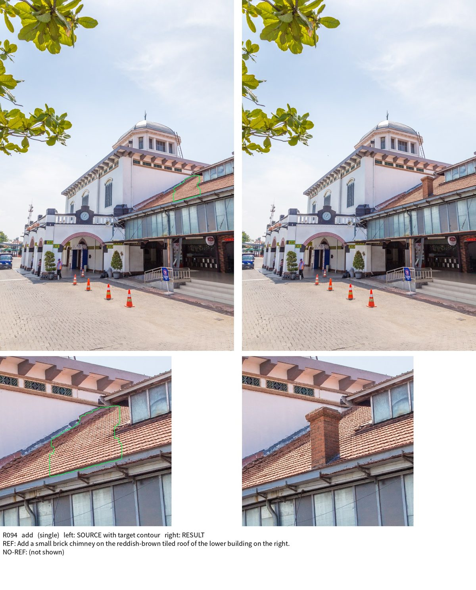
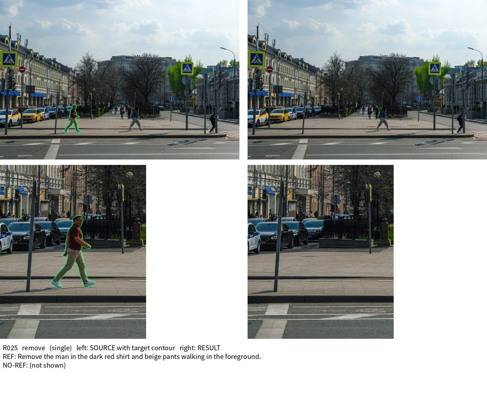
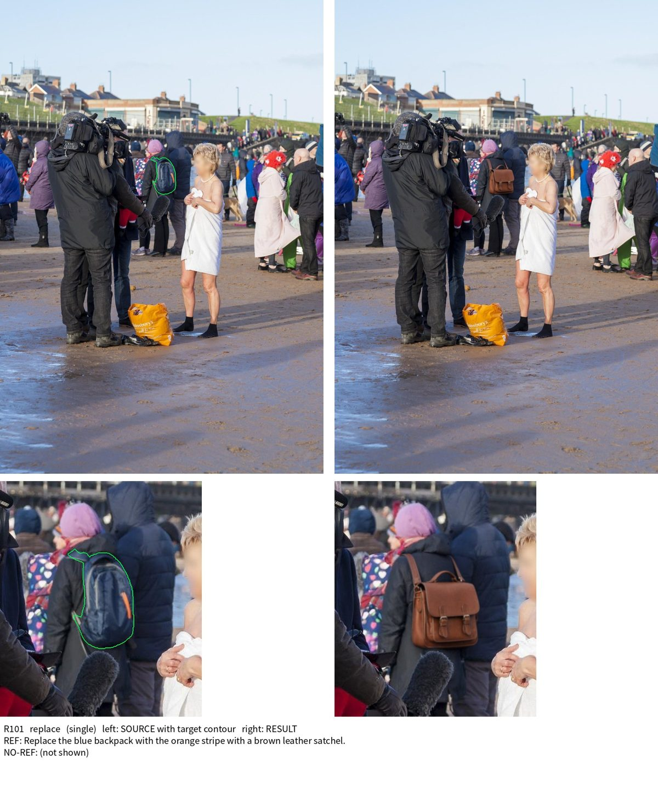
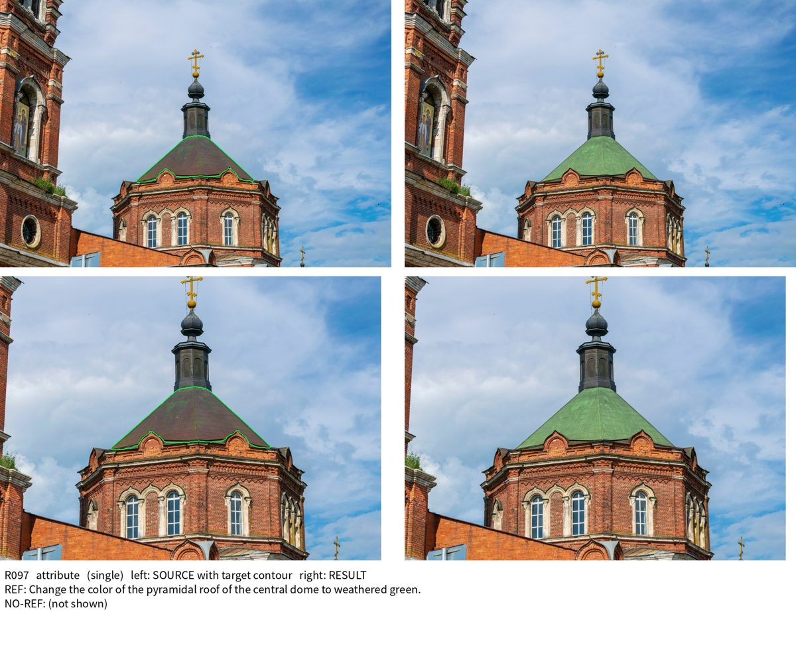
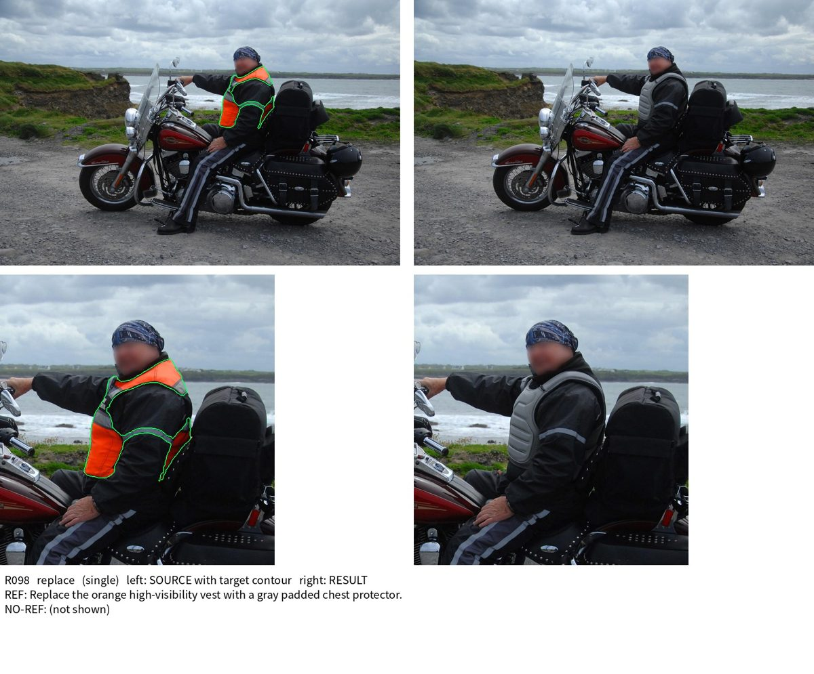
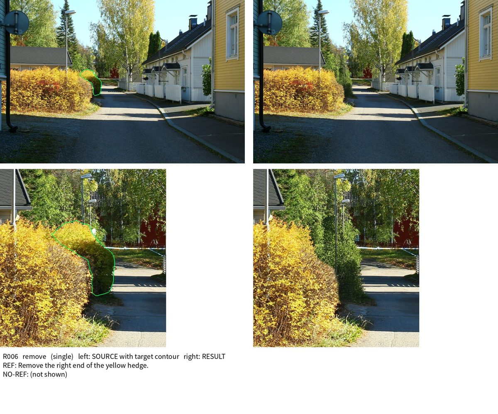

# 单目标数据 v2.1（证据管线）

本文是新版单目标数据的主文档：管线设计、代码、运行（四机入口）、验证结果、示例和已知问题。
- 已完成的 50k 单目标正式数据是旧管线产出，见 [DATASET_50K_ZH.md](DATASET_50K_ZH.md)。本文和新管线都不改动它。
- 孪生/多目标见 [TWINS_MULTI_ZH.md](TWINS_MULTI_ZH.md)。

## 1. 概览

| | |
|---|---|
| 定义 | 一条样本 = 原图 → 编辑图，一个 mask、一条指令（含 no-ref）、一种操作 |
| 管线 | 证据管线 v2.1：孪生/多目标的选样、规划、证据门、收尾、审核做法，每个目标从原图单独生成、单独审核 |
| 计划规模 | **5 万条**（2026-10-28 由 10 万改为暂定 5 万），四种操作各 12,500，四机生产 |
| 状态（2026-10-28） | 验证完成；5 万四机生产已准备、预热、打包，**尚未提交 Arnold** |
| 验证质量 | 助手盲评两轮各 60:60：合格 75% vs 50k 旧版 66%，不合格 2 vs 7（详见第 5 节） |
| 速度 | 验证时本机 54.3 GPU·秒/样本（GPU 与他人共享），独占节点折算约 45–47；50k 旧版 46.3 |

边界：
- 孪生/多目标的规划、生成、审核代码文件都没有改。单目标只新增模块和入口。
- 需要不同规则的地方，只在单目标进程运行时替换（见 2.2）。

## 2. 管线设计

### 2.1 流程

旧 50k 管线：Flash-Next 规划每个 mask，操作盲分配，指令协议 1.0，检查较弱，没有核验器。新管线把孪生/多目标积累下来的做法用到单目标上：

1. **选样**：元数据优先（可编辑性缓存加每图菜单），每张图选彼此独立的目标，四种操作按缺口均衡。多目标的选样约束只用来挑目标，不要求成组交付。
2. **规划**：27B 逐 mask 规划（思考 512）。
   - 证据门：读者、身份、内容、光照、介质、视角；
   - 另有替换重规划、显式文字、服装长度检查，与多目标生产的命令相同。
3. **生成**：`sa1b_pipeline/single_parallel.py` 把每个目标当作独立组件，从**原图**单独编辑。
   - 执行 mask 与多目标相同（其他目标的选区受保护）；
   - 编辑收尾：SAM3 删除阴影/倒影、颗粒、新增清理、对焦匹配；
   - OCR 文字核验。
4. **审核**（`single_parallel.audit_targets`）：打包方式与多目标的 packed-components-v4 相同。
   - 两个互不重叠的目标共用一次审核，重叠的逐个审核；
   - 每个包只审核一次，包内目标共用结果；
   - 核验器分档，Ref 疑虑核对。
5. **导出**：每个通过自身全部检查的目标导出为一个单目标样本（`singles_of`，字段同 `single_salvage.record`）。
   - 导出前逐像素证明：支持区外与原图完全相同，支持区内与审核看到的像素完全相同。

**v2 → v2.1**
- v2（第一版，`single_export.py`）只导出多目标生成里**单独成组件**的目标。与其他目标串联生成的目标带着别的编辑，无法单独导出。
- v2.1 每个目标都从原图单独生成，这部分目标也能导出（wave03：609 个中 118 个，19%）。
- 同一批规划的配对重放（wave01 的 127 组）：
  - v2.1 导出 319 个，v2 导出 231 个；
  - 生成时间相同（1,729 s : 1,730 s）；
  - 两边都导出的 228 个，输出逐像素相同。
- 多出来的 91 个：65 个是串联目标；21 个来自 v2 中因多目标审核回归（见第 8 节）被跳过的组；5 个是审核结论不同（反向的有 3 个）。

### 2.2 单目标组（只在单目标进程内替换规则）

多目标规则要求每组至少两个可行目标。wave03 的 300 组里有 50 组在规划时被拒，其中 36 组只有一个可行目标。单目标进程放开这一条后，这些目标照常生成，约多出 6%。

- 只替换三处规则：选样行允许 1–4 个目标、建组至少一个可行目标、保留通过成员校验的全部目标。
- 建组函数由共享的 `build_multi_group` 源码生成，只把“至少 2 个”改成“至少 1 个”。共享代码那一行变了时会直接报错，不会悄悄失效。
- 测试确认：多目标输入下，它与共享函数的结果逐字段相同。

### 2.3 四种操作均匀（四机生产）

1. 每波开始时，按“配额 − 已导出”算出每种操作的剩余需要。
   - 选样单位 = 需要 ÷ 产出率 × 余量。产出率是已导出 ÷ 已规划目标，向 v2.1 验证的产出率平滑。
   - 余量 = 1.1 + 2/√需要：需要越少余量越大，最后几波少有不足。
   - 整波按约 1,700 个规划目标缩放（约 1,000 个样本）。
2. 生产选样（`select_evidence_groups.py` 加每图菜单）按这些缺口挑图，最缺的操作优先。
3. 选样器为凑够每组 2 个目标，会加入已经够数的操作。这些目标在规划前删掉（`single_planning.drop_complete_operations`），不再规划和编辑。
4. 规划允许单目标组（`run_single_validation.py --single-target-groups`）。
5. 合并（`merge`）：
   - 每台按波次顺序取每种操作的前 3,125 个；
   - 某台某种操作不足时（停止线或中断），用其他节点该操作的余量补齐；
   - 余量另存 `final/surplus.jsonl`。

### 2.4 速度

相对验证时的 wave04：
- **单目标组**：约多出 6% 的样本（见 2.2）。
- **不再为凑组规划多余目标**：均衡到最后，如果只能用多目标选样凑组，每个保留样本要选 1.81 个目标；去掉凑数目标后是 1.71 个，少约 6%。数字来自按第 667 片菜单的模拟。
- **每波更大**：约 1,700 个规划目标，验证时约 1,000 个。
  - 模型加载等每波固定开销（约 1,000 GPU·秒）摊得更薄；
  - 规划按每 100 组一份并行，最多 4 份。
- **提交前预热源图池**（`warm-pool`）：在开发机上为每台读入、标注并算好前 2 片的菜单。节点启动后直接选样，每台省掉约 50 分钟的读片和标注。
- 生成同时处理的组数 16 → 24：单目标组变多时，编辑队列保持足够深。

验证时已经采用的：
- 服务请求/响应队列放本地盘（`--service-root`）。网络盘上一次 stat 约 7 ms；有数百个轮询线程时，中位约 1.6 秒。跑完后把各 worker 的日志复制回 `run/services/`。
- 规划一次提交整波的全部请求，规划批次平均 10.6 → 15.3（满批 16）。
- `--planning-chunks K`：整波分成 K 份同时规划。300 组的规划阶段 1,247 → 963 秒，规划卡忙碌率 0.55 → 0.85。
- 编辑 5 卡、审核 3 卡：生成阶段两者的忙碌率都在 0.95 以上，比例合适。

## 3. 代码

| 环节 | 模块 / 脚本 |
|---|---|
| 四机驱动 | `scripts/run_single_production_4node.py`（prepare / bundle / warm-pool / node / prepare-pool / status / merge / recover-lock），启动 `scripts/single_production/launch_4node.sh` |
| 波次协调、均衡导出 | `scripts/run_single_waves.py` |
| 单波执行（规划 ＋ 生成） | `scripts/run_single_validation.py`（`--single-target-groups`、`--planning-chunks`、`--service-root`） |
| 生成、审核、导出 | `scripts/run_single_transactional.py`、`sa1b_pipeline/single_parallel.py` |
| 单目标规划规则 | `sa1b_pipeline/single_planning.py` |
| v2 导出（只留档） | `sa1b_pipeline/single_export.py` |
| 复用（只导入，不改） | `production_pool.py`、`shard_feeder.py`、`evidence_selection.py`、`evidence_gates.py`、`edit_finish.py`、`edit_verifier.py`、`audit_reconcile.py`、`inference_services.py` 等 |

## 4. 运行

### 4.1 5 万四机生产

**目标**：5 万个单目标样本，四种操作各 12,500；每台每种操作 3,125 个（`config.json` 的 `quota`）。

**实验目录**：`/mnt/bn/strategy-mllm-train/user/tanyue/experiments2/SAMTokEdit/data_pipeline/02_production_runs/sa1b_samtok_single100k_20261026/`（下文 `$ROOT`）。
- **目录名沿用最初的 10 万计划，配额已改为 5 万**。目录里的源图池记录了绝对路径，所以不改名。
- 2026-10-28 用 `prepare --samples 50000 --replace-unstarted` 改了配额，`config.json` 与原 10 万版本只有 `quota` 不同。原配置和代码包留档在 `$ROOT/planning/replaced_20261028T120953/`。源图池、分片顺序和排除表都没变。
- 随后重新执行了 `bundle`：
  - 代码 sha256 `29124ec8…`，与之前相同（代码未变，对应提交 `8e02507`）；
  - 配置 sha256 `b139e1f0…`。
  - 已核对：两个校验和都与文件一致，`status` 显示四台为 not_started、配额 5 万。
- `warm-pool` 已完成：每台前 2 片已读入、标注并算好菜单，每片约 11,000 张可用图。节点启动后直接选样，需要更多分片时自己读片。
  - 判类别：每台约 12–13 分钟，各约 4.1–4.5 万个新类别；
  - 菜单：每片约 7 分钟。
- 单机冒烟在 `$ROOT/planning/smoke1/`。
- 结果目录（运行后生成）：`$ROOT/final/`。

**源图**：每台按自己的分片顺序取图。
- 共 807 片；
- 避开孪生/多目标生产每台分片列表的前 48 片；
- 避开验证用的第 667 片。

另外排除基准集、评测集预留、50k 正式数据的来源图和验证池，共 17,399 个来源。分片顺序和每片里的图都是固定种子的随机顺序，再按菜单规则筛选、按缺口取图，见 [README“源图怎么选”](../README.md#源图怎么选)。类别可编辑性缓存合并了孪生/多目标生产和验证的全部标签，共 27.9 万个类别。

### 入口指令

**Arnold 任务**：4 workers × 8 H100，挂载 `/mnt/bn/strategy-mllm-train`。
- 四台的启动命令完全相同，平台注入 rank（`ARNOLD_ID`）。
- 不用 torchrun，不设 `CUDA_VISIBLE_DEVICES`。

```bash
#!/usr/bin/env bash
set -euo pipefail
exec bash /mnt/bn/strategy-mllm-train/user/tanyue/experiments2/SAMTokEdit/data_pipeline/02_production_runs/sa1b_samtok_single100k_20261026/deployment/arnold_entry.sh
```

`arnold_entry.sh` 的内容如下，也可以直接把这几行填进 Arnold：

```bash
#!/usr/bin/env bash
set -euo pipefail
export SINGLE_RUN_ROOT=/mnt/bn/strategy-mllm-train/user/tanyue/experiments2/SAMTokEdit/data_pipeline/02_production_runs/sa1b_samtok_single100k_20261026
export SINGLE_RUNTIME_ROOT="${SINGLE_RUNTIME_ROOT:-/opt/tiger/sa1b-evidence-production-runtime}"
exec bash "$SINGLE_RUN_ROOT/deployment/launch_4node.sh"
```

launcher 依次做这些事（与孪生/多目标生产相同的环境和安装）：
1. 检查 4×8 拓扑、代码包和配置的校验和；
2. 解包到 `/opt/tiger/sa1b-single-production-code/<sha>`；
3. 安装两套锁定环境（`scripts/group_production/setup_runtime.sh`，CUDA 12.9）；
4. 安装旁挂库（`scripts/evidence_production/setup_extras.sh`：RapidOCR、crc32c、tfd-utils）；
5. 检查字体；
6. 把三个模型复制到 `/opt/tiger/sa1b-evidence-model-cache`；
7. 启动本 rank。

**准备、预热和打包**（都已执行；改代码或参数后重做）：

```bash
cd /opt/tiger/tanyue/sa1b-samtok-edit-data
ROOT=/mnt/bn/strategy-mllm-train/user/tanyue/experiments2/SAMTokEdit/data_pipeline/02_production_runs/sa1b_samtok_single100k_20261026
python3 scripts/run_single_production_4node.py --root "$ROOT" prepare --samples 50000 --world-size 4   # 已执行（首次加 --replace-unstarted 改配额）
# 8 卡 + HDFS 挂载的开发机上，用 mllm 环境（标注要用 27B）
SA1B_LOCAL_MODEL_MAP="$(cat /tmp/sa1b-recovery-model-map.json)" SA1B_FEEDER_LIB=/tmp/sa1b-evidence-smoke-runtime/feeder-lib \
  /tmp/sa1b-next-runtime/bin/python scripts/run_single_production_4node.py --root "$ROOT" warm-pool --shards-per-rank 2
python3 scripts/run_single_production_4node.py --root "$ROOT" bundle
```

- `bundle` 打包当前工作区代码，记录代码、配置和模型清单的校验和。
- 改配额或参数：在任何节点启动前执行 `prepare ... --replace-unstarted`，再执行 `bundle`。
- `warm-pool` 可以中断后重跑，已完成的分片会跳过。

### 4.2 进度与合并

```bash
python3 scripts/run_single_production_4node.py --root "$ROOT" status          # 各台进度、预计剩余小时
tail -f "$ROOT/logs/progress.log"                                             # rank 0 每 10 分钟写一行
tail -f "$ROOT/logs/node0.log"                                                # 每台的完整输出
python3 scripts/run_single_production_4node.py --root "$ROOT" merge --partial # 中途导出已完成部分到 final_partial/
```

- 每台的波次在 `$ROOT/nodes/node<r>/waves/waveNN/`：
  - `inputs/` 是选样，其中 `selected_full.jsonl` 是删掉已满操作之前的选样；
  - `run/` 是规划与生成；
  - `run/single/singles.jsonl` 是本波导出。
- 每台的账本在 `waves/ledger.json`，进度在 `waves/progress.json`。统计以这两个文件为准。共享盘上增量读取日志偶尔会读到不一致的内容。
- 全部完成后 rank 0 自动合并到 `$ROOT/final/`：
  - `singles_balanced.jsonl`：5 万行，每行一个单目标样本，路径为绝对路径；
  - `surplus.jsonl`：余量；
  - `summary.json`：统计。

### 4.3 中断恢复与热修复

- **中断恢复**：
  - 每波的选样、规划请求、每组的生成与审核都有检查点，重启后从中断处继续；
  - 节点上的协调器失败后最多重启 3 次；
  - Arnold 换了一次 trial 时，旧锁会自动回收；
  - 同一 trial 内死掉的节点，先用 `recover-lock --rank r --previous-workers-stopped` 回收锁。
- **热修复**：
  - 执行 `bundle --hotfix "原因"`，旧代码包留档到 `planning/hotfix_<时间>/`；
  - 重启节点后，用旧代码开始、尚未完成的那一波会被移到 `run.superseded.<时间>`，在同一份选样上从规划重新跑；
  - 已完成的波次不动。

### 4.4 冒烟与时间估计

**单机冒烟**（`$ROOT/planning/smoke1/`，`world_size=1`，每种操作 16 个，每波约 60 个规划目标）：经 `deployment/arnold_entry.sh` 启动（假 Arnold 环境变量，本机已有环境，`--model-map`）。
- 第 1 次启动发现参数传递错误：选样参数以 `--` 开头，被当成选项。现改为用 JSON 传递。用 `bundle --hotfix` 换代码后重启，顺带走通了热修复流程。
- 两波共 1,354 秒：
  - 第 1 波 27 组、76 个规划目标，导出 45 个（四种操作 11/11/12/11）；
  - 第 2 波 31 组、77 个目标，导出 47 个。
- 规划阶段没有拒掉的组。按旧规则会因“少于两个可行目标”被拒的 9 + 11 组，作为单目标组照常生成。
- 合并：四种操作各 16 个，无缺口。余量 28 个，因为需要很小时余量系数大。`status`、`progress.log`、自动合并都正常。
- 删除已满操作后的真模型检查（`$ROOT/planning/smoke2_drop/`）：
  - 10 行选样，按 add、attribute 已满过滤后剩 7 行（每行 1–2 个目标）；
  - 规划 5 组，另 2 组唯一的目标未通过证据门；
  - 导出 4 个，只有 remove/replace。

**时间估计**
- 均衡的代价约 +3–6%，单目标组救回约 −5%，更大的波次约 −2%，大致相互抵消。
- 5 万个 × 约 45 GPU·秒 ÷ 32 卡 ≈ 20 小时，加启动（环境、模型复制）约 21 小时。
- 每台约 13 波，每波约 1.6 小时。
- 参考：孪生/多目标生产原估约 2.0 天，实际 2.5 天（多 25%）。按同样比例，单目标可能要约 25 小时。

### 4.5 单机一波（验证用）

验证实验目录：`/mnt/bn/strategy-mllm-train/user/tanyue/experiments2/SAMTokEdit/data_pipeline/04_current_validation/sa1b_single_target_v2_20261026`（下文 `$E5`），复现脚本在 `$E5/reproduce/`。

```bash
WAVE=$E5/waveNN NGROUPS=300 PLANNING_CHUNKS=3 bash $E5/reproduce/run_wave_v21.sh
python $E5/reproduce/analyze_wave_v21.py $E5/waveNN $E5/analysis/waveNN.json
```

## 5. 验证结果

报告：`/opt/tiger/tanyue/visualization_tmp/single_target_v2_20261026/单目标v2_验证报告.md`；盲评样例（13 页，好坏都有）在同目录的 `单目标v2_盲评样例.pdf`。

### 5.1 质量：助手盲评

以下是**助手自己的盲评**：随机编号，判定冻结 sha256 后才揭盲；不是独立第三方评审，评审者也是新管线的开发者。
- 每轮 50k 旧版与新管线各 60 个，每种操作各 15 个。
- 两个臂用的是不同图片，不是同图配对。

| 轮次 | 来源 | 合格 | 小瑕疵 | 不合格 | 合格率 | 可用率（合格＋小瑕疵） |
|---|---|---|---|---|---|---|
| 第一轮 | 50k 旧版 | 43 | 11 | 6 | 71.7% | 90.0% |
| 第一轮 | 新管线 v2 | 43 | 16 | 1 | 71.7% | 98.3% |
| 第二轮 | 50k 旧版 | 36 | 23 | 1 | 60.0% | 98.3% |
| 第二轮 | 新管线 v2.1 | 47 | 12 | 1 | 78.3% | 98.3% |
| 合并 | 50k 旧版 | 79 | 34 | 7 | 65.8% | 94.2% |
| 合并 | 新管线 | 90 | 28 | 2 | 75.0% | 98.3% |

- 合并差异 p≈0.16（合格）、0.17（不合格）。样本量还不够下“显著”的结论。
- 50k 臂两轮之间合格率差了 12 个百分点，说明评审和抽样本身波动很大，只宜比较同一轮之内的两个臂。
- 新管线的主要好处：不合格少；add 合格率高（25/30 : 17/30）。replace 合格率没有变高，但没有不合格。

### 5.2 自动通过率（wave02，v2.1）

| 层 | add | remove | replace | attribute | 合计 |
|---|---|---|---|---|---|
| 选中目标 | 734 | 494 | 596 | 724 | 2,548 |
| 规划通过（规则＋证据门） | 523（71%） | 349（71%） | 388（65%） | 421（58%） | 1,681（66.0%） |
| 到达语义审核 | 488（66%） | 343（69%） | 379（64%） | 405（56%） | 1,615（63.4%） |
| 审核＋核验器通过，导出 | 453（62%） | 290（59%） | 360（60%） | 396（55%） | 1,499（58.8%） |

两层相交的估计：选中目标中约 46% 既自动通过、又被助手判为合格（58.8% × 78.3%）。

### 5.3 速度

- 验证时本机每个样本 54.3 GPU·秒（与他人进程共享 GPU），独占节点折算约 45–47。50k 旧版是 46.3。
- 配对重放：同样的生成时间，v2.1 导出 319 个，v2 导出 231 个（见 2.1）。

## 6. 示例

取自第二轮盲评的 v2.1 样本，盲评编号见图下文字。上排是原图（绿色为目标轮廓）和结果，下排是对齐放大。

**新增 · 合格**（R094）：在右侧矮楼的瓦屋顶上加一个小砖烟囱。


**删除 · 合格**（R025）：删除前景中穿深红上衣、米色裤子的行人。


**替换 · 合格**（R101）：蓝色双肩包换成棕色皮革邮差包。


**属性 · 合格**（R097）：中央穹顶的锥形屋顶改为风化铜绿色。


**v2.1 救回的串联目标**（R098）：橙色反光背心换成灰色护胸。在多目标生成里，它与同图其他目标串联，v2 无法单独导出；v2.1 从原图单独生成后可以导出。


**删除 · 不合格**（R006）：删除黄色绿篱的右端，却补出一丛新的绿色灌木，没有露出背后的路面和草地。这是新管线两个不合格之一。


## 7. 测试

- `tests/test_single_parallel.py`：
  - 多目标里会串联的两个目标都从原图生成并各自导出，只改动自己的目标；
  - 中断后续跑不重复调用；
  - 只剩一个有效目标时仍审核；
  - 互不重叠的目标两两共用一次审核；
  - 导出像素证明拒绝支持区外改动和未审核的图。
- `tests/test_pack_audit_revision.py`：审核修改了说明文字（Ref 修复）时，同一包只审核一次。
- `tests/test_single_planning.py`：
  - 单目标建组函数在多目标输入上与共享函数结果相同，并接受一个目标；
  - 共享规则变化时拒绝运行；
  - 保留与删除已满操作；
  - 只在给定模块上替换。
- `tests/test_single_production.py`：
  - 波次规划（缩放、稀缺操作优先、小需要的余量、停止线）；
  - 删除已满操作与续跑；
  - 均衡导出；
  - 换代码后重跑未完成的波次；
  - 合并时用余量补齐；
  - 协调器命令能被它自己的参数解析器解析；
  - 分片避让；
  - 进度与预计时间；
  - 预热源图池。

全量测试：855 通过，1 个失败是改动前就有的。

## 8. 已知问题与下一步

- **5 万生产尚未运行**：提交 Arnold 后，按第 4 节查看进度。完成后在本文补充生产结果（路径、计数、用时、示例）。
- **剩余瑕疵主要来自生成器**：
  - 替换或改色后，旧内容在边缘残留（光晕、细条）；
  - 模糊区域里的新内容过于清晰；
  - 大面积改色像平涂；
  - 删除时补出新内容（如上面的 R006）。
- **多目标代码里的审核回归**（`b4c9991`）不影响单目标：单目标用自己的 `audit_targets`，每个包只审核一次。详情和处理建议见 [TWINS_MULTI_ZH.md 已知问题](TWINS_MULTI_ZH.md#9-已知问题)。
- 盲评由助手完成，两臂说明文字的风格（协议 1.0 / 2.0）可能透露来源，盲法不完全。
