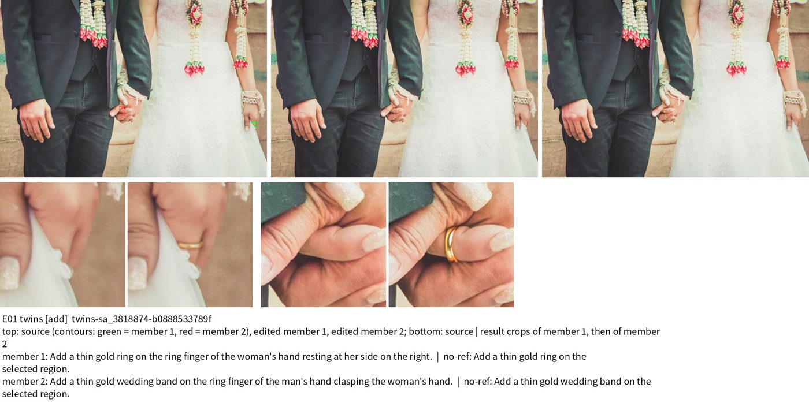
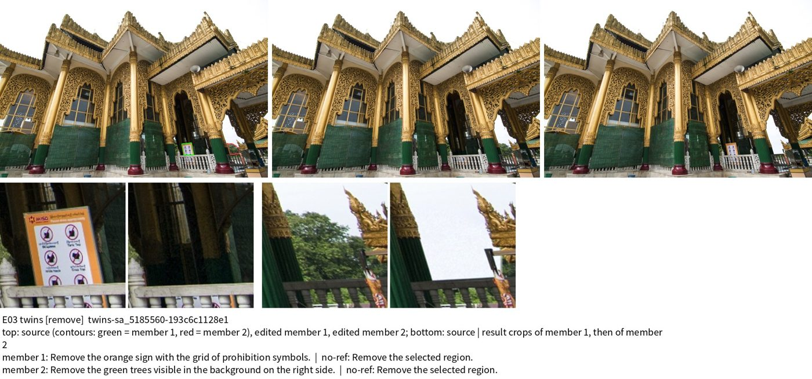
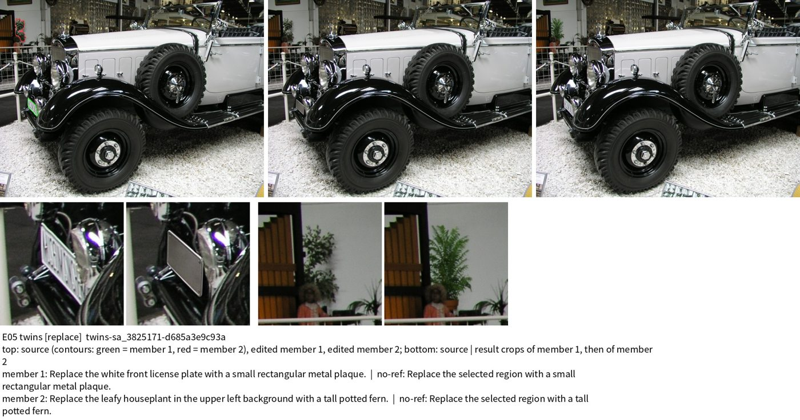
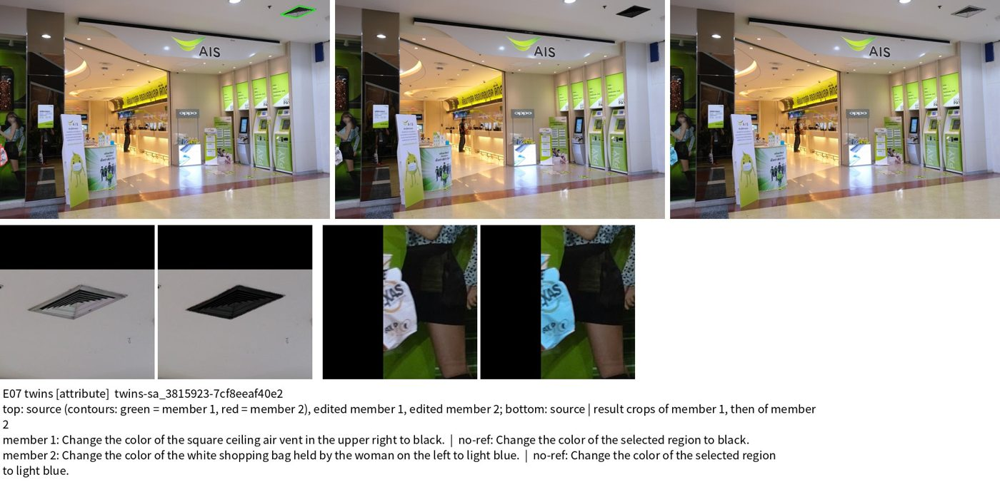
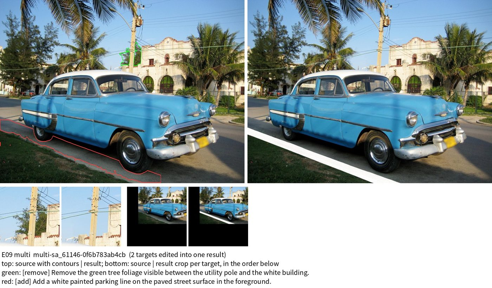
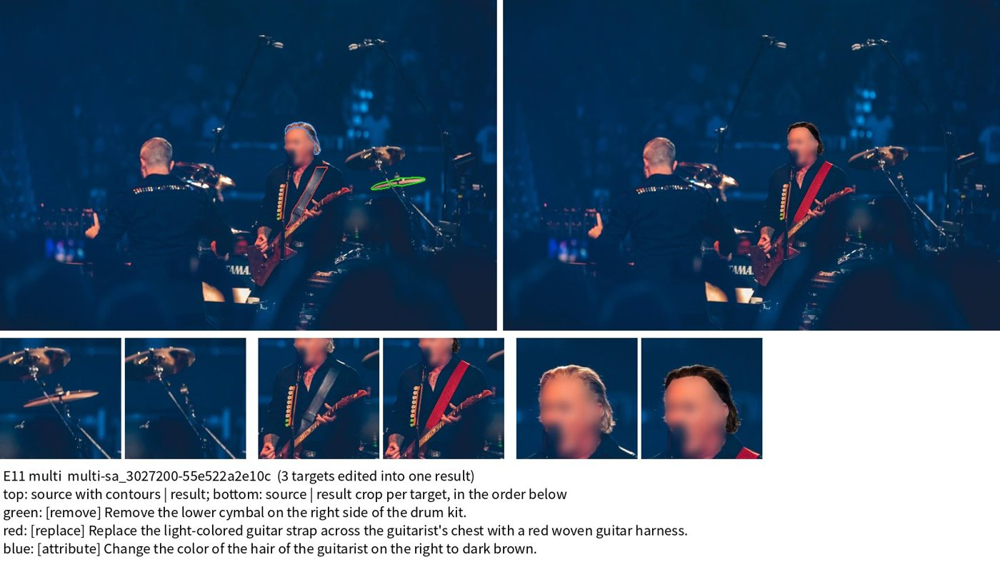
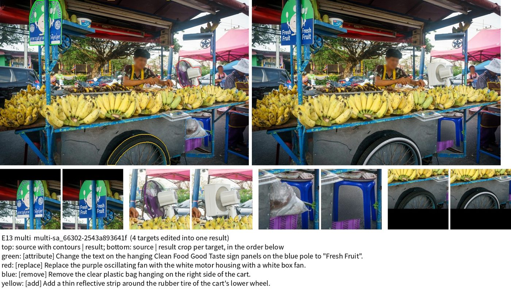

# 孪生 ＋ 多目标数据（证据管线）

本文是孪生和多目标两套数据的主文档：管线设计、代码、运行、生产结果、数据读取、质量评估和示例。
- 逐步实验和历史方案见 [PIPELINE.md](PIPELINE.md)；
- 四机运行的操作细节见 [FOURNODE_RUN_GUIDE.md](FOURNODE_RUN_GUIDE.md#孪生约-25-万个样本--多目标约-10-万个样本四机生产证据管线2026-10-25)。

## 1. 概览

| | 孪生（twins） | 多目标（multi） |
|---|---|---|
| 定义 | 同一张源图里两个不同目标，用**同一种操作**各自独立编辑，得到两张结果图；两条指令的操作相同，内容可按对象分别设计 | 一张源图里 2–4 个目标，四种操作各不相同，全部编辑进**同一张**结果图 |
| 一条样本 | 一个成员：源图 → 该成员的结果图（每组 2 条） | 一个目标；训练时以组为单位：源图 → 联合结果图 ＋ 多条指令 |
| 最终规模 | **12,511 组 = 25,022 条样本** | **100,117 个目标**，39,814 张图 |
| 四种操作 | 新增 3,128、删除 3,127、替换 3,128、属性 3,128（组） | 新增 25,123、删除 24,994、替换 25,000、属性 25,000（目标） |
| 状态 | 已完成（2026-10-28） | 已完成（2026-10-28） |

两类数据在同一个四机生产里一起产出，共用选样、规划和审核的基础设施。

- **模型**：规划和审核都用 Qwen3.8-27B，编辑用 Qwen-Image-2.1（40 步），删除阴影/倒影和位置解析用 SAM3。
- **协议**：指令协议 2.0（`benchmark-concise-3-blind-1`），mask 语义 2.0。

## 2. 管线设计

一个"波次"依次走完下面 6 步。四机生产就是每台机器循环跑波次，直到每种操作的接受量都达标。

1. **选样**（元数据优先，不调模型）
   - 每张源图预先算好"菜单"（`evidence_selection.image_menu`）：能为哪种操作组成孪生组，多目标能用哪些操作。
   - 依据是类别可编辑性缓存（27B 不带思考，按类别判一次）和几何规则：面积、分离度、承托关系；不删穿戴物和覆盖层，不改天空、水面、地面的颜色，跳过黑白照片。
   - 每波按剩余缺口分配名额：孪生先选，稀缺操作优先；多目标用剩下的图，最缺的操作优先。
   - 孪生的"新增"会多选一个候选成员（4 选 2），由后面的证据门挑出最好的两个。
2. **规划**：27B 逐 mask 规划，每个目标一次调用，思考 512 token；输入是原图和带轮廓的裁剪图。
   - 输出指代（Ref）、编辑内容、no-ref 指令和附着位置。
   - 显式文字要求写出具体字样（`--text-verify`）。
   - 替换被判为"只改外观"时，重规划一次（`--replace-retry`）。
3. **证据门**（规划后核验，27B 不带思考；`evidence_gates.py`）
   - 读者：只看 Ref 能否找回同一个目标；
   - 身份：是否是同一物体；内容：替换是否真的换了物体；
   - 光照：阴影或逆光的部件不做改色；
   - 介质：不在画、浮雕等画面里新增；视角：航拍不做新增。
   - 任一项不过，这个目标就不进入生成。
4. **生成**：Qwen-Image-2.1，40 步，只写执行 mask 内的区域。
   - **孪生**：两个成员各自从原图编辑（`twin_streaming`）。
   - **多目标**：彼此独立的目标各自从原图并行编辑；写入区域重叠或有依赖的目标串行编辑；最后把各部分逐像素拼回一张图（`multi_parallel`，并验证拼接没有改动别处的像素）。
   - **收尾**（`edit_finish`）：删除时用 SAM3 一并去掉目标的投影和倒影；另有补颗粒、单物体新增的杂散清理、景深匹配。
   - **文字核验**：用 OCR 检查写出的文字，不对就重试，最多若干次。
5. **审核**（27B）
   - 主审核看对齐的原图和结果图裁剪，逐项判断：操作是否正确、是否完成、目标外是否保持、是否自然、宿主是否完整。
   - 主审核通过后，核验器再按操作类型问几个是/否缺陷问题（`--audit-verifier split`），只会拒绝，不会放行。
   - 审核质疑 Ref 是否唯一时，用规划阶段的读者证据裁决（`--audit-ref-reconcile`）。
   - 多目标按组件打包审核：两个互不重叠的组件共用一次审核调用。
6. **接受与导出**
   - **孪生**：两个成员都通过，整组才接受。
   - **多目标**：保留通过的目标，至少 2 个且类型组合合法才接受。
   - 没能成组但自身全部通过的成员或目标，另存为"附带单目标"（`--keep-singles`），不计入均衡。

**均衡与停止**（`run_evidence_waves.py`）
- 每波按"剩余需要 ÷ 估计产出率 × 余量"选样，产出率随每波实际接受量更新。
- 导出时，孪生按每种操作截取配额；多目标按组的组合类型解整数规划，挑出四种操作最均衡的整组子集。
- 某类只差 1–2 个单位时不再开新波（用户选择的省时间规则）。

**源图选取**
- 先随机排序：分片顺序随机，各台分片互不重叠；每片里的图也按固定种子随机排序。
- 再按菜单规则筛选，最后按缺口取图，所以会偏向能做稀缺操作的图。
- 排除 benchmark 200 张和评测预留 1,200 张。
- 孪生和多目标之间没有重叠的源图。与 50k 正式数据有 8 张源图重合，与单目标验证池有 81 张重合，编辑的目标不同（当时没有排除这两部分）。
- 完整规则见 [README“源图怎么选”](../README.md#源图怎么选)。

**四机生产**（`run_evidence_production_4node.py`）
- 每台有自己的源图池：按需从 HDFS 整片读入 SA-1B，用空闲 GPU 给新类别做可编辑性标注，再算菜单。
- 各 rank 的分片列表互不相交，图像哈希在共享目录登记，避免重复使用。
- 代码打包冻结并校验；要改代码只能走 `bundle --hotfix`，换代码后未完成的波次会从规划重跑。
- Arnold 换 trial 后旧锁自动回收；协调器出错会自动重启。

## 3. 代码

| 环节 | 模块 / 脚本 |
|---|---|
| 四机驱动 | `scripts/run_evidence_production_4node.py`（prepare / bundle / node / status / merge / prefeed / recover-lock），启动 `scripts/evidence_production/launch_4node.sh`，旁挂库 `scripts/evidence_production/setup_extras.sh` |
| 波次协调与均衡导出 | `scripts/run_evidence_waves.py` |
| 单波执行（两类同时规划、同时生成） | `scripts/run_dual_validation.py` |
| 源图池 | `sa1b_pipeline/production_pool.py`、`sa1b_pipeline/shard_feeder.py` |
| 选样 | `scripts/select_evidence_groups.py`、`sa1b_pipeline/evidence_selection.py` |
| 规划 | `scripts/run_group_pipeline.py --per-mask-planning`、`sa1b_pipeline/per_mask_planning.py`、`content_planning.py`、`group_planning.py`、`text_edits.py` |
| 证据门 | `sa1b_pipeline/evidence_gates.py` |
| 孪生生成与审核 | `scripts/run_twins_streaming.py`、`sa1b_pipeline/twin_streaming.py`、`twin_contract.py`、`twin_compact_audit.py` |
| 多目标生成与审核 | `scripts/run_multi_transactional.py`、`sa1b_pipeline/multi_parallel.py`、`multi_transactional.py`、`multi_component_audit.py`、`multi_execution_contract.py` |
| 编辑收尾 / 文字核验 | `sa1b_pipeline/edit_finish.py`、`removal_effects.py`、`text_verification.py` |
| 审核核验 / Ref 核对 | `sa1b_pipeline/edit_verifier.py`、`audit_reconcile.py` |
| 常驻模型服务 | `sa1b_pipeline/inference_services.py`（每卡一个文件收件箱的服务池；`--priority-scheduling` 让多目标的链式请求先行） |
| 附带单目标 | `sa1b_pipeline/single_salvage.py` |

生产所用的单波开关（`run_evidence_production_4node.DUAL_FLAGS`）：

```text
--planner-devices 0,1,2,3,4,5,6,7 --audit-devices 5,6,7 --concurrent-kinds --priority-scheduling
--evidence-gates --text-verify --twin-single-add --evidence-gate-lighting --evidence-gate-medium
--evidence-gate-viewpoint --replace-retry --garment-extent-check --edit-finish --audit-verifier split
--audit-ref-reconcile --keep-singles --planning-view-workers 16 --coordinated-quotas
```

测试：`tests/test_evidence_waves.py`、`test_production_selection.py`、`test_evidence_gates.py`、`test_multi_parallel.py`、`test_multi_component_audit.py`、`test_multi_transactional.py` 等。

## 4. 运行

入口指令、进度查看、中断恢复和热修复流程见 [四机指南](FOURNODE_RUN_GUIDE.md#入口指令)。

本次生产：
- 实验目录：`/mnt/bn/strategy-mllm-train/user/tanyue/experiments2/SAMTokEdit/data_pipeline/02_production_runs/sa1b_samtok_group_twins50k_multi100k_20261025`（下文 `$PROD`）。
- 四台 Arnold 4×8 H100，trial 303966543。
- 部署代码：10-25 20:13 热修复后的代码包，sha256 `5a0562eb…`（`$PROD/deployment/manifest.json`），内容对应提交 `612905e`。打包时工作区基于 `398140f`，有 7 个文件未提交，随后提交为 `612905e`。旧包留档在 `$PROD/planning/hotfix_20261025T201335/`。

## 5. 生产结果

**数据位置**（`$PROD/final/`）

| 文件 | 行数 | 内容 |
|---|---|---|
| `twins_balanced.jsonl` | 12,511 | 孪生组，每行一组（两个成员） |
| `multi_balanced.jsonl` | 39,814 | 多目标组，每行一张图（2–4 个目标） |
| `singles.jsonl` | 12,363 | 附带单目标（不均衡，单独产品） |
| `summary.json` | — | 配额、导出计数、各 rank 明细 |

图片和 mask 不复制，记录里是绝对路径，指向 `$PROD/nodes/node<r>/waves/waveNN/run/{twins,multi}/generation/generated/…`。

**计数与漏斗**（四台合计）

| | 选中 | 接受 | 导出 | 接受率（选中 → 接受） |
|---|---|---|---|---|
| 孪生（组） | 29,373 | 12,524 | 12,511 | 0.43：新增 0.33、删除 0.50、替换 0.48、属性 0.45 |
| 多目标（目标） | 201,500 | 101,403 | 100,117 | 0.50：新增 0.53、删除 0.51、替换 0.49、属性 0.49 |

- 多目标每组目标数：2 个 23,442 组，3 个 12,255 组，4 个 4,117 组。
- 接受多于导出的部分，是已满额操作的超出量，被均衡导出舍弃。
- 附带单目标 12,363 条：来自孪生 5,722、多目标 6,641；新增 4,633、删除 2,618、替换 2,235、属性 2,877。

**用时**
- 全程 60.5 小时：10 月 25 日 20:18 至 10 月 28 日 08:46 UTC。最早一次启动是 17:54，因故障在 20:18 热修复后重启。
- 四台共 303 波（76/77/76/74），平均每波 45.9 分钟。前期约 50 分钟，收尾阶段约 32 分钟。
- 约 1,936 GPU·时。平均每个产出单位（一条孪生样本或一个多目标目标）约 56 GPU·秒。
- 原先估计独占节点约 2.0 天，实际 2.5 天。

**跳过的组**：共 73 组，约占 0.13%，按设计隔离，波次照常继续。
- 72 组：区域重叠（`parallel fusion has overlapping accepted supports`）；
- 1 组：SAM3 定位文字超过 32 token。

**运行记录**
- `$PROD/logs/node<r>.log`：各台完整输出；
- `$PROD/logs/progress.log`：rank 0 每 10 分钟一行进度；
- `$PROD/nodes/node<r>/waves/ledger.json`：每波的选中、接受、用时；
- 每波的 `failed_groups.jsonl` 和 `counts.json`。

注意：共享盘上增量读取日志偶尔会读到不一致的内容。统计以账本（`ledger.json`）和 `progress.json` 为准。

## 6. 数据读取

```python
import json
ROOT = '/mnt/bn/strategy-mllm-train/user/tanyue/experiments2/SAMTokEdit/data_pipeline/02_production_runs/sa1b_samtok_group_twins50k_multi100k_20261025/final'

# 孪生：每组两条样本，各自从同一张原图编辑，结果图只含自己的编辑
for line in open(f'{ROOT}/twins_balanced.jsonl'):
    g = json.loads(line)
    for m in g['members']:
        sample = {'source': g['source_image'], 'target': m['edited_image'], 'mask': m['mask'],
                  'instruction': m['instruction'], 'instruction_noref': m['instruction_noref'],
                  'operation': g['operation']}

# 多目标：一张原图、一张联合结果图，2-4 个目标各有 mask 和指令
for line in open(f'{ROOT}/multi_balanced.jsonl'):
    g = json.loads(line)
    source, target = g['source_image'], g['joint_target']
    targets = [{'mask': u['mask'], 'instruction': u['instruction'], 'instruction_noref': u['instruction_noref'],
                'operation': u['operation']} for u in g['units']]
```

常用字段：
- **孪生组**：`twin_id`、`operation`、`source_image`、`twin_contract_version`（`same-operation-adapted-3`）、`group_checks`、`members[]`。
- **孪生成员**：`unit_id`、`edited_image`、`mask`（源区域）、`support_mask`（实际写入区域）、`instruction`、`instruction_noref`、`ref`、`payload`、`instruction_spec`、`semantic_audit`。
- **多目标组**：`multi_id`、`source_image`、`joint_target`、`n_targets`、`operations`、`generation_order`、`joint_audit`、`parallel`（组件与拼接证明）、`units[]`。
- **多目标目标**：字段同孪生成员；另有 `step_output_image`（该目标所在组件的结果）、`component_audit_image`。

孪生两条指令的 no-ref 句子可以不同（操作相同、内容按对象设计），删除类通常相同。

## 7. 质量评估

生产配置等同于验证时的"完整出图 5"（第七轮）。下表各轮都是助手盲评，在**不同图片**上进行，轮次之间的差异不能归因于某项改动。

| 轮次（日期） | 交付目标 | 合格 | 含小瑕疵 | 不合格 | 报告 |
|---|---|---|---|---|---|
| 证据核验对照（10-22） | 33（对照 32） | 79%（对照 59%） | 94%（对照 72%） | 2（对照 5） | `/opt/tiger/tanyue/visualization_tmp/evidence_gate_20261022/验证报告.md` |
| 第二轮（10-22） | 58 | 74% | 98% | 0 | `/opt/tiger/tanyue/visualization_tmp/text_support_balance_20261022/验证报告.md` |
| 第三轮（10-23） | 74 | 74% | 95% | 4 | `/opt/tiger/tanyue/visualization_tmp/clean_edit_quality_20261023/验证报告.md` |
| 第四轮（10-24） | 73 | 59% | 95% | 4 | `/opt/tiger/tanyue/visualization_tmp/audit_verifier_pasted_20261024/验证报告.md` |
| 第五轮（10-24） | 67 | 60% | 93% | 5 | `…/audit_verifier_pasted_20261024/验证报告_续.md` |
| 第六轮（10-24） | 88 | 81% | 100% | 0 | `…/audit_verifier_pasted_20261024/验证报告_第六轮.md` |
| **第七轮 = 生产配置（10-25）** | 77 | **65%** | **96%** | 3 | `…/audit_verifier_pasted_20261024/验证报告_第七轮.md` |

**生产中途抽查**（2026-10-27，助手目视，非盲评，样本小）
- 从各台最新一波随机抽 8 组，共 18 个编辑：16 合格、2 小瑕疵、0 不合格。
- 两处小瑕疵：贴纸像贴上去且位置与指令不符；替换出的石头像贴图。
- 位置：`/opt/tiger/tanyue/visualization_tmp/production_4node_20261025/spotcheck_20261027/`。

数据是自动审核通过的版本，没有做独立的人工验收。

## 8. 示例

从最终数据随机抽取，未挑选；用固定种子，脚本是 `/opt/tiger/tanyue/visualization_tmp/production_4node_20261025/release_examples/render_examples.py`。同目录有 14 张完整示例：孪生每种操作 2 组，多目标 2/3/4 个目标各 2 组。

**孪生 · 新增**：两个人的无名指上各加一枚细金戒指。


**孪生 · 删除**：删除禁止标志牌；删除背景里的树，补成天空。


**孪生 · 替换**：车牌换成金属铭牌；绿植换成蕨类盆栽。


**孪生 · 属性**：天花板风口改成黑色；购物袋改成浅蓝色。


**多目标 · 2 个目标**：删除电线杆旁的树叶；在路面上加一条白色停车线。停车线面积大、很平整，略显生硬。


**多目标 · 3 个目标**：删除镲片、吉他背带换成红色编织款、头发改成深棕色。


**多目标 · 4 个目标**：招牌文字改为"Fresh Fruit"、风扇换成箱式风扇、删除塑料袋、轮胎加反光条。


## 9. 已知问题

1. **区域重叠导致整组跳过**：72 组，约 0.06%。
   - 原因：删除会把目标的投影一起清掉，写入区域比规划时大，两个原本独立的组件最终重叠。
   - 生产代码（`612905e`）的处理：保留先到的组件、丢掉后一个；如果打包审核阶段就撞上重叠，整组跳过。
   - 修复尝试 `b4c9991`（已推送，**未部署**）：重叠组件分开审核。但它引入一个回归：同一审核包对每个组件各调用一次审核；第一次调用里，Ref 修复会就地改写成员的说明文字，第二次调用就把它当成"输入变化"，报 `component audit input changed`，整组跳过。单目标验证里 127 组中有 7 组因此被跳过。
   - 正确的修法是一个包只审核一次、各组件共用结果；单目标的 `single_parallel.audit_targets` 就是这样做的。
   - **在多目标代码修复之前，不要用当前分支头给孪生/多目标生产打 `bundle --hotfix`。**
2. **SAM3 定位文字超过 32 token**：1 组。修法是调用前截断文字，需要改共享代码，未修。
3. **生成器剩余瑕疵**：
   - 阴影或景深虚化处的新增物过亮、过锐，像贴图；
   - 删除后有残留，或补成平整的色块；
   - 大面积改色像平涂。
   这些主要靠审核和核验器拦截，没有完全消除。
4. **数据未经人工验收**：使用前建议按需抽查。
